# LearnUP Draw.io Class Diagrams

Produce one focused class diagram for the requested scope. The default is the user's reference style: white rectangular class boxes, black relations, and three compartments with only the class name populated. This is a static structural view, not an execution sequence or database ERD.

Read [references/learnup-class-conventions.md](references/learnup-class-conventions.md) before drafting. It contains source locations and rules for deriving relationships from LearnUP's mixed Java and TypeScript implementation. Use [references/LearningPersistence_ClassDiagram.puml](references/LearningPersistence_ClassDiagram.puml) as a small source-backed formatting example, not as a template of classes required for every UC.

## Establish scope and evidence

- Identify the UC code/name or feature/module name from the request and source. Support subcodes such as `UC25.3`, and do not invent a UC catalog. Ask only if ambiguity prevents identifying the requested scope.
- Default file: `docs/uml/class/[UC_CODE]_ClassDiagram.puml`. For a module without a UC code, use `[FEATURE]_ClassDiagram.puml` with a filesystem-safe identifier. Honor an explicit alternate destination.
- Trace only the relevant controller actions, services, repository/base classes, interfaces, domain models, and meaningful DTO/client types. Start from related React/API code only to locate the owning backend feature; React function components are not automatically UML classes.
- Read declarations and relevant usages, not just filenames or imports. Include a helper, DTO, enum, or framework parent only when it explains a meaningful relationship. An unused import is not evidence of a dependency.
- Current implementation establishes what exists. Compare relevant contracts/specifications when needed and disclose conflicts. For an explicitly requested future design, label proposed elements and assumptions separately from implemented structure.
- Keep identifiers and generic types faithful to source. Use English labels and titles; communicate with the user in their language. Class names have no instance prefix `:`.

## Select a useful level of detail

**Overview is the default.** Include names and relationships. Keep both member compartments empty; do not secretly populate fields/methods and hide them. Declare each classifier with a multiline body containing one `--` separator between its empty attribute and operation compartments. Do not use `hide empty members` or `hide members`, which collapse the reference style.

**Detailed mode is used when requested.** Keep the same style, add only relevant attributes and operations, and validate with `--mode detailed`. Use visibility and types supported by code: `-field: Type`, `#field: Type`, `+operation(arg: Type): ReturnType`. Preserve optionality and generics. Omit routine constructors, accessors, framework metadata, and inherited members unless they explain the requested design. Prisma model properties are data; do not invent model methods.

- Use `class`, `abstract class`, `interface`, or `enum` according to the declaration. A Prisma model may be shown as `class "Enrollment" as Enrollment <<PrismaModel>>`; a TypeScript data interface remains an interface. Add a short stereotype when needed to distinguish kinds after hiding the class icon.
- One real classifier per box; do not merge several names with `/`, `&`, `+`, or `and`.
- Use explicit, unique aliases, including service prefixes when separate services contain the same class name. Qualified display names can disambiguate real names; aliases are layout identifiers, not invented classes.
- A three-class diagram may be sufficient for a small feature. Do not add classes simply to match the example's node count or hierarchy.

## Derive the correct UML relationships

Use the canonical directions below. Hollow triangles point to the parent/interface; diamonds touch the whole/owner. Reverse notation is accepted by the validator, but prefer these forms for consistency.

| Meaning | PlantUML | Evidence required |
| --- | --- | --- |
| Generalization | `Child --|> Parent` | Actual class `extends`, or interface `extends` |
| Realization | `Implementation ..|> Contract` | Actual `implements` or explicit documented implementation contract |
| Dependency | `Consumer ..> Supplier` | Temporary use, operation parameter/result, static call, meaningful type dependency |
| Navigable association | `Holder --> Target` | A retained typed reference, including constructor-injected fields |
| Association | `A -- B` | A structural relationship whose navigability is intentionally unspecified |
| Shared aggregation | `Whole o-- Part` | Explicit meaningful whole-part semantics with independent part lifetime |
| Composition | `Whole *-- Part` | Exclusive whole-part ownership and lifetime semantics supported by the model |

- Injection alone establishes a retained-reference association, not aggregation/composition. Method-local usage establishes dependency. Avoid duplicate dependency arrows when an association already explains the same usage.
- Do not infer ownership from a name, UUID foreign key, Prisma `@relation`, or cascade deletion alone. Use a plain association when ownership is not established. Multiplicity belongs on associations/whole-part links only when source constraints establish it, not on inheritance or temporary dependencies.
- Do not copy the sample's `BaseController`, `BaseDao`, or `BaseBean` unless those declarations actually exist. NestJS classes do not implicitly inherit invented framework base classes.
- Cross-service REST/Kafka interactions do not make remote classes in-process object references. Prefer the local HTTP client and contract; include remote implementation types only when the requested scope needs them and mark service ownership. Never infer cross-database associations from matching IDs.
- Keep Gateway, Kafka, databases, screens, and actors out of a class diagram unless a relevant actual code classifier is being modeled. A running service or topic is not a class. No sequence messages, activation bars, numbered calls, or workflow branches.

## Presentation

Use this header once, replacing the title scope/name:

```plantuml
@startuml
title [SCOPE] - [NAME] Class Diagram
top to bottom direction
skinparam monochrome true
skinparam backgroundColor white
skinparam classBackgroundColor white
skinparam classBorderColor black
skinparam classFontColor black
skinparam ArrowColor black
skinparam shadowing false
skinparam roundcorner 0
skinparam classAttributeIconSize 0
hide circle
show empty members
```



Declare all classifiers before relationships; finish with one `@enduml`. Avoid colored themes, images, macros, remote includes, and large notes. Keep the reference report's section heading and blue instructional placeholder outside the generated diagram.

Prefer controllers/services above repositories and models, with shared parents positioned near children. Optimize for legible labels and few crossing lines. Use declaration order and a few `-[hidden]right->` or `-[hidden]down->` layout links when needed. Hidden links affect positioning only; never count them as evidence of a domain relationship. Do not change relation types just to improve layout. Across multiple services, use white rectangular `package` groups only when ownership would otherwise be unclear; retain a flat layout for a single service like the image.

Exact positions vary by renderer. Inspect the result instead of promising a pixel-identical copy. Preserve hollow triangles/diamonds and dashed dependencies; these carry meaning.

## Verification and delivery

Run the stdlib-only validator from the repository root:

```text
python .agents/skills/learnup-drawio-class-diagram/scripts/validate_puml.py docs/uml/class/[UC_CODE]_ClassDiagram.puml
```

Append `--mode detailed` for a requested detailed diagram. Fix errors and rerun. The validator checks the supported subset: wrapper/header, classifier declarations, aliases, braces, overview compartments, referenced endpoints, relation notation, inheritance/realization kinds, duplicate links, and inheritance cycles. It does not read source code, prove ownership or multiplicity, or fully parse PlantUML member signatures. Review every included relationship against source separately. Do not invent a link to silence an unused-class warning; justify the independent classifier or narrow the scope.

When a local PlantUML renderer is available, render and inspect spacing, three compartments, arrowheads, crossings, and clipping. A local example command is `java -jar <local-plantuml.jar> -tpng <diagram.puml>`; add `-Playout=smetana` when Graphviz is unavailable. Draw.io import is a separate check; renderer success alone does not prove it. If either tool is unavailable, state what was actually checked. Do not send project source or diagrams to remote renderers without authorization.

Return the output link, a short scope/relationship summary, relevant source paths, any meaningful assumptions or omissions, and separate static/render/import results. Do not paste the full PlantUML unless requested.
