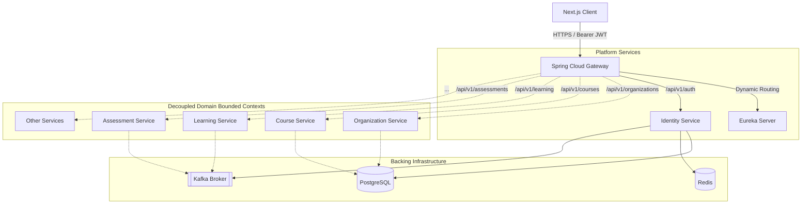

# LearnUP — B2B Multi-Tenant Online Learning Platform

> **P0 Architectural Baseline & Repository Blueprint**  
> Enterprise microservices foundation supporting multi-tenancy, polyglot backend services (Spring Boot preferred, NestJS supported), event-driven choreography via Apache Kafka, dynamic service discovery, edge security perimeter, and contract-first governance.

---

## 1. System Taxonomy & Conceptual Classification

To maintain clear separation of concerns across the codebase, platform components are organized into 5 distinct classifications:

| Classification | Directory | Components | Scope in P0 |
| :--- | :--- | :--- | :--- |
| **Architectural Decision** | `docs/` | ADRs (001–007), System Blueprints | Formal architecture principles for multi-tenancy (`organizationId`), communication, security, polyglot rules, and persistence. |
| **Contract** | `contracts/` | OpenAPI 3.0 specs, Kafka Event Schema | Generic `ApiResponse<T>`, `ApiError`, offset pagination, headers, and CloudEvent-compatible Kafka event envelope. |
| **Infrastructure** | `infrastructure/` | PostgreSQL 16, Kafka KRaft, Kafka UI, Redis 7 | Core backing services orchestrated via Docker Compose. |
| **Platform Service** | `platform/` | Eureka Server, Spring Cloud Gateway, Identity Service | Discovery registry, edge security/header injection, User authentication & JWT issuance (strictly user/credential/roles scope). |
| **Future Business Service** | *Documented boundaries* | Organization, Subscription, Payment, Course, Learning, Assessment, Certificate, Recommendation, Notification, Specialization | Documented by **name and bounded context boundary only**. Zero domain models, zero business logic. Technology choices remain TBD. |

---

## 2. Architecture Overview



---

## 3. Security & Multi-Tenancy Architecture

### 3.1 Standardized Identity Claims
- **Tenant Identifier**: Standardized exclusively on `organizationId` across all contracts, JWT claims, headers, and database tables.
- **Allowed Roles**: Standardized across the entire platform to exactly:
  - `ADMIN`: Platform super-administrator.
  - `ORGANIZER`: Customer organization administrator.
  - `INSTRUCTOR`: Educational content creator and evaluator.
  - `LEARNER`: End-user learner.

### 3.2 Gateway Security & Header Invariants
1. Client authenticates via `Authorization: Bearer <JWT>`.
2. Spring Cloud Gateway validates token signature and expiration.
3. **Gateway Anti-Spoofing**: Gateway **MUST overwrite or remove any client-supplied `X-User-ID` or `X-Organization-ID` headers**.
4. Gateway derives and injects authenticated internal headers:
   - `X-User-ID`: From verified JWT `sub` claim.
   - `X-Organization-ID`: From verified JWT `organizationId` claim.
   - `X-Correlation-ID`: Preserved or newly generated UUID.
5. Internal microservices trust `X-User-ID` and `X-Organization-ID` because direct public ingress bypass is prevented.

---

## 4. Repository Structure

```
learnup/
├── .github/                              # CI/CD linting & validation workflows
├── docs/                                 # Architectural Blueprints & ADRs
│   ├── architecture/
│   │   ├── system-architecture.md        # C4 model, topology & taxonomy
│   │   ├── service-boundaries.md         # Bounded context catalog (10 future services)
│   │   ├── technology-decisions.md       # Spring Boot vs NestJS decision matrix
│   │   ├── communication-rules.md        # REST & Kafka event governance
│   │   ├── database-ownership.md         # DB-per-service, multi-tenancy, future Outbox
│   │   ├── security-principles.md        # JWT spec, canonical roles, Gateway security
│   │   ├── shared-contracts.md           # Contract-first OpenAPI & AsyncAPI governance
│   │   ├── java-nestjs-interop.md        # Cross-stack conventions & envelope specs
│   │   └── cross-cutting-concerns.md     # Correlation ID, logging, health, offset pagination
│   └── adr/                              # Architecture Decision Records
│       ├── ADR-001-polyglot-backend-selection.md
│       ├── ADR-002-organization-id-multi-tenancy.md
│       ├── ADR-003-kafka-event-envelope-and-conventions.md
│       ├── ADR-004-api-gateway-and-service-discovery.md
│       ├── ADR-005-jwt-and-internal-header-propagation.md
│       ├── ADR-006-database-ownership-and-future-outbox.md
│       └── ADR-007-standard-api-response-and-error-envelope.md
├── contracts/                            # Generic Schemas & Contracts
│   ├── openapi/                          # Generic OpenAPI 3.0 reusable components
│   │   ├── headers.yaml                  # X-User-ID, X-Organization-ID, X-Correlation-ID
│   │   ├── api-response.yaml             # Standard ApiResponse<T> envelope
│   │   ├── api-error.yaml                # Standard ApiError schema
│   │   ├── pagination.yaml               # Offset/page pagination parameters & meta
│   │   └── security.yaml                 # Bearer JWT security scheme
│   └── events/                           # Generic Kafka Event Schemas
│       └── event-envelope.schema.json    # CloudEvent-compatible envelope schema
├── packages/                             # Reusable Common Libraries (Cross-Cutting)
│   ├── common-java/                      # Shared Java library for Spring Boot services
│   └── common-ts/                        # Shared TypeScript library (Next.js & NestJS)
│       ├── src/core/                     # Framework-neutral (Next.js & NestJS)
│       └── src/adapters/nestjs/          # NestJS-specific decorators, filters, interceptors
├── infrastructure/                       # Local Dev & Orchestration
│   └── docker/
│       ├── docker-compose.infra.yml      # Infrastructure: PostgreSQL, Kafka, Kafka UI, Redis
│       ├── docker-compose.platform.yml   # Platform: Eureka, Gateway, Identity
│       ├── docker-compose.yml            # Unified orchestration
│       └── .env.example                  # Environment variable configuration template
├── platform/                             # Foundational Platform Services
│   ├── eureka-server/                    # Dynamic Service Discovery Server (Port: 8761)
│   ├── gateway/                          # API Gateway & Security Perimeter (Port: 8000)
│   └── identity-service/                 # User Authentication & JWT Issuance (Port: 8081)
├── templates/                            # Clean Service Archetypes (Zero Domain Logic)
│   ├── spring-boot-template/             # Spring Boot microservice archetype
│   └── nestjs-template/                  # NestJS microservice archetype
├── pom.xml                               # Root Maven POM for Java modules
└── README.md                             # Platform master documentation & guide
```

---

## 5. Local Infrastructure Quickstart

### 5.1 Run Core Infrastructure (PostgreSQL, Kafka, Kafka UI, Redis)
```bash
# Start backing infrastructure
docker compose -f infrastructure/docker/docker-compose.infra.yml up -d
```

Service URLs:
- **PostgreSQL**: `localhost:5432` (User: `postgres`, DB: `learnup_identity`)
- **Apache Kafka**: `localhost:9092`
- **Kafka UI**: `http://localhost:8080`
- **Redis**: `localhost:6379`

### 5.2 Run Unified Stack (Infra + Platform Services)
```bash
# Start all infrastructure and platform services
docker compose -f infrastructure/docker/docker-compose.yml up -d
```

Platform URLs:
- **Spring Cloud Gateway**: `http://localhost:8000`
- **Eureka Dashboard**: `http://localhost:8761`
- **Identity Service**: `http://localhost:8081`

---

## 6. Scope Boundaries (P0 vs Future Phases)

### In Scope for P0:
- Comprehensive architecture documentation and ADRs (ADR-001 to ADR-007).
- Generic OpenAPI 3.0 contracts and CloudEvent-compatible Kafka event envelope.
- `common-java` library and `common-ts` (core + nestjs adapter) library.
- Eureka Server, Spring Cloud Gateway (with anti-spoofing header injection), and Identity Service baseline.
- Clean `spring-boot-template` and `nestjs-template` service archetypes.

### Explicitly Out of Scope for P0:
- ❌ **Frontend Application Code**: Next.js app implementation is deferred.
- ❌ **Business Domain Logic**: Zero code for Course, Learning, Assessment, Payment, Subscription, Certificate, Recommendation, Notification, Specialization, or Organization.
- ❌ **Identity OpenAPI Contract**: Moved to Identity implementation phase.
- ❌ **PostgreSQL Row-Level Security (RLS)**: Documented as an architectural option for future tenant isolation.
- ❌ **Transactional Outbox Engine**: Documented as a future reliability pattern for Kafka events.
- ❌ **OpenTelemetry Tracing**: Deferred; only Correlation ID and structured logging are implemented.
- ❌ **Cursor Pagination**: Deferred; only offset/page-based pagination is supported.
- ❌ **Azure Blob Storage / Azurite**: Deferred; storage abstractions documented conceptually.
