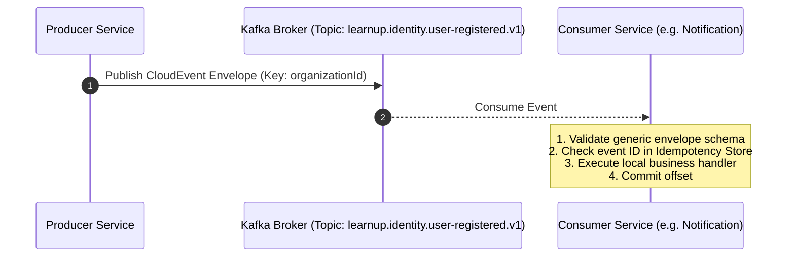

# Inter-Service Communication Rules

## 1. Overview

LearnUP enforces a strict communication topology:
- **Synchronous Communication (REST/HTTP)**: Reserved for external client-to-service ingress via Spring Cloud Gateway and low-latency, read-only queries where immediate consistency is necessary.
- **Asynchronous Communication (Kafka Events)**: The mandatory default for all cross-service state mutation notifications, domain integration, data replication, and background processing.

---

## 2. Synchronous REST Communication Rules

### 2.1 URL & Resource Naming Conventions
- Base path standard: `/api/v1/<resource-plural>`
- Use standard HTTP methods strictly according to RFC 9110:
  - `GET`: Safe & idempotent retrieval.
  - `POST`: Create resource or execute non-idempotent action.
  - `PUT`: Complete idempotent replacement of a resource.
  - `PATCH`: Idempotent partial update of a resource.
  - `DELETE`: Idempotent removal of a resource.

### 2.2 Ingress & Gateway Routing
- Clients connect exclusively to the **Spring Cloud Gateway**. Direct public access to internal microservices is forbidden.
- The Gateway performs token validation, strips client-supplied internal headers, injects authenticated headers (`X-User-ID`, `X-Organization-ID`, `X-Correlation-ID`), and routes traffic via Eureka service discovery.

### 2.3 Resiliency & Timeouts
- **Connect Timeout**: Maximum 2000 ms.
- **Read Timeout**: Maximum 5000 ms (custom timeouts configured for long-running operations).
- **Circuit Breaking**: Critical external integrations must implement circuit breakers (e.g. Resilience4j in Spring Boot) to prevent cascading failures.

---

## 3. Asynchronous Kafka Event Rules



### 3.1 Standard Event Envelope Schema
All events emitted to Kafka MUST be encapsulated in the generic CloudEvent-compatible envelope:

```json
{
  "id": "evt_01HGB98A76B5...",
  "source": "learnup.identity-service",
  "type": "identity.user.registered",
  "specversion": "1.0",
  "datacontenttype": "application/json",
  "time": "2026-09-12T10:00:00Z",
  "organizationId": "org_01HGB7398...",
  "correlationId": "corr_01HGB4829...",
  "data": {
    "userId": "usr_01HGB...",
    "email": "user@enterprise.com",
    "role": "LEARNER"
  }
}
```

### 3.2 Topic Naming Convention
Kafka topics must strictly follow the hierarchical dot-delimited pattern:
```
learnup.<domain>.<event-name>.v<version>
```
*Examples:*
- `learnup.identity.user-registered.v1`
- `learnup.course.course-published.v1`
- `learnup.learning.progress-updated.v1`

### 3.3 Partitioning Keys
- All messages MUST specify a partition key.
- By default, use `organizationId` as the partition key to guarantee strict in-order processing for all events within a given organization tenant.
- When ordering per entity is required, composite keys (e.g. `organizationId:entityId`) may be used.

### 3.4 Consumer Idempotency Principles
Because Kafka provides **at-least-once delivery**, consumers MUST guarantee idempotent execution:
1. Every consumer must track processed `id` (event IDs) in a fast store (PostgreSQL or Redis).
2. If `id` has already been processed, the consumer skips domain side-effects and immediately acknowledges/commits the offset.

### 3.5 Future Reliability Pattern: Transactional Outbox
- In future implementation phases where transactional consistency between PostgreSQL database writes and Kafka event publishing is required, services will implement the **Transactional Outbox Pattern**.
- State changes and corresponding outbound events are written atomically within the same local database transaction. A separate relay process reads from the outbox table and dispatches events to Kafka.
*(Documented as an architectural standard; outbox code is out of scope for P0).*
