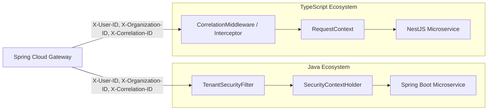

# Java (Spring Boot) & NestJS Interoperability Strategy

## 1. Objectives

To support a seamless polyglot architecture where services can be written in either **Spring Boot (Java)** or **NestJS (TypeScript)**, LearnUP establishes strict interoperability standards across HTTP APIs, asynchronous Kafka event messaging, error handling, and runtime execution context.

---

## 2. Universal Data & Naming Standards

| Scope | Standard Format | Example |
| :--- | :--- | :--- |
| **JSON Field Names** | `camelCase` | `{"organizationId": "org_123", "createdAt": "..."}` |
| **HTTP URLs & Paths** | `kebab-case` | `/api/v1/user-profiles`, `/course-modules` |
| **Database Tables & Columns** | `snake_case` | `organization_id`, `created_at` |
| **Kafka Topics** | Dot-delimited lowercase with version | `learnup.identity.user-registered.v1` |
| **Date / Time Values** | ISO-8601 UTC Strings (Z-suffix) | `"2026-09-12T10:00:00.000Z"` |

---

## 3. Unified REST API Envelopes

Regardless of backend technology, all REST endpoints MUST return standard JSON structures.

### 3.1 Success Envelope: `ApiResponse<T>`
```json
{
  "success": true,
  "data": {
    "id": "usr_01HGB...",
    "email": "learner@enterprise.com"
  },
  "meta": {
    "page": 0,
    "size": 20,
    "totalElements": 1,
    "totalPages": 1
  },
  "error": null,
  "timestamp": "2026-09-12T10:00:00.000Z"
}
```

### 3.2 Error Envelope: `ApiError`
```json
{
  "success": false,
  "data": null,
  "meta": null,
  "error": {
    "code": "RESOURCE_NOT_FOUND",
    "message": "The requested course could not be found.",
    "details": [
      {
        "field": "courseId",
        "issue": "Invalid identifier format"
      }
    ],
    "correlationId": "corr_01HGB4829..."
  },
  "timestamp": "2026-09-12T10:00:00.000Z"
}
```

---

## 4. Cross-Stack Context Propagation



### 4.1 Injected Headers
Internal services in both ecosystems read identical headers:
- `X-User-ID`: Identifies the authenticated subject.
- `X-Organization-ID`: Identifies the active tenant context.
- `X-Correlation-ID`: Trace identifier passed through downstream HTTP calls and Kafka events.

---

## 5. Shared Common Libraries Structure

| Java Common Library (`packages/common-java`) | TypeScript Common Library (`packages/common-ts`) |
| :--- | :--- |
| `ApiResponse.java`, `ApiError.java`, `PageResponse.java` | `src/core/api/api-response.interface.ts`, `api-error.interface.ts` |
| `TenantSecurityFilter.java`, `SecurityContextHolder.java` | `src/core/context/request-context.interface.ts`, `src/adapters/nestjs/tenant-context.interceptor.ts` |
| `CorrelationIdFilter.java` | `src/adapters/nestjs/correlation.middleware.ts` |
| `GenericEventEnvelope.java` | `src/core/event/generic-event-envelope.interface.ts` |

### 5.1 Next.js vs NestJS Separation in TypeScript
To maintain clean boundaries:
- **`packages/common-ts/src/core/`**: Framework-neutral interfaces, constants, and utilities usable by Next.js frontend and Node.js backend.
- **`packages/common-ts/src/adapters/nestjs/`**: NestJS-specific decorators, interceptors, middleware, and filters. Next.js does NOT import from the `adapters/` directory.
