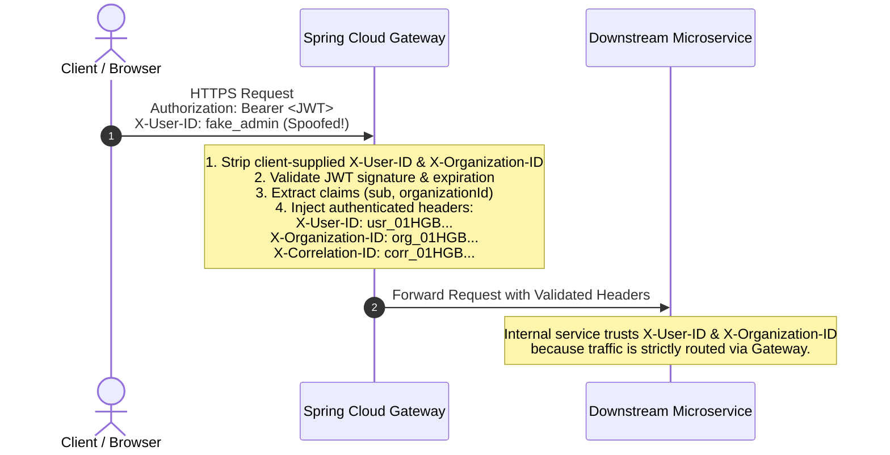

# Security Principles & Authorization Architecture

## 1. Authentication & Token Architecture

LearnUP uses **JSON Web Tokens (JWT)** for stateless, cryptographically verifiable authentication across the platform.

### 1.1 Standardized JWT Claims
JWTs issued by the platform **Identity Service** contain standardized claims:

```json
{
  "sub": "usr_01HGB98A76B5F4E3D2C1",
  "role": "ORGANIZER",
  "organizationId": "org_01HGB7398A1B2C3D4E5",
  "iat": 1726113600,
  "exp": 1726117200,
  "iss": "learnup-identity-service",
  "aud": "learnup-platform"
}
```

### 1.2 Allowed Platform Roles
Role-Based Access Control (RBAC) across LearnUP is standardized to exactly four canonical roles:

| Role Name | Description & Typical Privileges |
| :--- | :--- |
| `ADMIN` | Platform Super-Administrator with cross-organization operational and system privileges. |
| `ORGANIZER` | Enterprise Customer Administrator managing organizational seats, employees, and billing. |
| `INSTRUCTOR` | Course author and educator with privileges to create courses, grade quizzes, and view class metrics. |
| `LEARNER` | End-user student participating in courses, submitting assignments, and earning certificates. |

---

## 2. Gateway Security Behavior & Header Sanitization

The **Spring Cloud Gateway** operates as the secure perimeter for the platform:



### 2.1 Gateway Security Invariants
1. **Mandatory Header Stripping (Anti-Spoofing)**:
   - The Gateway **MUST overwrite or remove any client-supplied `X-User-ID` or `X-Organization-ID` headers**.
   - Clients must never be allowed to dictate user identity or tenant context directly.
2. **JWT Validation & Header Derivation**:
   - The Gateway validates the JWT signature (via public key / shared secret) and checks expiration.
   - Upon successful verification, the Gateway derives:
     - `X-User-ID` from the `sub` claim.
     - `X-Organization-ID` from the `organizationId` claim.
3. **Correlation ID Propagation**:
   - The Gateway inspects incoming requests for `X-Correlation-ID`.
   - If present, the value is preserved; if absent, the Gateway generates a secure UUID and sets `X-Correlation-ID`.
4. **Internal Trust Model**:
   - Internal backend microservices trust `X-User-ID` and `X-Organization-ID` only because direct external ingress to internal services is blocked at the network perimeter.

---

## 3. Microservice Authorization Enforcement

Downstream microservices (Spring Boot / NestJS) use platform common libraries to enforce authorization:

1. **Context Population**:
   - A servlet filter (Java) or interceptor/middleware (TypeScript) extracts `X-User-ID`, `X-Organization-ID`, and `X-Correlation-ID` and binds them to the request execution context.
2. **Tenant Scoping**:
   - Every database query automatically applies the tenant boundary:
     `WHERE organization_id = :currentOrgId`
3. **Role Verification**:
   - Endpoints requiring specific privileges (e.g. `@PreAuthorize("hasRole('ORGANIZER')")` or NestJS `@Roles('ORGANIZER')`) enforce access control before controller execution.

---

## 4. Zero-Trust & Secret Management Guidelines

1. **Defense in Depth**:
   - In production environments, inter-service communication within the internal virtual network uses mutual TLS (mTLS) or private subnet peering.
2. **Externalized Secrets**:
   - No credentials, private keys, or API tokens may be stored in source control.
   - All secrets must be supplied at runtime via environment variables or secret management vaults (e.g., HashiCorp Vault, AWS Secrets Manager, Azure Key Vault).
