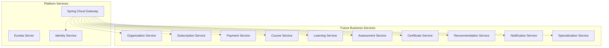

# Service Boundary Principles & Domain Catalog

## 1. Core Principles of Service Boundary Decomposition

LearnUP decomposes its application architecture according to **Domain-Driven Design (DDD)** principles:

1. **Autonomous Bounded Contexts**:
   - Each service is the single source of truth for its own ubiquitous language, domain models, and business invariants.
   - No direct database sharing between bounded contexts (strict Database-per-Service rule).

2. **High Cohesion, Loose Coupling**:
   - Capabilities that change together for the same business reason belong inside the same service boundary.
   - Cross-domain interactions occur solely through well-defined asynchronous Kafka events or contract-driven REST APIs.

3. **Anti-Corruption Layers (ACL)**:
   - When one service consumes data or events from another service, it maps the incoming payload into its own internal domain model via an explicit translation layer.
   - Downstream models must never leak internal upstream schemas.

4. **Avoiding Distributed Monolith Anti-Patterns**:
   - Services must not execute synchronous chains of HTTP requests to complete single transactional writes (no temporal coupling).
   - Write operations must remain local to a single service boundary. Cross-boundary synchronization must rely on eventual consistency via event choreography.

---

## 2. Platform Services (Foundation)

| Service Name | Primary Scope & Architectural Responsibilities |
| :--- | :--- |
| **Eureka Server** | Platform discovery registry; maintains dynamic instance heartbeats and routing topology. |
| **Spring Cloud Gateway** | Ingress API gateway; token validation, rate limiting, request correlation, header sanitization, and `X-User-ID` / `X-Organization-ID` / `X-Correlation-ID` header injection. |
| **Identity Service** | User identity management, credentials verification, authentication endpoints, JWT token issuance, and global role verification. *(Explicitly does not manage Organization business entities or billing).* |

---

## 3. Future Business Services Catalog (Names & Boundaries Only)

> [!IMPORTANT]
> The following business services are documented for **boundary definition and architectural planning only**. In accordance with P0 rules, zero business logic, zero domain entities, and zero business code are implemented at this stage. Technology choices (Spring Boot vs NestJS) for each service remain uncommitted.

### 3.1 Organization Service (Future)
- **Bounded Context**: Tenant organizational structures, company profiles, workspaces, departments, and organization membership.
- **Boundary Rule**: Owns tenant lifecycle and organizational metadata. Distributes tenant lifecycle events via Kafka.

### 3.2 Subscription Service (Future)
- **Bounded Context**: B2B plan definitions, seat quotas, licensing tiers, enterprise entitlements, and renewal schedules.
- **Boundary Rule**: Owns enterprise license quota enforcement.

### 3.3 Payment Service (Future)
- **Bounded Context**: Invoicing, payment gateway integrations, transaction history, receipts, and refund workflows.
- **Boundary Rule**: Integrates with external payment processors; emits transaction settlement events.

### 3.4 Course Service (Future)
- **Bounded Context**: Course authoring, syllabus structures, curriculum modules, lesson content metadata, and media asset references.
- **Boundary Rule**: Manages educational content catalog; does not track individual student progress.

### 3.5 Learning Service (Future)
- **Bounded Context**: Student enrollment, lesson completion tracking, active bookmarks, learning time analytics, and pathway progression.
- **Boundary Rule**: High-write event receiver capturing learner activity streams.

### 3.6 Assessment Service (Future)
- **Bounded Context**: Quizzes, automated exams, open-ended assignments, rubrics, question banks, and grading evaluation.
- **Boundary Rule**: Manages test execution and score calculation; emits evaluation outcome events.

### 3.7 Certificate Service (Future)
- **Bounded Context**: Credential generation, digital signature verification, verifiable certificate metadata, and public badge verification.
- **Boundary Rule**: Listens for course/pathway completion events to mint digital certificates.

### 3.8 Recommendation Service (Future)
- **Bounded Context**: Content similarity scoring, personalized career path recommendations, skill gap analysis, and trend insights.
- **Boundary Rule**: Analytical context consuming event streams to produce read-optimized recommendations.

### 3.9 Notification Service (Future)
- **Bounded Context**: Multi-channel delivery (Email, SMS, In-App push), templating engine, delivery logs, and user communication preferences.
- **Boundary Rule**: Consumer-only event sink that dispatches communication based on platform event triggers.

### 3.10 Specialization Service (Future)
- **Bounded Context**: Multi-course learning tracks, career certificates, milestone checkpoints, and degree-equivalent pathways.
- **Boundary Rule**: Groups multiple course entities into unified structured programs.
