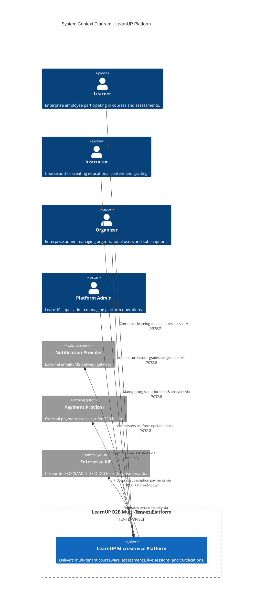
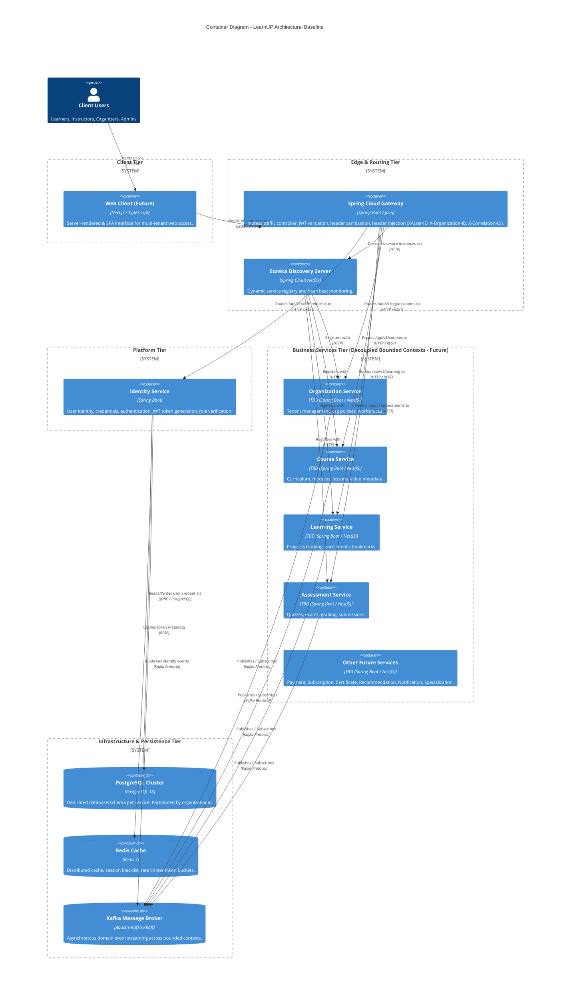

# LearnUP System Architecture

## 1. Executive Overview

**LearnUP** is an enterprise-grade B2B multi-tenant online learning platform designed to support scalable organizational workforce development, continuous education, and certified learning pathways. 

The architecture is built on a **modular microservice topology** orchestrated around:
- **Centralized API Gateway & Service Discovery**: Spring Cloud Gateway and Netflix Eureka providing secure ingress, authentication offloading, routing, and dynamic load balancing.
- **Polyglot Backend Ecosystem**: Spring Boot as the default/preferred enterprise foundation, with NestJS fully supported for I/O-intensive or rapid-iteration services.
- **Strict Multi-Tenant Isolation**: Tenant boundary isolation anchored strictly around `organizationId`.
- **Event-Driven Asynchronous Messaging**: Apache Kafka handling domain events with unified CloudEvent-compatible envelope schemas and idempotency guarantees.
- **Polyglot Persistence with Database-per-Service**: Independent PostgreSQL schemas/databases per service, Redis for caching/invalidation, and future object storage abstractions.

---

## 2. C4 Architecture Models

### 2.1 System Context (C4 Level 1)



---

### 2.2 Container Diagram (C4 Level 2)



---

## 3. High-Level Ingress & Data Flow

```
[ Client / Browser (Next.js) ]
              |
              | 1. HTTP Request with `Authorization: Bearer <JWT>`
              v
[ Spring Cloud Gateway ] 
  - Validates JWT signature & expiry
  - Strips any client-supplied `X-User-ID`, `X-Organization-ID` (Anti-spoofing)
  - Extracts `sub` -> Injects `X-User-ID`
  - Extracts `organizationId` -> Injects `X-Organization-ID`
  - Resolves or generates `X-Correlation-ID`
              |
              | 2. Proxies request with validated internal headers
              v
[ Microservice Instance (Spring Boot / NestJS) ]
  - Security/Tenant Filter binds `organizationId` & `userId` to execution context
  - Service executes domain operation scoped strictly to `organizationId`
  - Emits domain event (if state changed) wrapped in generic Kafka envelope
              |
              +--------------------------+
              |                          |
              v                          v
      [ PostgreSQL ]               [ Apache Kafka ]
  (Scoped by organizationId)      (Broadcasts generic event envelope)
```

---

## 4. Architectural Taxonomy & Classifications

To ensure disciplined governance, the entire codebase is partitioned into 5 unambiguous classifications:

1. **Architectural Decisions**: ADRs and engineering principles governing the platform.
2. **Contracts**: OpenAPI 3.0 reusable component schemas and AsyncAPI/JSON Schema event envelopes.
3. **Infrastructure**: Backing services (PostgreSQL, Kafka, Kafka UI, Redis) managed via Docker Compose.
4. **Platform Services**: Foundation services (Eureka Server, Spring Cloud Gateway, Identity Service) required for system operation.
5. **Future Business Services**: Domain-specific services (Course, Learning, Assessment, etc.) documented strictly by name, bounded context, and interface boundary, without pre-committing technologies or domain models in P0.
