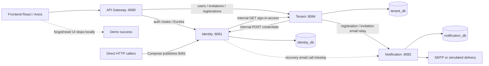
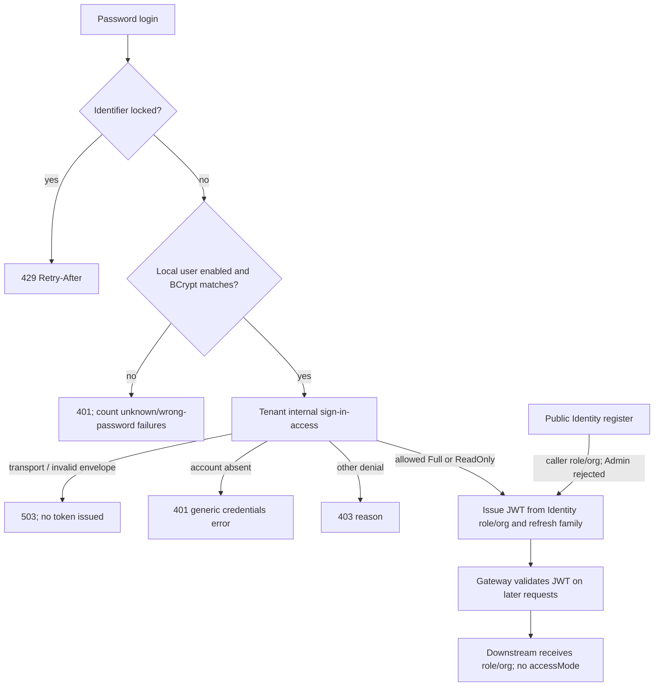
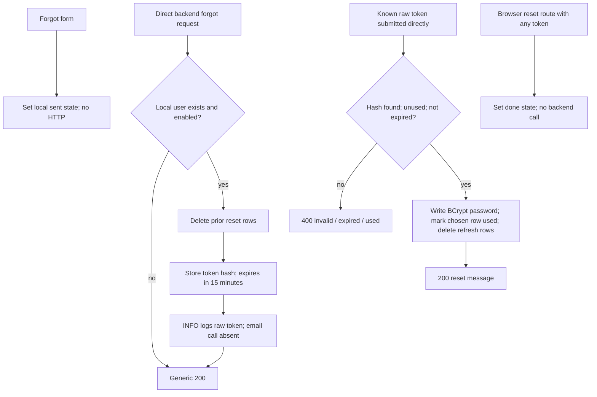

# LearnUP Identity Service — deep audit and implementation preparation

Audit date: 2026-10-18, Asia/Saigon. Repository: `D:\Study\learnup`. Inspected HEAD: `dcda178a41efa49d7917633fb291230be542cdb6`.

This is an audit, not an implementation. Application code, tests, configuration and migrations were not edited. Direct scope is UC05, UC05.1, UC06, UC07 and UC08; UC04, UC09 and UC09.1 were inspected only at authentication integration boundaries. No Kafka, Notification redesign, database redesign or changes to the existing project audit are proposed as completed work.

## 1. Sources, evidence and verification limits

### 1.1 Source availability and precedence

| Requested source | Actual repository evidence | Treatment |
| --- | --- | --- |
| `docs/source-of-truth/LearnUP_UseCase (2).docx` | Only [LearnUP_UseCase.docx](../source-of-truth/LearnUP_UseCase.docx) exists. SHA-256: `4427BE07A8AC07C738816305CBEDADC1AC124277BE0E4D7483E5A8D28B1DA0AD`. | Available DOCX used for business requirements. Equality to the requested `(2)` version cannot be established. |
| `docs/source-of-truth/LearnUP_QuyTacNghiepVu (2).docx` | Only [LearnUP_QuyTacNghiepVu.docx](../source-of-truth/LearnUP_QuyTacNghiepVu.docx) exists. SHA-256: `A37D453738C0B35B5D0D3A990949CEA544B3A13A4DC8071FED912AAF511B74FE`. | Available DOCX used for business rules. Same version limitation. |
| `docs/audit/learnup-current-state-audit.md` | Absent. A repository filename search did not find a renamed current-state audit. | Not read or assumed. No historical audit claim is presented as current verification. |
| User-linked [database-ownership.md](../architecture/database-ownership.md) | Present and read. | Architectural policy, distinguished from the DOCX business requirements. |

DOCX files were opened as ZIP archives and `word/document.xml` was parsed in memory; no extracted files or directories were created. References `UC DOCX Pn` / `BR DOCX Pn` identify one-based `//w:body//w:p` paragraph positions, including paragraphs in table cells and blank paragraphs. They are reproducible paragraph identifiers, not invented DOCX line numbers. Relevant account/subscription sections and cross-cutting principles were inspected. Code references below are repository-relative links with starting line numbers; line ranges in prose describe the inspected method.

Architectural context also came from [service-boundaries.md:29](../architecture/service-boundaries.md#L29), [security.md:33](../architecture/security.md#L33), [source-of-truth-migration-plan.md:11](../architecture/source-of-truth-migration-plan.md#L11), and Identity's README. These documents disagree in places and contain older descriptions. For example, the migration plan calls Tenant a scaffold although it now has executable account and authentication-policy flows. Identity's README claims account/profile ownership, while service-boundaries assigns those to Tenant. None of these statements overrides executable code or the DOCX business rules.

The repository's [frontend architecture skill](../../frontend/.agents/skills/learnup-frontend/SKILL.md) was used for the frontend review. It guided inspection of the existing router, services, context and role pages; it did not cause implementation or unrelated UI recommendations.

### 1.2 Classification

- **Implemented and verified:** the specified behavior actually passed an executed test, within that test's stated boundary.
- **Partially implemented:** meaningful executable pieces exist, but an integration, policy or failure path prevents the whole UC being considered complete.
- **Stub/demo:** the action displays simulated success or intentionally skips work.
- **Missing:** no executable implementation was found for the required behavior.
- **Implemented incorrectly:** an executable path contradicts the requirement or has a concrete correctness/security defect.
- **Cannot verify:** runtime infrastructure or coverage is insufficient; static reasoning is identified explicitly.

All 27 existing Identity tests passed, and 9 existing Gateway JWT-filter tests passed. Identity tests use MockMvc, H2 with Flyway disabled, and a mocked `TenantAccessClient`. This verifies substantial Identity behavior, not a browser → Gateway → live Tenant/PostgreSQL/email journey. Local health probes to ports 8081, 8088 and 8080 timed out; Docker was unavailable. No live account-changing calls or emails were sent. See section 10 for commands, counts and limits.

## 2. Current architecture and responsibility boundaries

### 2.1 Executable architecture

Identity is Spring Boot 3.3.5 / Java 21, with Spring Security, BCrypt, JPA, PostgreSQL, Flyway, JJWT 0.12.6 and Eureka: [pom.xml:7](../../services/identity-service/pom.xml#L7). [IdentityServiceApplication:11](../../services/identity-service/src/main/java/com/learnup/identity/IdentityServiceApplication.java#L11) scans Identity and the common library.



Solid arrows exist in code. Dotted arrows identify the broken UC07 integration. Identity has no Notification client and no Google verifier. [AuthService](../../services/identity-service/src/main/java/com/learnup/identity/service/AuthService.java#L33) depends only on its repositories, password encoder, JWT service, Tenant access client and login throttle service.

Identity exposes port 8081 directly in [docker-compose.yml:127](../../docker-compose.yml#L127), in addition to Gateway access. Its security chain permits every request: [SecurityConfig.securityFilterChain:33–49](../../services/identity-service/src/main/java/com/learnup/identity/config/SecurityConfig.java#L33). `UserContextFilter` extracts headers; it does not authenticate their sender. Internal credential provisioning has a separate controller key check, but user-context operations do not.

### 2.2 Actual ownership versus prescribed behavior

The DOCX documents prescribe actors, lifecycle effects and access conditions; they do **not** assign every field or UC to a microservice. The service recommendations below follow the repository architecture documents and observed integration, not an invented BR assigning ownership.

| Information / responsibility | Current authority and duplication | Explicit documentary position | Recommendation for preparation |
| --- | --- | --- | --- |
| User ID | Tenant creates UUIDv7 account IDs. Identity provisioning accepts them, but public registration independently creates UUIDv4 IDs; the seeder uses fixed IDs. | [service-boundaries.md:37](../architecture/service-boundaries.md#L37) assigns account master/ID generation to Tenant. DOCX BR-31 requires old/new accounts to remain distinct. | Keep Tenant's ID canonical. Identity stores the same scalar ID for credentials/session ownership. Stop the alternative public account-creation path before considering schema changes. |
| Login email | Tenant has `email varchar(254)` with a unique index over non-deleted accounts. Identity has a separate unconditional `email varchar(100)` unique constraint and resolves login/recovery locally. | BR-30/31 define global uniqueness among non-deleted accounts and safe email reuse. Architecture migration plan assigns account email to Tenant. | Tenant governs allocation/reallocation; Identity needs a reliable lookup/projection contract. Do not treat an Identity email conflict as proof of Tenant deletion. |
| Role / Organization ID | Stored in both databases. JWT and `UserResponse` use Identity's copies; Tenant's access verdict does not return them. | DOCX identifies allowed actors; architecture assigns membership/account master to Tenant. | Bind JWT claims to a canonical Tenant principal, validate consistency before issuance, and preserve platform Admin's lack of Organization. |
| Account status | Tenant has `Pending`, `Active`, `Deactivated`, `activatedAt`, `deletedAt`; Identity has an independent `enabled` boolean. | BR-20/21/27/36/37 define lifecycle/access effects; they do not define service-specific replicas. | Tenant owns business account lifecycle. Document any separate credential-disable purpose for `enabled`; it is currently another gate with no synchronization contract. |
| Password / credential hash | Identity owns `password_hash`; Tenant forwards raw passwords over its internal HTTP client and does not persist a password field in its User model. | Architecture explicitly assigns credentials to Identity. UC08 requires old-password verification. | Retain Identity ownership. Authenticate service calls and specify provisioning retry/consistency behavior. |
| Refresh/reset state | Identity owns token hashes and validity/revocation timestamps. | UC06/07 prescribe outcomes, not these database mechanisms or exact lifetimes. | Retain Identity ownership; Notification must not consume or authorize reset tokens. |
| Subscription / Organization access | Tenant computes a sign-in decision from its own account, Organization and Subscription tables. Identity calls it on login/refresh. | UC05/BR-27 require checks; BR-15–17 govern grace and suspension access. | Tenant supplies an effective access decision; Identity applies it to token issuance. Gateway/business services need an agreed enforcement contract for restricted operations. |
| Name / avatar / department | Tenant has real read/edit/avatar endpoints. Identity also stores `fullName` and returns it, but has no profile update API. | UC09/09.1, BR-33/34; architecture assigns profile master to Tenant. | Keep profile changes in Tenant. Identity's copy must be explicitly treated as a projection or avoided in profile reads. Do not move UC09.1 into Identity. |
| Email verification / invitation / activation | Tenant orchestrates Organizer registration verification/payment and member invitations; Identity is called to establish credentials. | UC03, UC04, BR-6/20/21/278 distinguish these flows. | Preserve these existing boundaries. Identity does not own the entire registration or invitation lifecycle. |
| Authentication transport | Gateway validates access JWTs, strips supplied identity headers, and forwards trusted headers plus an internal key. | [security.md:87](../architecture/security.md#L87) describes an internal-network trust model. | Identity must verify that context came from the trusted channel; direct published ports currently defeat that assumption. |
| Recovery email | Identity generates/stores the token; delivery is missing. Notification has a generic email endpoint. | UC07 requires an Email Service interaction. Architecture maps transactional email delivery to Notification. | Identity constructs the recovery request/link, Notification delivers it; Frontend handles the link and reset form. Delivery/status/authentication contract is in section 7. |

Field evidence: [Tenant User schema:35–56](../../services/tenant-service/prisma/schema.prisma#L35), [Identity User:14–44](../../services/identity-service/src/main/java/com/learnup/identity/domain/User.java#L14), [IdentityClient.setCredentials:28–68](../../services/tenant-service/src/infrastructure/clients/identity/identity.client.ts#L28), [AuthService.register:58](../../services/identity-service/src/main/java/com/learnup/identity/service/AuthService.java#L58), [setCredentials:322](../../services/identity-service/src/main/java/com/learnup/identity/service/AuthService.java#L322), and [JwtTokenService.generateAccessToken:32](../../services/identity-service/src/main/java/com/learnup/identity/service/JwtTokenService.java#L32).

Unresolved decisions: the Google linking/proof policy for non-Gmail Google accounts; the exact transport/enforcement of restricted access; credential-retention policy after Tenant deletion; and cross-service provisioning atomicity. No new ownership rule or database migration is assumed to settle these.

## 3. Endpoint and DTO inventory

### 3.1 Identity endpoints actually mapped

`AuthController` maps both `/api/v1/auth` and `/api/auth`; `UserController` maps both `/api/v1/users` and `/api/users`. The table shows the v1 form and the unique internal path. Legacy aliases execute the same methods. There are 10 handler methods / 19 path-method combinations, not 19 independent implementations.

| Method / path | Controller → service evidence | Request → successful response | Actual authentication / notable failures |
| --- | --- | --- | --- |
| POST `/api/v1/auth/register` | [AuthController.register:20](../../services/identity-service/src/main/java/com/learnup/identity/controller/AuthController.java#L20) → [AuthService.register:58](../../services/identity-service/src/main/java/com/learnup/identity/service/AuthService.java#L58) | `username,email,password,fullName?,role?,organizationId?` → 201 token pair + user | Public at Gateway and Identity. Rejects Admin with 403 and existing username/email with 409. Other roles and caller-supplied Organization are accepted; no Tenant/activation/seat check. |
| POST `/api/v1/auth/login` | [AuthController.login:27](../../services/identity-service/src/main/java/com/learnup/identity/controller/AuthController.java#L27) → [AuthService.login:97](../../services/identity-service/src/main/java/com/learnup/identity/service/AuthService.java#L97) | `username,password`; `username` also accepts email → 200 token pair, user, `accessMode` | Public; credentials and Tenant decision checked. 400 validation, 401 credentials/local disabled, 403 Tenant denial, 429 throttle, 503 Tenant unavailable. |
| POST `/api/v1/auth/refresh` | [AuthController.refresh:33](../../services/identity-service/src/main/java/com/learnup/identity/controller/AuthController.java#L33) → [AuthService.refresh:140](../../services/identity-service/src/main/java/com/learnup/identity/service/AuthService.java#L140) | `refreshToken` → 200 new pair + user + `accessMode` | Public; opaque token is the credential. Hash, expiry, revocation, rotation/reuse, local user and Tenant checks. 401 invalid/reused; 403 denial; 503 unavailable. |
| POST `/api/v1/auth/logout` | [AuthController.logout:39](../../services/identity-service/src/main/java/com/learnup/identity/controller/AuthController.java#L39) → [AuthService.logout:202](../../services/identity-service/src/main/java/com/learnup/identity/service/AuthService.java#L202) | Optional `{refreshToken?,logoutAll?}` → 200 `{message}` | Gateway requires access JWT; direct Identity accepts raw user headers or possession of refresh token. With no effective context/token, can report success without revoking anything. |
| POST `/api/v1/auth/change-password` | [AuthController.changePassword:54](../../services/identity-service/src/main/java/com/learnup/identity/controller/AuthController.java#L54) → [AuthService.changePassword:228](../../services/identity-service/src/main/java/com/learnup/identity/service/AuthService.java#L228) | `currentPassword,newPassword,confirmPassword` → 200 `{message}` | Gateway requires JWT; direct Identity requires only a parseable `X-User-ID` and correct old password. 401 no ID; 404 missing user; 400 mismatch/same/wrong old password. |
| POST `/api/v1/auth/forgot-password` | [AuthController.forgotPassword:72](../../services/identity-service/src/main/java/com/learnup/identity/controller/AuthController.java#L72) → [AuthService.forgotPassword:259](../../services/identity-service/src/main/java/com/learnup/identity/service/AuthService.java#L259) | `email` → 200 generic `{message}` | Public. Unknown/local disabled returns the same success body. Known/local enabled stores a reset hash and logs the raw token; does not send instructions. |
| POST `/api/v1/auth/reset-password` | [AuthController.resetPassword:78](../../services/identity-service/src/main/java/com/learnup/identity/controller/AuthController.java#L78) → [AuthService.resetPassword:288](../../services/identity-service/src/main/java/com/learnup/identity/service/AuthService.java#L288) | `token,newPassword,confirmPassword` → 200 `{message}` | Public; reset token is the credential. 400 unknown/expired/used/mismatch; 404 missing credential user. |
| GET `/api/v1/auth/me` | [AuthController.getCurrentUser:84](../../services/identity-service/src/main/java/com/learnup/identity/controller/AuthController.java#L84) → [AuthService.getCurrentUser:190](../../services/identity-service/src/main/java/com/learnup/identity/service/AuthService.java#L190) | Header context → 200 Identity `UserResponse` | Gateway JWT; direct Identity trusts user header. No Tenant status/profile refresh. 401 missing/unparseable ID; 404 absent local user. |
| GET `/api/v1/users/me` | [UserController.getCurrentUser:25](../../services/identity-service/src/main/java/com/learnup/identity/controller/UserController.java#L25) → same service | Same local user DTO | Exists directly on Identity, but Gateway routes `/users/**` to **Tenant**, not this controller. Direct tests do not verify the Gateway route. |
| POST `/api/internal/credentials` | [InternalCredentialController.setCredentials:30](../../services/identity-service/src/main/java/com/learnup/identity/controller/internal/InternalCredentialController.java#L30) → [AuthService.setCredentials:322](../../services/identity-service/src/main/java/com/learnup/identity/service/AuthService.java#L322) | `userId,password,username?,email?,fullName?,role?,organizationId?` → 200 `{message}` | Controller checks `x-internal-key`; 403 missing/wrong key. Not routed publicly by Gateway. Overwrites credentials; can assign Admin; no Tenant principal/deletion proof is checked. |

No Google login, Google callback, Google token-verification or session-list endpoint exists. No Identity profile update endpoint exists; that is not automatically an Identity responsibility gap.

### 3.2 Response/error/validation contract

[AuthResponse:3–12](../../services/identity-service/src/main/java/com/learnup/identity/dto/AuthResponse.java#L3) carries `accessToken`, `refreshToken`, `tokenType=Bearer`, `expiresIn` in seconds, `user`, and optional `accessMode`. [UserResponse.fromUser:34](../../services/identity-service/src/main/java/com/learnup/identity/dto/UserResponse.java#L34) exposes ID, username, email, name, uppercase role, Organization ID, local enabled flag and creation time; it omits password/token hashes. Tokens in the authentication response are intentional credentials; reset tokens are **not** returned in recovery responses.

Identity/Gateway envelopes are `{success,data?,error?:{code,message,details?}}`: [ApiResponse:15](../../libraries/java-common/src/main/java/com/learnup/common/response/ApiResponse.java#L15). Tenant responses are `{statusCode,message,data}`: [TransformInterceptor.intercept:19](../../services/tenant-service/src/common/interceptors/transform.interceptor.ts#L19). The Tenant access client reads only `data`, so these different outer envelopes currently interoperate.

[SignInExceptionHandler:20–43](../../services/identity-service/src/main/java/com/learnup/identity/exception/SignInExceptionHandler.java#L20) maps denied access, replay, throttling with `Retry-After`, and Tenant failure. [GlobalExceptionHandler:26–120](../../libraries/java-common/src/main/java/com/learnup/common/exception/GlobalExceptionHandler.java#L26) maps business/bean-validation errors and supplies a generic 500 fallback.

Validation is present but inconsistent: [RegisterRequest:12–29](../../services/identity-service/src/main/java/com/learnup/identity/dto/RegisterRequest.java#L12) requires username 3–50 and password 6–100; [ChangePasswordRequest:8–16](../../services/identity-service/src/main/java/com/learnup/identity/dto/ChangePasswordRequest.java#L8), [ResetPasswordRequest:8–16](../../services/identity-service/src/main/java/com/learnup/identity/dto/ResetPasswordRequest.java#L8) and [SetCredentialsRequest:12–23](../../services/identity-service/src/main/java/com/learnup/identity/dto/internal/SetCredentialsRequest.java#L12) require minimum 6 but lack consistent maxima. Internal email/name/username are not format/length validated. Login has only nonblank checks, although its throttle key column is limited to 254 characters. DTOs do not enforce role–Organization consistency.

## 4. Business-rule and UC traceability

### 4.1 Authoritative requirements relevant to authentication

| UC / BR | DOCX evidence | Required behavior and audit interpretation |
| --- | --- | --- |
| UC05 / BR-27 | UC DOCX P92–97; BR DOCX P90–91 | All four roles use registered email/password; account, Subscription and Organization must be checked before role access. Current password login performs these checks except public registration can bypass the path entirely. |
| UC05.1 / BR-28/29 | UC P100–105; BR P92–95 | Google login only for existing, non-deleted Organizer/Instructor/Learner accounts; reject Admin and unknown email. Personal Google authentication, not enterprise SSO. Implementation missing. |
| UC06 | UC P108–112 | End the session and withdraw credentials on the device. The source does not specify JWT denylists, immediate distributed access-token revocation, or mandatory logout-all. Existing refresh revocation plus browser cleanup is meaningful implementation, with expiry/race gaps. |
| UC07 | UC P116–120 | Request recovery through the registered email, receive a link, set a new password. The source does not prescribe the implementation's 15-minute token duration or an 8-character password policy. Email delivery and frontend calls are missing. |
| UC08 | UC P124–128 | Verify old password before replacing it. BCrypt verification exists and was tested. Header authentication and password/reset lifecycle defects remain. |
| BR-30/31/37 | BR P96–99, P116–117 | Globally unique login email among non-deleted accounts; reuse creates an independent account while retaining the old account's training results/certificates. Does not itself authorize unconditional Identity credential deletion. |
| BR-15/16/17 | BR P54–60 | Seven-day grace: existing learning continues, new enrollment is prohibited and Organizer cannot create accounts/Courses/upload. After grace, Learner/Instructor lose access; Organizer retains only viewing/exporting training reports for 30 days after suspension, then loses access. No requirement to infer instantaneous JWT revocation from these rules. |
| BR-20/21/278; UC04 | BR P70–77; UC P84–89 | Organizer activates after verified registration/payment; Instructor/Learner activate through invitation/password setting; expired invitation gets clear guidance. Identity establishes credentials but does not own every activation action. |
| UC09/09.1 / BR-33/34/35 | UC P132–145; BR P104–109 | View own account status/role/email/name; self-edit name/avatar, not login email. Organizer may edit member email/name only before activation, and an email change invalidates the invitation. Profile APIs reside in Tenant. |
| BR-36/40/45/283 | BR P114–125, P140–149 | Account deactivation/deletion and Organization suspension affect access, with distinct Subscription and Organization states. These are not interchangeable flags. Exact Organization-suspension role exceptions are not fully elaborated in the cited authentication rules; current Tenant denies all non-Admin roles and this policy needs confirmation, not an invented exception. |
| Audit scope | BR P878–907 and P933–944 | Authentication security logging can be recommended, but the source's governance action list does not make every login a mandatory Audit-service event. Enterprise SSO is explicitly outside MVP. |

### 4.2 Completion matrix

| Flow | Backend classification | Frontend / external classification | What is actually verified |
| --- | --- | --- | --- |
| UC05 password login | Partially implemented; local BCrypt, throttle and mocked Tenant-denial paths verified. Public registration is implemented incorrectly. | Real login client and role navigation; full deployed chain cannot verify. | Successful credentials, invalid credentials, mocked denial/unavailability, throttle, all four seeded roles. Canonical claim consistency and full Subscription policy are not covered. |
| UC05.1 Google | Missing. | Button displays an unavailable error; no Google request. | Source inspection only; no Google tests or configured flow. |
| UC06 logout | Partially implemented; supplied refresh token revocation verified. | Real logout client and shared cleanup hook. | Revoked token cannot refresh. Direct Identity tests do not authenticate the request, and expired-Gateway-JWT/logout races are untested. |
| UC07 recovery request | Partially implemented; creates/stores expiring hash, generic response. | Forgot page is demo; email delivery missing. | Existing test proves a row is created. Executed logs confirm raw reset-token leakage. |
| UC07 reset | Partially implemented; sequential reuse rejection verified, concurrency/lifetime implemented incorrectly. | Reset page is demo and ignores the URL token. | A manually inserted known token changes password and its sequential reuse is rejected; delivered-link flow is not tested. |
| UC08 change password | Partially implemented; BCrypt old-password verification and updates verified; trust/password-lifecycle defects. | Four real role pages share working request hook and error/loading state. | Wrong current password, confirmation mismatch, successful update, old/new login behavior. Existing test does not assert session deletion despite its display name. |
| UC04 boundary | Executable Tenant → Identity provisioning and Tenant activation, with collision and cross-service consistency defects. | Real invitation lookup/accept page, not wholly demo; login's invitation shortcut is a demo token. | Identity internal API accept/reject tests pass; no real Tenant/Identity activation integration test ran. |
| UC09/09.1 boundary | Identity has duplicate read DTOs; Tenant has real profile read/update/avatar flows. | Real Tenant profile APIs; Admin context fails at Tenant guard. | Identity local profile omission of secrets verified. Tenant profile/browser/storage integration was not run. |

## 5. End-to-end flow traces

### 5.1 UC05 — email/password login

| Step | Exact path/method/line evidence | Executed behavior / gap |
| --- | --- | --- |
| Frontend route/action | [router.tsx:571](../../frontend/src/router.tsx#L571); [LoginPage.submit:41–66](../../frontend/src/pages/guest/login.tsx#L41) | `/login`; validates email, tracks loading/error, calls real API, stores pair, loads profile and chooses role home or local redirect. No hardcoded bearer token in this path. |
| API client | [loginAPI:9–20](../../frontend/src/services/identity.service.ts#L9); [Axios interceptors:7–57](../../frontend/src/services/axios.customize.ts#L7) | POST `/api/v1/auth/login`, body `{username: enteredEmail,password}`. Attaches stored bearer if present; public Gateway login does not require it. Header `delay:1000` has no authentication role. |
| Gateway route/security | [routes:16–19](../../gateway/api-gateway/src/main/resources/application.yml#L16); [whitelist:75–95](../../gateway/api-gateway/src/main/resources/application.yml#L75); [JwtAuthenticationFilter.filter:69–84](../../gateway/api-gateway/src/main/java/com/learnup/gateway/filter/JwtAuthenticationFilter.java#L69) | Eureka route to Identity, no path rewrite; public login strips spoofed user/Organization/role/internal headers, then adds configured internal key. |
| Controller | [AuthController.login:27–30](../../services/identity-service/src/main/java/com/learnup/identity/controller/AuthController.java#L27); [LoginRequest:7–11](../../services/identity-service/src/main/java/com/learnup/identity/dto/LoginRequest.java#L7) | Validated request; `username` is a legacy wire field rather than an email-only contract. |
| Credentials / throttle | [AuthService.login:97–117](../../services/identity-service/src/main/java/com/learnup/identity/service/AuthService.java#L97); [UserRepository.findByUsernameOrEmail:17](../../services/identity-service/src/main/java/com/learnup/identity/repository/UserRepository.java#L17); [LoginThrottleService:41–82](../../services/identity-service/src/main/java/com/learnup/identity/service/LoginThrottleService.java#L41) | Query `identity_db.users`, reject local disabled, BCrypt-match password; failures recorded in separate transactions against `login_throttles`. Successful credentials clear this identifier's failures before Tenant decision. Username and email are separate throttle identities. |
| External policy | [TenantAccessClient.check:35–48](../../services/identity-service/src/main/java/com/learnup/identity/client/TenantAccessClient.java#L35) → [Tenant SignInAccessController.check:11–15](../../services/tenant-service/src/modules/sign-in-access/sign-in-access.controller.ts#L11) → [SignInAccessService.check:36–80](../../services/tenant-service/src/modules/sign-in-access/sign-in-access.service.ts#L36) | GET `/api/v1/internal/users/{userId}/sign-in-access`, internal key, connect/read timeout 3 seconds each. Tenant guard authenticates the service call. Policy returns allow/mode/reason; errors become 503 and fail closed. |
| Tenant database | [SignInAccessRepository:13–36](../../services/tenant-service/src/modules/sign-in-access/sign-in-access.repository.ts#L13) | Reads Tenant User + Organization and latest current-status Subscription. Checks stored statuses, but not current time against `startsAt/expiresAt/graceEndsAt` for Active/Grace. Role/Organization used for its policy are not returned to Identity. |
| Tokens / response | [AuthService.login:119–136](../../services/identity-service/src/main/java/com/learnup/identity/service/AuthService.java#L119); [JwtTokenService.generateAccessToken:32–47](../../services/identity-service/src/main/java/com/learnup/identity/service/JwtTokenService.java#L32); [issueRefreshToken:399–423](../../services/identity-service/src/main/java/com/learnup/identity/service/AuthService.java#L399) | Identity's local role/Organization becomes JWT claims. 15-minute access JWT; random opaque refresh token, SHA-256 hash stored, default seven-day expiry. Access mode is only a response field. Frontend loads Tenant name/avatar but retains Identity role/Organization. |
| Tests | [shouldLoginSuccessfully:161](../../services/identity-service/src/test/java/com/learnup/identity/controller/AuthControllerIntegrationTest.java#L161), [seed roles:297](../../services/identity-service/src/test/java/com/learnup/identity/controller/AuthControllerIntegrationTest.java#L297), [denials/outage:585–620](../../services/identity-service/src/test/java/com/learnup/identity/controller/AuthControllerIntegrationTest.java#L585), [throttle:678–715](../../services/identity-service/src/test/java/com/learnup/identity/controller/AuthControllerIntegrationTest.java#L678) | Passed. Tenant client is mocked throughout; seeded-role test does not prove real Tenant policy or Admin's downstream profile access. |

Happy path is implemented inside Identity and wired in Frontend. Wrong credentials produce 401; fifth failure records a lock and the following attempt produces 429; mocked Tenant denial gives 403, absent account is hidden as 401, outage gives 503. Local disabled-user messages differ before password verification. Actual distributed operation remains unverified and policy/claim defects prevent marking the UC complete.

### 5.2 UC05.1 — Google login

| Step | Evidence | Actual behavior |
| --- | --- | --- |
| Frontend action | [LoginPage:201–216](../../frontend/src/pages/guest/login.tsx#L201) | Button only sets an unavailable error. `?state=google` shows a prepared error at lines 31–32; it is not a Google callback. |
| API client | [identity.service.ts:1–47](../../frontend/src/services/identity.service.ts#L1) | No Google call/DTO. |
| Gateway | [auth route:16](../../gateway/api-gateway/src/main/resources/application.yml#L16); [whitelist:75](../../gateway/api-gateway/src/main/resources/application.yml#L75) | Generic auth routing exists, but no Google public whitelist/callback contract. |
| Controller/service | [AuthController:20–99](../../services/identity-service/src/main/java/com/learnup/identity/controller/AuthController.java#L20); [AuthService:58–427](../../services/identity-service/src/main/java/com/learnup/identity/service/AuthService.java#L58) | No Google verification or existing-account resolution branch. |
| Repository/database | [User:14–44](../../services/identity-service/src/main/java/com/learnup/identity/domain/User.java#L14); [V1–V4 migration directory](../../services/identity-service/src/main/resources/db/migration/) | No provider-subject linkage or challenge/replay state. Existing local email alone does not establish a secure Google identity link. |
| External/response/tests | [pom.xml:28–125](../../services/identity-service/pom.xml#L28); [Identity test files](../../services/identity-service/src/test/java/com/learnup/identity/) | No Google verifier/client configuration, backend response or tests. All Google happy/failure paths are missing. |

Preparation must cover the three permitted roles, non-deleted canonical account lookup, rejection of Admin/unknown email, and the same Tenant access gate as password login. It must never call account registration to satisfy an unmatched Google email. See section 9 for the secure integration contract and unresolved proof/linking choice.

### 5.3 UC06 — logout

| Step | Exact path/method/line evidence | Executed behavior / gap |
| --- | --- | --- |
| Frontend action | [Admin menu:151–169](../../frontend/src/components/layout/layout.admin.tsx#L151), [Organizer menu:235–255](../../frontend/src/components/layout/layout.organizer.tsx#L235), [Learner signOut:63](../../frontend/src/components/layout/layout.learner.tsx#L63), [Instructor signOut:62](../../frontend/src/components/layout/layout.instructor.tsx#L62) → [useSignOut:7–22](../../frontend/src/hooks/use.sign.out.ts#L7) | All four roles invoke a real shared hook. Reads current refresh token, calls logout if present, clears both stored tokens/context and navigates to login. |
| Client | [logoutAPI:23–26](../../frontend/src/services/identity.service.ts#L23); [Axios request:7–19](../../frontend/src/services/axios.customize.ts#L7) | POST `/api/v1/auth/logout`, `{refreshToken}`, stored access bearer. Errors with response bodies are resolved by interceptor; hook does not inspect success. |
| Gateway | [JWT filter:87–158](../../gateway/api-gateway/src/main/java/com/learnup/gateway/filter/JwtAuthenticationFilter.java#L87); [whitelist:75–95](../../gateway/api-gateway/src/main/resources/application.yml#L75) | Logout is protected. Expired access JWT gives 401 before Identity; logout is excluded from automatic refresh at [auth.session.ts:20](../../frontend/src/services/auth.session.ts#L20). Browser then clears the only local refresh-token copy even though server revocation did not occur. |
| Controller/service | [AuthController.logout:39–51](../../services/identity-service/src/main/java/com/learnup/identity/controller/AuthController.java#L39) → [AuthService.logout:202–224](../../services/identity-service/src/main/java/com/learnup/identity/service/AuthService.java#L202) | Trusts context/header ID. `logoutAll=true` deletes user's refresh rows; otherwise a supplied token is hashed and its row revoked. Without token, a supplied user ID deletes all that user's sessions. No identity-to-token-owner match is checked. |
| Database/external | [RefreshTokenRepository:19–29](../../services/identity-service/src/main/java/com/learnup/identity/repository/RefreshTokenRepository.java#L19); [RefreshToken.revoke:67](../../services/identity-service/src/main/java/com/learnup/identity/domain/RefreshToken.java#L67) | Updates `revoked_at` or deletes rows. No Tenant/Notification call; no server HTTP session. Access JWTs remain cryptographically usable until expiry. |
| Response/tests | Controller returns generic success even for absent/unknown token; [logout test:371–398](../../services/identity-service/src/test/java/com/learnup/identity/controller/AuthControllerIntegrationTest.java#L371), [signed-out-token test:760–770](../../services/identity-service/src/test/java/com/learnup/identity/controller/AuthControllerIntegrationTest.java#L760) | Passed: subsequent refresh is 401, not replay error. These requests supply no bearer/internal origin proof and bypass Gateway. Logout-all, session isolation, expiry and concurrent rotation are uncovered. |

The ordinary backend single-token logout works in tests. Existing access-token validity is a documented lifecycle characteristic, not automatically a DOCX violation. The expired-access logout failure and unauthenticated direct logout-all are separate concrete defects.

### 5.4 UC07 — request recovery email

| Step | Exact path/method/line evidence | Executed behavior / gap |
| --- | --- | --- |
| Frontend/action | [router.tsx:176](../../frontend/src/router.tsx#L176); [ForgotPasswordPage.submit:11–13](../../frontend/src/pages/guest/password.forgot.tsx#L11) | `/forgot-password` only stores the entered email in React state. Lines 43–51 claim a sent email and link to `/reset-password/demo-token`. No network call, loading or delivery-error state. |
| API client | [identity.service.ts:1–47](../../frontend/src/services/identity.service.ts#L1) | No forgot-password helper. The browser flow stops here. The following rows describe the separately callable backend path. |
| Gateway/controller | [whitelist:79](../../gateway/api-gateway/src/main/resources/application.yml#L79) and [auth route:16](../../gateway/api-gateway/src/main/resources/application.yml#L16) → [AuthController.forgotPassword:72–75](../../services/identity-service/src/main/java/com/learnup/identity/controller/AuthController.java#L72) | Public POST `/api/v1/auth/forgot-password`, validated `{email}`. |
| Service/repository | [AuthService.forgotPassword:259–284](../../services/identity-service/src/main/java/com/learnup/identity/service/AuthService.java#L259); [UserRepository.findByEmail:15](../../services/identity-service/src/main/java/com/learnup/identity/repository/UserRepository.java#L15); [PasswordResetTokenRepository.deleteByUserId:15](../../services/identity-service/src/main/java/com/learnup/identity/repository/PasswordResetTokenRepository.java#L15) | Resolves local normalized email; unknown/local disabled returns quietly. Deletes existing reset rows, generates two random UUIDs, stores SHA-256 hash with 15-minute expiry. No Tenant status lookup or recovery throttle. |
| Database | [PasswordResetToken:17–30](../../services/identity-service/src/main/java/com/learnup/identity/domain/PasswordResetToken.java#L17); [V2:7–18](../../services/identity-service/src/main/resources/db/migration/V2__create_password_reset_tokens.sql#L7) | Persists user ID, unique hash, expiry, used timestamp and created timestamp in Identity DB. |
| External service | [AuthService:282–284](../../services/identity-service/src/main/java/com/learnup/identity/service/AuthService.java#L282) | No Notification invocation or link construction. Raw token is logged at INFO. Intended existing email endpoint: [EmailDeliveryController.sendEmail:19–34](../../services/notification-service/src/main/java/com/learnup/notification/controller/EmailDeliveryController.java#L19), not `/notifications/send`. |
| Response | [AuthController:75](../../services/identity-service/src/main/java/com/learnup/identity/controller/AuthController.java#L75) | 200 generic instructions-sent message for known/unknown/local disabled. It contains no reset token; it overstates actual delivery. Malformed email gets validation 400. Timing neutrality is not demonstrated. |
| Tests | [shouldHandleForgotPasswordAndResetPasswordFlow:463–493](../../services/identity-service/src/test/java/com/learnup/identity/controller/AuthControllerIntegrationTest.java#L463) | Passed: token-row count is one. Test then inserts its own known reset token; it never receives the generated token through email or browser. No unknown/disabled recovery test or email test exists in Identity. |

### 5.5 UC07 — consume recovery link and reset password

| Step | Exact path/method/line evidence | Executed behavior / gap |
| --- | --- | --- |
| Frontend route/action | [router.tsx:177](../../frontend/src/router.tsx#L177); [ResetPasswordPage:9–40](../../frontend/src/pages/guest/password.reset.tsx#L9) | `/reset-password/:token` exists but never reads `useParams`, validates token or calls backend. Form submit sets `done=true` and claims success. |
| Client/Gateway | [identity.service.ts](../../frontend/src/services/identity.service.ts#L1) lacks reset helper; [Gateway whitelist:80](../../gateway/api-gateway/src/main/resources/application.yml#L80) | No current browser request. Backend separately permits public POST `/api/v1/auth/reset-password`. |
| Controller/service | [AuthController.resetPassword:78](../../services/identity-service/src/main/java/com/learnup/identity/controller/AuthController.java#L78) → [AuthService.resetPassword:288–318](../../services/identity-service/src/main/java/com/learnup/identity/service/AuthService.java#L288) | Validates DTO/confirmation, hashes token, finds row, checks unused and future expiry, BCrypt-hashes trimmed new password, saves user, marks token used and deletes user's refresh rows in one transaction. |
| Repository/database | [PasswordResetTokenRepository.findByTokenHash:13](../../services/identity-service/src/main/java/com/learnup/identity/repository/PasswordResetTokenRepository.java#L13); [PasswordResetToken.isValid/markUsed:54–60](../../services/identity-service/src/main/java/com/learnup/identity/domain/PasswordResetToken.java#L54) | No row lock, optimistic version or conditional consume. Sequential reuse is rejected; simultaneous requests may both pass the check. Other reset rows are not invalidated after success. |
| External/response | No external call. [AuthController:81](../../services/identity-service/src/main/java/com/learnup/identity/controller/AuthController.java#L81) | 200 message only; 400 invalid/expired/used token or confirmation mismatch. Reset does not issue a new JWT, re-enable an account or activate a Tenant account. |
| Tests | [reset test:495–518](../../services/identity-service/src/test/java/com/learnup/identity/controller/AuthControllerIntegrationTest.java#L495) | Passed for manually inserted token, new-password login and sequential replay rejection. Expiry, race, sibling token invalidation, session-deletion assertion and usable delivered link are uncovered. |

### 5.6 UC08 — change password

| Step | Exact path/method/line evidence | Executed behavior / gap |
| --- | --- | --- |
| Role pages/routes | [Admin page:14–43](../../frontend/src/pages/admin/password.change.tsx#L14), [Organizer:19–57](../../frontend/src/pages/organizer/password.change.tsx#L19), [Instructor:12–59](../../frontend/src/pages/instructor/password.change.tsx#L12), [Learner:17–64](../../frontend/src/pages/learner/password.change.tsx#L17); routes at [210](../../frontend/src/router.tsx#L210), [272](../../frontend/src/router.tsx#L272), [312](../../frontend/src/router.tsx#L312), [451](../../frontend/src/router.tsx#L451) | All use the shared hook; forms have loading and error feedback, 8–72 character UI policy, current/new/confirm fields. |
| Hook/API client | [useChangePassword.submit:58–85](../../frontend/src/hooks/use.change.password.ts#L58) → [changePasswordAPI:28–32](../../frontend/src/services/identity.service.ts#L28) | Maps `{current,password,confirm}` to `{currentPassword,newPassword,confirmPassword}`; POST `/api/v1/auth/change-password`. Successful response clears stored tokens/context and returns to login. |
| Gateway | [JwtAuthenticationFilter:87–158](../../gateway/api-gateway/src/main/java/com/learnup/gateway/filter/JwtAuthenticationFilter.java#L87); [auth.session.retryWithFreshToken:78–98](../../frontend/src/services/auth.session.ts#L78) | JWT-protected; a 401 may trigger refresh/retry. No role-specific exclusion: all four permitted roles can call. |
| Controller/service | [AuthController.changePassword:54–69](../../services/identity-service/src/main/java/com/learnup/identity/controller/AuthController.java#L54) → [AuthService.changePassword:228–255](../../services/identity-service/src/main/java/com/learnup/identity/service/AuthService.java#L228) | Obtains user ID from raw header context, validates confirmation and difference, finds user and checks BCrypt current password before writing. Correct old password remains required even with a forged user ID; header forgery alone is not a no-secret password overwrite. |
| Repository/database | [UserRepository:11](../../services/identity-service/src/main/java/com/learnup/identity/repository/UserRepository.java#L11); [RefreshTokenRepository.deleteByUserId:21](../../services/identity-service/src/main/java/com/learnup/identity/repository/RefreshTokenRepository.java#L21) | Updates hash/timestamp and deletes refresh tokens in one transaction. Does not invalidate outstanding password-reset links. Uses `newPassword.trim()` after checking untrimmed values. |
| External/response | No Tenant/Notification call; [AuthController:69](../../services/identity-service/src/main/java/com/learnup/identity/controller/AuthController.java#L69) | 200 message; wrong current/mismatch/same password → 400. This endpoint does not require or verify an authenticated Spring Security principal directly. |
| Tests | [shouldChangePasswordAndInvalidateOldPassword:403–458](../../services/identity-service/src/test/java/com/learnup/identity/controller/AuthControllerIntegrationTest.java#L403) | Passed: wrong old, mismatch, successful write and old/new login checks. No test asserts that pre-existing refresh/reset tokens or old access tokens behave as intended. |

### 5.7 Necessary integration traces: UC04, UC09 and UC09.1

**UC04 member activation:** [ActivatePage:79–139](../../frontend/src/pages/guest/activate.tsx#L79) reads the route token and uses [getInvitationAPI/acceptInvitationAPI:84–91](../../frontend/src/services/organization.service.ts#L84). Public Gateway invitation routes forward to Tenant: [Gateway YAML:35–37](../../gateway/api-gateway/src/main/resources/application.yml#L35), [whitelist:83](../../gateway/api-gateway/src/main/resources/application.yml#L83). [InvitationsController:21–33](../../services/tenant-service/src/modules/invitations/invitations.controller.ts#L21) calls [InvitationsService.accept:43–76](../../services/tenant-service/src/modules/invitations/invitations.service.ts#L43). Tenant validates purpose/deletion/expiry and pending status, calls [IdentityClient.setCredentials:28–67](../../services/tenant-service/src/infrastructure/clients/identity/identity.client.ts#L28), then atomically consumes its invitation and activates its user. Identity's [internal controller:30–42](../../services/identity-service/src/main/java/com/learnup/identity/controller/internal/InternalCredentialController.java#L30) hashes/saves credentials and revokes refresh rows. Tenant returns `{email,role}`; frontend shows activation success. [AccountTokensService:52–95](../../services/tenant-service/src/modules/account-tokens/account-tokens.service.ts#L52) distinguishes invalid, used, revoked and expired invitations. This is real code, not evidence that Identity owns invitations.

There is a consistency window: Identity commits the password before Tenant consumes the invitation. Two accept requests can both overwrite Identity credentials even though only one conditional Tenant consume succeeds; a failed response can correspond to the final password. A later Tenant transaction failure can leave credentials for a still-pending account. Login's Tenant gate blocks pending accounts, but the cross-service password side effect remains. This concurrency scenario is inferred from call order and was not reproduced. If `IDENTITY_SERVICE_URL` is missing, the client explicitly logs `[STUB]` and returns success without storing credentials; Tenant can then activate an account that cannot authenticate.

**Organizer activation boundary:** [RegistrationsService.create:120–169](../../services/tenant-service/src/modules/registrations/registrations.service.ts#L120) generates canonical UUIDv7 IDs and calls Identity *before* its Tenant transaction, with no username. The Organizer is initially pending; [pay:271](../../services/tenant-service/src/modules/registrations/registrations.service.ts#L271) enforces email verification and activates Organization/account with Subscription after payment. [expireRegistration:520–537](../../services/tenant-service/src/modules/registrations/registrations.service.ts#L520) soft-deletes expired pending accounts; it does not delete Identity credentials. These paths explain why old credential records can exist, but do not prove every email conflict is stale.

**UC09/09.1:** authenticated login/rehydration calls [loadUserWithProfile:34](../../frontend/src/services/profile.service.ts#L34), while role profile pages use [useMyProfile:42](../../frontend/src/hooks/use.my.profile.ts#L42) and [ProfileEditor:13](../../frontend/src/components/profile/profile.editor.tsx#L13). [profile.service.ts:5–23](../../frontend/src/services/profile.service.ts#L5) calls GET/PATCH `/api/v1/users/me`, PUT/DELETE `/api/v1/users/me/avatar` through Tenant Axios. Gateway routes these to Tenant, [ProfileController:20–51](../../services/tenant-service/src/modules/profile/profile.controller.ts#L20), [ProfileService:33–116](../../services/tenant-service/src/modules/profile/profile.service.ts#L33), then [ProfileRepository:12–38](../../services/tenant-service/src/modules/profile/profile.repository.ts#L12). Tenant owns name/avatar persistence and storage-provider interactions. DTOs allow name only; global validation rejects extra fields: [UpdateProfileDto:9](../../services/tenant-service/src/modules/profile/dto/update-profile.dto.ts#L9), [main.ts:19–24](../../services/tenant-service/src/main.ts#L19). Frontend marks email read-only. No Identity password hash is exposed here.

Admin has a concrete integration defect: Identity correctly omits `organizationId` for platform Admin, and Tenant sign-in policy explicitly allows active Admin. But [Tenant InternalAuthGuard:53–63](../../services/tenant-service/src/common/guards/internal-auth.guard.ts#L53) requires an Organization header for **every** non-service user request. Thus Admin profile read/update/avatar requests through Gateway are rejected. Login profile enrichment falls back to Identity data, so login success can mask this failure. Adding a fabricated Organization to Admin is not a valid fix.

## 6. Authentication/session state and security findings

### 6.1 Current access decision and session state



The public-registration branch bypasses the credential/Tenant policy sequence. For refresh, an explicit Tenant denial deletes all the user's refresh rows and commits that deletion using `noRollbackFor`; Tenant unavailability fails closed without that deliberate deletion. Local `enabled=false` also denies refresh, but does not use the explicit Tenant-denial deletion branch.

```mermaid
stateDiagram-v2
    [*] --> Active: login/register creates independent family
    Active --> Rotated: refresh locks token; issue child; revoke parent; set replaced_by
    Rotated --> FamilyRevoked: rotated parent submitted again
    Active --> Revoked: logout current raw token
    Active --> Expired: expires_at reached
    Active --> Deleted: logout-all / password change / reset / Tenant refresh denial
    Revoked --> Rejected: refresh gives 401 UNAUTHORIZED
    Expired --> Rejected: refresh gives 401 UNAUTHORIZED
    FamilyRevoked --> Rejected: active descendants revoked
    Rotated --> Active: child remains in same family
    Deleted --> Rejected: token hash not found
```



Each login has an independent family; ordinary rotation gives the new token another seven-day lifetime. No device/session-list or absolute family-lifetime limit is implemented. Neither is prescribed by the cited DOCX. The diagram describes sequential code behavior; it is not proof of concurrency safety across family descendants, logout or password updates.

Access JWTs are stateless: logout/password operations update refresh/reset state, while Gateway checks the access signature and time claims without a session lookup. A previously issued access JWT can remain usable for its remaining lifetime (default at most approximately 15 minutes). This is a security-design tradeoff to review, **not** a finding that the DOCX mandates an immediate JWT denylist. New issuance under incorrect policy and failure to restrict a deliberately `ReadOnly` login are separate defects.

### 6.2 Prioritized findings

Severity describes impact; conditional deployment exposure and runtime limits are stated explicitly. “Confirmed in code” does not mean a live exploit was executed.

| ID | Severity / basis | Finding and evidence | Requirement classification |
| --- | --- | --- | --- |
| SEC-01 | Critical; direct port exposure configured, header-only behavior verified in tests | Identity's [SecurityConfig:37–47](../../services/identity-service/src/main/java/com/learnup/identity/config/SecurityConfig.java#L37) permits all and [UserContextFilter:34–64](../../libraries/java-common/src/main/java/com/learnup/common/context/UserContextFilter.java#L34) trusts arbitrary headers. [AuthController:39–98](../../services/identity-service/src/main/java/com/learnup/identity/controller/AuthController.java#L39) uses them for current-user, logout-all and password-change targeting. [Compose:132–133](../../docker-compose.yml#L132) publishes Identity directly. | Authentication trust boundary is broken. Profile disclosure and arbitrary-user session invalidation need no victim password. Password change still checks the old password. |
| SEC-02 | Critical; confirmed token issuance bypass | [AuthService.register:58–93](../../services/identity-service/src/main/java/com/learnup/identity/service/AuthService.java#L58) accepts Organizer/Instructor/Learner and arbitrary Organization, creates its own account and issues tokens without Tenant. [Gateway whitelist:76–78](../../gateway/api-gateway/src/main/resources/application.yml#L76) exposes it. | Contradicts account creation/activation boundaries in BR-20/21/23 and authentication checks in BR-27. Not merely an unused legacy endpoint. |
| SEC-03 | High; raw token exposure observed in this test run | [AuthService.forgotPassword:283–284](../../services/identity-service/src/main/java/com/learnup/identity/service/AuthService.java#L283) logs the entire valid reset token at INFO with email/user ID. Current Surefire XML contains this log. [InternalCredentialController:36–37](../../services/identity-service/src/main/java/com/learnup/identity/controller/internal/InternalCredentialController.java#L36) also logs rejected internal-key contents. | Security defect; UC07 bearer secret can be used by a log reader. No raw reset token is returned in API responses. |
| SEC-04 | Critical if repository defaults are deployed; actual environment secrets not inspected | Public fallback HMAC/internal secrets exist in [application.yml:36–41](../../services/identity-service/src/main/resources/application.yml#L36), [JwtConfig:10](../../services/identity-service/src/main/java/com/learnup/identity/config/JwtConfig.java#L10), and [Gateway YAML:72–74](../../gateway/api-gateway/src/main/resources/application.yml#L72). [DevAccountSeeder:30,45–49,107–119](../../services/identity-service/src/main/java/com/learnup/identity/config/DevAccountSeeder.java#L30) runs outside `prod`, defaults enabled and restores a known default password on startup. Compose uses `docker`, with seed enabled at [135–144](../../docker-compose.yml#L135). | Conditional deployment vulnerability. Known HMAC secret permits forged roles/subjects; known internal secret permits credential overwrite, including Admin. Seed startup can undo a legitimate password change and re-enable seeded users. |
| SEC-05 | High; missing atomicity and stale-link invalidation confirmed, race not executed | [resetPassword:296–317](../../services/identity-service/src/main/java/com/learnup/identity/service/AuthService.java#L296) reads/checks/writes without a lock/version/conditional consume; [repository:13](../../services/identity-service/src/main/java/com/learnup/identity/repository/PasswordResetTokenRepository.java#L13). [changePassword:249–255](../../services/identity-service/src/main/java/com/learnup/identity/service/AuthService.java#L249) and [setCredentials:368–373](../../services/identity-service/src/main/java/com/learnup/identity/service/AuthService.java#L368) leave reset tokens usable. Reset consumes only its chosen row. | Security/correctness defect, not a claim that DOCX dictates a particular locking mechanism. A previously issued link can replace a newer password. Concurrent reset use can pass twice. |
| SEC-06 | High risk if replicas differ; missing invariant confirmed, live drift not measured | [Tenant policy:36–80](../../services/tenant-service/src/modules/sign-in-access/sign-in-access.service.ts#L36) evaluates Tenant role/org; [SignInAccess DTO:6](../../services/identity-service/src/main/java/com/learnup/identity/dto/internal/SignInAccess.java#L6) carries no canonical claims; [JWT issuance:37–44](../../services/identity-service/src/main/java/com/learnup/identity/service/JwtTokenService.java#L37) trusts Identity's copies. | BR-27 role/account consistency gap. An allowed verdict is not proof that the local role, email and Organization used for claims are correct. |
| SEC-07 | High; conditional policy failures demonstrated by branches, not live Subscription transition | [SignInAccessService:60–79](../../services/tenant-service/src/modules/sign-in-access/sign-in-access.service.ts#L60) permits any stored Active/Grace row without checking expiry; repository also ignores future `startsAt`. No Subscription advancement implementation was found under Tenant `src`; its only scheduled interval found is email relay. `ReadOnly` is not in JWT/Gateway/frontend auth state. [ProfileService.updateMine:38–41](../../services/tenant-service/src/modules/profile/profile.service.ts#L38) allows a non-deleted user to write without a Subscription check. | BR-15–17 enforcement gap: stale Active/Grace data can permit new sign-in/refresh after access should end; an intentionally ReadOnly Organizer token can still call profile update. User creation already checks Active Subscription, so not all downstream operations lack policy checks. |
| SEC-08 | High integrity risk; credential deletion and lack of predecessor proof confirmed | [releaseEmailFromOtherUser:382–392](../../services/identity-service/src/main/java/com/learnup/identity/service/AuthService.java#L382) deletes the entire old local user on email conflict without checking Tenant deletion. Production foreign keys cascade token deletion. | BR-30/31 require legitimate email reuse, not automatic deletion on any conflicting service request. No evidence that Tenant learning/certificate records are deleted by this code; Identity history/mapping and an active user's credentials can still be lost. |
| SEC-09 | Medium; confirmed inconsistent secret transformation | [changePassword:233–249](../../services/identity-service/src/main/java/com/learnup/identity/service/AuthService.java#L233), [resetPassword:308](../../services/identity-service/src/main/java/com/learnup/identity/service/AuthService.java#L308), [setCredentials:324](../../services/identity-service/src/main/java/com/learnup/identity/service/AuthService.java#L324) trim passwords after validation; register/login do not. | Correctness/security policy gap. A padded short password can meet DTO length then shrink, or a padded “different” password can normalize to the existing one. Exact password-policy numbers are not asserted as BRs. |
| SEC-10 | Medium; expired-access logout defect confirmed; races inferred | [auth.session.ts:20](../../frontend/src/services/auth.session.ts#L20) excludes logout from refresh; protected Gateway rejects its expired access token; [useSignOut:11–21](../../frontend/src/hooks/use.sign.out.ts#L11) clears local credentials without checking success. Logout lookup is unlocked while refresh rotates under a row lock. | UC06 server revocation can be skipped. Concurrent logout/rotation or in-flight refresh versus password change can leave a successor token or restored client tokens. No concurrent reproduction was run. |
| SEC-11 | Medium; validation/error gaps confirmed in code | DTO/schema limits disagree; unknown/malformed JSON types, missing request bodies and `DataIntegrityViolationException` have no specific mappings in [GlobalExceptionHandler:83–120](../../libraries/java-common/src/main/java/com/learnup/common/exception/GlobalExceptionHandler.java#L83). | Contract robustness: paths can reach generic 500 instead of stable 400/409. Concurrency uniqueness conflicts are not covered by pre-query duplicate checks. No claim of raw password leakage from the normal validation log. |
| SEC-12 | Medium availability/configuration defect | Identity expects `INTERNAL_SERVICE_KEY`; [Compose Identity environment:134–144](../../docker-compose.yml#L134) does not pass it. Tenant receives that variable at [242](../../docker-compose.yml#L242); Gateway receives a differently named `INTERNAL_GATEWAY_KEY` at [102](../../docker-compose.yml#L102). | Changing defaults can break both provisioning and Identity → Tenant access checks, or Gateway → Tenant context. Success with shared defaults does not verify secure custom-secret deployment. |
| SEC-13 | High integration exposure if Notification's published port is reachable | [EmailDeliveryController:28–34](../../services/notification-service/src/main/java/com/learnup/notification/controller/EmailDeliveryController.java#L28) calls [ServiceCallOnly.require:15–18](../../services/notification-service/src/main/java/com/learnup/notification/security/ServiceCallOnly.java#L15), which only rejects an existing user header. Notification has no internal-key check in this path/security configuration, and [Compose:167–168](../../docker-compose.yml#L167) publishes its port. | Identity cannot assume that attaching an internal key authenticates recovery-email requests on the receiving side. This report documents the dependency; it does not audit/redesign Notification's other features. |

### 6.3 Concrete trust-boundary implications

**Gateway sanitization works at its tested boundary.** [JWT filter:69–84,133–158](../../gateway/api-gateway/src/main/java/com/learnup/gateway/filter/JwtAuthenticationFilter.java#L69) removes caller-supplied `X-User-ID`, `X-Organization-ID`, `X-User-Role` and internal key, and substitutes verified claims on protected requests. Nine executed filter tests verify signature, expiry, role and sanitization cases. Forwarded role headers are therefore not independently forgeable through this filter using an ordinary valid low-privilege token. The alternative public-registration issuer and known-default signing key are distinct ways to obtain untrustworthy but validly signed claims.

**Direct Identity bypass is already demonstrated by existing tests.** [shouldGetMeProfile:235–253](../../services/identity-service/src/test/java/com/learnup/identity/controller/AuthControllerIntegrationTest.java#L235) sends only user/role headers and gets profile data; [change test:438–443](../../services/identity-service/src/test/java/com/learnup/identity/controller/AuthControllerIntegrationTest.java#L438) changes a password with user ID plus old password, no access token/internal proof. [logout:202–224](../../services/identity-service/src/main/java/com/learnup/identity/service/AuthService.java#L202) allows an arbitrary supplied user UUID to target logout-all. Malformed UUIDs do not provide authentication; parseable victim UUIDs are sufficient for these context lookups. Forged Organization/role are also accepted into common context, although these particular Identity methods mostly use only user ID.

**Public registration can cross the service boundary.** In source, an unauthenticated caller can choose `role=ORGANIZER` and an existing target Organization ID, receive an access JWT, then present it to Gateway. Tenant's [InternalAuthGuard:53–70](../../services/tenant-service/src/common/guards/internal-auth.guard.ts#L53) accepts the forwarded subject/role/org without loading the caller's account. [UsersController.createInstructor:38–43](../../services/tenant-service/src/modules/users/users.controller.ts#L38) checks Organizer role; [UsersService.createAccount:255–335](../../services/tenant-service/src/modules/users/users.service.ts#L255) checks the selected Organization, Subscription and quotas but does not establish that the caller is its canonical Organizer. Thus the issued token can authorize an Organization-scoped operation despite its subject not existing in Tenant. This chain is a static code finding; no live victim Organization was modified. Future refresh denial for that orphan subject does not undo the original access-token issuance.

**Internal provisioning is partially protected, not unauthenticated in all configurations.** Missing/wrong key → 403 was verified. However, the shared key is the only controller authority, a repository fallback is known, and a valid-key request can overwrite any user's password/role or reassign an email. This endpoint has no Gateway route, but is reachable on directly published Identity. Key checking, private transport and narrow account-provisioning validation need to work together.

### 6.4 JWT/password/security observations without invented BRs

- Identity always sets `sub`, `role`, `iat`, `exp`, and an optional Organization claim. It does not set issuer/audience/JTI/access mode. Gateway verifies signature and any expiry present, and checks a nonblank subject and approved role. It does not explicitly require `exp`, validate UUID syntax or enforce an Organization for member roles, and does not require issuer/audience. Those are hardening recommendations, not separately numbered DOCX requirements. Direct Identity does no JWT parsing at all.
- The implementation uses `signWith(key)`, not an explicitly selected HS256 algorithm. JJWT chooses a compatible signing algorithm from the key; the README/comment's HS256 description is not authoritative evidence of the actual algorithm. Both issuer and Gateway use the same key construction. Pin/document the intended contract if needed; no algorithm mismatch was demonstrated. [JJWT 0.12.6 documentation](https://github.com/jwtk/jjwt/blob/0.12.6/README.adoc).
- BCrypt hashing/current-password comparison are real and tested: [SecurityConfig.passwordEncoder:22–25](../../services/identity-service/src/main/java/com/learnup/identity/config/SecurityConfig.java#L22), [AuthService:112,244](../../services/identity-service/src/main/java/com/learnup/identity/service/AuthService.java#L112). No plaintext password column exists in Identity or Tenant User. No explicit normal-path password/access-token logging was found in the inspected Identity code; reset-token and rejected-key logging are confirmed exceptions.
- Opaque refresh/reset tokens are generated from two `UUID.randomUUID()` values and only SHA-256 hashes are persisted. Hashing high-entropy opaque tokens is appropriate; a password-style slow hash is not automatically needed for these tokens. No reset token is encoded into `UserResponse` or recovery API responses.
- Recovery returns a neutral body for missing/disabled local emails. Known accounts do extra database work; timing equality is unverified. Login's unknown account skips BCrypt work, and local-disabled accounts get a different message before matching a password. These are enumeration considerations, not proof of a measured timing attack. BR-32's registration-resend policy is not automatically a password-recovery rate-limit rule.
- Login throttling is real (default five failures, 15-minute window/lock); lock values are configuration rather than DOCX rules. Username and email aliases create distinct counters; unknown identifiers can grow the table; password-change verification is not throttled. A canonical email-only contract and bounded abuse controls would reduce these gaps.
- Frontend stores both tokens in localStorage: [auth.ts:19–22](../../frontend/src/utils/auth.ts#L19). This creates exposure if same-origin script execution is compromised; no XSS exploit was investigated here. A cookie/BFF migration is not assumed or required by this audit.
- `UserContextFilter` creates/echoes a correlation ID and clears thread-local context in `finally`. Identity does not emit a dedicated login audit record or have a `LoginAudit` table despite the architecture allocation table naming one. The DOCX does not make that table a confirmed missing authentication BR.

## 7. UC07 Identity–Notification integration contract

### 7.1 Current reset-token lifecycle



Sequential issuance deletes prior rows; sequential reuse is rejected. Concurrent issuance has no per-user lock or unique “one usable token” constraint, so two requests can create sibling usable tokens. Concurrent consumption is likewise not atomic. Password change/internal credential replacement do not revoke a previously issued link, and reset does not invalidate other rows. Disabled/deleted Tenant status is not checked in reset; changing a password alone does not grant access because later login still has its own gates.

### 7.2 Existing endpoint Identity should integrate with

The existing intended email operation is POST `/api/v1/notifications/email/send` (legacy alias `/api/notifications/email/send`), on Notification's private base URL. [EmailDeliveryController.sendEmail:28–34](../../services/notification-service/src/main/java/com/learnup/notification/controller/EmailDeliveryController.java#L28) returns HTTP 201 with `ApiResponse<EmailLogResponse>`. Tenant already uses its alias in [EmailRelayService.deliver:50–83](../../services/tenant-service/src/modules/outbox/email-relay.service.ts#L50). POST `/notifications/send` creates an in-app notification and is not the recovery-email contract.

| Contract element | Existing capability / requirement for Identity |
| --- | --- |
| Owner of token and authorization | Identity generates raw token, persists only its hash/expiry/consumption state, validates it on reset, and invalidates it according to the reviewed lifecycle. Notification never decides which user/password the token can change. |
| Request body | [SendEmailRequest:8–18](../../services/notification-service/src/main/java/com/learnup/notification/dto/SendEmailRequest.java#L8): `{recipientEmail,subject,body,templateCode?}`. First three are nonblank; recipient must be an email. No dedicated reset-template endpoint exists. |
| Link | Identity needs a configured, trusted frontend origin and constructs `/reset-password/{encodedRawToken}`, matching the current route. Include expiry/help text in email. No current Identity frontend-origin/recovery-email configuration or link builder exists. Do not derive origin from an untrusted Host header or send raw token in the API response. |
| Headers/channel | Use a private service URL, JSON content type, authenticated service-origin contract and a correlation ID. Existing Tenant code attaches `x-internal-key`; Notification currently does not validate it on this path. Identity must not forward user-role/ID headers: current `ServiceCallOnly` rejects a user context. Origin authentication is a receiving-service prerequisite, not satisfied merely by omitting `X-User-ID`. |
| Response | [EmailLogResponse:8–28](../../services/notification-service/src/main/java/com/learnup/notification/dto/EmailLogResponse.java#L8): ID, recipient, subject, status, error message, sent timestamp; no body/token. Check the nested status as well as HTTP status. |
| Delivery failure | [EmailDeliveryService.sendEmail:53–89](../../services/notification-service/src/main/java/com/learnup/notification/service/EmailDeliveryService.java#L53) catches SMTP exceptions, stores `FAILED`, and still returns through HTTP 201. Identity must not treat every 201 as delivered. Timeout/retry behavior and whether a failed send retains a usable token need an explicit contract. No Kafka implementation is needed to settle this. |
| Mock mode | [Notification application.yml:40–43](../../services/notification-service/src/main/resources/application.yml#L40) defaults mail disabled; [service:72–75](../../services/notification-service/src/main/java/com/learnup/notification/service/EmailDeliveryService.java#L72) simulates delivery but still stores status `SENT`. A successful API response therefore does not prove a real inbox delivery. Integration verification needs an explicit SMTP test receiver. |
| Recovery response | Keep a neutral public message across unknown/disabled/known addresses. Define non-enumerating handling of delivery failures and rate limits. Existing source does not prescribe exact recovery throttling thresholds. |
| Secret retention | Raw token necessarily appears in the outgoing email/link, but must be excluded from application logs, tracing payloads, API responses and email-log metadata. Current Identity logs violate this. Tenant's fallback relay logs email bodies if no Notification URL is configured; do not copy that behavior into Identity recovery. |

Frontend is not connected at either end. There is currently no usable emailed reset link: Identity does not build/send one, and the route component ignores its token. SMTP settings alone cannot make UC07 work.

## 8. Database, credential lifecycle and provisioning risks

### 8.1 Actual Identity persistence

| Migration/entity | Constraints and lifecycle | Audit assessment |
| --- | --- | --- |
| [V1:6–33](../../services/identity-service/src/main/resources/db/migration/V1__init_identity_schema.sql#L6), [User:14–44](../../services/identity-service/src/main/java/com/learnup/identity/domain/User.java#L14) | `users`: UUID PK, unique non-null username and email, BCrypt hash, optional name/org, role string, enabled, timestamps. No soft-delete, case-insensitive email index, role CHECK or role/org CHECK. | Tenant also has account identity/profile/state. Java registration/provisioning lowercases email, but the DB itself does not enforce case folding or “unique only while not deleted.” No cross-database FK is present. |
| [V1 refresh_tokens:19–33](../../services/identity-service/src/main/resources/db/migration/V1__init_identity_schema.sql#L19), [V4:1–6](../../services/identity-service/src/main/resources/db/migration/V4__add_refresh_token_family.sql#L1) | Unique token hash, FK to local users with ON DELETE CASCADE, expiry/revocation/creation; V4 backfills family ID from token ID and adds replacement scalar/index. | Rotation/reuse mechanism exists. No replacement/family FK, cleanup job or session/device metadata. These omissions are not all business-rule violations. |
| [V2:7–18](../../services/identity-service/src/main/resources/db/migration/V2__create_password_reset_tokens.sql#L7), [PasswordResetToken:54–60](../../services/identity-service/src/main/java/com/learnup/identity/domain/PasswordResetToken.java#L54) | Unique token hash, local-user cascading FK, expiry/used/creation timestamps. No unique constraint on user, optimistic version or atomic consume query. | Expiry and sequential single use exist; concurrent single use/latest-link behavior is not guaranteed. |
| [V3:1–6](../../services/identity-service/src/main/resources/db/migration/V3__create_login_throttles.sql#L1), [LoginThrottleRepository:16–18](../../services/identity-service/src/main/java/com/learnup/identity/repository/LoginThrottleRepository.java#L16) | Identifier PK varchar(254), failures/window/lock timestamps; failure update uses pessimistic lock after a separately committed row creation. | More than an in-memory stub; failed-login counters survive outer transaction rollback. No TTL cleanup and no input bound matching the key. |

Production sets Hibernate `validate` and Flyway enabled: [application.yml:12–22](../../services/identity-service/src/main/resources/application.yml#L12). Tests instead create/drop Hibernate H2 schema and disable Flyway. JPA token entities hold user IDs as scalar UUIDs, so Hibernate-generated tests do not automatically reproduce the SQL migration foreign keys. A passing credential-deletion test does not validate PostgreSQL cascades or V4 backfill/locking.

Database-per-service is logically followed by Identity's code: repositories connect to Identity DB and Tenant is called over HTTP. The configured default database username is shared `postgres` in Compose, and [init-databases.sh:4–12](../../infrastructure/postgres/init-databases.sh#L4) grants that role database access. Thus the separate database-user privilege isolation required by [database-ownership.md:30–35](../architecture/database-ownership.md#L30) is not established by the defaults. No live database privilege inspection was possible. Separate credentials are a deployment recommendation, not justification for a schema redesign.

### 8.2 `releaseEmailFromOtherUser()` and historical identity

The actual sequence in [AuthService.setCredentials:322–374](../../services/identity-service/src/main/java/com/learnup/identity/service/AuthService.java#L322) is:

1. Normalize supplied email; find a different Identity user holding it.
2. Hard-delete that user and flush, with no Tenant read or expected-old-user condition.
3. Create/update the requested user; set password and supplied role/org; save; delete that user's refresh tokens.

The code comment labels the predecessor “stale.” That is not evidence that Tenant has deleted the predecessor. The DOCX BR-31 independently permits email reuse after deletion, but it does not make this unchecked inference valid.

Production ON DELETE CASCADE removes the old user's refresh/reset state. Old access JWTs are not rewritten/revoked by that deletion, while local `/auth/me` for the old subject becomes not found. No call touches Tenant's old account, training results or certificates, and the databases have no cross-service cascade. Therefore it would be inaccurate to claim this function demonstrably deletes training history. The actual risks are deletion of a still-valid credential identity, lost Identity session/history evidence, orphaned old JWT subjects relative to Identity reads, and ambiguous email-to-ID reconstruction if consumers treat email as immutable history identity.

The existing [shouldReassignEmailFromStaleUserOnReRegistration:641–666](../../services/identity-service/src/test/java/com/learnup/identity/controller/AuthControllerIntegrationTest.java#L641) verifies the deletion/new login behavior, but never creates or checks a deleted Tenant predecessor or old token/history preservation. A reviewed contract should prove the predecessor was deleted and authorize email reassignment between two specific IDs. Retention/tombstone policy can then be chosen; this audit does not prescribe dropping/renaming tables or rewriting migrations.

### 8.3 Deterministic username collision — PROV-01, high availability impact

[IdentityClient:47–54](../../services/tenant-service/src/infrastructure/clients/identity/identity.client.ts#L47) sends no username. [AuthService.setCredentials:336–338](../../services/identity-service/src/main/java/com/learnup/identity/service/AuthService.java#L336) falls back to `user_` plus the first eight characters of user ID. The username has a global unique constraint. Tenant IDs are UUIDv7: [RegistrationsService:10,121–122](../../services/tenant-service/src/modules/registrations/registrations.service.ts#L10) and [Tenant User schema:36](../../services/tenant-service/prisma/schema.prisma#L36).

A read-only expression check using distinct IDs `01900000-0000-7000-8000-00000000a201` and `01900000-0000-7000-8000-00000000a202` produced the same fallback `user_01900000`. Thus two distinct valid users with that prefix collide deterministically. UUIDv7 time prefixes make this especially relevant to ordinary provisioning, not just random UUID collisions. A second different-email provisioning request can fail at the DB unique constraint; internal DTO validation/prechecks do not catch it as a useful conflict. Tenant wraps Identity non-2xx as `IDENTITY_UNAVAILABLE`, masking the root cause.

The internal-API success test supplies an explicit username; the email-reassignment test deletes the predecessor before creating the new row. Neither catches two concurrently valid, different-email users sharing the prefix. Fixing fallback generation is a small Identity implementation task and does not require redesigning account ownership.

### 8.4 Other consistency risks

- Tenant permits email up to 254 characters while Identity persists 100: [OrganizerAccountDto:70–80](../../services/tenant-service/src/modules/registrations/dto/create-registrations.dto.ts#L70), [Identity User:21](../../services/identity-service/src/main/java/com/learnup/identity/domain/User.java#L21). A valid Tenant input can fail provisioning; do not infer a business maximum of 100 from the older schema.
- The synthesized fallback email is `{userId}@learnup.local` and default role is Learner when metadata is absent. The internal API test intentionally exercises this permissive metadata contract. Normal Tenant requests send real metadata; making mandatory canonical fields explicit would reduce silent invalid provisioning.
- Existing-user provisioning does not update `fullName`, cannot clear Organization with null, and preserves existing `enabled`; creation sets enabled true. This is not a reliable full account-projection synchronization API. Tenant profile edits consequently leave Identity name stale; frontend overlays only name/avatar.
- Recovery/refresh rows and unknown-identifier throttle rows have no cleanup job. Repeated logins/rotations and arbitrary failed-login identifiers can grow storage. Cleanup retention must preserve replay detection for still-relevant families rather than erase rotated ancestors too early.
- Identity-local registration uniqueness prechecks are subject to a concurrent insert race; the DB catches duplicates but the generic handler does not map that case to the intended 409.
- Username/email are also separate uniqueness namespaces. Public registration can assign a username equal to another account's email, while using a different email of its own; [findByUsernameOrEmail:17](../../services/identity-service/src/main/java/com/learnup/identity/repository/UserRepository.java#L17) can then match two rows for the victim's login identifier. There is no disambiguation/error path in `login()`. This denial-of-service risk follows from the query and constraints; it was not exercised against a live account. ID-H1 and the email-only contract in ID-L5 address its entry point and ambiguity.
- Invitation consume has a conditional Tenant update, but it occurs after the independent Identity password mutation. Registrations also call Identity before their Tenant transaction. These are cross-service consistency defects; “same transaction” inside either database does not make both databases atomic.

## 9. Backend–frontend contracts and Google preparation

### 9.1 Contract comparison

| Surface | Actual backend contract | Actual frontend contract | Result / required preparation |
| --- | --- | --- | --- |
| Login | POST `/api/v1/auth/login`, `{username,password}`, token pair + user + accessMode | Correct URL/method; maps email into username; stores real returned tokens | Connected. Backend additionally accepts username despite email being the documented login identity. Loading/error/role navigation exist. |
| Token refresh | POST `/api/v1/auth/refresh`, `{refreshToken}`, rotate pair | [auth.session.ts:28–58](../../frontend/src/services/auth.session.ts#L28) uses independent raw Axios client and one in-flight promise per JS module; saves both new tokens | Connected for one tab. Cross-tab refresh coordination is absent; server can treat a legitimate concurrent tab refresh as reuse. Refreshed user/accessMode do not update App context. |
| Startup account | GET `/api/v1/auth/me` with Gateway bearer | [AppProvider:30–54](../../frontend/src/components/context/app.context.tsx#L30) calls real API then Tenant profile | Connected; returns local Identity enabled/role/org, not current Tenant account access. A still-valid JWT does not trigger Tenant sign-in recheck here. |
| Logout | Protected POST `/api/v1/auth/logout`, optional token/all | Correct URL/body; always clears storage/context, does not examine response | Real current-session path. No logout-all UI, which is not a required UC omission. Expired access JWT prevents server revocation. Hook lacks an in-flight timeout/loading guard and can hang before cleanup if transport never completes. |
| Change password | Correct DTO, min 6 backend, trimmed persistence | Correct POST/body; frontend 8–72 characters, checks confirm/difference, real loading/error states | Connected, not a fixture. Policy/transformation differs; UI character count alone is not a consistent BCrypt byte-bound policy. |
| Forgot password | Public POST `/api/v1/auth/forgot-password`, `{email}`, generic body | No API helper/call; local sent state and demo-token link | Stub/demo. Backend endpoint is unused by this page. Need actual call and neutral success/failure/loading contract. |
| Reset password | Public POST `/api/v1/auth/reset-password`, `{token,newPassword,confirmPassword}` | No API helper/call; form uses `{password,confirm}` internally and ignores route token | Stub/demo. A UI “Password reset” message does not prove any stored password changed. Need route-token mapping and expired/used/invalid handling. |
| Google | No endpoint/verifier | Button displays unavailable; home page advertises Google | Missing implementation; accurate error behavior exists but marketing/copy claims exceed current capability. |
| Identity `/users/me` | Direct Identity GET exists | Profile client uses Gateway `/api/v1/users/me` → Tenant | Not a misspelled frontend URL. Identity `UserController` is effectively a redundant direct route; its passing test is not Tenant profile verification. |
| Profile update/avatar | Tenant PATCH name; PUT/DELETE avatar | Real matching Tenant client; email disabled | Appropriate boundary, with Admin missing-Organization guard defect and local Identity name staleness. |
| Legacy register helper | Identity maps `/api/v1/auth/register`; real business registration is Tenant `/api/v1/registrations` | [registerAPI:34–46](../../frontend/src/services/identity.service.ts#L34) targets nonexistent `/api/v1/user/register` and supplies `{fullName,email,password,phone}` | Stale unused helper; repository search found no caller. Real organization-registration page uses `createRegistrationAPI`. Correcting this helper to hit public Identity registration would perpetuate SEC-02. |
| Envelope/errors | Java `{success,data,error:{code,message}}`; Tenant `{statusCode,message,data}` | [global.d.ts:3–8](../../frontend/src/types/global.d.ts#L3) requires `message/statusCode` and models error as string/array. Auth code casts around this mismatch. [axios.customize.ts:28–43](../../frontend/src/services/axios.customize.ts#L28) unwraps data bodies and resolves HTTP error bodies | Current auth UI can display mapped errors, but types do not describe reality and callers checking only rejection miss server failures. No blanket claim that every existing auth error state is missing. |
| Base URL/configuration | Gateway local 8080; Compose host default 8088. Protected Tenant endpoints expect Gateway headers. | [.env.example:3–12](../../frontend/.env.example#L3) points Identity at Gateway but Tenant/Course/Assessment directly at services; [env.ts:17–28](../../frontend/src/config/env.ts#L17) requires all three URLs | Examples mix trusted/untrusted development paths. Compose supplies all URLs through Gateway at [355–358](../../docker-compose.yml#L355). Align a real-auth setup and explicitly disable fake identities for integration verification. |

### 9.2 Browser lifecycle and fixture distinctions

No hardcoded bearer/access/refresh token was found in the inspected login/logout/change-password path. `?state=credentials` pre-fills demo email/password at [login.tsx:131–134](../../frontend/src/pages/guest/login.tsx#L131); login's `/activate/demo-token` shortcut at line 226 is a fixture, whereas a genuine invitation URL is handled by the real activation component.

[ProtectedRoute:9–24](../../frontend/src/components/identity/index.tsx#L9) bypasses authentication/role UI checks in Vite development when a fake-identity flag is set. [Axios:15–17](../../frontend/src/services/axios.customize.ts#L15) can send a dev user ID; [Tenant DevFakeAuthMiddleware:51–87](../../services/tenant-service/src/common/middleware/dev-fake-auth.middleware.ts#L51) can synthesize trusted headers when explicitly enabled outside production. Their explanatory comments describe earlier Gateway limitations that current route/filter code has addressed; the comments are not evidence that Gateway still lacks routing/internal headers. These development mechanisms must be disabled in a real authentication test.

[retryWithFreshToken:82–98](../../frontend/src/services/auth.session.ts#L82) retries eligible 401 responses once. It does not distinguish every reason for a downstream 401; network/503 refresh failures also lead to token clearing. A second 401 after a successful refresh returns the error without necessarily resetting authenticated App context. Refresh state is coordinated only within a single tab; no `storage`/cross-tab session listener exists in the inspected auth context. An in-flight refresh can store a new pair after logout clears storage, and login/profile enrichment can complete after another session action. These are untested race risks, not runtime observations.

All four roles have connected change-password screens. The Organizer page incorrectly states “Google login does not apply to Organizer” at [password.change.tsx:67](../../frontend/src/pages/organizer/password.change.tsx#L67), directly contradicting BR-28. The Admin screen's Google exclusion is correct. ReadOnly access mode is absent from `ILogin`, `IUser`, route authorization and post-refresh context, so the client cannot present the intended restricted account state even if backend policy supplies it.

### 9.3 Secure Google integration needed, within MVP

Business acceptance comes from UC05.1/BR-28/29: existing non-deleted account only, allowed role only, and no account/Organization/Subscription bypass. No enterprise SSO, organization-domain enrollment or automatic account creation is justified by those rules.

Technical preparation: verify Google ID-token signature against Google keys, configured audience, issuer and expiry on the server; validate verified-email evidence. Resolve an existing Tenant account and use its canonical ID/role/Organization. Google recommends retaining stable provider `sub` for linkage; email is a mutable account-discovery attribute. Google warns that an externally hosted email, even when `email_verified=true`, does not always prove current mailbox ownership; first-link proof policy needs review. These are security recommendations, separate from LearnUP BRs. [Google server-side verification guidance](https://developers.google.com/identity/gsi/web/guides/verify-google-id-token).

Protect login initiation/response against request forgery and replay using the chosen flow's state/nonce or GIS CSRF mechanism. Configure the OAuth client/origins and any callback; send credentials securely. A confidential client secret belongs only on the backend if the selected flow needs it. The exact flow is not chosen by the source documents. [Google OpenID Connect guidance](https://developers.google.com/identity/openid-connect/openid-connect).

Identity needs a canonical existing-account lookup by email/provider linkage. Current `sign-in-access` only accepts user ID and returns a verdict, and the inspected user-directory/batch routes are not an existing-login-email resolution contract. A narrow Tenant integration addition is therefore an external dependency. After resolution, use the same access policy and refresh-family issuer as password login. Do not create a missing credential/account by calling `register()`, infer a role from frontend parameters, or reinterpret a previously deleted account's email as its historical identity.

No `GoogleLoginRequest`, verifier bean, client/audience configuration, callback route, provider linkage, anti-replay flow or Google tests currently exists. Linking lifecycle after email reuse and Google-email changes must preserve canonical LearnUP IDs; the DOCX does not prescribe a particular linkage-table design.

## 10. Existing tests and verification results

### 10.1 Commands actually executed

PowerShell, Java 21.0.2 and Maven 3.9.16 were available. Initial `mvn -o test` could not resolve Spring Boot parent 3.3.5 in the sandbox user's empty cache and executed zero tests. Reusing the existing owner's Maven cache exposed a sandbox `AccessDeniedException` while javac closed `hibernate-validator-8.0.1.Final.jar`; a diagnostic `-e` run confirmed the filesystem cause. One intermediate invocation also stopped on PowerShell parsing of an unquoted `-Dstyle.color` argument; it was corrected, not counted as a test failure. No dependencies, POM or tests were changed to repair these environment problems.

The following final commands ran successfully with approved access outside the sandbox to the existing dependency cache:

```powershell
# Working directory: D:\Study\learnup\services\identity-service
mvn -o '-Dmaven.repo.local=C:\Users\Nguyen Hoang Dat\.m2\repository' '-Dstyle.color=never' test

# Working directory: D:\Study\learnup\gateway\api-gateway
mvn -o '-Dmaven.repo.local=C:\Users\Nguyen Hoang Dat\.m2\repository' '-Dstyle.color=never' '-Dtest=JwtAuthenticationFilterTest' test
```

| Executed suite | Tests run | Passed | Failures | Errors | Skipped | Current-run evidence |
| --- | ---: | ---: | ---: | ---: | ---: | --- |
| `AuthControllerIntegrationTest` | 25 | 25 | 0 | 0 | 0 | Surefire XML/TXT refreshed 2026-10-18 15:45:57 +07; suite 22.75 s. |
| `JwtTokenServiceTest` | 2 | 2 | 0 | 0 | 0 | Same run; suite 0.095 s. |
| Identity total | 27 | 27 | 0 | 0 | 0 | Maven `BUILD SUCCESS`, total 29.744 s, completed 15:45:57 +07. |
| `JwtAuthenticationFilterTest` (Gateway boundary only) | 9 | 9 | 0 | 0 | 0 | Maven `BUILD SUCCESS`, total 14.757 s, completed 15:49:06 +07. |
| All tests executed for this audit | 36 | 36 | 0 | 0 | 0 | No frontend, Tenant, Notification or Gateway application-context suite was executed. |

Fresh results were read from [Identity Surefire reports](../../services/identity-service/target/surefire-reports/) and [Gateway filter report](../../gateway/api-gateway/target/surefire-reports/TEST-com.learnup.gateway.filter.JwtAuthenticationFilterTest.xml). Older XML files were not counted; notably Gateway's application-context report predates this audit. Surefire generated nonfatal Windows classpath-root warnings in dumpstream files; final test results were successful.

### 10.2 Complete current Identity inventory

Controller tests below are all in [AuthControllerIntegrationTest.java](../../services/identity-service/src/test/java/com/learnup/identity/controller/AuthControllerIntegrationTest.java#L38). Each ran and passed. Method names/display names do not expand what their assertions prove.

| Method / starting line | Behavior asserted / important limitation |
| --- | --- |
| `shouldRegisterNewUser` :81 | 201 pair, BCrypt-formatted non-plaintext stored password, selected role/org. Also verifies the unsafe independent registration behavior currently accepted. |
| `shouldRejectDuplicateRegistration` :113 | Sequential duplicate username/email → 409. Not a concurrent insert test. |
| `shouldRejectAdminSelfRegistration` :141 | Admin public registration → 403. Does not reject public Organizer registration. |
| `shouldLoginSuccessfully` :161 | Local valid username/password → pair; Tenant mocked allow. |
| `shouldRejectInvalidLogin` :180 | Missing user → 401. Additional wrong-password coverage exists in change/seeder/throttle tests. |
| `shouldRefreshTokenAndRotate` :192 | Refresh accepted, then old-token reuse → 401 `REFRESH_TOKEN_REUSED`. Does not assert new raw token differs from old. |
| `shouldGetMeProfile` :226 | Header-only local profile read, hashes/refresh omitted. Demonstrates acceptance of unauthenticated direct header context. |
| `shouldSupportV1RoutePrefix` :258 | Direct v1 register/login/Identity users-me routing. Not Gateway → Tenant `/users/me`. |
| `shouldSeedAndLoginAllDevAccounts` :297 | Four seed IDs/roles/org fields and email logins, bad Admin password. Tenant mocked; retrieved access JWT is not used to authenticate its profile requests. |
| `shouldLogoutAndRevokeRefreshToken` :371 | Headerless/token-body logout accepted; subsequent refresh → 401. |
| `shouldChangePasswordAndInvalidateOldPassword` :403 | Wrong old password/mismatch rejected, successful update, old login denied/new login accepted. Does not assert existing refresh rows were deleted. |
| `shouldHandleForgotPasswordAndResetPasswordFlow` :463 | Forgot creates one row; manually inserts a second known token; resets with that manual token, new login succeeds, sequential reuse fails. Does not test actual generated-token delivery or original sibling invalidation. |
| `shouldSetCredentialsViaInternalApiWithValidKey` :523 | Correct key provisions credentials/login. Explicit username avoids fallback collision. |
| `shouldRejectInternalApiWithoutValidKey` :552 | Missing/wrong key → 403. |
| `shouldRejectSignInWhenTenantDeniesAccess` :585 | Mocked deactivated account → 403 reason. |
| `shouldHideAccountNotFoundAsInvalidCredentials` :599 | Mocked absent Tenant account → generic 401. |
| `shouldFailClosedWhenTenantUnavailable` :612 | Mocked Tenant client throws → 503. Does not exercise real HTTP timeout/401/404/deserialization. |
| `shouldRejectRefreshAndRevokeSessionsWhenDenied` :625 | Mocked Subscription denial → 403 and no remaining refresh rows for user. Only one initial family is created. |
| `shouldReassignEmailFromStaleUserOnReRegistration` :641 | Valid-key request deletes conflicting local user and permits new ID login. No proof of Tenant deletion or PostgreSQL cascade/history assertions. |
| `shouldLockSignInAfterRepeatedFailures` :678 | Five wrong passwords followed by correct password → 429 with Retry-After. |
| `shouldLockUnknownEmailTheSameWay` :695 | Unknown email follows same lock threshold/status pattern. Does not compare timing. |
| `shouldResetFailuresAfterSuccessfulSignIn` :704 | Successful login clears accumulated failures. |
| `shouldRevokeFamilyWhenRotatedRefreshTokenIsReused` :726 | Replayed ancestor rejected and its rotated child then rejected. Sequential, single family. |
| `shouldRotateRefreshTokensInTheSameFamily` :744 | Three successive refreshes retain family ID. |
| `shouldNotFlagSignedOutTokenAsReuse` :760 | Logged-out token gives ordinary unauthorized, not replay. |

JWT tests are in [JwtTokenServiceTest.java:36–87](../../services/identity-service/src/test/java/com/learnup/identity/service/JwtTokenServiceTest.java#L36): `shouldGenerateValidJwt` (:38) parses the signature and checks subject/role/org and expiry after issue; `shouldOmitOrganizationIdWhenNull` (:67) verifies platform Admin claim shape. Neither tests missing expiry, wrong issuer/audience, exact lifespan boundaries, key rotation or Gateway interoperability with a token actually issued by a live Identity service.

The nine executed [Gateway filter tests](../../gateway/api-gateway/src/test/java/com/learnup/gateway/filter/JwtAuthenticationFilterTest.java#L65) cover missing bearer (:67), malformed bearer (:81), wrong signature (:97), expired token (:120), missing subject (:138), unapproved role (:162), spoofed-header removal/injection (:180), correlation propagation (:226), and public-route sanitization (:252). Their tokens are built in test helpers and their chain is mocked; they do not route a request to a real Identity/Tenant instance. The tests even use non-UUID subjects/Organizations, so passing them does not establish UUID claim validation.

### 10.3 Uncovered critical behavior and environmental limits

- No test rejects unauthenticated forged Identity user headers, public Organizer token issuance or a mismatched Identity/Tenant role/org.
- No real Tenant HTTP contract, custom internal-key Compose deployment, active Admin profile request, effective expiry/grace boundary or ReadOnly operation test ran. Tenant has code for these boundaries, not a verified end-to-end authorization chain.
- No reset-expiry edge, concurrent reset use, concurrent issuance, stale link after password change/provisioning, sibling-token revocation, recovery enumeration/abuse or secret-log assertion exists in Identity tests.
- No PostgreSQL migration execution, local cascading FK, real pessimistic-lock/concurrent transaction or refresh/logout/password-race test exists in the executed H2 suite. Refresh lock/reuse code is better than a missing rotation implementation, but real concurrency remains unverified.
- No Google happy/failure path, browser auth-session/multi-tab race, recovery form API, expired-access logout or actual emailed-link test ran. Frontend's unrelated existing tests are not evidence for these behaviors.
- Read-only health probes to `http://localhost:8081/actuator/health`, `:8088/actuator/health` and `:8080/actuator/health` each timed out after two seconds. Docker CLI could not reach the daemon pipe and could not read the user's Docker config under the sandbox. No containers/services were started or live database state changed to bypass that limitation.
- The deterministic username-prefix collision was checked with in-memory PowerShell expressions only; no users were created for that check. Source/DOCX reads, Git status and report validation were read-only.

## 11. Prioritized, independently reviewable implementation backlog

These are proposed follow-up tasks only. P0 contains exposed security defects; P1 enables correct in-scope UCs; P2 improves resilience/consistency. Every task includes its own regression requirements. Tasks needing Tenant/Gateway/Notification are explicitly coordination dependencies, not permission to edit them during this audit. Existing migrations should not be rewritten; any eventual schema change needs a new migration supported by the chosen contract.

### 11.1 Identity security hardening

#### ID-H1 — P0: close independent public account/token creation (recommended first task)

- **UC/BR and location:** UC05, BR-20/21/23/27/30; [AuthController.register:20](../../services/identity-service/src/main/java/com/learnup/identity/controller/AuthController.java#L20), [AuthService.register:58](../../services/identity-service/src/main/java/com/learnup/identity/service/AuthService.java#L58), Gateway whitelist :76–86.
- **Expected/files:** disable/remove this public registration capability and its token issuance; preserve Tenant registration/activation/internal credential provisioning. Likely files: the linked controller/service, [Gateway application.yml](../../gateway/api-gateway/src/main/resources/application.yml#L75), related Identity/Gateway tests. Removing an unused frontend helper is a separate cleanup.
- **Dependencies:** confirm Tenant registration remains the supported public creation flow; no database migration required.
- **Acceptance/tests:** anonymous attempts for every role and chosen Organization create no Identity account/token; Tenant activation can still establish credentials and use normal login. Test both v1/legacy aliases and Gateway path.
- **Risk:** high impact if callers still depend on legacy registration; inventory callers and replace test setup deliberately. This task removes an immediate issuer bypass without waiting for account-schema redesign.

#### ID-H2 — P0: authenticate Identity request context

- **UC/BR/location:** UC05/06/08/09 boundary; [SecurityConfig:33](../../services/identity-service/src/main/java/com/learnup/identity/config/SecurityConfig.java#L33), [AuthController:39](../../services/identity-service/src/main/java/com/learnup/identity/controller/AuthController.java#L39), [UserController:25](../../services/identity-service/src/main/java/com/learnup/identity/controller/UserController.java#L25).
- **Expected/files:** require verified Gateway/service origin before accepting forwarded user context; enforce authenticated subject on self operations. Likely these files, a narrowly scoped new Identity security filter, [docker-compose.yml:127](../../docker-compose.yml#L127), boundary tests. Avoid silently changing shared common-filter behavior for every service.
- **Dependencies:** Gateway internal-key/transport contract; local-development connection strategy.
- **Acceptance/tests:** raw user/org/role headers without trusted origin cannot read another profile, change a password or revoke another user's sessions; legitimate Gateway requests and public login/reset still work. Test absent/wrong origin key and forged subject/header combinations.
- **Risk:** direct-service development clients and current insecure test assumptions must be migrated together; origin verification is not an excuse to trust caller-chosen registration claims.

#### ID-H3 — P0: redact authentication secrets from logs

- **UC/BR/location:** UC07/security recommendation; [AuthService:283](../../services/identity-service/src/main/java/com/learnup/identity/service/AuthService.java#L283), [InternalCredentialController:37](../../services/identity-service/src/main/java/com/learnup/identity/controller/internal/InternalCredentialController.java#L37).
- **Expected/files:** remove raw reset-token and internal-key contents; retain useful event/user/correlation metadata. Likely only linked classes and log-capture regression tests.
- **Dependencies:** none; do not replace logging with reset-token exposure in responses.
- **Acceptance/tests:** capture success/failure logs and response bodies; no password, raw reset/refresh token, JWT or supplied internal secret appears. Recovery still stores its token hash and returns neutral response.
- **Risk:** low functional risk; existing leaked production secrets, if any, require operational review outside this code change. No leaked live credentials were investigated in this audit.

#### ID-H4 — P0: explicit secure deployment configuration and opt-in seeds

- **UC/BR/location:** UC05/07/08, secure deployment recommendation; [JwtConfig:10](../../services/identity-service/src/main/java/com/learnup/identity/config/JwtConfig.java#L10), [application.yml:36](../../services/identity-service/src/main/resources/application.yml#L36), [DevAccountSeeder:30–119](../../services/identity-service/src/main/java/com/learnup/identity/config/DevAccountSeeder.java#L30), Compose :98–144.
- **Expected/files:** require usable non-default secrets in the intended deployed profiles, consistently wire internal-key variables, and make demo provisioning explicitly opt-in without silently resetting existing credentials. Likely linked configuration/seeder/Compose files and configuration tests.
- **Dependencies:** agreed deployment profiles/secret provisioning; matching Tenant/Gateway configuration.
- **Acceptance/tests:** missing/default deployed secret fails predictably; custom keys permit both integration directions; production-like startup creates no demo Admin; restart preserves a changed seed password. Test `docker`, `prod`, explicit demo and test modes.
- **Risk:** configuration compatibility/startup changes; document rollout values before enabling validation. No private secrets belong in source or frontend configuration.

### 11.2 Login and authorization correctness

#### ID-L1 — P1: bind issued claims to a canonical Tenant principal

- **UC/BR/location:** UC05/05.1, BR-27/28/29/30; [TenantAccessClient:35](../../services/identity-service/src/main/java/com/learnup/identity/client/TenantAccessClient.java#L35), [SignInAccess DTO:6](../../services/identity-service/src/main/java/com/learnup/identity/dto/internal/SignInAccess.java#L6), [AuthService.login/refresh:119,166](../../services/identity-service/src/main/java/com/learnup/identity/service/AuthService.java#L119).
- **Expected/files:** agree a principal/access response or verified projection contract including canonical ID/email/role/org and issue matching JWT/user data. Likely client/DTO/AuthService/JWT mapping and tests; external counterpart [Tenant sign-in-access files](../../services/tenant-service/src/modules/sign-in-access/).
- **Dependencies:** Tenant owner supplies the contract; no cross-database query or immediate table split.
- **Acceptance/tests:** mismatched/stale local role/org cannot become privileged claims; deleted/missing/pending/deactivated accounts fail correctly; valid Admin has no fabricated Organization. Include malformed/empty HTTP envelopes and unavailable Tenant.
- **Risk:** both services' wire contract changes must be compatible; actual historical mismatches require observation before cleanup.

#### ID-L2 — P1: verify effective Subscription timing at the access boundary

- **UC/BR/location:** UC05/05.1, BR-15–17/27; [Tenant SignInAccessService:54–80](../../services/tenant-service/src/modules/sign-in-access/sign-in-access.service.ts#L54), [repository:20–36](../../services/tenant-service/src/modules/sign-in-access/sign-in-access.repository.ts#L20), Identity client :35.
- **Expected/files:** have Tenant return a decision valid for the current time, including future start, expiry, grace and Organizer report-access end; Identity consumes it. Likely Tenant policy/repository/tests and Identity contract tests, not Identity-owned Subscription tables.
- **Dependencies:** Tenant owner must decide whether effective-time computation or a reliable lifecycle mechanism maintains states; audit does not invent an implementation.
- **Acceptance/tests:** stale Active/Grace rows cannot authorize new login/refresh beyond their applicable windows; grace learning access and 30-day Organizer restriction follow the DOCX. Test just-before/exactly-at/after boundaries with a controlled clock.
- **Risk:** current data may omit timing fields; migration/data policy must be evidence-based and reviewed by the Tenant owner.

#### ID-L3 — P1: carry and enforce restricted access at authentication/profile boundaries

- **UC/BR/location:** UC05/05.1 and UC09.1 boundary, BR-15/17/27; [AuthResponse:12](../../services/identity-service/src/main/java/com/learnup/identity/dto/AuthResponse.java#L12), [JWT issuance:32](../../services/identity-service/src/main/java/com/learnup/identity/service/JwtTokenService.java#L32), [Gateway filter:133](../../gateway/api-gateway/src/main/java/com/learnup/gateway/filter/JwtAuthenticationFilter.java#L133), [Tenant ProfileService.updateMine:38](../../services/tenant-service/src/modules/profile/profile.service.ts#L38).
- **Expected/files:** choose a compatible restricted-access context/recheck contract, then prevent disallowed profile writes by a deliberately restricted Organizer. Likely linked DTO/JWT/filter and Tenant guard/profile policy; broader domain enforcement remains with each owner.
- **Dependencies:** ID-L1/L2; Tenant/Gateway agreement. Frontend presentation is ID-F3.
- **Acceptance/tests:** genuine ReadOnly login permits only the documented authentication/report access policy and cannot PATCH profile; member grace restrictions remain enforced by business owners. Test backend requests independently of hidden UI buttons.
- **Risk:** do not widen report-only access to every GET or claim immediate JWT revocation was prescribed; clarify permitted credential-security operations separately.

#### ID-L4 — P1: support platform Admin context without an Organization

- **UC/BR/location:** UC05, UC09/09.1, BR-27/33; [Tenant InternalAuthGuard:53–63](../../services/tenant-service/src/common/guards/internal-auth.guard.ts#L53), [Identity JWT:43](../../services/identity-service/src/main/java/com/learnup/identity/service/JwtTokenService.java#L43).
- **Expected/files:** allow verified platform Admin context on relevant self-profile operations while continuing to require member Organization context. Likely Tenant guard/tests; Identity/Gateway integration tests; do not assign a dummy tenant to Admin.
- **Dependencies:** Tenant owner; trusted-origin contract from ID-H2.
- **Acceptance/tests:** real Admin JWT → Gateway → Tenant own-profile read/edit works with no Organization; non-Admin missing Organization remains denied; no arbitrary user ID/profile access.
- **Risk:** avoid accidentally granting Admin every Organization-scoped endpoint; permission expansion must stay endpoint-specific.

#### ID-L5 — P2: align email login and identifier bounds

- **UC/BR/location:** UC05, BR-27/30; [LoginRequest:7](../../services/identity-service/src/main/java/com/learnup/identity/dto/LoginRequest.java#L7), [AuthService.login:98–117](../../services/identity-service/src/main/java/com/learnup/identity/service/AuthService.java#L98), [LoginThrottleService.key:81](../../services/identity-service/src/main/java/com/learnup/identity/service/LoginThrottleService.java#L81).
- **Expected/files:** establish email as login identity, document compatibility for the legacy `username` wire field, normalize email consistently and bound input before persisting throttle keys. Likely DTO/service/repository/throttle tests plus frontend client if the wire field changes.
- **Dependencies:** canonical email/length contract with Tenant. Do not silently drop username schema columns as part of this task.
- **Acceptance/tests:** equivalent email forms map consistently; legacy aliases cannot bypass a shared failure budget; oversized identifiers produce 400, not 500/table errors. Test mixed case/whitespace and account-not-found responses.
- **Risk:** username-login clients may need a transition; lock thresholds are configurable security policy, not BR-32 recovery requirements.

### 11.3 Identity–Tenant credential lifecycle

#### ID-C1 — P1: eliminate fallback username prefix collisions

- **UC/BR/location:** UC04/05 boundary, BR-20/21/30; [AuthService.setCredentials:334–350](../../services/identity-service/src/main/java/com/learnup/identity/service/AuthService.java#L334), [V1 username constraint:8](../../services/identity-service/src/main/resources/db/migration/V1__init_identity_schema.sql#L8).
- **Expected/files:** choose a stable collision-free fallback within the existing username length or otherwise settle a minimal compatible contract. Likely AuthService and internal-provisioning tests; no existing migration rewrite needed.
- **Dependencies:** none beyond current full canonical UUID supplied by Tenant.
- **Acceptance/tests:** two active users with different emails and identical first eight UUID characters both provision and authenticate; retries keep each user's identity; existing explicit usernames remain compatible.
- **Risk:** low/moderate; preserve legacy username-login expectations while addressing PROV-01.

#### ID-C2 — P1: require proof for email reassignment

- **UC/BR/location:** UC04/05 and recovery, BR-30/31/37; [releaseEmailFromOtherUser:382](../../services/identity-service/src/main/java/com/learnup/identity/service/AuthService.java#L382), [SetCredentialsRequest:12–23](../../services/identity-service/src/main/java/com/learnup/identity/dto/internal/SetCredentialsRequest.java#L12).
- **Expected/files:** reject conflicting active owners; allow explicit, proven deleted-predecessor → new-ID handoff under a reviewed retention policy. Likely service/internal DTO/repository/tests and narrow Tenant lookup/authorization contract. Any retention schema change is a separately reviewed migration.
- **Dependencies:** Tenant owner proves predecessor state/IDs; historical lookup requirements must be agreed.
- **Acceptance/tests:** valid-key request alone cannot delete another active user's credentials; legitimate deleted-email reuse yields independent accounts; PostgreSQL token cascade/retention matches decision; old training/certificate IDs stay attributed to the old account.
- **Risk:** high data/lifecycle sensitivity; observe existing conflicts before any data cleanup, and do not infer deletion from comments.

#### ID-C3 — P1: make provisioning retries and activation ordering safe

- **UC/BR/location:** UC04/05, BR-20/21/278; [IdentityClient:28](../../services/tenant-service/src/infrastructure/clients/identity/identity.client.ts#L28), [InvitationsService.accept:56–74](../../services/tenant-service/src/modules/invitations/invitations.service.ts#L56), [AuthService.setCredentials:322](../../services/identity-service/src/main/java/com/learnup/identity/service/AuthService.java#L322).
- **Expected/files:** define idempotent activation/provisioning operation semantics so a losing/failed invitation attempt cannot set the final password; stop stub success in real deployments. Likely linked Identity/Tenant client/activation code, request contract and integration tests.
- **Dependencies:** Tenant owner; operation-ID/ordering design must be reviewed, not replaced with unsupported distributed-transaction claims.
- **Acceptance/tests:** duplicate/retried acceptance does not overwrite a successful password; induced Tenant failure is recoverable without unauthorized activation; missing Identity URL fails predictably outside explicit demo mode.
- **Risk:** high cross-service consistency risk; account creation and password reset must not share an unrestricted ambiguous overwrite operation.

### 11.4 Logout and refresh lifecycle

#### ID-S1 — P1: make current-session logout work after access expiry

- **UC/BR/location:** UC06; [AuthController.logout:39](../../services/identity-service/src/main/java/com/learnup/identity/controller/AuthController.java#L39), [AuthService.logout:202](../../services/identity-service/src/main/java/com/learnup/identity/service/AuthService.java#L202), [Gateway whitelist:75](../../gateway/api-gateway/src/main/resources/application.yml#L75), [useSignOut:11](../../frontend/src/hooks/use.sign.out.ts#L11).
- **Expected/files:** define a revocation path authorized by the current refresh capability even when access has expired, while retaining verified-principal requirements for all-session operations. Likely controller/service/Gateway rules/frontend logout hook and tests.
- **Dependencies:** ID-H2; agree idempotent unknown-token behavior and bounded failure UX.
- **Acceptance/tests:** expired-access logout revokes current refresh token; missing/forged identity cannot logout-all another user; current-session logout leaves an independent session intact; network failure still allows bounded local sign-out.
- **Risk:** public routing changes must not expose logout-all; do not implement an unrequested immediate access-token denylist as a prerequisite.

#### ID-S2 — P1: serialize refresh, revocation and password lifecycle races

- **UC/BR/location:** UC05/06/07/08; [AuthService.refresh/logout/change/reset:139–317](../../services/identity-service/src/main/java/com/learnup/identity/service/AuthService.java#L139), [RefreshTokenRepository:19–29](../../services/identity-service/src/main/java/com/learnup/identity/repository/RefreshTokenRepository.java#L19).
- **Expected/files:** preserve current family rotation/reuse protections while giving logout/password-revocation a defined concurrency ordering. Likely service/repository and PostgreSQL transaction tests; add schema only if the chosen invariant needs it.
- **Dependencies:** ID-T1 database test harness; browser-side response races addressed separately in ID-F2.
- **Acceptance/tests:** no active descendant survives a completed intended family/session revocation; concurrent ancestor replay/child rotation is safe; independent families remain isolated; password updates cannot be followed by an unchecked in-flight refresh creating a usable session.
- **Risk:** lock order/deadlocks and false-positive reuse; include realistic concurrent transactions, not repository mocks alone.

### 11.5 Password recovery and change password

#### ID-P1 — P1: consistent password validation and preservation

- **UC/BR/location:** UC04/07/08; old-password verification from UC08, length policy is a security recommendation. [ChangePasswordRequest:8](../../services/identity-service/src/main/java/com/learnup/identity/dto/ChangePasswordRequest.java#L8), [ResetPasswordRequest:8](../../services/identity-service/src/main/java/com/learnup/identity/dto/ResetPasswordRequest.java#L8), [AuthService:249,308,324](../../services/identity-service/src/main/java/com/learnup/identity/service/AuthService.java#L249).
- **Expected/files:** preserve entered password semantics, validate before hashing with an agreed common length/byte policy, and compare new/current consistently. Likely password DTOs/service/frontend rules and Tenant activation DTO coordination.
- **Dependencies:** agreed security policy; no invented BR minimum or silent rewriting of existing passwords.
- **Acceptance/tests:** leading/trailing spaces behave consistently across provision/login/change/reset; padded short password cannot evade policy; confirmation/current checks hold; non-ASCII/oversized input has a stable response.
- **Risk:** existing credentials may include whitespace; compatibility tests must precede any transformation change.

#### ID-P2 — P1: atomic reset consumption and complete reset revocation

- **UC/BR/location:** UC07/08/security lifecycle; [PasswordResetTokenRepository:13–15](../../services/identity-service/src/main/java/com/learnup/identity/repository/PasswordResetTokenRepository.java#L13), [AuthService:258–317](../../services/identity-service/src/main/java/com/learnup/identity/service/AuthService.java#L258), credential/password update methods.
- **Expected/files:** atomically enforce expiry/single use and ensure successful credential replacement invalidates previous recovery authority; serialize latest-link issuance. Likely service/repository/entity only if needed, plus real transaction tests.
- **Dependencies:** ID-P1 for secret semantics; ID-T1 for production DB coverage.
- **Acceptance/tests:** simultaneous token submissions have one successful consumer; old/sibling links fail after reset/change/provisioning; resend invalidates prior authority even under concurrent issuance; expired/boundary token is denied and user refresh sessions are removed.
- **Risk:** lock ordering and recovery availability; agree disabled/deleted-account handling without using password reset as account activation.

#### ID-P3 — P1: connect Identity recovery to the existing email endpoint

- **UC/BR/location:** UC07; [AuthService.forgotPassword:259](../../services/identity-service/src/main/java/com/learnup/identity/service/AuthService.java#L259), [EmailDeliveryController:28](../../services/notification-service/src/main/java/com/learnup/notification/controller/EmailDeliveryController.java#L28).
- **Expected/files:** add an Identity Notification HTTP client and trusted frontend-link configuration, send the existing DTO, and handle HTTP/nested FAILED status with neutral public responses. Likely AuthService, a new `services/identity-service/src/main/java/com/learnup/identity/client/NotificationEmailClient.java`, Identity configuration and tests. No Kafka or Notification redesign.
- **Dependencies:** Notification owner supplies authenticated receiving boundary and explicit delivery/mock-mode behavior; SMTP test receiver; contract in section 7.
- **Acceptance/tests:** generated link uses configured origin/current token; Identity stores only hash; no token leaks; failed/timeout/mock delivery is distinguishable in operational tests; a received link can reset once. Test DTO/headers/status parsing and delivery failure.
- **Risk:** token persistence versus send failure/retry ordering; do not report simulated `SENT` as inbox delivery.

#### ID-P4 — P2: bounded recovery abuse and stable client errors

- **UC/BR/location:** UC07, security recommendations distinct from BR-32; [ForgotPasswordRequest:8](../../services/identity-service/src/main/java/com/learnup/identity/dto/ForgotPasswordRequest.java#L8), [AuthService.forgotPassword:259](../../services/identity-service/src/main/java/com/learnup/identity/service/AuthService.java#L259), [GlobalExceptionHandler:83](../../libraries/java-common/src/main/java/com/learnup/common/exception/GlobalExceptionHandler.java#L83).
- **Expected/files:** agree bounded recovery request/guess controls and privacy-preserving responses, align email limits, map malformed JSON/constraint conflicts appropriately. Prefer an Identity-scoped handler if shared changes would affect other services. Likely DTO/service/security configuration and a new Identity exception handler/tests.
- **Dependencies:** canonical email limit and ID-P3 failure contract; decide thresholds explicitly rather than borrowing registration resend limits.
- **Acceptance/tests:** known/unknown/disabled recovery does not disclose existence in response; malformed/oversized input gets 400, race conflict gets agreed status, request flood cannot grow/send unbounded work. Measure timing before claiming timing resistance.
- **Risk:** accidental user enumeration or recovery denial-of-service from aggressive limits.

### 11.6 Google login

#### ID-G1 — P1: implement a verified Google authentication input

- **UC/BR/location:** UC05.1, BR-28/29; missing branch in [AuthController](../../services/identity-service/src/main/java/com/learnup/identity/controller/AuthController.java#L20), [pom.xml](../../services/identity-service/pom.xml#L28), Identity/Gateway configuration.
- **Expected/files:** choose the supported personal Google flow and implement server verification/request-forgery/replay checks per section 9.3. Likely a new Identity Google DTO/verifier/config/controller method, POM if a verifier library is chosen, and Gateway public-route rules.
- **Dependencies:** OAuth project/client/origins; ID-G2 account resolution before issuing any LearnUP token.
- **Acceptance/tests:** invalid external assertions or forged/replayed login responses issue no LearnUP credentials; legitimate verified input reaches only the existing-account path. Include verifier outage and wrong-client tests.
- **Risk:** high authentication risk; test via deterministic verification fixtures/mocks without disabling verification in real environments. No enterprise SSO is included.

#### ID-G2 — P1: existing-account Google resolution and shared session policy

- **UC/BR/location:** UC05.1, BR-27/28/29/30/31; [AuthService:97–186](../../services/identity-service/src/main/java/com/learnup/identity/service/AuthService.java#L97), [TenantAccessClient:35](../../services/identity-service/src/main/java/com/learnup/identity/client/TenantAccessClient.java#L35); no current provider linkage/resolution method.
- **Expected/files:** use canonical existing non-deleted account resolution, reviewed linking proof and the normal Tenant gate/session issuer. Likely new Identity Google application service/repository integration plus canonical Tenant lookup contract; any linkage schema requires a separately reviewed migration.
- **Dependencies:** ID-G1/ID-L1/L2 and a decision on first-link proof/email-reuse behavior.
- **Acceptance/tests:** Organizer/Instructor/Learner can authenticate only when eligible; Admin/unknown/deleted account always denied; no new LearnUP account is created; wrong Organization/access policy cannot be bypassed; recycled email preserves independent IDs.
- **Risk:** accidental account takeover through email-based linking; successful Google verification alone is not the final LearnUP authorization decision.

### 11.7 Frontend integration

#### ID-F1 — P1: replace forgot/reset demos with actual contracts

- **UC/BR/location:** UC07; [password.forgot.tsx:11](../../frontend/src/pages/guest/password.forgot.tsx#L11), [password.reset.tsx:9](../../frontend/src/pages/guest/password.reset.tsx#L9), [identity.service.ts](../../frontend/src/services/identity.service.ts#L1), [router.tsx:176](../../frontend/src/router.tsx#L176).
- **Expected/files:** add actual recovery/reset helpers, read route token, map DTO fields, and show success only after server result; add loading/error/expired/used-link states. Likely linked pages/service and identity request types/tests.
- **Dependencies:** ID-P2/P3 and stable response contract; no demo-token shortcut in real recovery UI.
- **Acceptance/tests:** submitting each form performs the correct POST; neutral recovery response; invalid/expired/used token cannot show successful reset; delivered token can change password and return to login. Verify actual JSON/URL, not only a mocked click state.
- **Risk:** false-success UX or token appearing in telemetry/history/referrers; review recovery-page token handling without inventing a new routing requirement.

#### ID-F2 — P2: browser session concurrency and failure recovery

- **UC/BR/location:** UC05/06/08; [auth.session.ts:25–98](../../frontend/src/services/auth.session.ts#L25), [use.sign.out.ts:11](../../frontend/src/hooks/use.sign.out.ts#L11), [AppProvider:30](../../frontend/src/components/context/app.context.tsx#L30).
- **Expected/files:** coordinate refresh/sign-out state across in-flight requests/tabs, prevent late token restoration, handle transient refresh failures deliberately, and bound logout waiting. Likely linked session/hooks/context plus auth utilities/tests.
- **Dependencies:** ID-S1/S2; agreed status/error contract.
- **Acceptance/tests:** concurrent 401s rotate coherently; tab sign-out/refresh race cannot restore a terminated session; a second 401 updates client state; temporary Tenant 503 does not silently become an unrelated invalid-password state. Test transport failure and expiry during logout.
- **Risk:** cross-tab locking deadlocks/false replay or over-eager sign-out; preserve bounded retry behavior.

#### ID-F3 — P2: auth types, access presentation and misleading fixture/copy cleanup

- **UC/BR/location:** UC05/05.1 and UC09 boundary, BR-17/28; [identity.types.ts:3–18](../../frontend/src/types/identity.types.ts#L3), [global.d.ts:3](../../frontend/src/types/global.d.ts#L3), [Organizer Google copy:67](../../frontend/src/pages/organizer/password.change.tsx#L67), [legacy register helper:34](../../frontend/src/services/identity.service.ts#L34).
- **Expected/files:** model actual auth error/access responses, update refreshed principal state/restricted navigation, remove unused wrong registration helper/demo entry links and correct role/capability copy. Keep the existing role-page/router structure. Likely linked types/service/context/login/Organizer screen and `.env.example`; Google button integration after G1/G2.
- **Dependencies:** ID-L1/L3/G1/G2 for final wire/capability semantics; frontend owner coordinates UX.
- **Acceptance/tests:** compile-time contracts describe actual Java errors/mode; no Organizer Google exclusion; restricted account UI matches server policy; real-auth environment routes protected calls through Gateway with dev bypass disabled; no simulated success remains in an implemented auth flow.
- **Risk:** avoid broad Axios/architecture refactoring; frontend restrictions never substitute for backend enforcement.

### 11.8 Regression and integration verification

#### ID-T1 — P1: production-database authentication regression suite

- **UC/BR/location:** UC04/05/06/07/08 and BR-30/31/37; [existing Identity test boundary:38–76](../../services/identity-service/src/test/java/com/learnup/identity/controller/AuthControllerIntegrationTest.java#L38), [test config:1–12](../../services/identity-service/src/test/resources/application-test.yml#L1), migrations V1–V4.
- **Expected/files:** add a dedicated disposable PostgreSQL/Flyway test mode alongside existing fast tests. Likely Identity POM/test resources and new integration tests; application migrations change only for justified fixes, never to suit H2.
- **Dependencies:** reachable disposable PostgreSQL/test infrastructure, ID-H/C/S/P changes as they land.
- **Acceptance/tests:** all migrations apply/validate; foreign-key cascades and V4 backfill work; real transaction tests cover username conflict, safe handoff, reset single use, rotation/replay/revocation races and session isolation. Test fixtures must never target a shared live DB.
- **Risk:** environment reliability and test isolation; explicitly report skipped/unavailable integration tests rather than counting them as passed.

#### ID-T2 — P1: verify the real authentication chain and usable recovery link

- **UC/BR/location:** UC05/05.1/06/07/08 plus UC04/09 boundaries, BR-15–17/27–31; [Frontend auth client](../../frontend/src/services/identity.service.ts#L1), [Gateway filter](../../gateway/api-gateway/src/main/java/com/learnup/gateway/filter/JwtAuthenticationFilter.java#L55), [Tenant access contract](../../services/tenant-service/src/modules/sign-in-access/sign-in-access.controller.ts#L11), [Notification email endpoint](../../services/notification-service/src/main/java/com/learnup/notification/controller/EmailDeliveryController.java#L28).
- **Expected/files:** add narrowly scoped end-to-end/contract fixtures for real Gateway → Identity → Tenant and a test SMTP mailbox, then browser recovery/reset. Likely new Identity integration tests and frontend authentication tests; service-owner test fixtures are external dependencies.
- **Dependencies:** H/L/C/S/P/G/F tasks for their respective behaviors; actual custom service keys, no fake-auth middleware, and disposable users/Organizations.
- **Acceptance/tests:** four-role email authentication, allowed three-role Google/denials, direct-header rejection, activation then login, Admin profile, restricted access, refresh/logout/old password behavior and delivered single-use reset link are demonstrated. Record which journeys actually ran.
- **Risk:** false confidence from mocked Tenant/verifier/mail; keep deterministic contract tests and clearly separate external-provider sandbox checks.

## 12. Repository safety and handoff

The initial `git status --short` failed on Git's ownership protection. All successful status comparisons used the command-local safe-directory override, without editing global Git configuration:

```powershell
git -c safe.directory=D:/Study/learnup status --short
```

The successful baseline was empty (clean worktree). During read-only inspection, nine unrelated tracked deletions appeared under `perf/learning/`. No audit command deleted, moved or edited those files; they were left untouched. The report is the only deliberately authored repository file:

```text
 D perf/learning/README.md
 D perf/learning/connectivity.js
 D perf/learning/fixture.cjs
 D perf/learning/observe-course.cjs
 D perf/learning/run.ps1
 D perf/learning/summarize.cjs
 D perf/learning/uc25.3.js
 D perf/learning/uc27.2-progress.js
 D perf/learning/uc27.2-run.ps1
?? docs/audit/
```

`docs/audit/` contains only `identity-service-deep-audit.md` from this audit. No directories were generated from DOCX paragraphs, UC/actor names, BRs or Markdown cells. No unrelated files were cleaned up or restored. No application/configuration/schema/migration/test source was modified and no implementation began.

Final report readback checked every local link target and starting-line bound; none was missing or out of range. Git diff whitespace checking passed. The final status/diff contained only this new report and the nine unrelated deletions listed above.

Requested Maven execution refreshed ordinary **ignored build artifacts** in the pre-existing `services/identity-service/target/` and `gateway/api-gateway/target/` trees: compiled/resources/compiler metadata, test classes, and Surefire XML/TXT reports. New dumpstreams are `2026-10-18T15-45-33_429.dumpstream` (Identity) and `2026-10-18T15-49-03_907.dumpstream` (Gateway); both contain nonfatal classpath warnings. These standard test artifacts are outside the authored report and are disclosed rather than deleted. No extracted DOCX files, extra audit files or unexpected root directories were created.

Review SEC-01–04 and the first hardening tasks before enabling additional authentication features. The first recommended implementation is **ID-H1: close public Identity account/token creation**, followed by **ID-H2: authenticate Identity request context**. Remaining work should follow the explicit service contracts and acceptance tests above; this audit stops here pending findings review.
