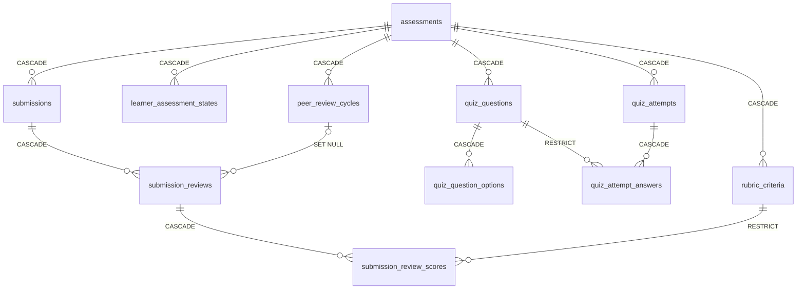

# Thiết kế database assessment-service (`assessment_db`)

Trạng thái: **14 bảng** trên `develop` sau migration `20261025000000_drop_completed_enrollments` (bản đầu `20260930084438_assessment` tạo 15 bảng, trong đó `completed_enrollments` đã bị bỏ).
Tài liệu mô tả đúng những gì có trên `develop`, đã gồm PR UC33 (#173, chốt chu kỳ chấm chéo và chạy theo lịch) và PR `completion-snapshot` (#176), cả hai merge ngày 29/10/2026 (giờ Sài Gòn; 28/10 theo UTC), PR #189 (tệp đề bài nhận PDF/DOCX/ZIP, giới hạn tải lên theo gói lưu trữ, 29/10/2026) và PR #190 (bỏ cột `peer_review_obligation`, D10, 30/10/2026). Những việc đã quyết nhưng **chưa làm** (thêm `CHECK`) ghi rõ ở mục 8 và 10.
Nhãn BR dùng số mới của bộ quy tắc v1.5 (`LearnUP_Business_Rules.docx`); mỗi số trích đều đã đối chiếu nội dung với bộ quy tắc, không lấy từ chú thích trong code (chú thích trong code còn lẫn số cũ và số mới).

Nguồn: `services/assessment-service/prisma/schema.prisma`, hai file migration, và code trong `src/modules`. Những điều chưa kiểm chứng hoặc chưa quyết định ghi ở mục 7, 8 và 10, không suy đoán.
Hai điểm cần biết ngay:
- **Migration không có ràng buộc `CHECK` nào.** Mọi giá trị trạng thái (`kind`, `grading_status`, `status`…) là chuỗi tự do ở DB; chỉ tầng ứng dụng giữ tập giá trị (mục 3 và 7).
- **`id` và `updated_at` không có giá trị mặc định ở DB**; Prisma sinh UUID v7 và `updated_at` ở tầng ứng dụng. Chèn tay bằng SQL phải tự điền hai cột này (các test tích hợp làm đúng như vậy).

---

## 1. Áp dụng quy ước

| Chỗ | Thực tế trên `develop` |
|---|---|
| Khóa chính | `uuid`, sinh UUID v7 ở ứng dụng (`@default(uuid(7))`), không có `DEFAULT` ở DB. Ngoại lệ: `learner_accounts.user_id` là ID gốc từ service khác, không sinh ở đây |
| `organization_id` | `uuid NOT NULL` ở 12 trong 14 bảng, **không có khóa ngoại** (tổ chức thuộc tenant-service). **Hai ngoại lệ:** `platform_settings` **không có cột này** (tham số mặc định cấp nền tảng, không thuộc Organization nào; BR-335); `outbox_events.organization_id` **cho phép NULL** (cả bốn chỗ ghi hiện có đều điền giá trị; schema không bắt buộc, và không có BR hay quyết định nào ghi lại lý do) |
| Thời gian | `timestamptz`. `created_at` có `DEFAULT CURRENT_TIMESTAMP`; `updated_at` do ứng dụng điền |
| Điểm | `numeric(5,2)` (điểm Quiz, điểm Assignment, điểm đạt) |
| Xóa | Xóa Assessment kéo theo con bằng `ON DELETE CASCADE` (mục 3). Hai khóa ngoại dùng `RESTRICT` (`quiz_attempt_answers.question_id`, `submission_review_scores.criterion_id`) và một dùng `SET NULL` (`submission_reviews.cycle_id`) |
| Khóa chặn tương tranh | Ba khóa tư vấn `pg_advisory_xact_lock(hashtext(...))`: theo Course (UC19.2, mục 4.1), theo `{assessmentId}:{learnerId}` (UC30, UC30.1) và theo `cycle:{assessmentId}` (đặt bài vào chu kỳ ở UC30 và UC30.1, và chốt chu kỳ ở UC33; mục 4.2, 4.3, 6). Chấm của Instructor dùng khóa dòng `SELECT … FOR UPDATE` trên bài nộp (UC32, mục 4.4) |

### 1.1 Truy vấn không lọc theo `organization_id`

Chưa rà toàn bộ truy vấn của repository để lập danh sách ngoại lệ như tài liệu learning-service. Các truy vấn đã đọc khi viết tài liệu này đều lọc theo `organization_id` (hoặc theo `assessment_id` của một Assessment đã lọc theo tổ chức). Việc rà đầy đủ ghi ở mục 10.

### 1.2 Giới hạn

Mỗi giới hạn có một lý do, thuộc một trong ba loại: **BR** (ghi số BR), **"agreed UI limits"** của quy ước CSDL (`Database_Conventions.md` mục 2, loại 3: các giới hạn nhập liệu đã thống nhất cho giao diện), hoặc **ràng buộc kỹ thuật** (ghi rõ). Theo cùng mục đó, một giới hạn không có căn cứ nào thì cột phải là `text`, không đặt một con số tự chọn.

Lưu ý nguồn: các số "agreed UI limits" dưới đây lấy theo danh sách Hào ghi ở review #174 ngày 28/10/2026. **`Database_Conventions.md` chưa có trong repo**, nên tài liệu này chưa đối chiếu được với mục gốc; khi file đó vào repo thì kiểm lại từng số.

| Ô nhập | Giới hạn ở DB | Lý do | Ghi chú |
|---|---|---|---|
| Tiêu đề Assessment | `varchar(200)` | "Agreed UI limits" (Conventions mục 2): tiêu đề 200 | |
| Đề bài Assignment | `varchar(8000)` | "Agreed UI limits": đề bài Assignment 8000 | Cần đề bài chữ hoặc một file đề (UC19.2) |
| File đề bài: số lượng | Một file | BR-189: mỗi Assignment có tối đa một tệp đề bài; "agreed UI limits": 1 file | Lưu ở kho ngoài, DB chỉ giữ `prompt_file_key` |
| File đề bài: kích thước và định dạng | PDF, DOCX hoặc ZIP, trần 50 MB (`PROMPT_FILE_MAX_BYTES`), cùng bảng loại tệp với bài nộp (`SUBMISSION_FILE_TYPES`). **Giới hạn thực tế = min(50 MB, giới hạn tệp raw của gói lưu trữ)** (`STORAGE_MAX_RAW_BYTES`, mặc định 10 MiB cho gói Cloudinary Free), quá thì trả 413 `FILE_TOO_LARGE` | BR-189 (số cũ BR-320): tệp đề bài có **cùng giới hạn kích thước và định dạng với tệp bài nộp**; "agreed UI limits": tệp PDF/DOCX/ZIP tối đa 50 MB. Code đã khớp từ PR #189 (mục 10 việc 9). Giới hạn thực tế được API trả cho màn hình (`maxFileBytes`) để chặn tệp quá cỡ ngay lúc chọn | |
| File đề bài: tên và MIME | `varchar(255)` mỗi cột; kích thước tệp `bigint` | Ràng buộc kỹ thuật: 255 là độ dài tối đa của tên tệp trên các hệ tệp phổ biến và đủ cho một kiểu MIME (type và subtype mỗi phần tối đa 127 ký tự, RFC 6838). `bigint` để lưu kích thước tính bằng byte, không phụ thuộc giới hạn 50 MB | |
| Câu hỏi Quiz | `varchar(2000)` | "Agreed UI limits": câu hỏi 2000 (BR-194 chỉ quy định các dạng câu hỏi, không độ dài) | |
| Đáp án Quiz | `varchar(500)` | "Agreed UI limits": đáp án 500 | |
| Dạng câu hỏi Quiz | Danh sách cho phép `SingleChoice`, `MultipleChoice`, `TrueFalse` | BR-194: ba dạng câu hỏi, đều chấm tự động | DB không kiểm; mục 3.2 |
| Tên và mô tả tiêu chí Rubric | `varchar(200)` và `varchar(500)` | "Agreed UI limits": tên rubric 200, mô tả rubric 500 | |
| Điểm tối đa của tiêu chí | `smallint` | BR-257: điểm mỗi tiêu chí là số nguyên từ 0 đến điểm tối đa của tiêu chí; BR không đặt trần cho điểm tối đa. `smallint` (trần 32.767 do kiểu dữ liệu) là lựa chọn kỹ thuật cho số nguyên nhỏ | Cùng lý do cho `submission_review_scores.points` |
| Nội dung bài nộp | `varchar(20000)` (`SUBMISSION_CONTENT_MAX_LENGTH`) | "Agreed UI limits": bài nộp dạng chữ 20000 | |
| File bài nộp | PDF, DOCX hoặc ZIP, một file, trần 50 MB (`SUBMISSION_FILE_MAX_BYTES`); giới hạn thực tế = min(50 MB, giới hạn tệp raw của gói lưu trữ), quá thì trả 413 `FILE_TOO_LARGE` | "Agreed UI limits": 1 file, PDF/DOCX/ZIP, tối đa 50 MB (BR-189 nhắc "giới hạn kích thước và định dạng" của tệp bài nộp mà không nêu giá trị; BR-188 chỉ nói tệp bài nộp không tính vào dung lượng của Subscription). Kiểm cả chữ ký đầu file là ràng buộc kỹ thuật (không tin loại tệp do trình duyệt báo) | Thư mục kho: `learnup/{organizationId}/assignments/{assessmentId}/submissions` |
| Nhận xét của người chấm | `varchar(2000)` | BR-323: nhận xét tự do của chấm chéo tối đa 2000 ký tự; "agreed UI limits": nhận xét review 2000. Chấm của Instructor dùng cùng cột và cùng giới hạn (BR-257 chỉ đòi nhận xét không rỗng) | Dùng cho chấm chéo và chấm của Instructor |
| Nhận xét khi chốt điểm | `varchar(2000)` | "Agreed UI limits": nhận xét chốt điểm 2000 (BR-255 quy định điểm cuối, không nêu độ dài nhận xét) | `finalization_comment` |
| Số người đánh giá mỗi bài (N) | `smallint` | BR-226 và BR-242 chỉ coi N là một số nhỏ (chu kỳ phải gom ít nhất N + 1 bài); BR không đặt trần cho N. `smallint` là lựa chọn kỹ thuật | |
| Điểm Quiz, điểm Assignment, điểm đạt, chênh lệch điểm | `numeric(5,2)` | BR-202: thang 0–100, làm tròn 2 chữ số thập phân; BR-253: chênh lệch điểm tính trên cùng thang. Kiểu chứa tới 999,99, đủ cho 100,00 | Áp dụng cho mọi cột điểm ở mục 3 (`passing_score`, `peer_review_score_gap`, `score_gap`, `score`, `final_score`) |

---

## 2. Danh sách bảng

Cột "Có code ghi" cho biết trên `develop` đã có chỗ nào ghi vào bảng. "Chưa" nghĩa là bảng đã có trong schema nhưng chưa có luồng nào dùng.

| # | Bảng | Giữ gì | Căn cứ chính | Có code ghi |
|---|---|---|---|---|
| 1 | `assessments` | Một Quiz hoặc Assignment của một phiên bản Course: cấu hình, đề bài, chấm chéo | BR-206, BR-207, BR-217, BR-224, BR-227 | Có (UC18 tạo Quiz, UC19 Assignment) |
| 2 | `quiz_questions` | Câu hỏi của Quiz | | **Chưa** (UC18.1 chỉ đọc) |
| 3 | `quiz_question_options` | Đáp án của câu hỏi, có cờ đúng | | **Chưa** |
| 4 | `rubric_criteria` | Tiêu chí chấm của Assignment | | Có (UC19.2) |
| 5 | `learner_assessment_states` | Mỗi Learner trên mỗi Assessment: số lượt liên tiếp, khóa tạm, nghĩa vụ chấm chéo | BR-217, BR-218, BR-221, BR-239, BR-241 | Có (UC30, UC30.1) |
| 6 | `quiz_attempts` | Một lượt làm Quiz | BR-198, BR-200, BR-211 | **Chưa** (UC29.1 chưa làm; chỉ đọc) |
| 7 | `quiz_attempt_answers` | Đáp án Learner đã chọn trong một lượt | | **Chưa** (chỉ xóa khi xóa Quiz) |
| 8 | `submissions` | Bài nộp Assignment: nội dung, file, chu kỳ, trạng thái chấm, điểm chốt | BR-208, BR-209, BR-210, BR-212, BR-213 | Có (UC30, UC30.1) |
| 9 | `peer_review_cycles` | Một chu kỳ chấm chéo của một Assignment | BR-208, BR-229, BR-230, BR-335 | Có: tạo chu kỳ `Open` khi có bài nộp (UC30); chốt, nhắc, hết hạn do việc chạy theo lịch và chốt tay của Instructor (UC33, mục 6) |
| 10 | `submission_reviews` | Một lượt đánh giá của một người cho một bài nộp | BR-236, BR-237, BR-242, BR-243, BR-248, BR-249, BR-252 | Có: **chấm của Instructor** (UC32); UC33 sinh dòng `Pending` của chấm chéo khi chốt chu kỳ và đánh `Missed` khi hết hạn. Người chấm chéo ghi điểm (UC31.1) **chưa làm** |
| 11 | `submission_review_scores` | Điểm từng tiêu chí trong một lượt đánh giá | | Có (cùng giao dịch với chấm của Instructor) |
| 12 | `learner_accounts` | Tài khoản Learner bị vô hiệu hóa hoặc đã xóa, bảng thưa | | **Chưa** (chưa có consumer event) |
| 13 | `platform_settings` | Bản sao tham số mặc định của nền tảng | BR-335 | **Chưa** (chỉ đọc, không có chỗ ghi; thiếu dòng thì dùng giá trị mặc định trong code) |
| 14 | `outbox_events` | Event ghi cùng giao dịch với thay đổi | Quy ước outbox | Có; **chưa có relay đưa lên Kafka** |

assessment-service **không có** bảng Enrollment, Course, Certificate hay thông báo. Quyền làm bài của Learner (BR-210: Course Completed thì chỉ đọc; Halted và Withdrawn thì bị chặn) do learning-service trả lời từng lần qua REST `assessment-access` (L17), không lưu ở đây. Bảng `completed_enrollments` từng làm việc đó nhưng không có nguồn ghi, đã bị bỏ (mục 8).

---

## 3. Chi tiết từng bảng

Ký hiệu: **B** = `NOT NULL`. Mọi bảng có `created_at` (B) và `updated_at` (B), và có `organization_id` (B) **trừ hai ngoại lệ ở mục 1** (`platform_settings` không có cột này; `outbox_events.organization_id` cho phép NULL); các cột đó không lặp lại dưới đây.

### 3.1 `assessments`

| Cột | Kiểu | Ghi chú |
|---|---|---|
| `course_id` | `uuid` B | Phiên bản Course; không có khóa ngoại (thuộc course-service) |
| `module_id` | `uuid` | Rỗng = gắn thẳng vào Course |
| `kind` | `text` B | `QUIZ` hoặc `ASSIGNMENT` |
| `title` | `varchar(200)` B | |
| `position` | `int` B | Thứ tự trong Course. Gán bằng "lớn nhất + 1" dưới khóa theo Course (mục 4.1); **không có chỉ mục duy nhất** |
| `passing_score` | `numeric(5,2)` B | |
| `max_consecutive_attempts` (n) | `int` B | BR-217 |
| `lockout_hours` (m) | `int` B | BR-217 |
| `is_required` | `boolean` B | Assignment luôn `true` (BR-206) |
| `time_limit_minutes` | `int` | Quiz |
| `prompt`, `prompt_file_key`, `prompt_file_name`, `prompt_file_mime`, `prompt_file_size_bytes` | | Assignment; file ở kho ngoài |
| `expected_duration_minutes` | `int` | Assignment; cộng vào thời lượng dự kiến của Course |
| `peer_review_enabled` | `boolean` B, mặc định `false` | BR-224, BR-227 |
| `peer_reviewers_per_submission` (N) | `smallint` | Có khi bật chấm chéo |
| `peer_review_cycle_days`, `peer_review_deadline_days` | `int` | Rỗng = lấy mặc định (mục 3.13) |
| `peer_review_score_gap` | `numeric(5,2)` | |
| `disabled_at` | `timestamptz` | Có thì Learner không thấy Assessment. **Chưa có code ghi cột này** (chỉ đọc) |
| `copied_from_id` | `uuid` | **Chưa có code nào dùng cột này** |

Chỉ mục: `(organization_id, course_id)`. Bảng con xóa theo (`ON DELETE CASCADE`): `quiz_questions`, `rubric_criteria`, `learner_assessment_states`, `quiz_attempts`, `submissions`, `peer_review_cycles`.

### 3.2 `quiz_questions` và 3.3 `quiz_question_options`

`quiz_questions`: `assessment_id` B (cascade), `question_type` B, `content` `varchar(2000)` B, `position` B. Duy nhất `(assessment_id, position)`.
`question_type` nhận `SingleChoice`, `MultipleChoice` hoặc `TrueFalse` (`QUIZ_QUESTION_TYPES` trong code); DB không kiểm, code đọc cho qua giá trị lạ.
`quiz_question_options`: `question_id` B (cascade), `content` `varchar(500)` B, `is_correct` B, `position` B. Duy nhất `(question_id, position)`.
Chưa có code ghi hai bảng; UC18.1 chỉ đọc chúng để hiển thị.

### 3.4 `rubric_criteria`

`assessment_id` B (cascade), `name` `varchar(200)` B, `description` `varchar(500)` B, `max_points` `smallint` B, `position` B. Duy nhất `(assessment_id, position)`. Được ghi cùng giao dịch với Assignment (UC19.2).

### 3.5 `learner_assessment_states`

| Cột | Kiểu | Ghi chú |
|---|---|---|
| `assessment_id` | `uuid` B | Cascade |
| `learner_id` | `uuid` B | |
| `first_activity_at` | `timestamptz` B | Dòng được tạo ở lần nộp đầu tiên (`ensureState`) |
| `consecutive_count` | `int` B, mặc định 0 | Số lượt liên tiếp (BR-218) |
| `locked_until` | `timestamptz` | Có giá trị khi đủ n lượt: tạm khóa m giờ, hiển thị cho Learner (BR-218, BR-221). Sau mốc này đếm lại từ 0 |
| `recorded_attempt_id` | `uuid` | **Chưa có code dùng.** Điểm ghi nhận của Quiz hiện tính lúc đọc, không lưu |
| `latest_submission_id` | `uuid` | Bài nộp mới nhất; không có khóa ngoại |
| ~~`peer_review_obligation`~~ | (đã bỏ) | **Đã bỏ ở #190** (D10, quyết định của Hào ở #176). Cột từng chỉ được ghi `Missed` khi hết hạn đánh giá và không bao giờ được đặt lại khi Learner bù xong review của chu kỳ sau (BR-239). Nay "còn nợ chấm chéo" được tính từ các dòng `submission_reviews` bằng `peerReviewOf`, cùng hàm với `completion-snapshot`; migration `20261029000000_drop_peer_review_obligation` xóa cột, `markObligationMissed` bị bỏ |
| `exempted_at` | `timestamptz` | Instructor miễn nghĩa vụ chấm chéo (BR-241, UC33.2). Cột và phép kiểm miễn đã có (đọc ở `owesPeerReviewDuty`, kết hợp với kết quả `peerReviewOf`), nhưng **chưa có code ghi**: người ghi là việc miễn nghĩa vụ UC33.2, **chưa làm** |
| `exempted_by` | `uuid` | **Chưa có code dùng**; cùng người ghi UC33.2 (chưa làm) |

Duy nhất `(assessment_id, learner_id)`. Mỗi dòng đóng vai trò khóa đếm lượt cho một Learner trên một Assessment.

### 3.6 `quiz_attempts` và 3.7 `quiz_attempt_answers`

`quiz_attempts`: `assessment_id` B (cascade), `learner_id` B, `attempt_number` B, `started_at` B, `deadline_at` B, `submitted_at`, `submission_kind`, `score` `numeric(5,2)`. Duy nhất `(assessment_id, learner_id, attempt_number)`.
`quiz_attempt_answers`: `attempt_id` B (cascade), `question_id` B (**`RESTRICT`**, nên khi xóa Quiz code phải xóa đáp án trước), `option_id` B (không có khóa ngoại). Duy nhất `(attempt_id, question_id, option_id)`.
Chưa có code tạo lượt làm; các cột này chờ UC29.1 (tự nộp khi hết giờ theo BR-200). Điểm ghi nhận của Quiz là lượt cao nhất (BR-198), **tính lúc đọc**.

### 3.8 `submissions`

| Cột | Kiểu | Ghi chú |
|---|---|---|
| `assessment_id` | `uuid` B | Cascade |
| `learner_id` | `uuid` B | |
| `submission_number` | `int` B | Tăng dần theo từng Learner trên từng Assignment |
| `content` | `varchar(20000)` | Một trong `content` và `file_key` phải có (kiểm ở ứng dụng) |
| `file_key`, `file_name`, `file_mime`, `file_size_bytes` | | File ở kho ngoài |
| `submitted_at` | `timestamptz` B | Thời gian của máy chủ |
| `cycle_id` | `uuid` | Chu kỳ chấm chéo chứa bài. **Không có khóa ngoại** sang `peer_review_cycles`. Rỗng khi Instructor chấm thẳng |
| `superseded_at` | `timestamptz` | Có khi bị bài nộp lại thay thế; bài đó giữ lại làm lịch sử (BR-213) |
| `grading_status` | `text` B | Mục 3.8.1 |
| `intervention_reason` | `text` | Lý do Instructor phải chấm |
| `final_score`, `finalization_comment`, `finalized_at`, `finalized_by` | | Khi chốt điểm (UC32.3). **Chưa có code ghi các cột này** trên `develop` |

Duy nhất `(assessment_id, learner_id, submission_number)`. **Điểm ghi nhận của Assignment là điểm của bài nộp gần nhất** (BR-212), tính lúc đọc, không lưu.

#### 3.8.1 Giá trị của `grading_status` và `intervention_reason`

`grading_status`: `AwaitingPeerReview` → `AwaitingInstructor` hoặc `AwaitingFinalization` → `Finalized`.

| Giá trị | Ý nghĩa | Ai đặt trên `develop` |
|---|---|---|
| `AwaitingPeerReview` | Bài nằm trong chu kỳ chấm chéo đang mở | UC30, UC30.1 |
| `AwaitingInstructor` | Instructor phải chấm | UC30 (chấm chéo tắt), UC30.1 (nộp lại sau mốc chốt) |
| `AwaitingFinalization` | Đã có đủ đánh giá, chờ chốt điểm | Chấm của Instructor (UC32): từ `AwaitingInstructor` |
| `Finalized` | Đã chốt điểm | **Chưa có code đặt** (UC32.3) |

`intervention_reason`: `PEER_REVIEW_DISABLED` (chấm chéo tắt) và `RESUBMITTED_AFTER_CUTOFF` (nộp lại sau mốc chốt, BR-213). UC33 thêm `TOO_FEW_SUBMISSIONS` (chu kỳ ít hơn N + 1 bài, BR-242) và `REVIEW_MISSED` (bài chưa đủ đánh giá hợp lệ khi hết hạn, BR-243), do việc chốt chu kỳ và việc hết hạn đánh giá ghi (mục 6).

### 3.9 `peer_review_cycles`

| Cột | Kiểu | Ghi chú |
|---|---|---|
| `assessment_id` | `uuid` B | Cascade |
| `opens_at`, `closes_at`, `review_due_at` | `timestamptz` B | Ba mốc. Tính theo ngày lịch của múi giờ tổ chức (mặc định `Asia/Ho_Chi_Minh`, chờ endpoint của tenant-service); mốc đóng là cuối ngày thứ L, hạn chấm là cuối ngày thứ D sau ngày chốt (BR-229) |
| `reviewers_per_submission` | `smallint` B | N, **sao chép** từ Assignment lúc tạo chu kỳ |
| `score_gap` | `numeric(5,2)` B | Sao chép |
| `reminder_hours` | `int` B | Sao chép từ `platform_settings` hoặc mặc định 24 |
| `status` | `text` B | Mục 3.9.1 |
| `reviewer_permutation` | `uuid[]`, **cho phép NULL** | Hoán vị ngẫu nhiên của tập người đánh giá, lưu lại để chốt lại cho cùng kết quả (BR-249). NULL khi chu kỳ vừa được tạo ở UC30 và chưa chốt; mã UC33 ghi mảng rỗng khi không giao được |
| `closed_at`, `reminded_at`, `completed_at` | `timestamptz` | Lúc chốt, lúc nhắc, lúc hết hạn đánh giá |

Không có chỉ mục nào ngoài khóa chính. Các giá trị tham số được sao chép nên đổi cấu hình chỉ áp dụng cho chu kỳ tạo sau (BR-335).

#### 3.9.1 Giá trị của `status`

| Giá trị | Ý nghĩa | Ai đặt trên `develop` |
|---|---|---|
| `Open` | Đang nhận bài, tạo theo nhu cầu ở lần nộp đầu tiên của một khoảng | UC30 |
| `Assigned` | Đã chốt, bài đã giao cho người đánh giá | Chốt chu kỳ (UC33) |
| `InstructorOnly` | Đã chốt nhưng quá ít bài, Instructor chấm hết (BR-242) | Chốt chu kỳ (UC33) |
| `Completed` | Hết hạn đánh giá | Việc hết hạn đánh giá (UC33) |

Trong lúc chốt, mã UC33 đặt tạm giá trị `Closing` **bên trong một giao dịch**; không giao dịch khác nhìn thấy giá trị này.

### 3.10 `submission_reviews`

| Cột | Kiểu | Ghi chú |
|---|---|---|
| `submission_id` | `uuid` B | Cascade |
| `cycle_id` | `uuid` | Khóa ngoại `ON DELETE SET NULL`; rỗng với đánh giá của Instructor ngoài chu kỳ |
| `reviewer_id` | `uuid` B | |
| `reviewer_role` | `text` B | `Learner` hoặc `Instructor` |
| `status` | `text` B | Mục 3.10.1 |
| `score` | `numeric(5,2)` | Có khi hoàn thành |
| `comment` | `varchar(2000)` | |
| `completed_at` | `timestamptz` | |

Chỉ mục: `(organization_id, reviewer_id)`. Không có chỉ mục theo `submission_id` hay `cycle_id` (mục 10).

#### 3.10.1 Giá trị của `status`

| Giá trị | Ý nghĩa | Ai đặt trên `develop` |
|---|---|---|
| `Pending` | Được giao, chưa chấm | Chốt chu kỳ (UC33) sinh dòng |
| `Completed` | Đã chấm đủ: mọi tiêu chí có điểm và có nhận xét | Instructor (UC32); chấm chéo của Learner chờ UC31.1 (**chưa làm**) |
| `Missed` | Hết hạn mà chưa chấm | Việc hết hạn đánh giá (UC33) |

Một đánh giá chỉ tính vào điểm khi `Completed`. Đã có thỏa thuận về bộ ba `Pending → Completed | Missed`.

### 3.11 `submission_review_scores`

`review_id` B (cascade), `criterion_id` B (**`RESTRICT`**), `points` `smallint` B. Duy nhất `(review_id, criterion_id)`: mỗi tiêu chí một điểm trong mỗi lượt đánh giá.

### 3.12 `learner_accounts`

Bảng thưa: `user_id` (khóa chính, ID gốc), `deactivated_at`, `deleted_at`, `status_as_of` B. Dành cho event tài khoản bị vô hiệu hóa hoặc xóa. **Chưa có consumer nào ghi.**

### 3.13 `platform_settings`

Bản sao tham số mặc định: `default_peer_review_cycle_days` 7, `default_peer_review_deadline_days` 3, `peer_review_reminder_hours` 24, `default_max_consecutive_attempts` 3, `default_lockout_hours` 24 (mặc định ở DB), `source_as_of` B. Code đọc dòng mới nhất; **chưa có chỗ ghi**, thiếu dòng thì dùng đúng các giá trị mặc định ghi trong code.

### 3.14 `outbox_events`

`aggregate_type` B, `aggregate_id` B, `event_type` B, `organization_id`, `payload` `jsonb` B, `occurred_at` B, `published_at`. Chỉ mục `(published_at)`. Dòng được ghi cùng giao dịch với thay đổi nó thông báo. Xem mục 5.3 về việc gửi.

---

## 4. Luồng chính

### 4.1 Tạo Assignment (UC19.2)

1. Kiểm quyền Instructor và Course (qua course-service): thuộc Instructor, có thể sửa, chưa Locked.
2. Một transaction: khóa theo Course (`pg_advisory_xact_lock(hashtext(courseId))`) để hai yêu cầu song song không chung `position`; lấy `position` lớn nhất + 1; ghi `assessments`; ghi `rubric_criteria`; ghi `outbox_events` loại `AssignmentMinutesChanged`.
3. Trước khi commit kiểm lại một lần nữa Course còn thêm được (cửa sổ còn lại chỉ bằng một lời gọi).
4. Sau commit: gọi REST course-service đặt tổng số phút của các Assignment; thành công thì đặt `published_at`; thất bại không làm hỏng thao tác, dòng outbox giữ nguyên chưa gửi và lần đổi sau sẽ gửi lại tổng đúng.

### 4.2 Nộp bài lần đầu (UC30)

1. Hỏi learning-service quyền làm bài (L17): `Full` được nộp, `ReadOnly` chỉ đọc (409 `ENROLLMENT_COMPLETED`), `None` bị chặn (409 `ENROLLMENT_NOT_ACTIVE`), chưa Enroll thì 403, lỗi hoặc câu trả lời không hợp lệ thì 503. Không lưu lại câu trả lời.
2. Kiểm tệp (loại, chữ ký, kích thước), tải lên kho ngoài trước giao dịch.
3. Một transaction: khóa theo `(assessment, learner)` (`{assessmentId}:{userId}`); tạo hoặc lấy dòng `learner_assessment_states`; kiểm khóa tạm; đặt chỗ cho bài: chấm chéo bật thì khóa theo Assignment (`cycle:{assessmentId}`), tìm chu kỳ chứa thời điểm nộp, chưa có thì tạo (sao chép tham số của Assignment, BR-335, BR-208), `grading_status = AwaitingPeerReview`; chấm chéo tắt thì `AwaitingInstructor` với lý do `PEER_REVIEW_DISABLED`; ghi `submissions`; cập nhật `consecutive_count`, `locked_until`, `latest_submission_id`; ghi `outbox_events` loại `LearnerAssessmentStatusChanged`.
4. Ghi dở: nếu transaction thất bại thì xóa file đã tải lên.

**Chọn chu kỳ ở bước 3.** Bài lần đầu chỉ vào một chu kỳ `Open`: truy vấn `findCycleContaining` lọc theo Assessment, `status = 'Open'` và hai mốc thời gian (`opens_at <= thời điểm < closes_at`), nên một chu kỳ vừa được chốt trong lúc bài chờ khóa không bị vào. (Trước PR UC33 #173, merge 29/10/2026, truy vấn này chưa lọc `status`.)

### 4.3 Nộp lại (UC30.1)

Cùng các bước trên; khác ở chỗ đặt bài (BR-213, BR-239). Trước khi đọc chu kỳ của bài trước, bài nộp lại lấy khóa `cycle:{assessmentId}` (cùng khóa với việc chốt chu kỳ), rồi đọc lại chu kỳ trong cùng transaction và quyết định (`decideResubmission`, `resubmission-placement.ts`):
- chu kỳ của bài trước còn **`Open` và chưa tới mốc chốt** (cả hai điều kiện): bài mới thay bài cũ trong cùng chu kỳ;
- chu kỳ đó **đã chốt, hoặc đã qua mốc chốt, hoặc bài trước không ở trong chu kỳ nào**: bài mới đi thẳng cho Instructor (`RESUBMITTED_AFTER_CUTOFF`), trừ khi Learner đang nợ nghĩa vụ chấm chéo (`peerReviewOf` của Learner trên Assignment này trả `Missed`, chưa được miễn): khi đó bài vào chu kỳ đang mở để bù nghĩa vụ. Các dòng review được đọc trong transaction nộp lại, dưới khóa chu kỳ.
Bài cũ được đặt `superseded_at` và giữ lại làm lịch sử. Không giới hạn tổng số lần nộp lại cho tới khi Enrollment Completed (BR-209, BR-210).

Nhờ đó một bài nộp hoặc nằm trong chu kỳ khi chu kỳ chốt, hoặc sang chu kỳ sau; chu kỳ vừa đóng trong lúc bài nộp lại chờ khóa thì không được vào và bài đi cho Instructor (BR-213). Đây là sửa đổi của PR UC33 (#173): trước đó đường thay bài trong cùng chu kỳ không lấy khóa và đọc chu kỳ trước khi có khóa, nên việc chốt chạy cùng lúc có thể giao review cho bài vừa bị thay.

### 4.4 Chấm của Instructor (UC32)

Một transaction: khóa dòng bài nộp (`FOR UPDATE`); chỉ chấm được bài đang `AwaitingInstructor` và là bài nộp gần nhất; ghi `submission_reviews` (vai `Instructor`, `Completed`) cùng `submission_review_scores`; đổi `grading_status` sang `AwaitingFinalization` bằng cập nhật có điều kiện (`WHERE grading_status = 'AwaitingInstructor'`). Việc chốt điểm cuối (`Finalized`, `final_score`) chưa có code.

### 4.5 Xem danh sách và kết quả của Learner (UC29, UC30.2)

Không ghi gì. File đề bài do dịch vụ tải từ kho (URL dựng từ khóa) rồi trả qua API sau khi kiểm quyền, trình duyệt không gọi thẳng kho. Trạng thái và điểm ghi nhận **tính lúc đọc** từ lượt làm hoặc bài nộp gần nhất: Quiz lấy lượt cao nhất (BR-198), Assignment lấy bài gần nhất (BR-212), trạng thái `NotStarted`, `InProgress`, `AwaitingResult`, `Completed`. Kết quả một bài chỉ có khi `Finalized`; người đánh giá không bao giờ lộ danh tính.

### 4.6 Chốt chu kỳ, nhắc, hết hạn (UC33)

Mô tả ở mục 6. Có trên `develop` từ PR #173 (29/10/2026).

---

## 5. Dữ liệu trao đổi với service khác

### 5.1 Nhận vào

| Từ | Cách | Dùng để |
|---|---|---|
| course-service | REST khi cần (có thể giả bằng `COURSE_CLIENT_MODE=fake`) | Biết Course có thuộc Instructor, đang sửa được, Locked chưa; thứ tự Module |
| learning-service | REST `GET /api/v1/internal/enrollments/assessment-access` (L17), mỗi yêu cầu một lần, không lưu | Quyền làm bài theo trạng thái Enrollment (BR-210). Bảng ánh xạ trạng thái → quyền: NotStarted, InProgress, Exempted là `Full`; Completed là `ReadOnly`; Halted, Withdrawn là `None`; câu trả lời mâu thuẫn bị coi là 503 |
| tenant-service | REST | Tên hiển thị Learner trên màn của Instructor |
| Event | **Chưa có consumer nào.** Hai bảng `learner_accounts` và `platform_settings` dành sẵn cho event tài khoản và tham số nền tảng | |

### 5.2 Cung cấp

| Cho | Cách | Nội dung |
|---|---|---|
| learning-service | REST nội bộ `GET /internal/learners/{learnerId}/courses/{courseId}/assessment-activity` (UC25.4) | `hasQuizAttempt`, `hasSubmission`, `hasPeerReviewGiven`: Learner đã làm gì trong phiên bản Course (learning-service dùng để quyết định xóa Enrollment hay giữ ở Withdrawn khi Learner rút) |
| learning-service | `completion-snapshot` (REST nội bộ) | **Có trên `develop`** từ PR #176 (29/10/2026): `GET /api/v1/internal/learners/{learnerId}/courses/{courseId}/completion-snapshot`, dành cho learning-service (guard kiểm khóa nội bộ dùng chung và header tổ chức, không kiểm danh tính riêng của learning-service; không qua gateway); hợp đồng ở `contracts/openapi/assessment-service.yaml`. Quy tắc `peerReview` (D10): tính theo **chu kỳ mới nhất mà Learner có phân công review** (BR-236, BR-238, BR-239): tất cả `Completed` là `Satisfied`, có `Missed` hoặc `Pending` quá hạn là `Missed`, còn lại `Pending`; không có phân công ở chu kỳ nào là `NotApplicable`. Một chu kỳ sau không có phân công cho Learner (ít hơn N + 1 bài, BR-242) không xóa `Missed` cũ. **`Waived` chưa được trả** và `exempted_at` chưa được đọc (chờ learning nhận `Waived`, L22). Nguồn là các dòng `submission_reviews`, không phải cột `peer_review_obligation` (đã bỏ ở #190, mục 3.5) |

### 5.3 Event phát ra (qua `outbox_events`)

| `event_type` | `aggregate_type` | Khi nào | Payload chính | Việc gửi hiện nay |
|---|---|---|---|---|
| `AssignmentMinutesChanged` | `Assignment` | Tạo, đổi thời lượng, xóa Assignment (`change`: `Created`, `DurationChanged`, `Deleted`) | `assignmentId`, `courseId`, `change`, `expectedDurationMinutes` | Gửi bằng **REST** sang course-service ngay sau commit (mục 4.1), không qua Kafka; dòng được đánh dấu đã gửi khi REST thành công |
| `LearnerAssessmentStatusChanged` | `LearnerAssessmentState` | Mỗi lần nộp hoặc nộp lại | `assessmentId`, `courseId`, `learnerId`, `kind`, `status` (`Submitted` hoặc `Resubmitted`), `submissionId`, `previousSubmissionId`, `consecutiveCount`, `lockedUntil` | **Chưa có relay**: `OutboxService` là lớp rỗng, nên dòng được ghi nhưng không bao giờ được gửi và `published_at` luôn rỗng. Learning-service chờ event này (kế hoạch giai đoạn 5) |

Payload của `LearnerAssessmentStatusChanged` sẽ được mở rộng (`reason`, `revision`, `firstActivityAt`…) ở giai đoạn 5; tài liệu này mô tả bản đang ghi.

---

## 6. Việc chạy theo lịch

PR UC33 (#173, merge 29/10/2026) thêm một bộ hẹn giờ trong tiến trình (`PEER_REVIEW_TICK_MS`, mặc định 60 giây trong Compose, không đặt hoặc 0 là tắt). Mỗi lượt chạy có việc thì ghi một dòng log tóm tắt (số chu kỳ đã chốt, đã nhắc, đã hết hạn):

| Việc | Điều kiện | Kết quả |
|---|---|---|
| Chốt chu kỳ | `status = Open` và `closes_at` đã qua (BR-230) | Đủ bài (≥ N + 1): sinh hoán vị, tạo `submission_reviews` `Pending` theo vòng, chu kỳ `Assigned`. Thiếu bài: chuyển bài cho Instructor, chu kỳ `InstructorOnly` (BR-242, BR-248, BR-249) |
| Nhắc | `Assigned`, `reminded_at` rỗng, còn trong cửa sổ `reminder_hours` trước `review_due_at` | Gửi một thông báo mỗi người còn nợ, đặt `reminded_at` (BR-232) |
| Hết hạn đánh giá | `Assigned` và `review_due_at` đã qua | Đánh `Pending → Missed`; bài chưa đủ N đánh giá hợp lệ chuyển cho Instructor (BR-237, BR-243); review của người bỏ chấm thành `Missed` (không còn ghi gì vào trạng thái của Learner; "còn nợ" được tính từ các dòng review, và người đã được miễn thì không nợ, BR-241); chu kỳ `Completed` |

Mỗi bước tranh giành chu kỳ bằng cập nhật có điều kiện (`WHERE status = ...`) nên hai lần chạy cùng lúc, hoặc hai bản của service, chỉ làm một lần. Chốt tay của Instructor, việc đặt bài nộp vào chu kỳ (lần đầu và nộp lại) dùng chung một khóa theo Assignment (`cycle:{assessmentId}`), kể cả việc nộp lại thay bài trong cùng chu kỳ (mục 4.3). Chốt tay (`POST .../peer-review/cycles/{cycleId}/close`) chỉ được khi đã qua mốc chốt mà lịch chưa chốt; chưa tới mốc thì trả 409 `CYCLE_NOT_DUE`. Ngày của chu kỳ không bao giờ bị dịch, để chu kỳ sau mở đúng lúc chu kỳ trước đóng (BR-230, BR-231). Không có việc "đóng sớm" vì BR chưa có.

---

## 7. Những gì hiện không có

Đây là mô tả hiện trạng; chưa phải mọi mục đều đã được xác nhận là cố ý.

| Chỗ | Hiện trạng | Ghi chú |
|---|---|---|
| Ràng buộc `CHECK` | Không có một cái nào | Mọi trạng thái là chuỗi tự do; chỉ ứng dụng giữ tập giá trị. Xem mục 8 |
| Khóa ngoại mềm | `submissions.cycle_id`, `learner_assessment_states.latest_submission_id`, `recorded_attempt_id`, `quiz_attempt_answers.option_id`, mọi `organization_id`, `course_id`, `learner_id`, `reviewer_id` | Không có khóa ngoại; toàn vẹn do ứng dụng giữ |
| Cột chưa có code dùng | `assessments.copied_from_id`, `learner_assessment_states.recorded_attempt_id`, `exempted_by` | Dành cho tính năng sau |
| Bảng chưa có luồng ghi | `quiz_questions`, `quiz_question_options`, `quiz_attempts`, `quiz_attempt_answers`, `learner_accounts`, `platform_settings` | Chờ UC18.3, UC29.1 và consumer event |
| Điểm ghi nhận | Không lưu | Tính lúc đọc từ lượt làm hoặc bài nộp gần nhất |
| Trạng thái Overdue, tính lại điểm khi đổi tham số | Không có | Đổi tham số chỉ áp dụng cho dữ liệu sinh sau (BR-335) |
| Bảng `completed_enrollments` | Đã bỏ | Mục 8 |
| Relay outbox sang Kafka | Chưa có | Giai đoạn 5 |

---

## 8. Quyết định nghiệp vụ phát sinh khi thiết kế

| # | Quyết định | Tình trạng |
|---|---|---|
| D5 | Bỏ bảng `completed_enrollments`: nó chỉ là bản chiếu dữ liệu của learning, không có nguồn ghi, nên BR-210 gần như không bao giờ có hiệu lực. Quyền làm bài lấy từ L17 mỗi lần. Migration `20261025000000_drop_completed_enrollments` | Đã chốt; migration cần chạy khi triển khai (PR #159) |
| D6 | Bộ ba trạng thái đánh giá `Pending → Completed \| Missed` | Hào đã chấp nhận; có trên `develop` (PR #173, 29/10/2026) |
| D7 | Bốn giá trị trạng thái chu kỳ `Open`, `Assigned`, `InstructorOnly`, `Completed` | Như trên |
| D8 | Thêm `CHECK` cho các cột trạng thái | Hào đồng ý (bình luận trên #174): làm ở PR migration riêng, sau khi PR UC33 (#173) merge vì UC33 thêm giá trị mới. #173 đã merge nên có thể làm; **chưa làm**. Xem mục 10 việc 5 |
| D9 | File nộp bài và file đề bài nằm ở kho Cloudinary qua `@learnup/ts-storage`; DB giữ khóa, dịch vụ tải file từ kho rồi trả qua API sau khi kiểm quyền. Chuyển sang giao hàng riêng tư với URL ký có hạn (việc P4) | Hào đồng ý hướng đi: dùng chung helper URL ký của course-service (#146, khoảng 28/10), không tự làm riêng. **Hiện file đang ở kiểu giao hàng công khai** (xem mục 10 việc 3) |
| D10 | Xếp bài (`owesPeerReviewDuty`) và `completion-snapshot` dùng **cùng một định nghĩa** "còn nợ chấm chéo", qua hàm `peerReviewOf` (các dòng review của Learner trên Assignment đó, giờ của yêu cầu); **bỏ cột `peer_review_obligation`** và hàm ghi `markObligationMissed` | Hào quyết định ở #176 (D-038). **Đã làm ở #190** (merge 30/10/2026): migration mới theo chiều tiến xóa cột, giữ `exempted_at` và `exempted_by` cho UC33.2; người đọc, người ghi và cột đổi trong cùng một PR vì chưa có deployment. Hệ quả: Learner đã bù review ở chu kỳ sau không còn bị coi là nợ, và một review `Pending` đã quá hạn được tính là `Missed` ngay (như ở `completion-snapshot`) |
| D11 | `completion-snapshot` chưa trả `Waived` và chưa đọc `exempted_at` | Hào (D-039): chờ learning nhận `Waived` (L22), rồi UC33.2 |

---

## 9. Sơ đồ quan hệ

Chỉ vẽ quan hệ có khóa ngoại thật; các quan hệ mềm ghi ở mục 7.

Bảng độc lập, không có khóa ngoại: `learner_accounts`, `platform_settings`, `outbox_events`.
Hướng dẫn bố trí cho dbdiagram.io chưa viết (mục 10).

---

## 10. Việc tiếp theo

1. **Đã cập nhật** sau khi #173 và #176 merge (29/10/2026): mục 2, 3.5, 3.8.1, 3.9.1, 3.10.1, 4.2, 4.3, 4.6, 5.2 và 6 chuyển từ "đang chờ" thành hiện trạng, thêm `TOO_FEW_SUBMISSIONS` và `REVIEW_MISSED`. Việc bỏ cột `peer_review_obligation` (D10, #190) và việc đề bài nhận PDF/DOCX/ZIP với giới hạn theo gói lưu trữ (#189) đã cập nhật (mục 1.2, 3.5, 4.3 và 5). Khi việc còn lại vào (`CHECK`), cập nhật tiếp mục 8.
2. **Rà các truy vấn không lọc theo `organization_id`** và lập bảng ngoại lệ như mục 1.1 của tài liệu learning-service.
3. **File riêng tư (P4):** cả hai nơi upload (`assignment-media.service.ts`, `learner-submissions.service.ts`) gọi `storage.upload` với `resourceType: 'raw'` và **không truyền `deliveryType`**; `@learnup/ts-storage` khi đó dùng `upload`, tức giao hàng công khai. Dịch vụ tải file bằng `storage.getUrl(key, 'raw')` là URL thường. Vì vậy ai có URL đều tải được, bất kể kiểm quyền ở API; đây là vấn đề chính, hơn cả việc URL hết hạn. Hướng đi: dùng helper URL ký của course-service (#146) rồi chuyển sang `authenticated`/`private`. Gói Free của Cloudinary chỉ có link hết hạn qua `private_download_url` (api.cloudinary.com), liên quan câu hỏi mở về giới hạn Admin API. Cần kiểm trước: file đã upload là kiểu nào trên môi trường thật (đọc code chưa đủ).
4. **Chỉ mục:** hiện chỉ có `assessments(organization_id, course_id)`, `submission_reviews(organization_id, reviewer_id)` và `outbox_events(published_at)` ngoài các khóa duy nhất. Các truy vấn theo `submissions.cycle_id`, `submission_reviews.cycle_id`, `submission_reviews.submission_id` chưa có chỉ mục. **Chưa đo, và tài liệu không nói chúng cần chỉ mục.** Bước cụ thể: chạy `EXPLAIN ANALYZE` các truy vấn của UC33 trên `cycle_id` / `submission_id` với dữ liệu seed, rồi mới quyết định.
5. **`CHECK` cho trạng thái (PR migration riêng; #173 đã merge nên có thể làm, chưa làm):** đếm trước các dòng có giá trị ngoài tập hợp; thêm từng constraint `NOT VALID` rồi `VALIDATE` (cách course-service đã làm); xác nhận Prisma không báo các `CHECK` viết tay là drift.
6. **Các luồng ghi còn thiếu:** câu hỏi và đáp án Quiz (UC18.3), lượt làm Quiz và tự nộp khi hết giờ (UC29.1, BR-200), chốt điểm Assignment (UC32.3), consumer event cho `learner_accounts` và `platform_settings`, ghi `disabled_at`.
7. **Relay outbox** và mở rộng payload `LearnerAssessmentStatusChanged` (giai đoạn 5). Endpoint `completion-snapshot` đã có (mục 5.2).
8. **Sơ đồ ERD cho dbdiagram.io** và số đo thực nghiệm: chưa làm.
9. **File đề bài: đưa code khớp BR-189 (đã làm ở #189, merge 29/10/2026).** Đề bài nhận PDF, DOCX hoặc ZIP, cùng bảng loại tệp với bài nộp (BR-189 và quy ước CSDL mục 2). Cloudinary gói Free chỉ cho tệp raw tới 10 MB (Plus 20, Advanced 40), thấp hơn trần 50 MB, nên giới hạn thực tế là min(50 MB, giới hạn tệp raw của gói) (D-048): tệp quá cỡ bị từ chối trước khi tải lên với 413 `FILE_TOO_LARGE`, và API cho màn hình biết giới hạn đó (`maxFileBytes`). Không còn việc nào ở mục này.
10. **Bỏ cột `peer_review_obligation` (D10): đã làm ở #190 (merge 30/10/2026).** Cột chỉ được ghi `Missed` và không bao giờ được đặt lại khi Learner bù xong các review của chu kỳ sau (BR-239), nên `owesPeerReviewDuty` vẫn coi Learner còn nợ. Cách làm: `owesPeerReviewDuty` gọi `peerReviewOf` (cùng hàm với `completion-snapshot`, đọc các dòng review trong transaction nộp lại, dưới khóa chu kỳ hiện có; còn nợ = kết quả `Missed` và chưa có `exempted_at`), đã bỏ `markObligationMissed`, và cột bị xóa bằng migration `20261029000000_drop_peer_review_obligation`. Không còn việc nào ở mục này.
11. **Đối chiếu các số "agreed UI limits"** ở mục 1.2 với `Database_Conventions.md` mục 2 khi file đó có trong repo (hiện các số lấy theo danh sách của Hào ở review #174).
