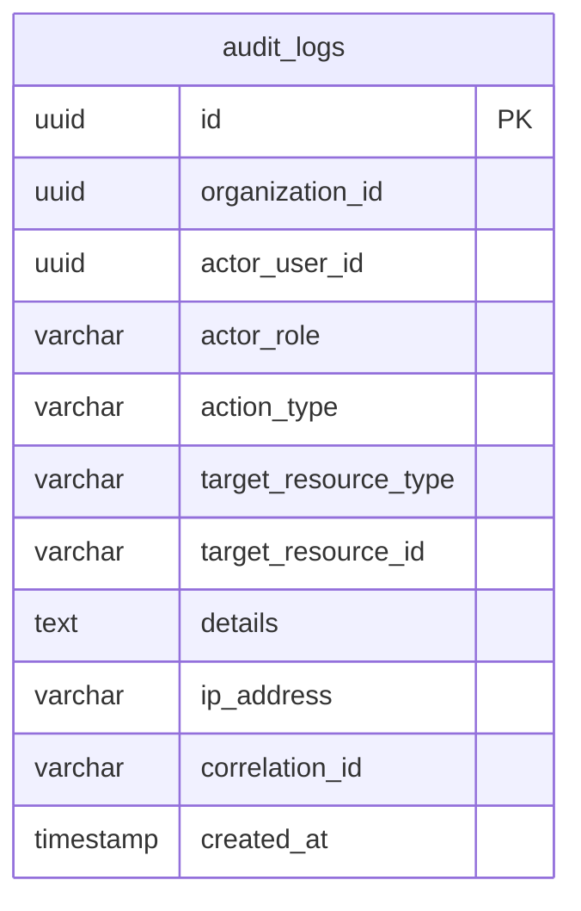

# Audit database reference

Database `audit_db`. See [conventions](conventions.md) and [Flyway migrations](../../services/audit-service/src/main/resources/db/migration).

## Invariants

- Audit writes append records, and the Gateway exposes read operations to authorized users.
- The current partial unique index deduplicates records by `(action_type, correlation_id)` when the correlation ID is present. Correlation IDs can be reused across action types.
- The [correlation migration](../../services/audit-service/src/main/resources/db/migration/V3__audit_correlation_idempotency.sql) replaces the ownership-transfer-only index with the current index.

## Tables

### `audit_logs`

| Column | PostgreSQL definition |
| --- | --- |
| `id` | `UUID PRIMARY KEY` |
| `organization_id` | `UUID` |
| `actor_user_id` | `UUID` |
| `actor_role` | `VARCHAR(50)` |
| `action_type` | `VARCHAR(100) NOT NULL` |
| `target_resource_type` | `VARCHAR(100)` |
| `target_resource_id` | `VARCHAR(255)` |
| `details` | `TEXT` |
| `ip_address` | `VARCHAR(100)` |
| `correlation_id` | `VARCHAR(100)` |
| `created_at` | `TIMESTAMP WITH TIME ZONE NOT NULL DEFAULT NOW()` |

```sql
CREATE INDEX idx_audit_logs_org_id ON audit_logs(organization_id);
CREATE INDEX idx_audit_logs_actor_id ON audit_logs(actor_user_id);
CREATE INDEX idx_audit_logs_action ON audit_logs(action_type);
CREATE INDEX idx_audit_logs_resource ON audit_logs(target_resource_type, target_resource_id);
CREATE INDEX idx_audit_logs_created_at ON audit_logs(created_at);
CREATE UNIQUE INDEX uq_audit_action_correlation ON audit_logs(action_type, correlation_id) WHERE correlation_id IS NOT NULL;
```

## Entity relationships



## Provided to other services

- The [Audit service](../../services/audit-service/README.md) describes internal audit writes and authorized reads.
