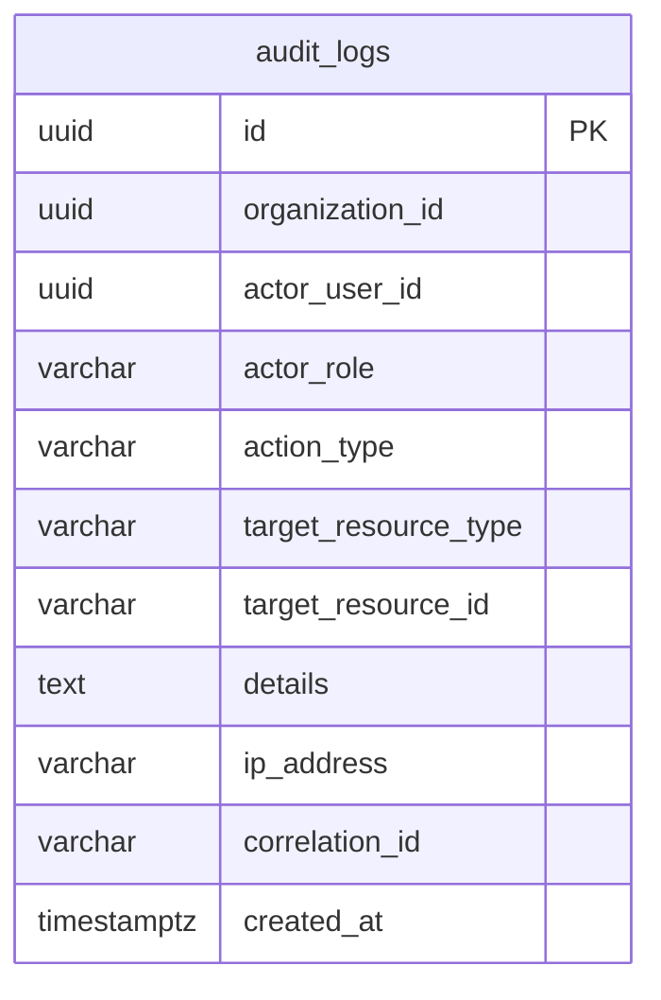

# Database: `audit_db`

## 1. Owner & Classification
* **Owning Service**: `audit-service`
* **Service Classification**: Supporting Service
* **Current Status**: IMPLEMENTED SUPPORTING-SERVICE DATABASE
* **Port / Runtime**: Port 8083 (Spring Boot 3.3.5 / Java 21)

---

## 2. Schema Sources & Verification Method
The documentation below reflects the actual database design verified against:
1. **Live PostgreSQL 16 Schema**: Verified via `information_schema` and `pg_catalog` on `audit_db`.
2. **Flyway Migration**: `V1__create_audit_logs_table.sql` located at `services/audit-service/src/main/resources/db/migration/`.
3. **JPA Entity Definitions**: `com.learnup.audit.entity.AuditLog`.

---

## 3. Migration Traceability

| Migration Version | Description | Creates / Modifies | Current Status |
|---|---|---|---|
| `V1__create_audit_logs_table.sql` | Durable Audit Logs Schema | Table: `audit_logs` Indexes & Constraints | Applied & Verified |

---

## 4. Tables Specification

### 4.1 Table: `audit_logs`
* **Purpose**: Durable append-only security and governance ledger recording administrative actions, user authentication events, course modifications, policy changes, and access attempts.

#### Columns:
| Column | SQL Type | Nullable | Default | Key | Notes / Application Mapping |
|---|---|---|---|---|---|
| `id` | `uuid` | `NOT NULL` | *None* | **PK** | Generated audit entry ID (`UUID.randomUUID()`) |
| `organization_id` | `uuid` | `YES` | *None* | | Tenant organization ID (null for system-level actions) |
| `actor_user_id` | `uuid` | `YES` | *None* | | Initiating user identifier (null for system automated tasks) |
| `actor_role` | `varchar(50)` | `YES` | *None* | | Authenticated role of the actor at time of event |
| `action_type` | `varchar(100)` | `NOT NULL` | *None* | | Canonical action verb (e.g., `USER_LOGIN`, `COURSE_CREATED`) |
| `target_resource_type` | `varchar(100)` | `YES` | *None* | | Type of affected entity (e.g., `COURSE`, `ORGANIZATION`, `USER`) |
| `target_resource_id` | `varchar(255)` | `YES` | *None* | | Identifier of affected entity |
| `details` | `text` | `YES` | *None* | | JSON or structured textual event context |
| `ip_address` | `varchar(100)` | `YES` | *None* | | Originating client IP address |
| `correlation_id` | `varchar(100)` | `YES` | *None* | | Distributed tracing correlation ID (`X-Correlation-ID`) |
| `created_at` | `timestamptz` | `NOT NULL` | `now()` | | Immutable creation timestamp (UTC) |

#### Constraints & Indexes:
* **Primary Key**: `audit_logs_pkey` on `(id)`
* **Indexes**:
  - `idx_audit_logs_org_id` on `(organization_id)` (B-Tree)
  - `idx_audit_logs_actor_id` on `(actor_user_id)` (B-Tree)
  - `idx_audit_logs_action` on `(action_type)` (B-Tree)
  - `idx_audit_logs_resource` on `(target_resource_type, target_resource_id)` (Composite B-Tree)
  - `idx_audit_logs_created_at` on `(created_at)` (B-Tree)

---

## 5. Relationships

* **Data Isolation**: `audit_logs` operates as an independent append-only ledger without foreign keys into other microservice databases.
* Scalar identifiers `actor_user_id`, `organization_id`, and `target_resource_id` decouple audit storage from operational schema lifecycles.

---

## 6. Immutability & Append-Only Enforcement
* **Application-Level Immutability**:
  - Immutability is strictly enforced in JPA entities using `@Column(updatable = false)` for `id` and `created_at`.
  - `AuditLogRepository` exposes exclusively `save()` and read query methods; no `delete` or `update` APIs exist.
  - `AuditLogController` and `AuditLogService` provide only `POST` (create) and `GET` (query/read) endpoints.
* **Database-Level Immutability**:
  - PostgreSQL table has no database-level triggers blocking direct SQL `UPDATE`/`DELETE`. Database access is restricted to the service application user.

---

## 7. Schema Observations & Notes
1. **Correlation Tracing**:
   - `correlation_id` allows audit trails to be correlated with API Gateway request logs.
2. **Resource Polymorphism**:
   - The pair `(target_resource_type, target_resource_id)` with composite index `idx_audit_logs_resource` supports polymorphic resource querying across all domains.
