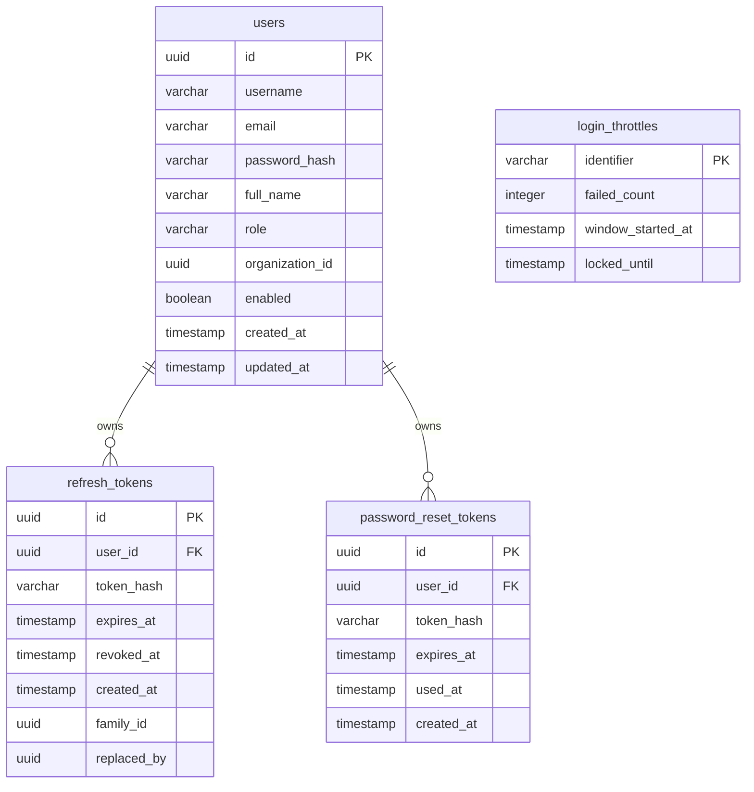

# Identity database reference

Database `identity_db`. See [conventions](conventions.md) and [Flyway migrations](../../services/identity-service/src/main/resources/db/migration).

## Invariants

- The credential ID is the canonical Tenant user ID. Credential email is nullable and remains unique when set, allowing release while retaining the credential record.
- Refresh and password-reset tokens are stored as hashes. Refresh token families and replacement IDs support rotation and family revocation.
- Login throttles keep attempts scoped to a credential lookup key rather than to an enrollment or an organization profile.

## Tables

### `users`

| Column | PostgreSQL definition |
| --- | --- |
| `id` | `UUID PRIMARY KEY` |
| `username` | `VARCHAR(50) NOT NULL UNIQUE` |
| `email` | `VARCHAR(100) UNIQUE` |
| `password_hash` | `VARCHAR(255) NOT NULL` |
| `full_name` | `VARCHAR(100)` |
| `role` | `VARCHAR(20) NOT NULL` |
| `organization_id` | `UUID` |
| `enabled` | `BOOLEAN NOT NULL DEFAULT TRUE` |
| `created_at` | `TIMESTAMP WITH TIME ZONE NOT NULL` |
| `updated_at` | `TIMESTAMP WITH TIME ZONE NOT NULL` |

```sql
CREATE INDEX idx_users_username ON users(username);
CREATE INDEX idx_users_email ON users(email);
CREATE INDEX idx_users_organization_id ON users(organization_id);
```

### `refresh_tokens`

| Column | PostgreSQL definition |
| --- | --- |
| `id` | `UUID PRIMARY KEY` |
| `user_id` | `UUID NOT NULL` |
| `token_hash` | `VARCHAR(255) NOT NULL UNIQUE` |
| `expires_at` | `TIMESTAMP WITH TIME ZONE NOT NULL` |
| `revoked_at` | `TIMESTAMP WITH TIME ZONE` |
| `created_at` | `TIMESTAMP WITH TIME ZONE NOT NULL` |
| `family_id` | `UUID NOT NULL` |
| `replaced_by` | `UUID` |

```sql
ALTER TABLE refresh_tokens ADD CONSTRAINT fk_refresh_tokens_user FOREIGN KEY (user_id) REFERENCES users(id) ON DELETE CASCADE;
CREATE INDEX idx_refresh_tokens_token_hash ON refresh_tokens(token_hash);
CREATE INDEX idx_refresh_tokens_user_id ON refresh_tokens(user_id);
CREATE INDEX idx_refresh_tokens_family_id ON refresh_tokens(family_id);
```

### `password_reset_tokens`

| Column | PostgreSQL definition |
| --- | --- |
| `id` | `UUID PRIMARY KEY` |
| `user_id` | `UUID NOT NULL` |
| `token_hash` | `VARCHAR(255) NOT NULL UNIQUE` |
| `expires_at` | `TIMESTAMP WITH TIME ZONE NOT NULL` |
| `used_at` | `TIMESTAMP WITH TIME ZONE` |
| `created_at` | `TIMESTAMP WITH TIME ZONE NOT NULL` |

```sql
ALTER TABLE password_reset_tokens ADD CONSTRAINT fk_password_reset_tokens_user FOREIGN KEY (user_id) REFERENCES users(id) ON DELETE CASCADE;
CREATE INDEX idx_password_reset_tokens_token_hash ON password_reset_tokens(token_hash);
CREATE INDEX idx_password_reset_tokens_user_id ON password_reset_tokens(user_id);
```

### `login_throttles`

| Column | PostgreSQL definition |
| --- | --- |
| `identifier` | `VARCHAR(254) PRIMARY KEY` |
| `failed_count` | `INTEGER NOT NULL` |
| `window_started_at` | `TIMESTAMP WITH TIME ZONE NOT NULL` |
| `locked_until` | `TIMESTAMP WITH TIME ZONE` |

## Entity relationships



## Provided to other services

- [Identity authentication](../../docs/architecture/security.md#downstream-authentication) covers bearer validation and internal provisioning.
