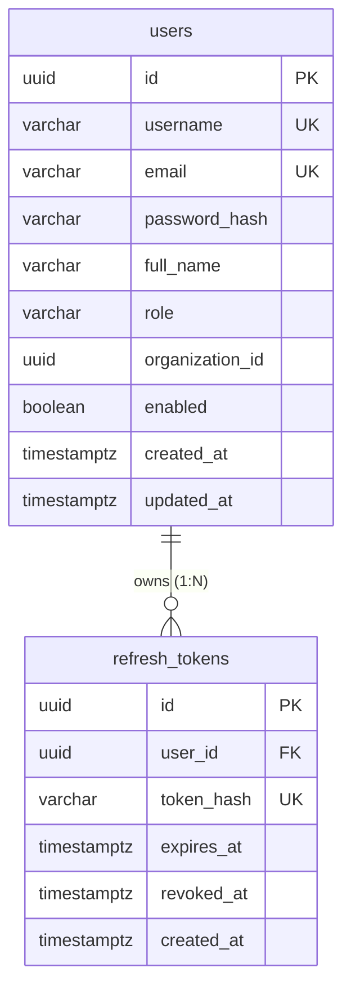

# Database: `identity_db`

## 1. Owner & Classification
* **Owning Service**: `identity-service`
* **Service Classification**: Supporting Service
* **Current Status**: IMPLEMENTED SUPPORTING-SERVICE DATABASE
* **Port / Runtime**: Port 8081 (Spring Boot 3.3.5 / Java 21)

---

## 2. Schema Sources & Verification Method
The documentation below reflects the actual database design verified against:
1. **Live PostgreSQL 16 Schema**: Verified via `information_schema` and `pg_catalog` on `identity_db`.
2. **Flyway Migration**: `V1__init_identity_schema.sql` located at `services/identity-service/src/main/resources/db/migration/`.
3. **JPA Entity Definitions**: `com.learnup.identity.domain.User` and `com.learnup.identity.domain.RefreshToken`.

---

## 3. Migration Traceability

| Migration Version | Description | Creates / Modifies | Current Status |
|---|---|---|---|
| `V1__init_identity_schema.sql` | Initial Identity Schema | Tables: `users`, `refresh_tokens` Indexes & Foreign Keys | Applied & Verified |

---

## 4. Tables Specification

### 4.1 Table: `users`
* **Purpose**: Stores user credentials, authentication attributes, assigned platform role, and organization association for JWT token issuance.

#### Columns:
| Column | SQL Type | Nullable | Default | Key | Notes / Application Mapping |
|---|---|---|---|---|---|
| `id` | `uuid` | `NOT NULL` | *None* | **PK** | Generated client/app-side (`UUID.randomUUID()`) |
| `username` | `varchar(50)` | `NOT NULL` | *None* | **UQ** | Unique login identifier (lowercase alphanumeric) |
| `email` | `varchar(100)` | `NOT NULL` | *None* | **UQ** | Unique user email address |
| `password_hash` | `varchar(255)` | `NOT NULL` | *None* | | BCrypt encrypted hash (`$2a$...`); never plaintext |
| `full_name` | `varchar(100)` | `YES` | *None* | | User display name |
| `role` | `varchar(20)` | `NOT NULL` | *None* | | Authenticated role (`ADMIN`, `ORGANIZER`, `INSTRUCTOR`, `LEARNER`) |
| `organization_id` | `uuid` | `YES` | *None* | | Logical tenant reference (nullable for platform ADMIN) |
| `enabled` | `boolean` | `NOT NULL` | `true` | | Account status flag (disabled accounts rejected at login) |
| `created_at` | `timestamptz` | `NOT NULL` | *None* | | Record creation timestamp (UTC) |
| `updated_at` | `timestamptz` | `NOT NULL` | *None* | | Record last update timestamp (UTC) |

#### Constraints & Indexes:
* **Primary Key**: `users_pkey` on `(id)`
* **Unique Constraints**:
  - `users_username_key` on `(username)`
  - `users_email_key` on `(email)`
* **Indexes**:
  - `idx_users_username` on `(username)` (B-Tree)
  - `idx_users_email` on `(email)` (B-Tree)
  - `idx_users_organization_id` on `(organization_id)` (B-Tree)

---

### 4.2 Table: `refresh_tokens`
* **Purpose**: Stores hashed refresh tokens for session prolongation and secure token rotation.

#### Columns:
| Column | SQL Type | Nullable | Default | Key | Notes / Application Mapping |
|---|---|---|---|---|---|
| `id` | `uuid` | `NOT NULL` | *None* | **PK** | Generated token record ID (`UUID.randomUUID()`) |
| `user_id` | `uuid` | `NOT NULL` | *None* | **FK** | Foreign key referencing `users(id)` |
| `token_hash` | `varchar(255)` | `NOT NULL` | *None* | **UQ** | SHA-256 hex hash of the raw refresh token |
| `expires_at` | `timestamptz` | `NOT NULL` | *None* | | Expiration timestamp (default: 7 days) |
| `revoked_at` | `timestamptz` | `YES` | *None* | | Revocation timestamp (set during rotation/logout) |
| `created_at` | `timestamptz` | `NOT NULL` | *None* | | Token creation timestamp (UTC) |

#### Constraints & Indexes:
* **Primary Key**: `refresh_tokens_pkey` on `(id)`
* **Foreign Key**: `fk_refresh_tokens_user` FOREIGN KEY (`user_id`) REFERENCES `users(id)` ON DELETE CASCADE
* **Unique Constraint**: `refresh_tokens_token_hash_key` on `(token_hash)`
* **Indexes**:
  - `idx_refresh_tokens_token_hash` on `(token_hash)` (B-Tree)
  - `idx_refresh_tokens_user_id` on `(user_id)` (B-Tree)

---

## 5. Relationships

* **`users` $\rightarrow$ `refresh_tokens`**: One-to-Many (`1:N`) enforced via database Foreign Key (`fk_refresh_tokens_user`) with `ON DELETE CASCADE`.

---

## 6. Schema Observations & Notes
1. **Future Tenant / User Ownership Migration**:
   * In the current implementation, `identity_db.users` acts as the authentication foundation and credential store.
   * According to the finalized architecture documents, canonical user/account master profiles and organization memberships will be mastered by `tenant-service` (`tenant_db`) once the NestJS team implements that service.
   * This migration is intentionally deferred to avoid dual-write instability during Phase 2.
2. **Security & Cryptographic Isolation**:
   * Raw passwords and raw refresh tokens are never persisted in plaintext.
   * Passwords use BCrypt hashing (`password_hash`).
   * Refresh tokens use SHA-256 hashing (`token_hash`) to enable secure server-side revocation and token rotation without storing sensitive secret material in plaintext.
