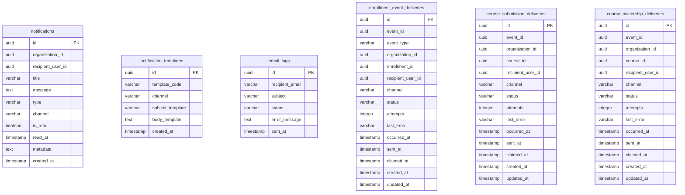

# Notification database reference

Database `notification_db`. See [conventions](conventions.md) and [Flyway migrations](../../services/notification-service/src/main/resources/db/migration).

## Invariants

- Delivery ledgers claim work before sending it. Their uniqueness constraints scope deduplication by event, recipient and channel.
- `enrollment_event_deliveries.enrollment_id` is nullable to support deliveries whose subject is a peer review rather than an enrollment.
- Course submission and ownership delivery have separate ledgers. In-app notices and email logs record their own channel-specific state.

## Tables

### `notifications`

| Column | PostgreSQL definition |
| --- | --- |
| `id` | `UUID PRIMARY KEY` |
| `organization_id` | `UUID` |
| `recipient_user_id` | `UUID NOT NULL` |
| `title` | `VARCHAR(255) NOT NULL` |
| `message` | `TEXT NOT NULL` |
| `type` | `VARCHAR(50) NOT NULL` |
| `channel` | `VARCHAR(50) NOT NULL DEFAULT 'IN_APP'` |
| `is_read` | `BOOLEAN NOT NULL DEFAULT FALSE` |
| `read_at` | `TIMESTAMP WITH TIME ZONE` |
| `metadata` | `TEXT` |
| `created_at` | `TIMESTAMP WITH TIME ZONE NOT NULL DEFAULT NOW()` |

```sql
CREATE INDEX idx_notifications_recipient ON notifications(recipient_user_id);
CREATE INDEX idx_notifications_org ON notifications(organization_id);
CREATE INDEX idx_notifications_is_read ON notifications(recipient_user_id, is_read);
CREATE INDEX idx_notifications_created_at ON notifications(created_at);
```

### `notification_templates`

| Column | PostgreSQL definition |
| --- | --- |
| `id` | `UUID PRIMARY KEY` |
| `template_code` | `VARCHAR(100) NOT NULL UNIQUE` |
| `channel` | `VARCHAR(50) NOT NULL` |
| `subject_template` | `VARCHAR(255)` |
| `body_template` | `TEXT NOT NULL` |
| `created_at` | `TIMESTAMP WITH TIME ZONE NOT NULL DEFAULT NOW()` |

### `email_logs`

| Column | PostgreSQL definition |
| --- | --- |
| `id` | `UUID PRIMARY KEY` |
| `recipient_email` | `VARCHAR(255) NOT NULL` |
| `subject` | `VARCHAR(255) NOT NULL` |
| `status` | `VARCHAR(50) NOT NULL` |
| `error_message` | `TEXT` |
| `sent_at` | `TIMESTAMP WITH TIME ZONE NOT NULL DEFAULT NOW()` |

```sql
CREATE INDEX idx_email_logs_recipient ON email_logs(recipient_email);
CREATE INDEX idx_email_logs_status ON email_logs(status);
CREATE INDEX idx_email_logs_sent_at ON email_logs(sent_at);
```

### `enrollment_event_deliveries`

| Column | PostgreSQL definition |
| --- | --- |
| `id` | `UUID PRIMARY KEY` |
| `event_id` | `UUID NOT NULL` |
| `event_type` | `VARCHAR(60) NOT NULL` |
| `organization_id` | `UUID NOT NULL` |
| `enrollment_id` | `UUID` |
| `recipient_user_id` | `UUID NOT NULL` |
| `channel` | `VARCHAR(20) NOT NULL` |
| `status` | `VARCHAR(20) NOT NULL` |
| `attempts` | `INTEGER NOT NULL DEFAULT 0` |
| `last_error` | `VARCHAR(100)` |
| `occurred_at` | `TIMESTAMP WITH TIME ZONE NOT NULL` |
| `sent_at` | `TIMESTAMP WITH TIME ZONE` |
| `claimed_at` | `TIMESTAMP WITH TIME ZONE` |
| `created_at` | `TIMESTAMP WITH TIME ZONE NOT NULL DEFAULT NOW()` |
| `updated_at` | `TIMESTAMP WITH TIME ZONE NOT NULL DEFAULT NOW()` |

```sql
ALTER TABLE enrollment_event_deliveries ADD CONSTRAINT uq_enrollment_event_delivery UNIQUE (event_id, recipient_user_id, channel);
ALTER TABLE enrollment_event_deliveries ADD CONSTRAINT ck_enrollment_event_delivery_status CHECK (status IN ('PENDING', 'PROCESSING', 'SENT', 'FAILED', 'SKIPPED'));
ALTER TABLE enrollment_event_deliveries ADD CONSTRAINT ck_enrollment_event_delivery_channel CHECK (channel IN ('EMAIL', 'IN_APP'));
ALTER TABLE enrollment_event_deliveries ADD CONSTRAINT ck_enrollment_event_delivery_attempts CHECK (attempts >= 0);
ALTER TABLE enrollment_event_deliveries ADD CONSTRAINT ck_enrollment_event_delivery_claim CHECK (status <> 'PROCESSING' OR claimed_at IS NOT NULL);
CREATE INDEX idx_enrollment_event_deliveries_enrollment ON enrollment_event_deliveries(enrollment_id);
CREATE INDEX idx_enrollment_event_deliveries_status ON enrollment_event_deliveries(status, created_at);
```

### `course_submission_deliveries`

| Column | PostgreSQL definition |
| --- | --- |
| `id` | `UUID PRIMARY KEY` |
| `event_id` | `UUID NOT NULL` |
| `organization_id` | `UUID NOT NULL` |
| `course_id` | `UUID NOT NULL` |
| `recipient_user_id` | `UUID NOT NULL` |
| `channel` | `VARCHAR(20) NOT NULL` |
| `status` | `VARCHAR(20) NOT NULL DEFAULT 'PENDING'` |
| `attempts` | `INTEGER NOT NULL DEFAULT 0` |
| `last_error` | `VARCHAR(100)` |
| `occurred_at` | `TIMESTAMP WITH TIME ZONE NOT NULL` |
| `sent_at` | `TIMESTAMP WITH TIME ZONE` |
| `claimed_at` | `TIMESTAMP WITH TIME ZONE` |
| `created_at` | `TIMESTAMP WITH TIME ZONE NOT NULL DEFAULT NOW()` |
| `updated_at` | `TIMESTAMP WITH TIME ZONE NOT NULL DEFAULT NOW()` |

```sql
ALTER TABLE course_submission_deliveries ADD CONSTRAINT uq_course_submission_delivery UNIQUE (event_id, recipient_user_id, channel);
ALTER TABLE course_submission_deliveries ADD CONSTRAINT ck_course_submission_channel CHECK (channel IN ('IN_APP', 'EMAIL'));
ALTER TABLE course_submission_deliveries ADD CONSTRAINT ck_course_submission_status CHECK (status IN ('PENDING', 'PROCESSING', 'SENT', 'FAILED', 'SKIPPED'));
ALTER TABLE course_submission_deliveries ADD CONSTRAINT ck_course_submission_claim CHECK (status <> 'PROCESSING' OR claimed_at IS NOT NULL);
ALTER TABLE course_submission_deliveries ADD CONSTRAINT ck_course_submission_attempts CHECK (attempts >= 0);
CREATE INDEX idx_course_submission_delivery_status ON course_submission_deliveries(status, created_at);
```

### `course_ownership_deliveries`

| Column | PostgreSQL definition |
| --- | --- |
| `id` | `UUID PRIMARY KEY` |
| `event_id` | `UUID NOT NULL` |
| `organization_id` | `UUID NOT NULL` |
| `course_id` | `UUID NOT NULL` |
| `recipient_user_id` | `UUID NOT NULL` |
| `channel` | `VARCHAR(20) NOT NULL` |
| `status` | `VARCHAR(20) NOT NULL DEFAULT 'PENDING'` |
| `attempts` | `INTEGER NOT NULL DEFAULT 0` |
| `last_error` | `VARCHAR(100)` |
| `occurred_at` | `TIMESTAMP WITH TIME ZONE NOT NULL` |
| `sent_at` | `TIMESTAMP WITH TIME ZONE` |
| `claimed_at` | `TIMESTAMP WITH TIME ZONE` |
| `created_at` | `TIMESTAMP WITH TIME ZONE NOT NULL DEFAULT NOW()` |
| `updated_at` | `TIMESTAMP WITH TIME ZONE NOT NULL DEFAULT NOW()` |

```sql
ALTER TABLE course_ownership_deliveries ADD CONSTRAINT uq_course_ownership_delivery UNIQUE (event_id, recipient_user_id, channel);
ALTER TABLE course_ownership_deliveries ADD CONSTRAINT ck_course_ownership_channel CHECK (channel IN ('IN_APP', 'EMAIL', 'AUDIT'));
ALTER TABLE course_ownership_deliveries ADD CONSTRAINT ck_course_ownership_status CHECK (status IN ('PENDING', 'PROCESSING', 'SENT', 'FAILED', 'SKIPPED'));
ALTER TABLE course_ownership_deliveries ADD CONSTRAINT ck_course_ownership_claim CHECK (status <> 'PROCESSING' OR claimed_at IS NOT NULL);
ALTER TABLE course_ownership_deliveries ADD CONSTRAINT ck_course_ownership_attempts CHECK (attempts >= 0);
CREATE INDEX idx_course_ownership_delivery_status ON course_ownership_deliveries(status, created_at);
```

## Entity relationships



## Provided to other services

- Refer to the [event catalog](../../contracts/events/README.md) for delivery streams and the [Notification service](../../services/notification-service/README.md) for service integration.
