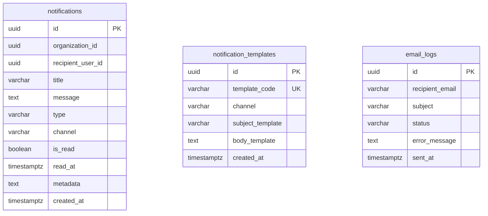

# Database: `notification_db`

## 1. Owner & Classification
* **Owning Service**: `notification-service`
* **Service Classification**: Supporting Service
* **Current Status**: IMPLEMENTED SUPPORTING-SERVICE DATABASE
* **Port / Runtime**: Port 8082 (Spring Boot 3.3.5 / Java 21)

---

## 2. Schema Sources & Verification Method
The documentation below reflects the actual database design verified against:
1. **Live PostgreSQL 16 Schema**: Verified via `information_schema` and `pg_catalog` on `notification_db`.
2. **Flyway Migration**: `V1__create_notifications_tables.sql` located at `services/notification-service/src/main/resources/db/migration/`.
3. **JPA Entity Definitions**:
   - `com.learnup.notification.entity.Notification`
   - `com.learnup.notification.entity.NotificationTemplate`
   - `com.learnup.notification.entity.EmailLog`

---

## 3. Migration Traceability

| Migration Version | Description | Creates / Modifies | Current Status |
|---|---|---|---|
| `V1__create_notifications_tables.sql` | Notifications & Email Delivery Schema | Tables: `notifications`, `notification_templates`, `email_logs` Indexes & Constraints | Applied & Verified |

---

## 4. Tables Specification

### 4.1 Table: `notifications`
* **Purpose**: Stores in-app notifications and alerts dispatched to learners, instructors, and organizers, tracking read/unread lifecycle states.

#### Columns:
| Column | SQL Type | Nullable | Default | Key | Notes / Application Mapping |
|---|---|---|---|---|---|
| `id` | `uuid` | `NOT NULL` | *None* | **PK** | Generated notification ID (`UUID.randomUUID()`) |
| `organization_id` | `uuid` | `YES` | *None* | | Logical tenant reference (nullable for platform-wide alerts) |
| `recipient_user_id` | `uuid` | `NOT NULL` | *None* | | Target recipient user identifier |
| `title` | `varchar(255)` | `NOT NULL` | *None* | | Notification title/headline |
| `message` | `text` | `NOT NULL` | *None* | | Full notification body content |
| `type` | `varchar(50)` | `NOT NULL` | *None* | | Category/type (e.g., `INFO`, `WARNING`, `SUCCESS`) |
| `channel` | `varchar(50)` | `NOT NULL` | `'IN_APP'` | | Delivery channel (default: `IN_APP`) |
| `is_read` | `boolean` | `NOT NULL` | `false` | | Read status flag (indexed for fast unread count queries) |
| `read_at` | `timestamptz` | `YES` | *None* | | Timestamp when marked as read |
| `metadata` | `text` | `YES` | *None* | | JSON-formatted contextual payload |
| `created_at` | `timestamptz` | `NOT NULL` | `now()` | | Creation timestamp (UTC) |

#### Constraints & Indexes:
* **Primary Key**: `notifications_pkey` on `(id)`
* **Indexes**:
  - `idx_notifications_recipient` on `(recipient_user_id)` (B-Tree)
  - `idx_notifications_org` on `(organization_id)` (B-Tree)
  - `idx_notifications_is_read` on `(recipient_user_id, is_read)` (Composite B-Tree)
  - `idx_notifications_created_at` on `(created_at)` (B-Tree)

---

### 4.2 Table: `notification_templates`
* **Purpose**: Stores reusable multi-channel notification and email templates with parameterized placeholders.

#### Columns:
| Column | SQL Type | Nullable | Default | Key | Notes / Application Mapping |
|---|---|---|---|---|---|
| `id` | `uuid` | `NOT NULL` | *None* | **PK** | Template identifier (`UUID.randomUUID()`) |
| `template_code` | `varchar(100)` | `NOT NULL` | *None* | **UQ** | Unique alphanumeric identifier code (e.g. `COURSE_ENROLLED`) |
| `channel` | `varchar(50)` | `NOT NULL` | *None* | | Target channel (`IN_APP`, `EMAIL`) |
| `subject_template` | `varchar(255)` | `YES` | *None* | | Parameterized subject line for emails |
| `body_template` | `text` | `NOT NULL` | *None* | | Parameterized message body template |
| `created_at` | `timestamptz` | `NOT NULL` | `now()` | | Creation timestamp (UTC) |

#### Constraints & Indexes:
* **Primary Key**: `notification_templates_pkey` on `(id)`
* **Unique Constraint**: `notification_templates_template_code_key` on `(template_code)`

---

### 4.3 Table: `email_logs`
* **Purpose**: Durable operational ledger recording transactional email dispatch attempts, recipient addresses, subjects, delivery statuses, and error traces.

#### Columns:
| Column | SQL Type | Nullable | Default | Key | Notes / Application Mapping |
|---|---|---|---|---|---|
| `id` | `uuid` | `NOT NULL` | *None* | **PK** | Generated log ID (`UUID.randomUUID()`) |
| `recipient_email` | `varchar(255)` | `NOT NULL` | *None* | | Target recipient email address |
| `subject` | `varchar(255)` | `NOT NULL` | *None* | | Dispatched email subject line |
| `status` | `varchar(50)` | `NOT NULL` | *None* | | Dispatch status (`SENT`, `FAILED`, `PENDING`) |
| `error_message` | `text` | `YES` | *None* | | Stack trace / error description if dispatch failed |
| `sent_at` | `timestamptz` | `NOT NULL` | `now()` | | Timestamp when email was dispatched (UTC) |

#### Constraints & Indexes:
* **Primary Key**: `email_logs_pkey` on `(id)`
* **Indexes**:
  - `idx_email_logs_recipient` on `(recipient_email)` (B-Tree)
  - `idx_email_logs_status` on `(status)` (B-Tree)
  - `idx_email_logs_sent_at` on `(sent_at)` (B-Tree)

---

## 5. Relationships

* **Data Isolation**: Tables inside `notification_db` operate autonomously without relational foreign keys across tables.
* Logical references to `recipient_user_id` and `organization_id` are scalar identifiers.

---

## 6. Schema Observations & Notes
1. **Consolidated Email Architecture**:
   * Physical email delivery logging is unified directly inside `notification_db.email_logs`.
   * The obsolete separate `email-service` application and database have been eliminated.
2. **Read Status Query Optimization**:
   * The composite index `idx_notifications_is_read (recipient_user_id, is_read)` provides fast filtering for unread notification count badge queries (`GET /api/notifications/unread-count`).
3. **Multi-Tenancy**:
   * Notifications support organization partitioning through `organization_id` and `idx_notifications_org`.
