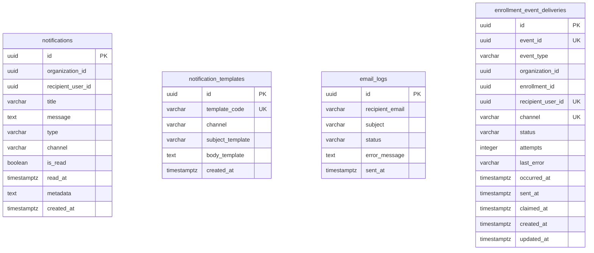

# Database: `notification_db`

## 1. Owner & Classification
* **Owning Service**: `notification-service`
* **Service Classification**: Supporting Service
* **Current Status**: IMPLEMENTED SUPPORTING-SERVICE DATABASE
* **Port / Runtime**: Port 8082 (Spring Boot 3.3.5 / Java 21)

---

## 2. Schema Sources & Verification Method
The documentation below reflects the actual database design verified against:
1. **Live PostgreSQL 16 Schema**: Verified via `information_schema` and `pg_catalog` on `notification_db`.
2. **Flyway Migrations**: `V1__create_notifications_tables.sql` and `V2__create_enrollment_event_deliveries.sql` located at `services/notification-service/src/main/resources/db/migration/`.
3. **JPA Entity Definitions**:
   - `com.learnup.notification.entity.Notification`
   - `com.learnup.notification.entity.NotificationTemplate`
   - `com.learnup.notification.entity.EmailLog`
   - `com.learnup.notification.entity.EnrollmentEventDelivery`

---

## 3. Migration Traceability

| Migration Version | Description | Creates / Modifies | Current Status |
|---|---|---|---|
| `V1__create_notifications_tables.sql` | Notifications & Email Delivery Schema | Tables: `notifications`, `notification_templates`, `email_logs` Indexes & Constraints | Applied & Verified |
| `V2__create_enrollment_event_deliveries.sql` | Ledger of the learning enrollment events the service has told people about | Table: `enrollment_event_deliveries` Unique key, CHECKs, indexes | Applied & Verified on PostgreSQL 16 (clean database, and over V1 with data) |

---

## 4. Tables Specification

### 4.1 Table: `notifications`
* **Purpose**: Stores in-app notifications and alerts dispatched to learners, instructors, and organizers, tracking read/unread lifecycle states.

#### Columns:
| Column | SQL Type | Nullable | Default | Key | Notes / Application Mapping |
|---|---|---|---|---|---|
| `id` | `uuid` | `NOT NULL` | *None* | **PK** | Generated notification ID (`UUID.randomUUID()`) |
| `organization_id` | `uuid` | `YES` | *None* | | Logical tenant reference (nullable for platform-wide alerts) |
| `recipient_user_id` | `uuid` | `NOT NULL` | *None* | | Target recipient user identifier |
| `title` | `varchar(255)` | `NOT NULL` | *None* | | Notification title/headline |
| `message` | `text` | `NOT NULL` | *None* | | Full notification body content |
| `type` | `varchar(50)` | `NOT NULL` | *None* | | Category/type (e.g., `INFO`, `WARNING`, `SUCCESS`) |
| `channel` | `varchar(50)` | `NOT NULL` | `'IN_APP'` | | Delivery channel (default: `IN_APP`) |
| `is_read` | `boolean` | `NOT NULL` | `false` | | Read status flag (indexed for fast unread count queries) |
| `read_at` | `timestamptz` | `YES` | *None* | | Timestamp when marked as read |
| `metadata` | `text` | `YES` | *None* | | JSON-formatted contextual payload |
| `created_at` | `timestamptz` | `NOT NULL` | `now()` | | Creation timestamp (UTC) |

#### Constraints & Indexes:
* **Primary Key**: `notifications_pkey` on `(id)`
* **Indexes**:
  - `idx_notifications_recipient` on `(recipient_user_id)` (B-Tree)
  - `idx_notifications_org` on `(organization_id)` (B-Tree)
  - `idx_notifications_is_read` on `(recipient_user_id, is_read)` (Composite B-Tree)
  - `idx_notifications_created_at` on `(created_at)` (B-Tree)

---

### 4.2 Table: `notification_templates`
* **Purpose**: Stores reusable multi-channel notification and email templates with parameterized placeholders.

#### Columns:
| Column | SQL Type | Nullable | Default | Key | Notes / Application Mapping |
|---|---|---|---|---|---|
| `id` | `uuid` | `NOT NULL` | *None* | **PK** | Template identifier (`UUID.randomUUID()`) |
| `template_code` | `varchar(100)` | `NOT NULL` | *None* | **UQ** | Unique alphanumeric identifier code (e.g. `COURSE_ENROLLED`) |
| `channel` | `varchar(50)` | `NOT NULL` | *None* | | Target channel (`IN_APP`, `EMAIL`) |
| `subject_template` | `varchar(255)` | `YES` | *None* | | Parameterized subject line for emails |
| `body_template` | `text` | `NOT NULL` | *None* | | Parameterized message body template |
| `created_at` | `timestamptz` | `NOT NULL` | `now()` | | Creation timestamp (UTC) |

#### Constraints & Indexes:
* **Primary Key**: `notification_templates_pkey` on `(id)`
* **Unique Constraint**: `notification_templates_template_code_key` on `(template_code)`

---

### 4.3 Table: `email_logs`
* **Purpose**: Durable operational ledger recording transactional email dispatch attempts, recipient addresses, subjects, delivery statuses, and error traces.

#### Columns:
| Column | SQL Type | Nullable | Default | Key | Notes / Application Mapping |
|---|---|---|---|---|---|
| `id` | `uuid` | `NOT NULL` | *None* | **PK** | Generated log ID (`UUID.randomUUID()`) |
| `recipient_email` | `varchar(255)` | `NOT NULL` | *None* | | Target recipient email address |
| `subject` | `varchar(255)` | `NOT NULL` | *None* | | Dispatched email subject line |
| `status` | `varchar(50)` | `NOT NULL` | *None* | | Dispatch status (`SENT`, `FAILED`, `PENDING`) |
| `error_message` | `text` | `YES` | *None* | | Stack trace / error description if dispatch failed |
| `sent_at` | `timestamptz` | `NOT NULL` | `now()` | | Timestamp when email was dispatched (UTC) |

#### Constraints & Indexes:
* **Primary Key**: `email_logs_pkey` on `(id)`
* **Indexes**:
  - `idx_email_logs_recipient` on `(recipient_email)` (B-Tree)
  - `idx_email_logs_status` on `(status)` (B-Tree)
  - `idx_email_logs_sent_at` on `(sent_at)` (B-Tree)

---

### 4.4 Table: `enrollment_event_deliveries`
* **Purpose**: One row for each thing the service owes to one person for one learning enrollment event (an e-mail, an in-app notice). It makes a repeated Kafka event harmless (delivery is at least once) and is how one handler takes ownership of a delivery before anything is sent. Filled by the consumer of `learnup.learning.enrollment-events`.

#### Columns:
| Column | SQL Type | Nullable | Default | Key | Notes / Application Mapping |
|---|---|---|---|---|---|
| `id` | `uuid` | `NOT NULL` | *None* | **PK** | Generated by the service (`UUID.randomUUID()`) |
| `event_id` | `uuid` | `NOT NULL` | *None* | **UQ** (part) | `eventId` of the envelope of the learning event |
| `event_type` | `varchar(60)` | `NOT NULL` | *None* | | Wire name of the event (e.g. `EnrollmentAssigned`) |
| `organization_id` | `uuid` | `NOT NULL` | *None* | | Logical tenant reference (no foreign key) |
| `enrollment_id` | `uuid` | `NOT NULL` | *None* | | Enrollment the event is about (logical reference to learning-service) |
| `recipient_user_id` | `uuid` | `NOT NULL` | *None* | **UQ** (part) | The Learner who is told |
| `channel` | `varchar(20)` | `NOT NULL` | *None* | **UQ** (part) | `EMAIL` or `IN_APP` |
| `status` | `varchar(20)` | `NOT NULL` | *None* | | `PENDING`, `PROCESSING`, `SENT`, `FAILED`, `SKIPPED` (`SENT` and `SKIPPED` are final) |
| `attempts` | `integer` | `NOT NULL` | `0` | | Number of times a handler claimed the row |
| `last_error` | `varchar(100)` | `YES` | *None* | | A fixed code (e.g. `TENANT_UNAVAILABLE`, `EMAIL_FAILED`, `INTERRUPTED`), never text from a payload or a broker |
| `occurred_at` | `timestamptz` | `NOT NULL` | *None* | | When the event happened (from the envelope) |
| `sent_at` | `timestamptz` | `YES` | *None* | | When the delivery was marked `SENT` |
| `claimed_at` | `timestamptz` | `YES` | *None* | | When the handler that owns the row (`PROCESSING`) claimed it; a claim older than the lease (`ENROLLMENT_EVENTS_CLAIM_LEASE`, default 2 minutes) can be taken over |
| `created_at` | `timestamptz` | `NOT NULL` | `now()` | | Creation timestamp (UTC) |
| `updated_at` | `timestamptz` | `NOT NULL` | `now()` | | Last change (UTC) |

#### Constraints & Indexes:
* **Primary Key**: `enrollment_event_deliveries_pkey` on `(id)`
* **Unique Constraint**: `uq_enrollment_event_delivery` on `(event_id, recipient_user_id, channel)`: the same event never produces the same message twice
* **Check Constraints**:
  - `ck_enrollment_event_delivery_status`: `status IN ('PENDING','PROCESSING','SENT','FAILED','SKIPPED')`
  - `ck_enrollment_event_delivery_channel`: `channel IN ('EMAIL','IN_APP')`
  - `ck_enrollment_event_delivery_attempts`: `attempts >= 0`
  - `ck_enrollment_event_delivery_claim`: `status <> 'PROCESSING' OR claimed_at IS NOT NULL`
* **Indexes**:
  - `idx_enrollment_event_deliveries_enrollment` on `(enrollment_id)` (B-Tree)
  - `idx_enrollment_event_deliveries_status` on `(status, created_at)` (Composite B-Tree)

**How a delivery is claimed**: before anything is looked up or sent, the handler locks the row (`SELECT ... FOR UPDATE`), checks that it is not final and not held by a younger claim, and sets `PROCESSING` with `claimed_at` and one more attempt, in one transaction. A second handler on the same event (two consumers during a rebalance, or one evicted while it still runs) waits for the lock, finds the row taken, and sends nothing. Every claimed row leaves `PROCESSING` before the handling returns; a row left there by a handler that died is retaken after the lease.

---

## 5. Relationships

* **Data Isolation**: Tables inside `notification_db` operate autonomously without relational foreign keys across tables.
* Logical references to `recipient_user_id` and `organization_id` are scalar identifiers.

---

## 6. Schema Observations & Notes
1. **Consolidated Email Architecture**:
   * Physical email delivery logging is unified directly inside `notification_db.email_logs`.
   * The obsolete separate `email-service` application and database have been eliminated.
2. **Read Status Query Optimization**:
   * The composite index `idx_notifications_is_read (recipient_user_id, is_read)` provides fast filtering for unread notification count badge queries (`GET /api/notifications/unread-count`).
3. **Multi-Tenancy**:
   * Notifications support organization partitioning through `organization_id` and `idx_notifications_org`.
4. **Enrollment event ledger**:
   * `enrollment_event_deliveries` is the duplicate guard of the Kafka consumer: its unique key keeps one row per event, person and channel, and `PROCESSING` + `claimed_at` give one handler ownership of a delivery. The in-app notice and the mark `SENT` of its row are written in one transaction. An e-mail cannot be part of a database transaction, so if the process stops between the SMTP server accepting a mail and the row saying `SENT`, that one mail may be sent twice (at-least-once, documented, no exactly-once claim).
   * A mail that is only simulated because mail is switched off (`SIMULATED`) counts as `SENT`; enabling SMTP later does not resend those.
