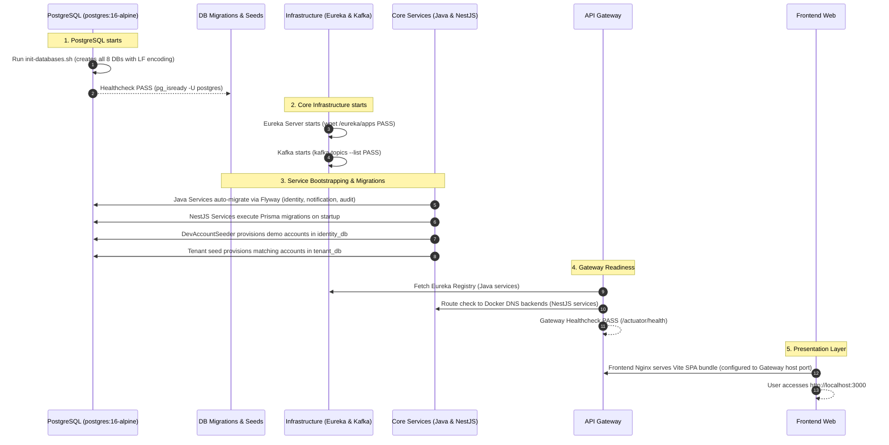

# LearnUP Platform — Comprehensive Docker Deployment Audit Report (Phase A)

**Document Version**: 1.0.0  
**Audit Date**: 2026-10-13  
**Status**: READ-ONLY AUDIT & PROPOSAL (Awaiting Phase B Approval)  
**Target Repository**: `huangdat/LearnUp` (`develop` branch)

---

## 1. Executive Summary & Document Verification

### 1.1 Objective
Audit the entire LearnUP repository to evaluate the technical feasibility and determine all prerequisites, conflicts, and required changes to enable full single-command container orchestration:
```bash
docker compose up --build
```
This audit strictly adheres to **Phase A (Read-only Audit & Proposal)**. No application code, Dockerfiles, compose files, schemas, or configurations have been modified.

### 1.2 Verification of Authoritative Architecture Documents
Per project constraints, the repository was inspected for the three specified reference documents:
* `LearnUP_Service_Architecture.docx` — **NOT PRESENT** in repository.
* `LearnUP_UseCase (1).docx` — **NOT PRESENT** in repository.
* `LearnUP_QuyTacNghiepVu (1).docx` — **NOT PRESENT** in repository.

**Actual Repository Architecture Documentation Found**:
* Architecture guides in `docs/architecture/`:
  * [`overview.md`](file:///d:/Study/learnup/docs/architecture/overview.md) (Architecture overview, port standards, communication matrix)
  * [`service-boundaries.md`](file:///d:/Study/learnup/docs/architecture/service-boundaries.md) (8-service domain ownership, anti-corruption rules)
  * [`database-ownership.md`](file:///d:/Study/learnup/docs/architecture/database-ownership.md) (Logical database-per-service topology)
  * [`event-driven.md`](file:///d:/Study/learnup/docs/architecture/event-driven.md) (Kafka event envelopes and naming conventions)
  * [`security.md`](file:///d:/Study/learnup/docs/architecture/security.md) (JWT authentication, internal header propagation)
  * [`service-discovery.md`](file:///d:/Study/learnup/docs/architecture/service-discovery.md) (Spring Cloud Gateway & Eureka specifications)
* Architectural Decision Records: [`docs/adr/0001-microservice-architecture.md`](file:///d:/Study/learnup/docs/adr/0001-microservice-architecture.md)
* Specification docs: `docs/assessment/UC19_Use_Case_Specification_2.11.docx`, `docs/diagrams/context/LearnUP_Context_Diagrams.docx`

### 1.3 Service & Database Boundary Compliance
* The system strictly comprises **8 application services** (5 business, 3 supporting) plus **5 infrastructure/platform components** (PostgreSQL, Kafka, Eureka Server, API Gateway, Frontend SPA).
* Standalone `media-service` and `email-service` remain strictly prohibited (media is handled via `@learnup/ts-storage` Cloudinary library; emails are handled by `notification-service`).
* **8 logical databases** are expected: `tenant_db`, `identity_db`, `course_db`, `learning_db`, `assessment_db`, `achievement_reporting_db`, `notification_db`, `audit_db`.

---

## 2. Current-State Service & Infrastructure Inventory

| Component | Category / Runtime | Dockerfile Status | Build Command (Native) | Container Entrypoint | Internal Port | Host Port (Configured) | Database | Dependencies | Health Check Endpoint | Status |
| :--- | :--- | :--- | :--- | :--- | :--- | :--- | :--- | :--- | :--- | :--- |
| **postgres** | Infrastructure / PostgreSQL 16 Alpine | Off-the-shelf image (`postgres:16-alpine`) | N/A | `docker-entrypoint.sh` | 5432 | 5432 | Hosts all 8 DBs | None | `pg_isready -U postgres` | **Requires Changes** (CRLF script issue; host port 5432 occupied) |
| **kafka** | Infrastructure / Confluent Kafka 7.6.0 (KRaft) | Off-the-shelf image (`confluentinc/cp-kafka:7.6.0`) | N/A | `/etc/confluent/docker/run` | 29092, 9092 | 9092, 29092 | None | None | `kafka-topics --bootstrap-server kafka:29092 --list` | **Ready** (Unused by services) |
| **eureka-server** | Infrastructure / Java 21, Spring Boot 3.3.5 | [`infrastructure/eureka-server/Dockerfile`](file:///d:/Study/learnup/infrastructure/eureka-server/Dockerfile) | `mvn clean package -DskipTests` | `java -jar app.jar` | 8761 | 8761 | None | None | `GET http://localhost:8761/eureka/apps` | **Ready** |
| **api-gateway** | Infrastructure / Java 21, Spring Cloud Gateway | [`gateway/api-gateway/Dockerfile`](file:///d:/Study/learnup/gateway/api-gateway/Dockerfile) | `mvn clean package -DskipTests` | `java -jar app.jar` | 8080 | 8080 | None | eureka-server | `GET /actuator/health` | **Requires Changes** (Build context lacks `java-common`; route mismatch; host port 8080 occupied) |
| **identity-service** | Supporting / Java 21, Spring Boot 3.3.5 | [`services/identity-service/Dockerfile`](file:///d:/Study/learnup/services/identity-service/Dockerfile) | `mvn clean package -DskipTests` | `java -jar app.jar` | 8081 | 8081 | `identity_db` | postgres, eureka-server | `GET /actuator/health` | **Requires Changes** (Build context lacks `java-common`) |
| **notification-service** | Supporting / Java 21, Spring Boot 3.3.5 | [`services/notification-service/Dockerfile`](file:///d:/Study/learnup/services/notification-service/Dockerfile) | `mvn clean package -DskipTests` | `java -jar app.jar` | 8082 | 8082 | `notification_db` | postgres, eureka-server | `GET /actuator/health` | **Requires Changes** (Build context lacks `java-common`) |
| **audit-service** | Supporting / Java 21, Spring Boot 3.3.5 | [`services/audit-service/Dockerfile`](file:///d:/Study/learnup/services/audit-service/Dockerfile) | `mvn clean package -DskipTests` | `java -jar app.jar` | 8083 | 8083 | `audit_db` | postgres, eureka-server | `GET /actuator/health` | **Requires Changes** (Build context lacks `java-common`; port 8083 collision) |
| **tenant-service** | Business / Node.js 22, NestJS 11, Prisma 7 | [`services/tenant-service/Dockerfile`](file:///d:/Study/learnup/services/tenant-service/Dockerfile) | `npm run build` | `node dist/src/main` | 8084 | 8084 | `tenant_db` | postgres, eureka-server | Missing explicit `/health` | **Requires Changes** (Missing `ts-storage` in Dockerfile; no Prisma migration on start) |
| **course-service** | Business / Node.js 22, NestJS 11, Prisma 7 | [`services/course-service/Dockerfile`](file:///d:/Study/learnup/services/course-service/Dockerfile) | `npm run build` | `node dist/src/main` | 8089 (compose) / 8083 (.env) | 8089 | `course_db` | postgres, eureka-server | Missing explicit `/health` | **Requires Changes** (Broken `ts-storage` copy; port mismatch; missing env vars) |
| **learning-service** | Business / Node.js 22, NestJS 11, Prisma 7 | [`services/learning-service/Dockerfile`](file:///d:/Study/learnup/services/learning-service/Dockerfile) | `npm run build` | `node dist/src/main` | 8085 | 8085 | `learning_db` | postgres, eureka-server | Missing explicit `/health` | **Requires Changes** (Missing required `COURSE_SERVICE_URL` env vars crashes startup) |
| **assessment-service** | Business / Node.js 22, NestJS 11, Prisma 7 | [`services/assessment-service/Dockerfile`](file:///d:/Study/learnup/services/assessment-service/Dockerfile) | `npm run build` | `node dist/src/main` | 8086 | 8086 | `assessment_db` | postgres, eureka-server | Missing explicit `/health` | **Requires Changes** (Missing `ts-storage` in Dockerfile; missing Cloudinary env vars) |
| **achievement-reporting-service** | Business / Node.js 22, NestJS 11, Prisma 7 | [`services/achievement-reporting-service/Dockerfile`](file:///d:/Study/learnup/services/achievement-reporting-service/Dockerfile) | `npm run build` | `node dist/main` | 8087 | 8087 | `achievement_reporting_db` | postgres, eureka-server | Missing explicit `/health` | **Requires Changes** (No migrations directory exists; no DB bootstrap) |
| **frontend** | Presentation / Node.js 22, React 19, Vite SPA | **MISSING** | `npm run build` | Web server (e.g. Nginx) | 3000 | 3000 | None | api-gateway | `GET /` | **Blocked** (Dockerfile missing; Vite env vars missing at build time) |

---

## 3. Confirmed Conflicts & Repository Evidence

### Conflict 1: Missing Frontend Dockerfile
* **Severity**: Blocker
* **Evidence**:
  * [`docker-compose.yml:330-334`](file:///d:/Study/learnup/docker-compose.yml#L330-L334) configures:
    ```yaml
    frontend:
      build:
        context: ./frontend
        dockerfile: Dockerfile
    ```
  * Verification on filesystem: `frontend/Dockerfile` does not exist (`Test-Path frontend/Dockerfile` returned `False`).
* **Impact**: `docker compose build` terminates with `failed to solve: failed to read dockerfile: open /frontend/Dockerfile: no such file or directory`.

---

### Conflict 2: Java Services Cannot Resolve `libraries/java-common` Dependency in Docker
* **Severity**: Blocker
* **Evidence**:
  * Four Java services depend on `com.learnup:java-common:1.0.0-SNAPSHOT`:
    * [`gateway/api-gateway/pom.xml:29-33`](file:///d:/Study/learnup/gateway/api-gateway/pom.xml#L29-L33)
    * [`services/identity-service/pom.xml:28-32`](file:///d:/Study/learnup/services/identity-service/pom.xml#L28-L32)
    * [`services/notification-service/pom.xml:29-33`](file:///d:/Study/learnup/services/notification-service/pom.xml#L29-L33)
    * [`services/audit-service/pom.xml:28-32`](file:///d:/Study/learnup/services/audit-service/pom.xml#L28-L32)
  * There is **no parent POM** at repository root. `java-common` is a local Maven library that is only installed to `~/.m2` if built on the host.
  * In `docker-compose.yml`, the build context for each Java service is set to its individual subdirectory:
    * Line 93: `context: ./gateway/api-gateway`
    * Line 123: `context: ./services/identity-service`
    * Line 154: `context: ./services/notification-service`
    * Line 190: `context: ./services/audit-service`
  * Their Dockerfiles run `mvn dependency:go-offline` and `mvn clean package`. Because Docker contexts cannot access files outside their directory (`../../libraries/java-common`), Maven cannot find `java-common:1.0.0-SNAPSHOT`.
* **Impact**: All four Java services fail during Docker build with `Could not resolve dependencies: Could not find artifact com.learnup:java-common:jar:1.0.0-SNAPSHOT in central`.

---

### Conflict 3: `course-service`, `tenant-service`, and `assessment-service` Dockerfiles Fail on Missing `libraries/ts-storage`
* **Severity**: Blocker
* **Evidence**:
  * In [`services/course-service/Dockerfile:13-16`](file:///d:/Study/learnup/services/course-service/Dockerfile#L13-L16):
    ```dockerfile
    # Build ts-storage
    WORKDIR /app/libraries/ts-storage
    RUN npm ci
    RUN npm run build
    ```
    However, lines 5-6 only execute `COPY libraries/ts-common ./libraries/ts-common`. The directory `libraries/ts-storage` is never copied! When line 14 runs `WORKDIR /app/libraries/ts-storage && RUN npm ci`, `/app/libraries/ts-storage` does not exist or lacks `package.json`.
  * In [`services/tenant-service/package.json:20`](file:///d:/Study/learnup/services/tenant-service/package.json#L20) and [`services/assessment-service/package.json:23`](file:///d:/Study/learnup/services/assessment-service/package.json#L23):
    Both declare `"@learnup/ts-storage": "file:../../libraries/ts-storage"`.
    Their respective Dockerfiles (`services/tenant-service/Dockerfile` and `services/assessment-service/Dockerfile`) copy only `libraries/ts-common` before running `npm install`.
* **Impact**: `npm install` and `npm ci` fail during build with `ENOENT: no such file or directory, open '/app/libraries/ts-storage/package.json'`.

---

### Conflict 4: Service Discovery Architecture Mismatch (Eureka `lb://` vs. NestJS Services)
* **Severity**: Critical Architecture Mismatch
* **Evidence**:
  * In [`gateway/api-gateway/src/main/resources/application.yml:12-60`](file:///d:/Study/learnup/gateway/api-gateway/src/main/resources/application.yml#L12-L60), all routes use Eureka dynamic load-balancing URIs:
    * `uri: lb://TENANT-SERVICE`
    * `uri: lb://COURSE-SERVICE`
    * `uri: lb://LEARNING-SERVICE`
    * `uri: lb://ASSESSMENT-SERVICE`
    * `uri: lb://ACHIEVEMENT-REPORTING-SERVICE`
  * In `docker-compose.yml`, environment variables `EUREKA_SERVER_URL: http://eureka-server:8761/eureka/`, `SERVICE_NAME`, `SERVICE_HOST` are passed to all 5 NestJS services.
  * **However**: None of the 5 NestJS services read or use these environment variables. There is no Eureka client (`eureka-js-client` or similar) in `libraries/ts-common` or any NestJS service.
  * Code evidence in [`services/tenant-service/src/common/middleware/dev-fake-auth.middleware.ts:7`](file:///d:/Study/learnup/services/tenant-service/src/common/middleware/dev-fake-auth.middleware.ts#L7):
    `"3. Gateway route bằng lb://TENANT-SERVICE (Eureka), nhưng tenant-service chưa đăng ký Eureka."`
* **Impact**: When requests hit API Gateway for any business service, Spring Cloud Gateway queries Eureka for registered instances. Because no instances exist, Gateway returns **`503 Service Unavailable`** (`Unable to find instance for <SERVICE_NAME>`).

---

### Conflict 5: API Gateway Route Predicate & Path Mismatches
* **Severity**: Functional Blocker
* **Evidence**:
  1. **Tenant Service**:
     * Gateway predicates ([`application.yml:35`](file:///d:/Study/learnup/gateway/api-gateway/src/main/resources/application.yml#L35)): `Path=/api/v1/users/**, /api/v1/organizations/**, /api/v1/subscriptions/**, /api/v1/payments/**`
     * Tenant Service controllers:
       * [`SubscriptionPlansController`](file:///d:/Study/learnup/services/tenant-service/src/modules/subscription-plans/subscription-plans.controller.ts#L7): mounted at `@Controller('subscription-plans')` -> `/api/v1/subscription-plans`. Does not match `/api/v1/subscriptions/**`.
       * [`RegistrationsController`](file:///d:/Study/learnup/services/tenant-service/src/modules/registrations/registrations.controller.ts): mounted at `@Controller('registrations')` -> `/api/v1/registrations/**`. Not configured in Gateway!
       * [`InvitationsController`](file:///d:/Study/learnup/services/tenant-service/src/modules/invitations/invitations.controller.ts): mounted at `@Controller('invitations')` -> `/api/v1/invitations/**`. Not configured in Gateway!
  2. **Learning Service**:
     * Gateway predicates ([`application.yml:47`](file:///d:/Study/learnup/gateway/api-gateway/src/main/resources/application.yml#L47)): `Path=/api/v1/learning/**, /api/learning/**`
     * Learning Service controllers:
       * [`EnrollmentsController`](file:///d:/Study/learnup/services/learning-service/src/modules/enrollments/enrollments.controller.ts#L17): mounted at `@Controller('enrollments')` -> `/api/v1/enrollments/**`.
       * Frontend API client ([`frontend/src/services/api.client.ts:12-18`](file:///d:/Study/learnup/frontend/src/services/api.client.ts#L12-L18)) issues requests directly to `/api/v1/enrollments`, `/api/v1/enrollments/me`, `/api/v1/enrollments/me/course-ids`.
     * Does not match `/api/v1/learning/**`.
* **Impact**: Frontend calls to guest subscription plans, registration, invitations, and learner enrollments receive **`404 Not Found`** from API Gateway.

---

### Conflict 6: Public Endpoints Blocked by Gateway JWT Authentication Filter
* **Severity**: Functional Blocker
* **Evidence**:
  * [`gateway/api-gateway/src/main/resources/application.yml:73-84`](file:///d:/Study/learnup/gateway/api-gateway/src/main/resources/application.yml#L73-L84) defines `jwt.whitelist`:
    ```yaml
    whitelist:
      - /api/v1/auth/login
      - /api/v1/auth/register
      - /api/v1/auth/refresh
      - /api/v1/certificates/verify/**
      - /actuator/health
      - /fallback/**
    ```
  * Public endpoints needed by guests without tokens:
    * `GET /api/v1/subscription-plans` (UC01 - Landing page plan list)
    * `POST /api/v1/registrations` (UC02 - Org self-registration)
    * `POST /api/v1/registrations/pay` (UC02.1 - Mock payment)
    * `POST /api/v1/registrations/verify-otp` (UC03 - Email OTP verification)
    * `GET /api/v1/invitations/info` (UC04 / UC12 - Invitation verification)
    * `POST /api/v1/invitations/accept` (UC04 - Accept invitation)
  * None of these public endpoints are listed in `jwt.whitelist`.
* **Impact**: Unauthenticated guests accessing the landing page or registration flow are immediately rejected with **`401 Unauthorized`** (`Missing or malformed Authorization header`) by `JwtAuthenticationFilter`.

---

### Conflict 7: Port Collisions & Inter-Service Port Inconsistencies
* **Severity**: Runtime Crash
* **Evidence**:
  1. **Host Port Collisions**:
     * Host port `8080` is currently bound to PID 3756 (`httpd` - Apache / PostgreSQL admin server).
     * Host port `5432` is currently bound to PID 8976 (Host `postgres.exe`).
     * Docker Compose attempting to bind `"8080:8080"` and `"5432:5432"` fails with `bind: address already in use`.
  2. **Audit Service vs. Course Service Port 8083 Collision**:
     * In `docker-compose.yml:194`, `audit-service` maps host port `8083:8083`.
     * In `services/course-service/.env.example:1`, course-service is documented to run on `PORT=8083`.
     * In `docker-compose.yml:224-226`, course-service is mapped to `8089:8089` with `PORT: 8089`.
     * In `docker-compose.yml:292`, `assessment-service` is configured with:
       `COURSE_SERVICE_URL: http://course-service:8083`.
       Because `course-service` container listens on `8089`, calls from `assessment-service` to `course-service:8083` fail with `ECONNREFUSED`.
     * In `services/learning-service/.env.example:6`, `COURSE_SERVICE_URL=http://localhost:8083`.

---

### Conflict 8: Missing Mandatory Environment Variables Crashing Services on Startup
* **Severity**: Runtime Crash
* **Evidence**:
  1. **Learning Service**:
     * [`services/learning-service/src/infrastructure/clients/course/course-service.config.ts:18-29`](file:///d:/Study/learnup/services/learning-service/src/infrastructure/clients/course/course-service.config.ts#L18-L29):
       Throws error during bootstrap if `COURSE_SERVICE_URL` or `COURSE_SERVICE_TIMEOUT_MS` are missing.
     * `docker-compose.yml:268-275` provides neither variable.
  2. **Course Service & Assessment Service (Cloudinary Storage)**:
     * [`services/course-service/src/infrastructure/storage/storage.provider.ts:6-8`](file:///d:/Study/learnup/services/course-service/src/infrastructure/storage/storage.provider.ts#L6-L8) and `services/assessment-service`:
       Both use `configService.getOrThrow('CLOUDINARY_CLOUD_NAME')`, `CLOUDINARY_API_KEY`, `CLOUDINARY_API_SECRET` during NestJS module instantiation (`StorageModule`).
     * `docker-compose.yml` does not provide them, causing an unhandled fatal bootstrap crash.

---

### Conflict 9: Frontend Vite Build-Time Environment Variable Rejection
* **Severity**: Build / Runtime Crash
* **Evidence**:
  * [`frontend/src/config/env.ts:19-25`](file:///d:/Study/learnup/frontend/src/config/env.ts#L19-L25):
    ```typescript
    const missing = services.filter((service) => !rawBackendUrls[service]?.trim());
    if (missing.length > 0) {
      throw new Error(`[env] Thiếu biến môi trường: ${missing.map(...).join(", ")}`);
    }
    ```
    Mandatory variables: `VITE_TENANT_BACKEND_URL`, `VITE_COURSE_BACKEND_URL`, `VITE_ASSESSMENT_BACKEND_URL`, plus `VITE_BACKEND_URL` in [`api.client.ts`](file:///d:/Study/learnup/frontend/src/services/api.client.ts#L25).
  * In `docker-compose.yml:338`, the only environment variable set is `VITE_API_GATEWAY_URL: http://localhost:8080`, which Vite ignores because it does not match Vite's baked client variables and is passed at container runtime rather than `docker build` time.
* **Impact**: The React application throws an immediate uncaught JavaScript exception in the browser and fails to render.

---

### Conflict 10: PostgreSQL Init Script CRLF & Shell Interpreter in Alpine
* **Severity**: Container Initialization Failure
* **Evidence**:
  * [`infrastructure/postgres/init-databases.sh`](file:///d:/Study/learnup/infrastructure/postgres/init-databases.sh#L1):
    Begins with `#!/bin/bash` and contains Windows CRLF line endings (`\r\n`).
  * `postgres:16-alpine` uses BusyBox `ash`/`sh` and lacks `/bin/bash` unless explicitly installed.
* **Impact**: Executing `/docker-entrypoint-initdb.d/init-databases.sh` fails with `/bin/bash^M: bad interpreter: No such file or directory`. The 8 databases are never created.

---

### Conflict 11: NestJS Database Migration Lifecycle Missing
* **Severity**: Runtime Data Failure
* **Evidence**:
  * Java services (`identity-service`, `notification-service`, `audit-service`) automatically execute Flyway migrations on startup (`spring.flyway.enabled: true`).
  * NestJS services (`tenant-service`, `course-service`, `learning-service`, `assessment-service`) rely on Prisma.
  * In their Dockerfiles, runner containers execute only `CMD ["node", "dist/src/main"]`. There is no command running `prisma migrate deploy`.
  * `npm install --omit=dev` in runner containers strips `devDependencies`, removing the `prisma` CLI tool itself.
  * For `services/achievement-reporting-service`: There is a `prisma/schema.prisma` file, but **no `prisma/migrations` directory exists at all**.
* **Impact**: On a fresh Docker PostgreSQL instance, the NestJS databases remain empty, and services crash on first query with `relation "..." does not exist`.

---

### Conflict 12: Git Conflict Marker in `tenant-service/.env.example`
* **Severity**: Minor / Repository Hygiene
* **Evidence**:
  * [`services/tenant-service/.env.example:24`](file:///d:/Study/learnup/services/tenant-service/.env.example#L24) contains an unresolved git conflict line:
    `>>>>>>> 18eca2dafabf83ab77ca2bdaf8d3217d489c65b2`.

---

### Conflict 13: Kafka Infrastructure Declared but Unused by Application Code
* **Severity**: Architectural Observation / Limitation
* **Evidence**:
  * Kafka broker is provisioned in `docker-compose.yml:30-61` with healthcheck.
  * Architecture specifications in `docs/architecture/event-driven.md` define Kafka event envelopes and topic conventions (`learnup.<domain>.<event-type>`).
  * Inspection of all 8 application services:
    * Zero `spring-kafka` dependencies in Maven POMs.
    * Zero `kafkajs` dependencies in NestJS `package.json` manifests.
    * No Kafka consumers or producers are currently implemented in application code.
* **Impact**: Kafka is purely an idle infrastructure container. Starting it consumes memory/CPU but does not block application HTTP flows.

---

## 4. Key Architectural Decisions Requiring Approval

### 4.1 Decision 1: Service Discovery Strategy for NestJS Services
**Problem**: Spring Cloud Gateway routes all services via Eureka `lb://...`. The 3 Java services register with Eureka, but the 5 NestJS services do not and have no Eureka client code.

| Option | Approach | Pros | Cons | Recommendation |
| :--- | :--- | :--- | :--- | :--- |
| **Option A** | Add Eureka Client library to all 5 NestJS services | Preserves 100% Eureka routing via `lb://...` in Gateway | `eureka-js-client` is unmaintained, fragile on Node 20+, adds heartbeat polling and connection failure risks to every Node service | Not recommended |
| **Option B (Recommended)** | **Configure Docker DNS routing in API Gateway for NestJS services** | **Zero changes to NestJS codebase**; leverages native Docker Compose DNS (`http://tenant-service:8084`, etc.); rock-solid reliability; fast routing without registry lag; keeps Java services on Eureka `lb://` | Gateway routes differ between Java services (`lb://`) and NestJS services (`http://`) | **RECOMMENDED** |
| **Option C** | Replace Gateway dynamic discovery with Spring Cloud DiscoveryClient static registry | Keeps Spring configuration centralized | Excessive XML/YAML boilerplate in Gateway without runtime benefit | Not recommended |

---

### 4.2 Decision 2: API Gateway Host Port Assignment
* **Problem**: Host port `8080` is occupied on the developer's Windows workstation by `httpd` (PID 3756).
* **Options**:
  * **Option 2A (Recommended)**: Map API Gateway to host port **`8088:8080`** (e.g. `http://localhost:8088`). Frontend connects to `http://localhost:8088`.
  * **Option 2B**: Require developer to terminate host process PID 3756 and keep `8080:8080`.

---

### 4.3 Decision 3: PostgreSQL Host Port Exposure
* **Problem**: Host port `5432` is occupied on the developer's Windows workstation by local PostgreSQL (PID 8976).
* **Options**:
  * **Option 3A (Recommended)**: Map container postgres to host port **`5433:5432`** (`5433:5432`). Internal container-to-container network remains `postgres:5432`. Developers can still inspect the database using DBeaver/pgAdmin at `localhost:5433`.
  * **Option 3B**: Do not expose PostgreSQL port to host at all (`expose: - 5432`).
  * **Option 3C**: Require developer to stop the local Windows PostgreSQL service.

---

### 4.4 Decision 4: Course Service Internal Port Standardization
* **Problem**:
  * `services/course-service/.env.example` uses `PORT=8083`.
  * `docker-compose.yml` maps `course-service` to `8089:8089`, while `audit-service` uses `8083`.
  * `assessment-service` inside `docker-compose.yml` hardcodes `COURSE_SERVICE_URL: http://course-service:8083`.
* **Options**:
  * **Option 4A (Recommended)**: Standardize `course-service` container internal port to **`8083`** (or `8089`), align `PORT`, and update `COURSE_SERVICE_URL: http://course-service:8083` across all services. Audit service keeps internal port `8083` since each container has its own private IP/hostname in Docker network `learnup-network`! Container ports do NOT conflict with each other inside Docker (only host port mappings do).

---

### 4.5 Decision 5: Prisma Migration Execution Strategy in Docker
* **Problem**: NestJS containers need tables before their NestJS application process starts.
* **Options**:
  * **Option 5A (Recommended)**: Include `prisma` CLI in the runner image and use a container entrypoint script (`docker-entrypoint.sh`):
    `npx prisma migrate deploy && node dist/src/main`
    For `achievement-reporting-service`, run `npx prisma db push`.
  * **Option 5B**: Create a dedicated one-shot `migration-runner` container in `docker-compose.yml` that runs before application services start.

---

### 4.6 Decision 6: API Gateway Route & Whitelist Alignment
* **Proposal**:
  1. Add missing routes to `gateway/api-gateway/src/main/resources/application.yml`:
     * Tenant: `/api/v1/subscription-plans/**`, `/api/v1/registrations/**`, `/api/v1/invitations/**`
     * Learning: `/api/v1/enrollments/**`
  2. Add public endpoints to `jwt.whitelist`:
     * `/api/v1/subscription-plans/**`
     * `/api/v1/registrations/**`
     * `/api/v1/invitations/**`

---

### 4.7 Decision 7: Cloudinary Credentials & Mock Fallback
* **Problem**: `course-service` and `assessment-service` crash if `CLOUDINARY_*` environment variables are missing.
* **Proposal**: Supply safe development mock placeholders (`dev_cloud`, `dev_key`, `dev_secret`) in `docker-compose.yml` and `.env.example`. File upload attempts will fail gracefully at the Cloudinary API boundary, but services start up and all non-upload use cases function completely.

---

## 5. Proposed Docker Compose Topology

```
+---------------------------------------------------------------------------------------+
|                                    HOST MACHINE                                       |
|                                                                                       |
|   Browser: http://localhost:3000 (Frontend)                                           |
|   Gateway API: http://localhost:8088 (Host Exposure)                                  |
|   PostgreSQL Admin: http://localhost:5433 (Optional Host DB Inspection)              |
+---------------------------------------------------------------------------------------+
                                            |
                                            v
+---------------------------------------------------------------------------------------+
|                              DOCKER NETWORK: learnup-network                          |
|                                                                                       |
|  +--------------------+                                                               |
|  |     frontend       | (Port 3000 -> Host 3000, Nginx SPA Reverse Proxy)             |
|  +--------------------+                                                               |
|            |                                                                          |
|            v (REST via Host URL: http://localhost:8088)                               |
|  +--------------------+                                                               |
|  |    api-gateway     | (Port 8080 -> Host 8088)                                      |
|  +--------------------+                                                               |
|       |           |                                                                   |
|   (lb:// via      | (Docker DNS direct HTTP)                                          |
|    Eureka)        |                                                                   |
|       |           +-------------------+--------------------+------------------+       |
|       v                               v                    v                  v       |
|  +------------------+         +----------------+   +---------------+   +------------+ |
|  | identity-service | (8081)  | tenant-service |   | course-service|   | learning-  | |
|  +------------------+         | (8084)         |   | (8083)        |   | service    | |
|  +------------------+         +----------------+   +---------------+   | (8085)     | |
|  | notification-svc | (8082)          |                    |           +------------+ |
|  +------------------+                 |                    |                  |       |
|  +------------------+                 |                    v                  |       |
|  | audit-service    | (8083)          |            +----------------+         |       |
|  +------------------+                 |            | assessment-svc | (8086)  |       |
|                                       |            +----------------+         |       |
|                                       v                    |                  |       |
|                               +---------------------------------------+       |       |
|                               | achievement-reporting-service (8087)  |       |       |
|                               +---------------------------------------+       |       |
|                                                                               |       |
|  +------------------------------------------------------------------------+   |       |
|  | eureka-server (8761 -> Host 8761)                                      |   |       |
|  +------------------------------------------------------------------------+   |       |
|                                                                               |       |
|  +------------------------------------------------------------------------+   |       |
|  | kafka (KRaft 29092 internal, 9092 host)                                |   |       |
|  +------------------------------------------------------------------------+   |       |
|                                                                               |       |
|  +------------------------------------------------------------------------+   |       |
|  | postgres (5432 internal -> Host 5433)                                  |   |       |
|  | [identity_db, tenant_db, course_db, learning_db,                       |   |       |
|  |  assessment_db, achievement_reporting_db, notification_db, audit_db]   |   |       |
|  +------------------------------------------------------------------------+   |       |
+---------------------------------------------------------------------------------------+
```

---

## 6. Proposed Migration & Safe Initialization Sequence

To guarantee deterministic, zero-race-condition startup without arbitrary sleeps:



---

## 7. Demo Account Seeding Safety Policy

### 7.1 Principles
1. **Opt-in Development Only**:
   * Controlled via `SPRING_PROFILES_ACTIVE=docker` (or `dev`) and `learnup.seed.enabled=${LEARNUP_SEED_ENABLED:true}`.
   * `DevAccountSeeder` in `identity-service` has `@Profile("!prod")` preventing execution in production.
2. **Idempotent Upsert**:
   * No `TRUNCATE` or `DELETE` on existing tenant data.
   * Both `DevAccountSeeder.java` and `infrastructure/postgres/seed-dev-accounts.sql` use `ON CONFLICT (id) DO UPDATE`.
3. **Cross-Database ID Synchronization**:
   * All demo accounts across `identity_db` and `tenant_db` share identical UUIDs:
     * **ADMIN**: `01900000-0000-7000-8000-000000000001` (`admin@learnup.local` / `LearnUp@123`)
     * **ORGANIZER**: `01900000-0000-7000-8000-00000000a010` (`organizer@learnup.local` / `LearnUp@123`, Org ABC: `01900000-0000-7000-8000-00000000a001`)
     * **INSTRUCTOR**: `01900000-0000-7000-8000-00000000a101` (`instructor@learnup.local` / `LearnUp@123`)
     * **LEARNER**: `01900000-0000-7000-8000-00000000a201` (`learner@learnup.local` / `LearnUp@123`)
4. **Password Security**:
   * BCrypt password hash: `$2a$10$qm9TrdFvzmpY5k/R9oi6gui0Kv6IPRhiyuyZTdeW4EPaZ1.tSeltO`.
   * Never stored in plain text.

---

## 8. Environment Variable Matrix

| Variable Name | Component | Default Development Value | Sensitive? | Purpose |
| :--- | :--- | :--- | :--- | :--- |
| `DB_USERNAME` | Platform / Compose | `postgres` | No | PostgreSQL master user |
| `DB_PASSWORD` | Platform / Compose | `postgres` | Dev only | PostgreSQL master password |
| `POSTGRES_PORT` | Platform / Host | `5433` | No | Host port for PostgreSQL |
| `GATEWAY_HOST_PORT` | Gateway / Host | `8088` | No | Host port for API Gateway |
| `JWT_SECRET` | Gateway, Identity | `devSecretKeyForLearnUpPlatformMustBeAtLeast32BytesLong` | Dev only | HMAC-SHA256 signing secret for JWT |
| `INTERNAL_GATEWAY_KEY` | Gateway | `learnup-internal-secret` | Dev only | Internal header `x-internal-key` |
| `INTERNAL_SERVICE_KEY` | All 5 NestJS services | `learnup-internal-secret` | Dev only | Verified by `InternalAuthGuard` |
| `EUREKA_CLIENT_SERVICEURL_DEFAULTZONE` | Java services | `http://eureka-server:8761/eureka/` | No | Eureka discovery URL |
| `LEARNUP_MAIL_ENABLED` | Notification | `false` | No | Disable physical SMTP in dev |
| `SPRING_MAIL_HOST` | Notification | `smtp.gmail.com` | No | SMTP host |
| `SPRING_MAIL_PORT` | Notification | `587` | No | SMTP port |
| `SPRING_MAIL_USERNAME` | Notification | `""` | Dev only | SMTP username |
| `SPRING_MAIL_PASSWORD` | Notification | `""` | Dev only | SMTP app password |
| `CLOUDINARY_CLOUD_NAME` | Course, Tenant, Assessment | `dev-cloud` | No | Cloudinary cloud identifier |
| `CLOUDINARY_API_KEY` | Course, Tenant, Assessment | `dev-key` | Dev only | Cloudinary API key |
| `CLOUDINARY_API_SECRET` | Course, Tenant, Assessment | `dev-secret` | Dev only | Cloudinary API secret |
| `COURSE_SERVICE_URL` | Learning, Assessment, Tenant | `http://course-service:8083` | No | Inter-service container URL |
| `COURSE_SERVICE_TIMEOUT_MS`| Learning, Assessment, Tenant | `3000` | No | Inter-service HTTP timeout |
| `LEARNING_SERVICE_URL` | Tenant | `http://learning-service:8085` | No | Inter-service container URL |
| `VITE_BACKEND_URL` | Frontend | `http://localhost:8088` | No | Browser URL to Gateway |
| `VITE_TENANT_BACKEND_URL` | Frontend | `http://localhost:8088` | No | Browser URL for tenant routes |
| `VITE_COURSE_BACKEND_URL` | Frontend | `http://localhost:8088` | No | Browser URL for course routes |
| `VITE_ASSESSMENT_BACKEND_URL`| Frontend | `http://localhost:8088` | No | Browser URL for assessment routes |

---

## 9. Required Code & Configuration Changes (Grouped by Component)

### 9.1 Infrastructure & Platform
1. **`docker-compose.yml`**:
   * Change build context for the 4 Java services (`api-gateway`, `identity-service`, `notification-service`, `audit-service`) to root `context: .` with explicit `dockerfile: path/to/Dockerfile`.
   * Update host port mappings (`api-gateway`: `8088:8080`, `postgres`: `5433:5432`).
   * Pass missing environment variables to `learning-service` (`COURSE_SERVICE_URL: http://course-service:8083`, `COURSE_SERVICE_TIMEOUT_MS: 3000`).
   * Pass dummy `CLOUDINARY_*` variables to `course-service`, `tenant-service`, and `assessment-service`.
   * Recreate `frontend` service configuration with multi-stage build args for Vite environment variables.
2. **`infrastructure/postgres/init-databases.sh`**:
   * Normalize line endings from CRLF to LF (`\n`).
   * Change interpreter header to `#!/bin/sh` for Alpine compatibility.
3. **`gateway/api-gateway/src/main/resources/application.yml`**:
   * Change NestJS routes from `lb://` to Docker DNS: `http://tenant-service:8084`, `http://course-service:8083`, `http://learning-service:8085`, `http://assessment-service:8086`, `http://achievement-reporting-service:8087`.
   * Add missing route predicates for Tenant (`/api/v1/subscription-plans/**`, `/api/v1/registrations/**`, `/api/v1/invitations/**`) and Learning (`/api/v1/enrollments/**`).
   * Add public guest endpoints to `jwt.whitelist`.

### 9.2 Java Services & Dockerfiles
1. **Java Dockerfiles** (`gateway/api-gateway/Dockerfile`, `services/identity-service/Dockerfile`, `services/notification-service/Dockerfile`, `services/audit-service/Dockerfile`):
   * Update to build from root context:
     ```dockerfile
     FROM maven:3.9-eclipse-temurin-21-alpine AS build
     WORKDIR /app
     COPY libraries/java-common ./libraries/java-common
     RUN mvn -f ./libraries/java-common/pom.xml clean install -DskipTests
     COPY <service-dir> ./<service-dir>
     RUN mvn -f ./<service-dir>/pom.xml clean package -DskipTests
     ...
     ```

### 9.3 NestJS Services & Dockerfiles
1. **`services/course-service/Dockerfile`**:
   * Add `COPY libraries/ts-storage ./libraries/ts-storage` before `WORKDIR /app/libraries/ts-storage`.
   * Add startup migration entrypoint.
2. **`services/tenant-service/Dockerfile` & `services/assessment-service/Dockerfile`**:
   * Add `COPY libraries/ts-storage ./libraries/ts-storage` before running `npm install`.
   * Add startup migration entrypoint.
3. **`services/achievement-reporting-service`**:
   * Create initial Prisma migration or configure entrypoint to run `prisma db push` on startup.
4. **`services/tenant-service/.env.example`**:
   * Remove git conflict marker on line 24.

### 9.4 Frontend
1. **Create `frontend/Dockerfile`**:
   * Multi-stage build:
     * Stage 1 (Builder): Node 22 Alpine, copy `frontend/`, accept `VITE_*` build args, run `npm ci` and `npm run build`.
     * Stage 2 (Runner): Nginx Alpine, copy `frontend/dist` to `/usr/share/nginx/html`, copy `nginx.conf` supporting SPA routing (`try_files $uri $uri/ /index.html;`), expose port 3000.
2. **Create `frontend/nginx.conf`**:
   * Nginx configuration listening on port 3000 with SPA fallback routing.

---

## 10. Verification Plan & Acceptance Criteria for Phase B

When Phase B is approved, verification will be strictly executed against the running Docker environment:

| ID | Verification Item | Target Command / Check | Acceptance Criterion |
| :--- | :--- | :--- | :--- |
| **V-01** | Docker Compose Validation | `docker compose config` | Exits with 0, valid YAML syntax |
| **V-02** | Full Image Build | `docker compose build` | All images build without cache errors or missing dependencies |
| **V-03** | Stack Startup | `docker compose up -d` | All 13 containers start without crashing |
| **V-04** | Container Health Status | `docker compose ps` | `postgres`, `kafka`, `eureka-server`, and Java services show `healthy` |
| **V-05** | Database Provisioning | `docker compose exec postgres psql -U postgres -l` | All 8 expected databases exist |
| **V-06** | Database Migrations | Inspect container startup logs | Flyway migrations applied; Prisma migrations applied |
| **V-07** | Eureka Registry | `curl http://localhost:8761/eureka/apps` | `IDENTITY-SERVICE`, `NOTIFICATION-SERVICE`, `AUDIT-SERVICE` registered |
| **V-08** | Gateway Health | `curl http://localhost:8088/actuator/health` | Returns HTTP 200 `{"status":"UP"}` |
| **V-09** | Public Endpoint Reachability | `curl http://localhost:8088/api/v1/subscription-plans` | Returns HTTP 200 with plan list (no 401/404/503) |
| **V-10** | Authentication (Login) | `POST /api/v1/auth/login` for all 4 demo roles | Returns HTTP 200 with valid JWT tokens for Admin, Organizer, Instructor, Learner |
| **V-11** | Session Restoration | `GET /api/v1/auth/me` with Bearer Token | Returns HTTP 200 with user profile |
| **V-12** | Inter-Service REST Routing | Representative requests to each of the 5 NestJS services via Gateway | Returns HTTP 200/201 (verified end-to-end routing) |
| **V-13** | Frontend Accessibility | Open `http://localhost:3000` in browser | Landing page loads, navigates to login, successful authentication |
| **V-14** | Data Persistence Check | `docker compose down` then `docker compose up -d` | Data remains intact; demo accounts and migrations survive |

---

## 11. Next Steps

> [!IMPORTANT]
> **Phase A is complete.** In accordance with the prompt instructions, implementation will not proceed until you review this report and explicitly approve:
> 1. Decision 1 (Service Discovery: Docker DNS for NestJS vs Eureka).
> 2. Decision 2 (Gateway host port: 8088 vs 8080).
> 3. Decision 3 (PostgreSQL host port: 5433 vs 5432).
> 4. Decision 4 (Course Service internal port: 8083 vs 8089).
> 5. Decisions 5-7 (Prisma migration strategy, Gateway route alignment, Cloudinary dev mocks).
