# LEARNUP — COMPREHENSIVE PROJECT STATUS, ARCHITECTURE & HANDOVER AUDIT

**Author:** Technical Lead, Senior Software Architect, DevOps & QA Lead  
**Target Audience:** Incoming Technical Reviewer / AI Assistant / Graduation Thesis Evaluation Committee  
**Date of Audit:** October 4, 2026  
**Repository Working Tree:** `develop` branch (HEAD commit: `ba44a40`)  
**Repository Corpus:** `huangdat/LearnUp` (`d:\Study\learnup`)  

---

## 1. Executive Summary

LearnUP is an enterprise-grade, B2B Multi-Tenant E-Learning and Compliance Training Platform designed as an undergraduate engineering graduation thesis. The architecture decomposes the business domain into **exactly 8 logical application services** (5 Business Services and 3 Supporting Services), orchestrated behind a centralized **Spring Cloud API Gateway** with **Netflix Eureka Service Discovery**, backed by **Apache Kafka (KRaft)** for asynchronous domain events, and persisting to **exactly 8 isolated PostgreSQL logical databases** adhering strictly to the Database-per-Service pattern.

### Current Implementation Reality
Contrary to earlier project planning where the 5 business services were designated as empty skeletons, the NestJS engineering team has implemented substantial business logic across **Tenant Service**, **Course Service**, **Learning Service**, and **Assessment Service**, with Prisma ORM schemas, database migrations, domain DTOs, controllers, and seeded test environments. The three Spring Boot supporting services (**Identity Service**, **Notification Service**, and **Audit Service**) are fully implemented, hardened, and pass 100% of their automated unit and integration tests.

### Overall Readiness Verdict: `PARTIAL — PASS WITH ACTIONABLE BLOCKERS`
The platform possesses strong architectural foundations, clean domain boundaries, rigorous multi-tenant data isolation, and comprehensive database schemas. However, end-to-end integration through the centralized API Gateway is currently blocked by two key infrastructure defects:
1. **NestJS Services Lack Eureka Client Registration:** NestJS business services do not register with Eureka, preventing API Gateway (`lb://<SERVICE-NAME>`) from dynamically resolving them.
2. **Gateway Route Whitelist Restrictions:** Public endpoints (such as public course catalog browsing and organization registration) are not included in the Gateway JWT whitelist, causing unauthenticated requests to receive `401 Unauthorized`.
3. **Frontend Dev Bypass:** The frontend currently utilizes a development-only identity switcher and bypass proxy directly hitting service ports rather than routing production traffic through the API Gateway.

---

## 2. Project Identity and Graduation Thesis Context

* **Project Title:** LearnUP — B2B Multi-Tenant Corporate Learning Management System (LMS)
* **Academic Context:** Graduation Thesis in Software Engineering / Computer Science
* **Core Academic Hypotheses & Goals:**
  * Validate the feasibility of the **Database-per-Service** pattern in a B2B SaaS context with strict tenant isolation.
  * Demonstrate a polyglot microservice platform combining **Java 21 / Spring Boot 3.3** (for high-throughput, enterprise supporting services) and **Node.js / NestJS 11** (for agile business service delivery).
  * Enforce zero cross-database queries or foreign keys, relying entirely on scalar UUIDs, REST APIs, and asynchronous Transactional Outbox patterns.
  * Implement complete end-to-end compliance tracking with append-only audit logging, time-locked quiz attempts, and verifiable digital certificates.
* **Source Control Status:**
  * Active Branch: `develop`
  * Head Commit: `ba44a40 Merge pull request #58 from huangdat/fix/assessment/update-import-paths`
  * Working Tree: Clean (untracked file `Liked videos.url` excluded)

---

## 3. Product Overview

### 3.1 Product Purpose & Target Market
LearnUP is designed for enterprises, educational institutions, and training academies requiring isolated, branded learning portals (Tenants/Organizations). Unlike consumer LMS platforms (e.g., Coursera, Udemy), LearnUP enforces strict corporate boundaries:
* Organizations purchase subscription tiers (Free, Standard, Enterprise).
* Organization Admins (Organizers) manage departments, seats, and course assignments.
* Instructors author version-controlled courses, publish curriculums, and manage assessments.
* Learners complete mandatory compliance training, peer-reviewed assignments, and receive verifiable certificates.

### 3.2 Key Actors
1. **System Admin (`SYSTEM_ADMIN`):** Platform owner managing subscription plans, reviewing flagged content, monitoring global audit logs, and setting platform-wide policy parameters.
2. **Organization Admin (`ORGANIZATION_ADMIN` / Organizer):** Tenant owner managing company profile, billing, member invitations, instructor roles, and viewing organizational progress reports.
3. **Instructor (`INSTRUCTOR`):** Content author managing course chains, authoring lessons, uploading media, designing rubrics, and evaluating learner submissions.
4. **Learner (`LEARNER`):** Corporate employee enrolled in mandatory or optional courses, consuming lessons, taking timed quizzes, submitting assignments, and grading peer submissions.

### 3.3 Core Business Workflows
* **UC01–UC04: Tenant Onboarding:** Public plan browsing -> Organization registration -> Email verification -> Account activation with password setup.
* **UC12–UC13: Seat & Member Management:** Organizers invite instructors and learners within subscription quota limits.
* **UC14–UC15 & UC21: Course Lifecycle:** Draft -> Under Review -> Published -> Archived. Versioning is preserved using immutable Course Chains.
* **UC25–UC27: Learning Lifecycle:** Catalog browsing -> Enrollment -> Curriculum consumption with tracked video watch intervals -> Automated deadline calculation with freeze periods during organization suspensions.
* **UC18–UC19: Assessment Lifecycle:** Quizzes with lockout policies (e.g., 3 failed attempts = 24h lockout) and peer-reviewed assignments scored using multi-criteria rubrics.
* **Certificates & Verification:** Cryptographic 12-character certificate code generated upon passing all required course assessments, verifiable publicly without login.

---

## 4. Final Source-of-Truth Summary

The system is governed by authoritative Vietnamese specification documents located in project documentation and approved architecture freezes:
1. `LearnUP_Service_Architecture.docx`: Authoritative service topology, network boundaries, and shared contract specifications.
2. `LearnUP_UseCase.docx`: Detailed use cases (UC01 through UC30+) and user interaction flows.
3. `LearnUP_QuyTacNghiepVu.docx`: Hard business rules (e.g., BR-100 quota rules, BR-200 course status machines, BR-300 due date calculations, BR-400 assessment lockout rules).
4. `LearnUP_Database_Guide.docx`: Master data models and schema constraints.
5. Internal Architecture Migration Plan: `docs/architecture/source-of-truth-migration-plan.md`.

---

## 5. Current Repository Inventory

```text
learnup/
├── .agents/                               # Custom agent skills and rules
├── contracts/                             # Shared interface schemas
│   ├── events/                            # JSON schemas for Kafka event envelopes
│   └── openapi/                           # OpenAPI / Swagger contracts
├── docs/                                  # Project documentation
│   ├── adr/                               # Architectural Decision Records (ADR 0001 - 0007)
│   ├── api/                               # API conventions and header contracts
│   ├── architecture/                      # Topology, security, service boundaries, migration plan
│   ├── assessment/                        # UC19 assessment execution specifications
│   ├── business/                          # Requirements support and mapping
│   ├── database/                          # ERD diagrams and database design documentation
│   └── project-status/                    # Comprehensive handover and audit reports
├── frontend/                              # React 18 / Vite / Ant Design web application
├── gateway/
│   └── api-gateway/                       # Spring Cloud Gateway (Port 8080)
├── infrastructure/
│   ├── eureka-server/                     # Netflix Eureka Service Discovery (Port 8761)
│   ├── kafka/                             # Kafka KRaft broker documentation
│   └── postgres/                          # PostgreSQL init scripts (init-databases.sh)
├── libraries/
│   ├── java-common/                       # Shared Java 21 library (ApiResponse, Security, Context)
│   └── ts-common/                         # Shared TypeScript library (@learnup/ts-common)
├── services/
│   ├── achievement-reporting-service/     # NestJS Business Service 5 (Port 8087)
│   ├── assessment-service/                # NestJS Business Service 4 (Port 8086)
│   ├── audit-service/                     # Spring Boot Supporting Service 3 (Port 8083)
│   ├── course-service/                    # NestJS Business Service 2 (Port 8089)
│   ├── identity-service/                  # Spring Boot Supporting Service 1 (Port 8081)
│   ├── learning-service/                  # NestJS Business Service 3 (Port 8085)
│   ├── notification-service/              # Spring Boot Supporting Service 2 (Port 8082)
│   └── tenant-service/                    # NestJS Business Service 1 (Port 8084)
├── docker-compose.yml                     # Unified multi-container local runtime specification
└── README.md                              # Root repository orientation guide
```

---

## 6. Target Architecture

The target architecture is an event-driven, polyglot microservice system:
* **Perimeter Defense:** Spring Cloud Gateway validates all incoming JWT access tokens, strips spoofed identity headers, and injects trusted context headers (`X-User-ID`, `X-User-Role`, `X-Organization-ID`, `X-Correlation-ID`, `X-Internal-Key`).
* **Service Discovery:** Netflix Eureka manages dynamic IP/port resolution for resilient inter-service load balancing.
* **Data Isolation:** Exactly 8 logical databases in PostgreSQL 16. Services never query another service's database directly.
* **Asynchronous Integration:** Domain state changes are captured via the **Transactional Outbox Pattern** and published as Kafka events wrapped in standard envelopes.

```text
                                  +-----------------------+
                                  |   Web Client (React)  |
                                  +-----------+-----------+
                                              | HTTP (Port 8080)
                                              v
                              +---------------+---------------+
                              |       API Gateway (Spring)    |
                              |   - JWT Validation & Claims   |
                              |   - Strip Spoofed Headers     |
                              |   - Injects X-Internal-Key    |
                              +---------------+---------------+
                                              |
                   +--------------------------+--------------------------+
                   | (Eureka Service Discovery: lb://SERVICE-NAME)       |
                   v                                                     v
       +-----------------------+                             +-----------------------+
       |   Supporting Services |                             |   Business Services   |
       |     (Spring Boot 3)   |                             |       (NestJS 11)     |
       +-----------------------+                             +-----------------------+
       | - identity-service    |                             | - tenant-service      |
       | - notification-service|                             | - course-service      |
       | - audit-service       |                             | - learning-service    |
       +-----------+-----------+                             | - assessment-service  |
                   |                                         | - achievement-service |
                   |                                         +-----------+-----------+
                   +--------------------------+--------------------------+
                                              |
                        +---------------------+---------------------+
                        |                     |                     |
                        v                     v                     v
              +-------------------+ +-------------------+ +-------------------+
              | 8 Isolated DBs    | | Apache Kafka      | | Transactional     |
              | (PostgreSQL 16)   | | (KRaft Mode)      | | Outbox Relays     |
              +-------------------+ +-------------------+ +-------------------+
```

---

## 7. Current Architecture Diagram

```mermaid
flowchart TD
    subgraph ClientLayer ["Client & Frontend"]
        UI["React 18 SPA (Vite / AntD)\nPort 3000"]
        DevSwitch["Dev Identity Switcher\n(dev/identity.proxy.ts)"]
        UI -.->|"Local Dev Direct Call (Bypass)"| DevSwitch
    end

    subgraph Perimeter ["API Perimeter & Discovery"]
        GW["API Gateway (Spring Boot 3.3)\nPort 8080\n[VERIFIED BY TEST]"]
        EUK["Eureka Server\nPort 8761\n[VERIFIED BY TEST]"]
        GW -.->|"Discovers via Eureka"| EUK
    end

    subgraph SupportingServices ["Supporting Services (Spring Boot 3.3 / Java 21)"]
        IDS["identity-service\nPort 8081\n[VERIFIED BY TEST]"]
        NTS["notification-service\nPort 8082\n[VERIFIED BY TEST]"]
        ADS["audit-service\nPort 8083\n[VERIFIED BY TEST]"]
    end

    subgraph BusinessServices ["Business Services (NestJS 11 / Prisma 7)"]
        direction TB
        TNS["tenant-service\nPort 8084\n[VERIFIED IN SOURCE]"]
        CRS["course-service\nPort 8089\n[VERIFIED IN SOURCE]"]
        LNS["learning-service\nPort 8085\n[VERIFIED IN SOURCE]"]
        ASS["assessment-service\nPort 8086\n[VERIFIED IN SOURCE]"]
        ARS["achievement-reporting-service\nPort 8087\n[VERIFIED IN SOURCE]"]
    end

    subgraph Storage ["Database Topology (PostgreSQL 16)"]
        DB_ID[("identity_db")]
        DB_NT[("notification_db")]
        DB_AD[("audit_db")]
        DB_TN[("tenant_db")]
        DB_CR[("course_db")]
        DB_LN[("learning_db")]
        DB_AS[("assessment_db")]
        DB_AR[("achievement_reporting_db")]
    end

    subgraph Messaging ["Event Broker (KRaft)"]
        KFK["Apache Kafka 7.6.0\nPorts 9092 / 29092\n[CONFIGURED]"]
    end

    %% Client traffic
    UI ==>|"Standard Production Path"| GW

    %% Gateway Routing
    GW -->|"lb://IDENTITY-SERVICE"| IDS
    GW -->|"lb://NOTIFICATION-SERVICE"| NTS
    GW -->|"lb://AUDIT-SERVICE"| ADS
    GW -.->|"lb://TENANT-SERVICE (Blocked: Not Registered)"| TNS
    GW -.->|"lb://COURSE-SERVICE (Blocked: Not Registered)"| CRS
    GW -.->|"lb://LEARNING-SERVICE (Blocked: Not Registered)"| LNS
    GW -.->|"lb://ASSESSMENT-SERVICE (Blocked: Not Registered)"| ASS
    GW -.->|"lb://ACHIEVEMENT-REPORTING-SERVICE (Blocked)"| ARS

    %% Eureka Registration
    IDS ==>|"Registers"| EUK
    NTS ==>|"Registers"| EUK
    ADS ==>|"Registers"| EUK
    TNS -.-x|"Missing Client"| EUK
    CRS -.-x|"Missing Client"| EUK
    LNS -.-x|"Missing Client"| EUK
    ASS -.-x|"Missing Client"| EUK
    ARS -.-x|"Missing Client"| EUK

    %% Inter-service HTTP
    TNS -->|"HTTP Email Relay"| NTS
    LNS -->|"HTTP Internal Query"| CRS
    ASS -->|"HTTP Internal Query"| CRS

    %% Database Connections
    IDS --> DB_ID
    NTS --> DB_NT
    ADS --> DB_AD
    TNS --> DB_TN
    CRS --> DB_CR
    LNS --> DB_LN
    ASS --> DB_AS
    ARS --> DB_AR

    %% Classifications
    classDef verified fill:#2e7d32,stroke:#1b5e20,color:#ffffff;
    classDef partial fill:#f57f17,stroke:#bc5100,color:#ffffff;
    classDef blocked fill:#c62828,stroke:#8e0000,color:#ffffff;
    classDef infra fill:#1565c0,stroke:#0d47a1,color:#ffffff;

    class IDS,NTS,ADS,GW,EUK verified;
    class TNS,CRS,LNS,ASS partial;
    class ARS blocked;
    class DB_ID,DB_NT,DB_AD,DB_TN,DB_CR,DB_LN,DB_AS,DB_AR,KFK infra;
```



---

## 8. Application Service Status Matrix

| Service Name | Class | Tech Stack | Status | Implemented Modules / Use Cases | Test Status | Confidence Level |
|---|---|---|---|---|---|---|
| `identity-service` | Supporting | Spring Boot 3.3.5 / Java 21 | Operational | Auth, Tokens, Roles, /me, LoginAudit | 10/10 PASS | `VERIFIED BY TEST` |
| `notification-service` | Supporting | Spring Boot 3.3.5 / Java 21 | Operational | In-App Notifications, Email Dispatch, Templates | 7/7 PASS | `VERIFIED BY TEST` |
| `audit-service` | Supporting | Spring Boot 3.3.5 / Java 21 | Operational | Append-only AuditLog, Filtering | 5/5 PASS | `VERIFIED BY TEST` |
| `tenant-service` | Business | NestJS 11 / Prisma 7 | Implemented | UC01-04 (Plans, Registration, Verification, Activation), UC12-13 (Accounts, Invitations), Outbox Relay | No runner | `VERIFIED IN SOURCE` |
| `course-service` | Business | NestJS 11 / Prisma 7 | Implemented | UC14-15, UC21, UC25 (Catalog, Structure, Chains, Quota Locks, Modules) | Tests in `test/` | `VERIFIED IN SOURCE` |
| `learning-service` | Business | NestJS 11 / Prisma 7 | Implemented | UC25-27 (Enrollment, Progress, Snapshots, BR-300 Due Dates) | Tests in `test/` | `VERIFIED IN SOURCE` |
| `assessment-service` | Business | NestJS 11 / Prisma 7 | Implemented | UC18-19 (Quizzes, Rubrics, Submissions, Peer Review, Lockout) | Tests in `test/` | `VERIFIED IN SOURCE` |
| `achievement-reporting-service` | Business | NestJS 11 / Prisma 7 | Skeleton/Base | Certificates, Evaluations, Report Exports (Schema defined, no migrations) | Untested | `VERIFIED IN SOURCE` |

---

## 9. Detailed Business Service Audit

### 9.1 `tenant-service`
* **Intended Responsibility:** Canonical owner of B2B Organizations, Subscriptions, Subscription Plans, User/Account Profiles, and Member Invitations.
* **Current Implementation:** Highly developed domain service. Contains Prisma schema with 10 models, 2 database migrations (`20260927000000_init_tenant_schema`, `20261002000000_add_account_management_and_partial_unique_indexes`).
* **Key Implemented Endpoints:**
  * `GET /api/v1/subscription-plans`: Lists available subscription tiers.
  * `POST /api/v1/organizations/register`: Submits organization registration with pending status and verification token.
  * `POST /api/v1/registrations/verify-email`: Verifies token and transitions organization state.
  * `POST /api/v1/users/activate`: Completes account activation.
  * `GET /api/v1/users`: Lists accounts filtered by role and organization.
  * `POST /api/v1/invitations`: Dispatches invitation tokens for new instructors and learners.
* **Transactional Outbox & Email Relay:** Includes `EmailRelayService` which continuously polls `outbox_events` and posts HTTP requests directly to `notification-service`.
* **DevFakeAuth Middleware:** Located at `src/common/middleware/dev-fake-auth.middleware.ts`. When `DEV_FAKE_AUTH=true`, injects simulated authentication headers for local dev because API Gateway does not discover the service.

### 9.2 `course-service`
* **Intended Responsibility:** Lifecycle management of courses, modules, lessons, media assets, and course versioning chains.
* **Current Implementation:** Full implementation with Prisma 7, 1 migration (`20260930125513_init_course`), and comprehensive seed data (`prisma/seed.ts`).
* **Key Implemented Endpoints:**
  * `GET /api/v1/courses/catalog`: Public learner course catalog with pagination.
  * `GET /api/v1/courses/:id/introduction`: Course introduction with metadata and curriculum outline.
  * `GET /api/v1/courses`: Organization-scoped course list with status and instructor filters.
  * `POST /api/v1/courses`: Creates new course chain or draft version.
  * `POST /api/v1/courses/:id/modules`: Adds curriculum modules.
  * `GET /api/v1/internal/courses/batch`: Internal endpoint for batch course lookup.
  * `GET /api/v1/internal/courses/:id/tree`: Internal curriculum tree retrieval for `learning-service`.

### 9.3 `learning-service`
* **Intended Responsibility:** Managing learner enrollments, lesson progress, reading/video tracking, and deadline enforcement.
* **Current Implementation:** Full implementation with Prisma 7 and 2 migrations (`20260929113645_init`, `20260930164821_add_material_progress_constraints`).
* **Key Implemented Features:**
  * Local read snapshots (`course_version_snapshots`, `material_snapshots`, `lesson_snapshots`) to freeze course state upon enrollment.
  * PostgreSQL `int4multirange` type to record granular video playback intervals.
  * Business Rule BR-300 engine calculating dynamic completion deadlines adjusted for organization suspensions.
  * Endpoints: `POST /api/v1/learning/enrollments`, `GET /api/v1/learning/my-courses`, `GET /api/v1/learning/curriculum/:enrollmentId`.

### 9.4 `assessment-service`
* **Intended Responsibility:** Managing quizzes, multi-criteria rubrics, learner submissions, and double-blind peer reviews.
* **Current Implementation:** Full implementation with Prisma 7 and 1 migration (`20260930084438_assessment`).
* **Key Implemented Features:**
  * Strict lockout enforcement (`max_consecutive_attempts`, `lockout_hours`).
  * Peer review assignment engine with score gap thresholds.
  * Endpoints: `GET /api/v1/assessments/quizzes`, `POST /api/v1/assessments/quizzes/:id/attempts`, `POST /api/v1/assessments/submissions`.

### 9.5 `achievement-reporting-service`
* **Intended Responsibility:** Automated certificate generation, course evaluation forms, and compliance export reporting.
* **Current Implementation:** Skeleton / Base module. Contains NestJS controllers and DTOs and `schema.prisma`.
* **Limitation:** Has **no Prisma migration files** created yet (`achievement-reporting-service/prisma/migrations` does not exist). The database `achievement_reporting_db` is currently empty.

---

## 10. Detailed Supporting Service Audit

### 10.1 Identity Service
* **Implementation:** Spring Boot 3.3.5 / Java 21 / PostgreSQL (`identity_db`).
* **Security & Tokens:**
  * Passwords hashed using BCrypt.
  * Stateless JWT access tokens signed with HMAC-SHA256 (`JWT_SECRET`, default 15 minutes validity).
  * Opaque refresh tokens stored in hashed format in `refresh_tokens` table with strict single-use rotation and revocation.
  * Role claims strictly validated against canonical `UserRole` enum (`LEARNER`, `INSTRUCTOR`, `ORGANIZATION_ADMIN`, `SYSTEM_ADMIN`).
* **Endpoints:**
  * `POST /api/v1/auth/login`
  * `POST /api/v1/auth/register`
  * `POST /api/v1/auth/refresh`
  * `POST /api/v1/auth/logout`
  * `GET /api/v1/auth/me`
* **Tests:** 10/10 unit and integration tests passing (`VERIFIED BY TEST`).
* **Canonical User Migration Deferral:** User profiles remain stored in `identity_db.users`. Relinquishing profile fields to `tenant-service` is intentionally deferred until Tenant Service completes authentication integration.

### 10.2 Notification Service & SMTP Audit
* **Implementation:** Spring Boot 3.3.5 / Java 21 / PostgreSQL (`notification_db`).
* **Mail Dispatch Architecture:**
  * Supports real SMTP delivery via `spring-boot-starter-mail` and `JavaMailSender`.
  * Configuration flags: `learnup.mail.enabled` (default: `false`), `spring.mail.host`, `spring.mail.port`, `spring.mail.username`, `spring.mail.password`.
  * When `learnup.mail.enabled=false`, the service simulates email dispatch via structured logging.
  * When `learnup.mail.enabled=true`, sends HTML and UTF-8 multipart messages via `MimeMessageHelper`.
  * Logs every attempt to `email_delivery_logs` with status `SENT` or `FAILED`.
* **Rigorous SMTP State Differentiation:**
  1. *Code supports SMTP:* **YES** (`VERIFIED IN SOURCE`).
  2. *Unit tests cover SMTP behavior:* **YES** (`VERIFIED BY TEST` — 7/7 tests pass).
  3. *SMTP configuration exists:* **YES** (`VERIFIED IN SOURCE` in `application.yml` and `.env.example`).
  4. *SMTP connection verified:* **NOT AT RUNTIME** (Docker offline during audit).
  5. *Real email delivery verified:* **NOT VERIFIED** (no live test credentials executed).
  6. *Recipient mailbox receipt verified:* **NOT VERIFIED**.
  * **Manual Verification Requirement:** To verify live SMTP delivery, set `LEARNUP_MAIL_ENABLED=true`, provide valid credentials in `.env`, start the service, and execute `POST /api/v1/notifications/email` targeting a verified external mailbox.

### 10.3 Audit Service
* **Implementation:** Spring Boot 3.3.5 / Java 21 / PostgreSQL (`audit_db`).
* **Immutability Architecture:**
  * Provides append-only durability for compliance events (`AuditLog`).
  * Endpoints: `POST /api/v1/audit` (create), `GET /api/v1/audit` (query with filters).
  * **CRITICAL FINDING:** Immutability is enforced **strictly at the application layer** (absence of update/delete REST endpoints and repository methods). The database table `audit_logs` does **not** have PostgreSQL triggers or rules preventing raw SQL updates or deletes.
* **Tests:** 5/5 unit and integration tests passing (`VERIFIED BY TEST`).

---

## 11. API Gateway and Eureka

### 11.1 API Gateway
* **Technology:** Spring Cloud Gateway 2023.0.3 on Spring Boot 3.3.5 (Port 8080).
* **Security Filter (`JwtAuthenticationFilter`):**
  * Validates HMAC-SHA256 signature and expiration of JWT tokens.
  * Extracts claims: `sub` (User ID), `role`, and `organizationId`.
  * Strips incoming client-spoofed headers: `X-Internal-Key`, `X-User-ID`, `X-Organization-ID`, `X-User-Role`, `X-Correlation-ID`.
  * Injects trusted downstream headers: `X-Internal-Key`, `X-User-ID`, `X-User-Role`, `X-Organization-ID`, `X-Correlation-ID`.
* **Testing:** 10/10 gateway unit and route tests pass (`VERIFIED BY TEST`).
* **Architectural Defects & Whitelist Discrepancies:**
  * Whitelist currently only permits `/api/v1/auth/**`, `/api/v1/certificates/verify/**`, `/actuator/health`, and `/fallback/**`.
  * **DEFECT:** Public endpoints for anonymous users—such as `GET /api/v1/courses/catalog`, `GET /api/v1/subscription-plans`, and `POST /api/v1/organizations/register`—are **omitted from the whitelist**. Any client invoking them through the Gateway without a JWT token receives `401 Unauthorized`.

### 11.2 Eureka Service Discovery
* **Technology:** Netflix Eureka Server (Port 8761).
* **Status:**
  * Server operational (`VERIFIED BY TEST`).
  * Spring Boot services (`identity-service`, `notification-service`, `audit-service`) register cleanly.
  * **DEFECT:** NestJS services (`tenant-service`, `course-service`, `learning-service`, `assessment-service`, `achievement-reporting-service`) **do not contain Eureka client integration**. Consequently, Gateway routing via `lb://TENANT-SERVICE` or `lb://COURSE-SERVICE` fails in production mode.

---

## 12. Kafka and Event-Driven Architecture

* **Broker Configuration:** Confluent Apache Kafka 7.6.0 running in **KRaft mode** (no ZooKeeper dependency). Standard port 9092, internal controller 29093.
* **Standard Event Envelope (`contracts/events/`):**
  * Formatted consistently across Java (`libraries/java-common`) and TypeScript (`libraries/ts-common`):
    ```json
    {
      "eventId": "UUIDv7",
      "eventType": "string",
      "aggregateType": "string",
      "aggregateId": "UUID",
      "timestamp": "ISO-8601",
      "organizationId": "UUID",
      "payload": {}
    }
    ```
* **Transactional Outbox Implementation Reality:**
  * While all 5 NestJS Prisma schemas contain `outbox_events` tables, **no Kafka producers or consumers are wired into application logic**.
  * Current outbox events (e.g., in `tenant-service`) are relayed via direct HTTP REST calls (`EmailRelayService` -> `notification-service`) rather than Kafka topics.

---

## 13. PostgreSQL and Database Design

### 13.1 Database Topology
The platform provisions **exactly 8 logical PostgreSQL databases** via `infrastructure/postgres/init-databases.sh`:
1. `identity_db` (Flyway: 3 tables)
2. `notification_db` (Flyway: 3 tables)
3. `audit_db` (Flyway: 1 table)
4. `tenant_db` (Prisma: 10 tables, 2 migrations)
5. `course_db` (Prisma: 10 tables, 1 migration)
6. `learning_db` (Prisma: 10 tables, 2 migrations)
7. `assessment_db` (Prisma: 15 tables, 1 migration)
8. `achievement_reporting_db` (Prisma: 5 models, 0 migrations)

### 13.2 Data Isolation Verification
* **Zero Cross-Database Foreign Keys:** Verified across all SQL migrations and Prisma schema definitions (`VERIFIED IN SOURCE`).
* **Zero Cross-Database Queries:** All services connect exclusively to their designated database URI (`VERIFIED IN SOURCE`).
* **Scalar Logical Identifiers:** Foreign aggregates are referenced strictly by opaque UUIDs (`organizationId`, `userId`, `courseId`).

---

## 14. Frontend Audit

* **Technology:** React 18.3.1, Vite, Ant Design 5.21.6, SCSS.
* **Functional Scope:**
  * Auth pages: Login, Organization Registration, Email Verification, Password Reset.
  * Learner pages: My Courses, Course Catalog, Course Introduction, Lesson Markdown/Video Viewer, Quiz Attempt interface.
  * Organizer pages: Dashboard, Organization Settings, Member Management, Course Quotas.
  * Admin pages: Subscription Plan Management, Organization Approval.
* **Testing & Build:**
  * 113 unit tests pass across 10 test suites (`VERIFIED BY TEST`).
  * 1 test suite fails (`src/components/learner/lesson.markdown.test.tsx`) due to an unresolved module import for `react-markdown`.
* **Dev Bypass Mechanism:** The frontend currently incorporates `dev/identity.proxy.ts` and `dev-fake-auth`, bypassing API Gateway during local development to call individual NestJS service ports directly.

---

## 15. Shared Libraries and Contracts

### 15.1 `java-common`
* **Status:** Fully functional. 37/37 unit tests passing (`VERIFIED BY TEST`).
* **Responsibilities:** Provides `ApiResponse<T>`, `ApiError`, `HeaderConstants`, `UserRole`, `EventEnvelope<T>`, and Spring Web/Security filters (`CorrelationIdFilter`, `InternalAuthFilter`).

### 15.2 `ts-common`
* **Status:** Clean type compilation (`tsc --noEmit` PASS).
* **Responsibilities:** Framework-neutral TypeScript library defining canonical headers, roles, event envelopes, and API response wrappers.
* **Limitation:** Vitest runner currently fails to discover test suites in the local Windows environment due to ESM/file resolution issues.

---

## 16. Docker and Deployment

* **Compose Validation:** `docker compose config --dry-run` passed successfully (`VERIFIED IN SOURCE`).
* **Service Count:** 12 containers (1 Postgres, 1 Kafka, 1 Eureka, 1 Gateway, 3 Spring Supporting Services, 5 NestJS Business Services, 1 Frontend).
* **Configuration Bug Discovered:**
  * In `docker-compose.yml` (line 292), `assessment-service` is configured with `COURSE_SERVICE_URL: http://course-service:8083`.
  * However, `course-service` is mapped to port **8089** (line 226), while port **8083** belongs to `audit-service`. This will cause inter-service calls from assessment to course to fail inside Docker.

---

## 17. Azure Deployment Feasibility

### 17.1 Architectural Feasibility
LearnUP is fully containerized and compatible with Azure cloud infrastructure.

### 17.2 Recommended Azure Deployment Model
1. **Compute:** **Azure Container Apps (ACA)**.
   * Superior to Azure Kubernetes Service (AKS) for a graduation thesis: drastically lower cost, built-in ingress, automatic TLS, and scale-to-zero capability.
2. **Database:** **Azure Database for PostgreSQL Flexible Server**.
   * Single server instance hosting all 8 logical databases to minimize operational costs while maintaining logical data isolation.
3. **Event Streaming:** **Azure Event Hubs** (with Kafka API endpoint) or a lightweight single-node Kafka container on ACA.
4. **Media Storage:** **Azure Blob Storage** for video lessons, assignment attachments, and PDF reading materials.
5. **Secrets & Monitoring:** **Azure Key Vault** paired with **Azure Application Insights** for distributed tracing.

---

## 18. Microservice Boundary Justification

| Service | Bounded Context | Justification for Boundary Isolation | Operational Cost Trade-Off |
|---|---|---|---|
| `identity-service` | Identity & Access Management | Isolates cryptographic secrets, password hashing, and token issuance from business domain vulnerabilities. | Requires network hops for token validation (mitigated by Gateway JWT caching). |
| `tenant-service` | Organization & Billing | Governs commercial lifecycle, quotas, and B2B tenancy without bloating course/learning engines. | High synchronization demand with Identity during user onboarding. |
| `course-service` | Content Authoring | High read volume (catalog browsing) vs write volume (authoring). Supports versioning chains without polluting progress tracking. | Snapshots required in Learning Service to prevent breaking active enrollments. |
| `learning-service` | Learning Progress Engine | Massive transactional write throughput (video heartbeats, reading progress). Requires high write availability. | Redundant read-model snapshots required for courses and lessons. |
| `assessment-service` | Evaluation & Compliance | Strict security controls, time-limited locks, and double-blind peer reviews. | Inter-service calls needed to verify course/module completion. |
| `achievement-reporting-service` | Certification & Analytics | Long-running analytical reporting, PDF generation, and public certificate verification. | High async dependency on completed learning/assessment events. |
| `notification-service` | Multi-Channel Communication | External I/O rate limits (SMTP, SMS). Prevents third-party email latency from blocking user requests. | Requires retry queues and async event delivery. |
| `audit-service` | Legal & Compliance Audit | Append-only security boundary. High durability requirements for regulatory auditing. | Storage growth over time; requires optimized partitioning. |

---

## 19. Completed Phase History

* **Phase 0: Microservice Platform Foundation (`13bfb7d`)**
  * Established 8 logical databases in PostgreSQL, Confluent Kafka KRaft, and directory scaffolding.
* **Phase 1: Supporting Services Foundation (`bd87f0f`, `731de31`)**
  * Implemented Identity Service, Notification Service, and Audit Service on Spring Boot 3.3.
* **Phase 2: Platform Hardening (`da6c4cd`, `d0325d3`, `b25a39a`, `8730616`)**
  * Hardened API Gateway filters, header sanitization, Eureka registration, and unified error handling.
* **Phase 2.5: Supporting Database Design Export (`e7e878c`, `82754e7`, `b607631`, `e09948c`)**
  * Exported finalized Mermaid ERD diagrams and documentation for supporting schemas.
* **Contract & Boundary Freeze (`7b2152c`)**
  * Froze shared HTTP headers, JWT claim structures, and event envelope specifications.
* **SMTP Integration Update (`70bdfcc`, `08668c8`)**
  * Integrated real SMTP dispatch with `JavaMailSender`, fallback simulation, and delivery logging.
* **NestJS Business Service Implementation (Commits `7c7f326` through `ba44a40`)**
  * Implemented Prisma schemas, migrations, and controllers across Tenant, Course, Learning, and Assessment services.
  * Added frontend UI workflows for Learner, Organizer, and Admin portals.

---

## 20. Testing and Validation Evidence

| Module | Build / Test Command | Result | Pass/Fail Count | Confidence Level |
|---|---|---|---|---|
| `libraries/java-common` | `mvn test` | PASS | 37 passed, 0 failed | `VERIFIED BY TEST` |
| `infrastructure/eureka-server` | `mvn test` | PASS | 1 passed, 0 failed | `VERIFIED BY TEST` |
| `gateway/api-gateway` | `mvn test` | PASS | 10 passed, 0 failed | `VERIFIED BY TEST` |
| `services/identity-service` | `mvn test` | PASS | 10 passed, 0 failed | `VERIFIED BY TEST` |
| `services/notification-service` | `mvn test` | PASS | 7 passed, 0 failed | `VERIFIED BY TEST` |
| `services/audit-service` | `mvn test` | PASS | 5 passed, 0 failed | `VERIFIED BY TEST` |
| `libraries/ts-common` | `npm run typecheck` | PASS | Clean TypeScript compilation | `VERIFIED BY TEST` |
| `libraries/ts-common` | `npm test` | FAIL | Runner failed to collect tests | `VERIFIED BY TEST` |
| `frontend` | `npm test` | PARTIAL | 113 passed, 1 suite failed | `VERIFIED BY TEST` |
| `docker-compose.yml` | `docker compose config --dry-run` | PASS | Syntax & configuration valid | `VERIFIED IN SOURCE` |

---

## 21. Security Review

* **Gateway Perimeter Defense:** Spoofed headers (`X-User-ID`, `X-User-Role`, `X-Internal-Key`) are stripped unconditionally before forwarding requests downstream (`VERIFIED IN SOURCE`).
* **Internal Service Guarding:** All NestJS and Spring Boot microservices enforce `InternalAuthGuard` / `InternalAuthFilter` verifying `X-Internal-Key`.
* **SQL Injection Safety:** Ensured across all services through parameter-binding ORMs (Prisma ORM for NestJS, Spring Data JPA / Hibernate for Spring Boot).
* **CRITICAL RISK — DevFakeAuth in Production:** The middleware `dev-fake-auth.middleware.ts` in `tenant-service` must be strictly disabled or removed prior to production deployment (`DEV_FAKE_AUTH=false`).

---

## 22. Source-of-Truth Consistency

1. **Port Mismatch in Docker Compose:** `docker-compose.yml` sets `COURSE_SERVICE_URL: http://course-service:8083` for assessment-service, whereas `course-service` listens on port 8089 and port 8083 belongs to `audit-service`. (Classification: *Implementation Bug / Blocking*).
2. **Gateway Public Route Whitelist:** Gateway whitelist lacks `/api/v1/subscription-plans`, `/api/v1/organizations/register`, and `/api/v1/courses/catalog`. (Classification: *Configuration Drift / Blocking*).
3. **Eureka Client in NestJS:** Architecture requires all services to register with Eureka, but NestJS services currently lack Eureka registration logic. (Classification: *Deferred Integration / Blocking*).
4. **Canonical User Profile Ownership:** Monolithic user table remains in `identity_db`. (Classification: *Intentional Deferral / Non-Blocking*).

---

## 23. Known Issues and Technical Debt

1. **Assessment Service Docker Port Misconfiguration:** `COURSE_SERVICE_URL` points to `8083` instead of `8089`.
2. **API Gateway Whitelist Incompleteness:** Unauthenticated public endpoints are rejected with 401.
3. **Missing NestJS Eureka Client:** Services cannot be routed dynamically via `lb://`.
4. **Achievement Reporting Service Missing Migrations:** Prisma schema exists but no migrations have been executed.
5. **Frontend `react-markdown` Module Resolution Failure:** Causes 1 test suite failure in Vitest.
6. **Kafka Event Producers/Consumers Not Wired:** Business events rely on direct REST calls rather than Kafka message pub/sub.
7. **Audit Table Database-Level Immutability:** Lacks PostgreSQL triggers to enforce immutability at the storage engine level.

---

## 24. Intentionally Deferred Work

1. **Canonical User Profile Relinquishment:** Migrating name, email, department, and organization fields out of `identity_db.users` to `tenant_db.users`.
2. **Google OAuth2 Authentication:** Social login deferral.
3. **Kafka Event Streaming for Domain Events:** Switching from HTTP outbox relays to full Kafka event-driven choreography.
4. **Redis Distributed Caching:** Deferred to maintain zero caching complexity during thesis defense.

---

## 25. Remaining Work Roadmap

### Phase P0: Critical Integration Blockers
* Add missing public routes to API Gateway `jwt.whitelist` (`/api/v1/subscription-plans`, `/api/v1/organizations/register`, `/api/v1/courses/catalog`).
* Fix `COURSE_SERVICE_URL` in `docker-compose.yml` from `8083` to `8089`.
* Integrate Eureka client (`eureka-js-client`) into all 5 NestJS services.
* Fix `react-markdown` dependency in frontend.

### Phase P1: Service Completeness & Database Alignment
* Generate initial Prisma migration for `achievement-reporting-service` (`prisma migrate dev --name init`).
* Remove `dev-fake-auth` middleware from `tenant-service` and route all frontend requests cleanly through API Gateway.

### Phase P2: Event-Driven Outbox & Kafka Wiring
* Replace `tenant-service` HTTP email relay with Kafka event producer emitting to `tenant.events`.
* Implement Kafka consumer in `notification-service` to consume outbox events and trigger email templates.

### Phase P3: Thesis Defense & Presentation Readiness
* Execute end-to-end integration test covering UC01 through UC27 via the API Gateway.
* Prepare demonstration scripts and slide decks illustrating microservice boundary decisions, multi-tenant isolation, and fault tolerance.

---

## 26. Graduation Thesis and Defense Considerations

* **Demonstrating Microservice Fault Tolerance:** During defense, demonstrate that shutting down `notification-service` does not prevent organization registration or course enrollment (Outbox buffering).
* **Database-per-Service Proof:** Demonstrate that no service can execute cross-database joins, showcasing scalar UUID loose coupling.
* **Multi-Tenancy Defense:** Highlight how `organizationId` is enforced across all tables and queries to prevent cross-tenant data leakage.

---

## 27. Final Readiness Assessment

* **Architecture Consistency:** `PASS WITH NON-BLOCKING ISSUES`
* **Supporting Service Implementation:** `PASS` (100% tests passing)
* **Business Service Implementation:** `PASS WITH ACTIONABLE BLOCKERS` (logic complete; Eureka registration missing)
* **Database Topology:** `PASS` (all 8 databases isolated)
* **Gateway & Eureka:** `PARTIAL` (Eureka functional; whitelist and NestJS registration need fixes)
* **Kafka Readiness:** `PARTIAL` (Broker configured; application pub/sub deferred)
* **SMTP Real Delivery:** `NOT VERIFIED` (Code & configuration ready; live mailbox verification pending)
* **Frontend Readiness:** `PASS WITH NON-BLOCKING ISSUES` (UI complete; dev proxy must be swapped for Gateway)
* **Docker Readiness:** `PASS WITH ACTIONABLE BLOCKERS` (Compose config valid; port 8083 typo in assessment service)
* **Azure Deployment Readiness:** `DOCUMENTED BUT NOT VERIFIED` (Architecturally sound; no cloud infra provisioned)
* **Production Readiness:** `NOT VERIFIED` (Suitable for thesis demo, not hardened for commercial production)
* **Graduation Thesis Readiness:** `PASS WITH ACTIONABLE BLOCKERS` (High academic merit; minor integration wiring required)

---

## 28. Evidence Index

* `gateway/api-gateway/src/main/java/com/learnup/gateway/filter/JwtAuthenticationFilter.java`: JWT validation, claim injection, header stripping.
* `services/tenant-service/src/common/middleware/dev-fake-auth.middleware.ts`: Documents Gateway routing and Eureka discovery gaps.
* `services/notification-service/src/main/java/com/learnup/notification/service/NotificationService.java`: SMTP vs simulated email logic.
* `infrastructure/postgres/init-databases.sh`: Creation of exactly 8 logical databases.
* `docker-compose.yml`: Line 224 (`course-service: 8089`), Line 194 (`audit-service: 8083`), Line 292 (`assessment-service: COURSE_SERVICE_URL: http://course-service:8083`).
* `docs/architecture/source-of-truth-migration-plan.md`: Authoritative microservice boundary specifications.

---

## 29. Appendix — Repository Tree and Important Files

* **API Gateway Configuration:** `gateway/api-gateway/src/main/resources/application.yml`
* **Service Discovery Configuration:** `infrastructure/eureka-server/src/main/resources/application.yml`
* **Prisma Schemas:**
  * `services/tenant-service/prisma/schema.prisma`
  * `services/course-service/prisma/schema.prisma`
  * `services/learning-service/prisma/schema.prisma`
  * `services/assessment-service/prisma/schema.prisma`
  * `services/achievement-reporting-service/prisma/schema.prisma`
* **Spring Boot Database Migrations:**
  * `services/identity-service/src/main/resources/db/migration/V1__init_identity_schema.sql`
  * `services/notification-service/src/main/resources/db/migration/V1__create_notifications_tables.sql`
  * `services/audit-service/src/main/resources/db/migration/V1__create_audit_logs_table.sql`
