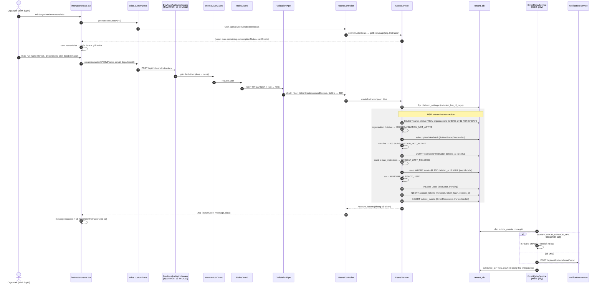

# UC12.2 – Thêm Instructor: ghi chú thay đổi và luồng hoạt động

> Người làm: Trọng (thành viên D) · Nhánh: `feat/tenant/uc12.2-create-instructor` · Ngày: 01/10/2026
> Trạng thái: **đã chạy được** (seed → API → build màn hình), **chưa commit**. Các ca lỗi và giao diện: Trọng tự test theo [mục 7.2](#72-gọi-thử-bằng-curl-khi-dev_fake_authtrue).
> Link trong file này là đường dẫn tương đối tính từ `docs_temp/`. `#Lxx` = dòng xx (đúng tại thời điểm viết, sửa code sau này có thể lệch vài dòng).
> Xây trên nền UC12: xem [`UC12_XemDanhSachInstructor_GhiChu.md`](UC12_XemDanhSachInstructor_GhiChu.md) (DevFakeAuthMiddleware, RolesGuard, quy ước role HOA / PascalCase, axios trả envelope…).

---

## Mục lục

1. [Tóm tắt nhanh](#1-tóm-tắt-nhanh)
2. [Luồng hoạt động (workflow)](#2-luồng-hoạt-động-workflow)
3. [Backend – tenant-service](#3-backend--tenant-service)
4. [Seed dữ liệu](#4-seed-dữ-liệu)
5. [Frontend](#5-frontend)
6. [Biến môi trường](#6-biến-môi-trường)
7. [Cách chạy và kiểm tra](#7-cách-chạy-và-kiểm-tra)
8. [Phần đang FAKE và cách chuyển sang thật](#8-phần-đang-fake-và-cách-chuyển-sang-thật)
9. [Lưu ý quan trọng / bẫy dễ dính](#9-lưu-ý-quan-trọng--bẫy-dễ-dính)
10. [Việc cần chuyển cho người khác](#10-việc-cần-chuyển-cho-người-khác)
11. [Gắn các UC sau vào đâu](#11-gắn-các-uc-sau-vào-đâu)

---

## 1. Tóm tắt nhanh

- **Nghiệp vụ:** Organizer tạo một tài khoản Instructor mới (trạng thái `Pending`) trong chính Organization của mình; hệ thống gửi lời mời tới email đã khai. Người nhận tự đặt mật khẩu và kích hoạt ở UC04 (của A).
- **Endpoint:**
  - `POST /api/v1/users/instructors` – tạo Instructor, chỉ `ORGANIZER`.
  - `GET /api/v1/users/instructors/seats` – số chỗ Instructor, chỉ `ORGANIZER`.
- **Màn hình:** `/organizer/instructors/add` (route có sẵn, trang mockup có sẵn → thay logic). Danh sách `/organizer/instructors` bật nút "Add Instructor" và hiện lại "x / y seats used".
- **Gửi email:** dùng **Transactional Outbox có sẵn** (`OutboxService.enqueueEmail`) trong cùng transaction tạo user + token. Không tạo client mới, **không thêm biến môi trường**.
- **Không migrate DB.** Không sửa `schema.prisma`, `.env`. Không cài thư viện mới.
- **Seed:** subscription `a301` của ABC đổi sang gói **Premium** (ABC dùng 23/30 → còn 7); thêm Gamma (Grace) và Delta (hết chỗ).

Quy tắc nghiệp vụ liên quan:

| BR | Nội dung | Áp dụng ở đâu |
|---|---|---|
| BR-21 | Tài khoản Instructor/Learner do Organizer tạo; người dùng nhận email mời, tự đặt mật khẩu và kích hoạt | tenant không nhận/không lưu mật khẩu, không gọi identity-service |
| BR-23 | Tạo tài khoản Instructor hoặc Learner phải qua bước kiểm số chỗ còn lại theo giới hạn của Subscription | Bước 4 (khóa dòng tổ chức + đếm) |
| BR-36 | Vô hiệu hóa tài khoản không xóa dữ liệu và **không giải phóng chỗ** theo giới hạn gói | Đếm chỗ tính cả `Pending`, `Active`, `Deactivated` |
| BR-37 | Xóa tài khoản = gán `deleted_at`; xóa mới giải phóng chỗ | Đếm chỗ / kiểm email chỉ xét `deleted_at IS NULL` |
| BR-15 | Subscription hết hạn → ân hạn 7 ngày; trong thời gian này Organizer **không tạo tài khoản**, không tạo Course, không upload học liệu | Subscription `Grace` → 403 |
| BR-17 | Subscription `Suspended` → Organizer chỉ còn quyền xem và kết xuất báo cáo (30 ngày) | Subscription `Suspended` → 403 |
| BR-45 | Admin tạm khóa (Suspended) Organization khi tổ chức nhiều lần để report quá hạn hoặc vi phạm hệ thống | `organizations.status ≠ Active` → 403 |
| BR-30 | Email là định danh đăng nhập duy nhất toàn nền tảng (chỉ xét tài khoản chưa xóa) | `findAccountByEmailAcrossOrganizations` |
| BR-31 | Email của tài khoản đã xóa được cấp lại cho tài khoản mới | DB đã có partial unique `WHERE deleted_at IS NULL` → dùng lại được |
| BR-34 | Organizer nhập họ tên, email và đơn vị công tác khi tạo tài khoản Instructor/Learner | `CreateAccountDto` |
| BR-279 | Đơn vị công tác là chữ nhập tự do, hệ thống chuẩn hóa khoảng trắng khi lưu (và gợi ý giá trị đã có – **chưa làm**) | `normalizeText`; rỗng → `null` |
| BR-278 | Lời mời có thời hạn theo tham số nền tảng (`invitation_link_ttl_days`, mặc định 7 ngày); phát lại thì liên kết cũ mất hiệu lực | `expires_at = created_at + ttl` |
| BR-269 | Thay đổi tham số nền tảng chỉ áp cho dữ liệu phát sinh sau | `expires_at` tính và chép **ngay lúc tạo token** |
| BR-22 | Organizer phát lại lời mời cho tài khoản chưa kích hoạt hoặc lời mời đã hết hiệu lực | UC12.7 (của A) – xem [mục 11](#11-gắn-các-uc-sau-vào-đâu) |

---

## 2. Luồng hoạt động (workflow)

### 2.1 Tạo Instructor – một request



### 2.2 Các điểm chặn và mã lỗi

| Bước | Điều kiện | HTTP | `error.code` | Message (backend) |
|---|---|---|---|---|
| InternalAuthGuard (có sẵn) | thiếu / sai `x-internal-key` | 401 | — | `Invalid or missing internal service key.` |
| RolesGuard | role ≠ ORGANIZER | 403 | `FORBIDDEN` | Bạn không có quyền thực hiện thao tác này. |
| ValidationPipe | `fullName` rỗng / > 100, email sai / > 254, `department` > 100, ký tự điều khiển, field lạ (vd. `organizationId`) | 400 | — | `message: string[]` (tiếng Việt) |
| 2 | `organizations.status ≠ Active` (BR-45) | 403 | `ORGANIZATION_NOT_ACTIVE` | Tổ chức đang không hoạt động nên không tạo được tài khoản. |
| 3 | không có Subscription hiện hành, hoặc ở `Grace` (BR-15) / `Suspended` (BR-17) | 403 | `SUBSCRIPTION_NOT_ACTIVE` | Subscription không ở trạng thái hoạt động nên không tạo được tài khoản. |
| 4 | Instructor chưa xóa ≥ `max_instructors` của subscription (BR-23, BR-36) | 409 | `SEAT_LIMIT_REACHED` | Đã dùng hết số chỗ theo giới hạn của Subscription. |
| 5 | email trùng tài khoản chưa xóa ở **bất kỳ** tổ chức nào (BR-30) | 409 | `EMAIL_ALREADY_USED` | Email đã được sử dụng cho một tài khoản khác. *(không lộ tổ chức)* |
| 6 | 2 request cùng email đồng thời → DB ném P2002 | 409 | `EMAIL_ALREADY_USED` | như trên |

Format lỗi do `HttpExceptionFilter` có sẵn: `{ statusCode, timestamp, path, error: { code, message } }`. Mã riêng viết dạng chuỗi giống UC02 (`STANDARD_ERROR_CODES` của ts-common chỉ có mã chung).

### 2.3 Cách tính số chỗ – [`getSeatUsage`](../services/tenant-service/src/users/users.service.ts#L134)

- `used` = [`countUsedSeats(client, organizationId, role)`](../services/tenant-service/src/users/users.service.ts#L164): `users` của tổ chức, đúng role, `deleted_at IS NULL`, **mọi status**.
- `max` = `max_instructors` (hoặc `max_learners`) **trên subscription hiện hành** (bản chụp, BR-275) – không đọc từ gói. Không có subscription hiện hành → `0`.
- `remaining = max(0, max − used)` (không âm, kể cả khi dữ liệu cũ vượt giới hạn).
- `canCreate = organization Active && subscription Active && remaining > 0`.
- Endpoint seats **không khóa** dòng tổ chức (chỉ để hiển thị); lúc tạo thật mới khóa và đếm lại.

---

## 3. Backend – tenant-service

Thư mục gốc: [`services/tenant-service/`](../services/tenant-service/)

### 3.1 File TẠO MỚI

| File | Vai trò | Điểm cần xem |
|---|---|---|
| [`src/users/dto/create-account.dto.ts`](../services/tenant-service/src/users/dto/create-account.dto.ts) | Body tạo tài khoản, **tên chung** để UC13.2 dùng lại. Chuẩn hóa TRƯỚC khi kiểm độ dài (NFC, trim, gộp khoảng trắng; email `lower`). Từ chối ký tự điều khiển (`\p{Cc}`); `fullName`, `department` từ chối `<` `>` ("… không được chứa ký tự < hoặc >"). `department` rỗng sau trim → `null`. Không có `organizationId`. | [`CreateAccountDto`](../services/tenant-service/src/users/dto/create-account.dto.ts#L19) |
| [`src/users/interfaces/seat-usage.interface.ts`](../services/tenant-service/src/users/interfaces/seat-usage.interface.ts) | Kiểu dữ liệu của endpoint seats | `SeatUsage` |

### 3.2 File ĐÃ SỬA

| File | Trước | Sau |
|---|---|---|
| [`src/users/users.controller.ts`](../services/tenant-service/src/users/users.controller.ts) | Chỉ có `GET instructors` | Thêm [`@Get('instructors/seats')`](../services/tenant-service/src/users/users.controller.ts#L31) (đặt **trước** mọi route `instructors/:id` sau này) và [`@Post('instructors')`](../services/tenant-service/src/users/users.controller.ts#L39). Cùng `RolesGuard`, `@Roles('ORGANIZER')`, tag Swagger "UC12 - Users". |
| [`src/users/users.service.ts`](../services/tenant-service/src/users/users.service.ts) | `findInstructors` + 3 hàm private | Giữ nguyên code UC12. Constructor thêm `ConfigService`, `PlatformSettingsService`, `OutboxService`. Thêm: [`createInstructor`](../services/tenant-service/src/users/users.service.ts#L119), [`getInstructorSeats`](../services/tenant-service/src/users/users.service.ts#L126), [`getSeatUsage`](../services/tenant-service/src/users/users.service.ts#L134) (public, nhận role), [`countUsedSeats`](../services/tenant-service/src/users/users.service.ts#L164) (public, nhận client + role), [`createAccount`](../services/tenant-service/src/users/users.service.ts#L178) (private, nhận role – lõi dùng chung), [`findAccountByEmailAcrossOrganizations`](../services/tenant-service/src/users/users.service.ts#L306), [`findCurrentSubscription`](../services/tenant-service/src/users/users.service.ts#L316), `seatLimitOf`, [`emailAlreadyUsed`](../services/tenant-service/src/users/users.service.ts#L335), [`activationLink`](../services/tenant-service/src/users/users.service.ts#L343). Hằng [`INVITATION_TEMPLATE`](../services/tenant-service/src/users/users.service.ts#L43). |
| [`src/users/users.module.ts`](../services/tenant-service/src/users/users.module.ts) | Không import gì | `imports: [PlatformSettingsModule]` (lấy `invitation_link_ttl_days`). `OutboxModule`, `IntegrationsModule` là `@Global` nên không phải import. |
| [`prisma/seed-account-management.ts`](../services/tenant-service/prisma/seed-account-management.ts) | ABC/XYZ cùng gói Standard | Xem [mục 4](#4-seed-dữ-liệu) |

**Không đụng:** `InternalAuthGuard`, `RolesGuard`, `HttpExceptionFilter`, `TransformInterceptor`, `OutboxService`, `EmailRelayService`, `main.ts`, `app.module.ts`, `schema.prisma`, migration, `.env`, `.env.example` (không có biến mới).

### 3.3 Chi tiết transaction – [`createAccount`](../services/tenant-service/src/users/users.service.ts#L178)

1. Đọc `platform_settings` **trước** transaction (giá trị ttl dùng để chép vào `expires_at`).
2. Sinh token bằng [`generateSecretToken()`](../services/tenant-service/src/common/utils/token.util.ts) có sẵn: `randomBytes(32)` → base64url (43 ký tự); `token_hash` = SHA-256 (32 byte, kiểu `bytea`). **Chỉ lưu hash**, không log token ở service.
3. `prisma.$transaction(async (tx) => …)`:
   - [Khóa dòng tổ chức](../services/tenant-service/src/users/users.service.ts#L193) bằng `$queryRaw … FOR UPDATE` (tenant_db: "Kiểm số chỗ khi thao tác đồng thời"). Hai Organizer bấm cùng lúc với 1 chỗ cuối → request sau đợi request trước commit rồi mới đếm.
   - Kiểm 4 điều kiện theo thứ tự ở [mục 2.2](#22-các-điểm-chặn-và-mã-lỗi).
   - `INSERT users`: `role = Instructor`, `status = Pending`, `activated_at = null`, `organization_id` = của Organizer.
   - `INSERT account_tokens`: `purpose = Invitation`, `expires_at = users.created_at + invitation_link_ttl_days` (BR-278, BR-269).
   - [`outbox.enqueueEmail(tx, …)`](../services/tenant-service/src/users/users.service.ts#L275): `aggregateType 'User'`, `aggregateId` = id user, `templateCode 'INSTRUCTOR_INVITATION'`. Subject/body dựng giống UC02 (chuỗi tiếng Việt, có liên kết + hạn), dùng thẳng giá trị đã chuẩn hóa (không escape; `fullName` đã bị DTO chặn `<` `>` – xem [mục 9.6](#9-lưu-ý-quan-trọng--bẫy-dễ-dính)).
4. Lỗi Prisma `P2002` (unique) → `EMAIL_ALREADY_USED` ([L294](../services/tenant-service/src/users/users.service.ts#L294)).

Liên kết mời: `${FRONTEND_URL}/activate/<token>` – route `activate/:token` **đã có** trong `frontend/src/router.tsx` (token nằm trong path, không phải query; base64url an toàn trong path).

### 3.4 Ví dụ

`POST /api/v1/users/instructors`

```json
{ "fullName": "  Đỗ   Minh Khang ", "email": " Khang.Do@ABC.vn ", "department": "  Phòng   Đào tạo " }
```

→ `201`

```json
{
  "statusCode": 201,
  "message": "Tạo tài khoản Instructor thành công",
  "data": {
    "id": "01a0f82b-f9dd-74ad-af6e-4f73f9a51d6e",
    "fullName": "Đỗ Minh Khang",
    "email": "khang.do@abc.vn",
    "department": "Phòng Đào tạo",
    "status": "Pending",
    "activatedAt": null,
    "createdAt": "2026-10-01T15:53:46.717Z",
    "invitationExpired": false
  }
}
```

Response cùng dạng `AccountListItem` của UC12. **Không** trả token, **không** có `invitationSent` (thư nằm trong outbox, đã commit cùng tài khoản nên chắc chắn sẽ được gửi).

`GET /api/v1/users/instructors/seats` → `200`

```json
{ "statusCode": 200, "message": "Lấy số chỗ Instructor thành công",
  "data": { "used": 23, "max": 30, "remaining": 7, "subscriptionStatus": "Active", "canCreate": true } }
```

Thư trong log (`NOTIFICATION_SERVICE_URL` trống):

```
[DEV EMAIL] To: khang.do@abc.vn
Subject: LearnUP - Lời mời tham gia Công ty ABC
Xin chào Đỗ Minh Khang,
Công ty ABC đã tạo cho bạn tài khoản Instructor trên LearnUP.
Mở liên kết sau để đặt mật khẩu và kích hoạt tài khoản: http://localhost:3000/activate/<token 43 ký tự>
Liên kết có hiệu lực tới 2026-10-08T15:53:46.717Z.
```

---

## 4. Seed dữ liệu

File: [`prisma/seed-account-management.ts`](../services/tenant-service/prisma/seed-account-management.ts) (comment đầu file đã bổ sung phần UC12.2 + ID mới).

### 4.1 Thay đổi so với UC12

| Thay đổi | Trước | Sau | Vì sao |
|---|---|---|---|
| `SeedOrg` thêm `planName` | Mọi subscription chụp gói Standard | ABC: [`Premium`](../services/tenant-service/prisma/seed-account-management.ts#L155), XYZ: `Standard` | ABC có 23 Instructor chưa xóa > 10 của Standard → luôn hết chỗ. Đổi **cả `plan_id` lẫn 6 cột bản chụp** (`price`, `duration_days`, `max_learners`, `max_instructors`, `max_course_chains`, `max_storage_bytes`) cho khớp Premium. Không đổi gì khác của ABC/XYZ. |
| [`extraOrganizations`](../services/tenant-service/prisma/seed-account-management.ts#L174) + [`extraSubscriptionDates`](../services/tenant-service/prisma/seed-account-management.ts#L202) | — | Gamma, Delta | Mảng riêng, ngày subscription tính theo lúc chạy seed |
| Organizer [`c010`](../services/tenant-service/prisma/seed-account-management.ts#L267), [`d010`](../services/tenant-service/prisma/seed-account-management.ts#L279); [`deltaInstructors`](../services/tenant-service/prisma/seed-account-management.ts#L419) | — | thêm vào mảng `users` | |
| [`validateSeed`](../services/tenant-service/prisma/seed-account-management.ts#L474) | nhận 1 gói Standard | nhận `Map` các gói + `graceDays`; [kiểm tổ chức thêm](../services/tenant-service/prisma/seed-account-management.ts#L516) (Grace: `expires_at ≤ now < grace_ends_at`; Delta có đúng `max_instructors` Instructor); [BR-23](../services/tenant-service/prisma/seed-account-management.ts#L566) số Instructor chưa xóa ≤ giới hạn gói của ABC/XYZ; BR-40 chạy trên **mọi** tổ chức; kiểm giá trị > 0 cho mọi gói | |
| [`main`](../services/tenant-service/prisma/seed-account-management.ts#L672) | tìm gói Standard | [tìm 3 gói](../services/tenant-service/prisma/seed-account-management.ts#L673) Standard/Premium/Basic (thiếu gói nào báo `Chưa có gói X, hãy chạy npm run prisma:seed trước`); upsert tổ chức thêm **trước** users (khóa ngoại); [upsert subscription Gamma/Delta](../services/tenant-service/prisma/seed-account-management.ts#L748) | |

Giữ nguyên: mọi ID, tên, email, trạng thái, token của ABC/XYZ; nguyên tắc upsert theo UUID cố định, không xóa/truncate.

### 4.2 Dữ liệu mới và ID để test

| Đối tượng | ID | Ghi chú |
|---|---|---|
| Công ty CP Gamma | `c001` | Active |
| Subscription Gamma | `c301` | **Grace**, gói Standard. `expires_at` = lúc chạy seed − 2 ngày; `grace_ends_at` = `expires_at` + `subscription_grace_days` (7) → còn ~5 ngày ân hạn sau mỗi lần chạy seed |
| Organizer Gamma – Trương Thị Thảo | `c010` | `thao.truong@gamma.vn` |
| Công ty TNHH Delta | `d001` | Active |
| Subscription Delta | `d301` | Active, gói **Basic** (`max_instructors = 3`, gói nhỏ nhất). `starts_at` = lúc chạy seed − 5 ngày |
| Organizer Delta – Võ Minh Quân | `d010` | `quan.vo@delta.vn` |
| Instructor Delta | `d101` – `d103` | Hạnh, Việt, Ánh – Active → 3/3, hết chỗ |

ID đầy đủ: `01900000-0000-7000-8000-00000000XXXX`. `FAKE_COUNTS` không đổi (Instructor Delta = 0 Course).

### 4.3 Số chỗ sau seed

| Tổ chức | Gói (bản chụp) | Instructor chưa xóa | Còn lại | `canCreate` |
|---|---|---|---|---|
| ABC (Lan `a010`) | Premium (30) | 23 | **7** | true |
| XYZ (Hoa `b010`) | Standard (10) | 3 | 7 | true |
| Gamma (Thảo `c010`) | Standard (10), **Grace** | 0 | 10 | **false** |
| Delta (Quân `d010`) | Basic (3) | 3 | **0** | **false** |

Kết quả 2 lần chạy liền (01/10/2026): không lỗi, không trùng – 4 tổ chức, 40 user (35 cũ + 5 mới), 5 token, 4 subscription, 1 platform_settings. Danh sách UC12 của Lan sau seed: **23 dòng** (không đổi).

> ⚠️ **User test còn lại trong ABC:** lần POST thử ngày 01/10/2026 tạo `01a0f82b-f9dd-74ad-af6e-4f73f9a51d6e` – `khang.do@abc.vn` (Đỗ Minh Khang, Pending, có token + outbox đã relay). Seed **không** xóa user này (id ngẫu nhiên, không thuộc seed) → hiện ABC dùng **24/30** (còn 6) và danh sách UC12 của Lan là **24 dòng**. Chưa xóa, chờ Trọng quyết.

---

## 5. Frontend

Thư mục gốc: [`frontend/src/`](../frontend/src/)

### 5.1 File ĐÃ SỬA

| File | Thay đổi |
|---|---|
| [`pages/organizer/instructor.create.tsx`](../frontend/src/pages/organizer/instructor.create.tsx) | Mockup có sẵn → **giữ bố cục/style**, thay logic: field `workUnit` (bắt buộc) → `department` "Department (optional)"; bỏ "7 Instructor seats available" ghi cứng, [ô Seat check](../frontend/src/pages/organizer/instructor.create.tsx#L219) hiện "x Instructor seats remaining (used / max used)"; gọi seats khi mở trang; `canCreate = false` → [khóa form + nút](../frontend/src/pages/organizer/instructor.create.tsx#L173), Alert warning ghi lý do; [`submit`](../frontend/src/pages/organizer/instructor.create.tsx#L80) có `loading` + chống bấm 2 lần, chuẩn hóa giống backend trước khi gửi; rule client chặn `<` `>` ở Full name / Department ("… cannot contain < or >."); [`showCreateError`](../frontend/src/pages/organizer/instructor.create.tsx#L107) map mã lỗi; [thành công](../frontend/src/pages/organizer/instructor.create.tsx#L92) → `message.success("Instructor account created. An invitation email will be sent to <email>.")` rồi về danh sách (trang danh sách mount lại → tự tải lại); Cancel → `/organizer/instructors`. |
| [`pages/organizer/instructor.create.scss`](../frontend/src/pages/organizer/instructor.create.scss) | Thêm khoảng cách giữa 2 Alert xếp chồng (không thêm màu) |
| [`pages/organizer/instructors.tsx`](../frontend/src/pages/organizer/instructors.tsx) | Gọi seats ([L76](../frontend/src/pages/organizer/instructors.tsx#L76), tải lại cùng "Try again"); [nút Add Instructor](../frontend/src/pages/organizer/instructors.tsx#L111): `canCreate` → `Link` tới `/organizer/instructors/add`, ngược lại disabled + tooltip lý do; [dòng "x / y seats used"](../frontend/src/pages/organizer/instructors.tsx#L132) đặt lại ở `SectionCard extra` (vị trí cũ trước UC12). Import Excel, tìm kiếm, select, View details vẫn "Coming soon". |
| [`services/organization.service.ts`](../frontend/src/services/organization.service.ts) | Thêm [`getInstructorSeatsAPI`](../frontend/src/services/organization.service.ts#L32), [`createInstructorAPI`](../frontend/src/services/organization.service.ts#L36) |
| [`types/organization.types.ts`](../frontend/src/types/organization.types.ts) | Thêm [`ICreateAccountReq`](../frontend/src/types/organization.types.ts#L78), [`ISeatUsage`](../frontend/src/types/organization.types.ts#L85) |
| [`utils/helper.ts`](../frontend/src/utils/helper.ts) | Thêm [`seatBlockReason(seats, roleLabel)`](../frontend/src/utils/helper.ts#L58) – lý do không tạo được, dùng chung trang danh sách + trang tạo (UC13.2 truyền `"Learner"`) |

**Không sửa:** `router.tsx` (route `/organizer/instructors/add` đã trỏ đúng trang), `organizer.ui.*`, `axios.customize.ts`, `.env*`.

### 5.2 Map mã lỗi → thông báo

| Mã | Hiển thị |
|---|---|
| `EMAIL_ALREADY_USED` | gắn vào ô Email: "This email is already used by another account." |
| `SEAT_LIMIT_REACHED` | Alert chung + tải lại seats: "All Instructor seats are in use. Free a seat or upgrade your Subscription to add more Instructors." |
| `SUBSCRIPTION_NOT_ACTIVE` | "Your Subscription is not active. New accounts cannot be created." + tải lại seats |
| `ORGANIZATION_NOT_ACTIVE` | "Your Organization is suspended. New accounts cannot be created." + tải lại seats |
| `FORBIDDEN` | "You do not have permission to add Instructors." |
| 400 / khác | thông báo chung "Some details are invalid. Please review them and try again." (backend không trả tên field – đã thống nhất) |
| lỗi mạng (`catch`) | "Could not connect to the server. Please try again later." |

Lý do khóa nút / form (`seatBlockReason`, theo thứ tự kiểm của backend): Grace → "…grace period…"; Suspended → "…suspended…"; không có Subscription → "…no active Subscription."; hết chỗ → "All Instructor seats are in use (used / max)."; còn lại (Subscription Active, còn chỗ mà `canCreate=false`) → tổ chức bị khóa.

---

## 6. Biến môi trường

**Không thêm biến mới.** Dùng lại:

| Biến | Nơi đặt | Ý nghĩa | Mẫu | Bắt buộc |
|---|---|---|---|---|
| `FRONTEND_URL` | backend `.env` (có sẵn) | Gốc của liên kết mời `…/activate/<token>` | `http://localhost:3000` | Không (mặc định `http://localhost:3000`) |
| `NOTIFICATION_SERVICE_URL` | backend `.env` (có sẵn, **đang trống**) | Trống: relay in thư ra log `[DEV EMAIL]`. Có giá trị: relay gọi notification-service | `http://localhost:8082` | Không (chỉ khi muốn gửi thật) |
| `INTERNAL_SERVICE_KEY` | backend `.env` (có sẵn) | Relay gửi kèm khi gọi notification-service | — | Có |
| `DEV_FAKE_AUTH`, `VITE_BACKEND_URL`, `VITE_DEV_FAKE_USER_ID` | như UC12 | Fake danh tính khi chưa qua gateway | xem ghi chú UC12 mục 6 | như UC12 |

Muốn **gửi email thật** (từng bước):
1. notification-service (của Đạt) – đặt biến môi trường khi chạy: `LEARNUP_MAIL_ENABLED=true`, `SPRING_MAIL_HOST`, `SPRING_MAIL_PORT` (587), `SPRING_MAIL_USERNAME`, `SPRING_MAIL_PASSWORD`, `SPRING_MAIL_SMTP_AUTH=true`, `SPRING_MAIL_SMTP_STARTTLS_ENABLE=true`, `LEARNUP_MAIL_FROM`; DB `notification_db` (`SPRING_DATASOURCE_*`). Chạy ở cổng 8082.
2. tenant `.env`: `NOTIFICATION_SERVICE_URL=http://localhost:8082` → khởi động lại tenant.
3. Tạo 1 Instructor → trong ≤ 5 giây relay gửi; xem log notification-service hoặc `GET http://localhost:8082/api/notifications/email/logs?recipientEmail=…`.

---

## 7. Cách chạy và kiểm tra

### 7.1 Chạy

```bash
# Backend – services/tenant-service
npm run prisma:seed             # 1 lần, seed nền (3 gói + platform_settings)
npm run prisma:seed:accounts    # seed tài khoản (chạy lại được; Gamma được "làm mới" thời gian ân hạn)
npm run start:dev               # cần DEV_FAKE_AUTH=true

# Frontend – frontend/
npm ci                          # BẮT BUỘC nếu node_modules thiếu vitest (xem mục 9)
npm run dev                     # http://localhost:3000/organizer/instructors
```

Swagger: `http://localhost:8084/docs` (tag "UC12 - Users").

### 7.2 Gọi thử bằng curl (khi `DEV_FAKE_AUTH=true`)

> Mỗi lần tạo thành công **chiếm vĩnh viễn 1 chỗ** của ABC và thêm 1 dòng vào danh sách UC12 (seed không xóa). Hiện ABC còn 6 chỗ (xem cảnh báo ở [mục 4.3](#43-số-chỗ-sau-seed)).

```bash
B=http://localhost:8084/api/v1/users/instructors
ID=01900000-0000-7000-8000-00000000
J='content-type: application/json'

# --- seats ---
curl "$B/seats"                                        # Lan (ABC): used 23(+test) / max 30, canCreate true
curl -H "x-dev-user-id: ${ID}c010" "$B/seats"          # Gamma: subscriptionStatus Grace, canCreate false
curl -H "x-dev-user-id: ${ID}d010" "$B/seats"          # Delta: used 3, max 3, remaining 0, canCreate false

# --- 1. hợp lệ (Lan) → 201, DB: user Pending + token expires_at = created_at + 7 ngày, log [DEV EMAIL] có liên kết
curl -X POST "$B" -H "$J" -d '{"fullName":"Nguyễn Văn Test","email":"test1@abc.vn","department":"Phòng Kỹ thuật"}'

# --- 2. email trùng tài khoản ABC (Minh a101) → 409 EMAIL_ALREADY_USED
curl -X POST "$B" -H "$J" -d '{"fullName":"Trùng ABC","email":"minh.tran@abc.vn"}'

# --- 3. email trùng tài khoản XYZ (Khoa b101) → 409 EMAIL_ALREADY_USED, message chung (không lộ tổ chức)
curl -X POST "$B" -H "$J" -d '{"fullName":"Trùng XYZ","email":"khoa.ho@xyz.vn"}'

# --- 4. email của tài khoản đã xóa (a111 phuong.ly@abc.vn / a121 kim.do@abc.vn) → 201 (partial unique cho dùng lại, BR-31)
curl -X POST "$B" -H "$J" -d '{"fullName":"Lý Thị Phương","email":"phuong.ly@abc.vn"}'

# --- 5. chữ HOA + khoảng trắng → lưu "test5@abc.vn", tên/đơn vị gộp khoảng trắng; department "   " → null
curl -X POST "$B" -H "$J" -d '{"fullName":"  Trần   Văn  Năm ","email":"  TEST5@ABC.VN ","department":"   "}'

# --- 6. tạo tới khi hết chỗ ABC → 409 SEAT_LIMIT_REACHED; seats: remaining 0, canCreate false
for i in $(seq 1 8); do curl -s -X POST "$B" -H "$J" -d "{\"fullName\":\"Seat $i\",\"email\":\"seat$i@abc.vn\"}"; echo; done

# --- 7. Gamma (Grace) → 403 SUBSCRIPTION_NOT_ACTIVE
curl -X POST "$B" -H "$J" -H "x-dev-user-id: ${ID}c010" -d '{"fullName":"Gamma Test","email":"test@gamma.vn"}'

# --- 8. Delta (hết chỗ) → 409 SEAT_LIMIT_REACHED
curl -X POST "$B" -H "$J" -H "x-dev-user-id: ${ID}d010" -d '{"fullName":"Delta Test","email":"test@delta.vn"}'

# --- 9. sai role / sai body
curl -X POST "$B" -H "$J" -H "x-dev-user-id: ${ID}a101" -d '{"fullName":"X","email":"x@abc.vn"}'          # Instructor Minh → 403 FORBIDDEN
curl -X POST "$B" -H "$J" -d "{\"fullName\":\"X\",\"email\":\"x@abc.vn\",\"organizationId\":\"${ID}b001\"}"  # field lạ → 400
curl -X POST "$B" -H "$J" -d "{\"fullName\":\"$(printf 'a%.0s' $(seq 1 101))\",\"email\":\"x@abc.vn\"}"     # 101 ký tự → 400
curl -X POST "$B" -H "$J" -d '{"fullName":"   ","email":"x@abc.vn"}'                                      # rỗng sau trim → 400
curl -X POST "$B" -H "$J" -d '{"fullName":"X","email":"not-an-email"}'                                    # 400

# Giống request đi qua gateway thật (không cần fake):
curl "$B/seats" -H "x-internal-key: learnup-internal-secret" \
  -H "x-user-id: ${ID}a010" -H "x-organization-id: ${ID}a001" -H "x-user-role: ORGANIZER"
```

Xem liên kết mời: tìm `[DEV EMAIL]` trong log `npm run start:dev` (relay chạy mỗi 5 giây).

Thử tổ chức bị khóa (BR-45): chưa có seed. Có thể tạm đổi `organizations.status` của một tổ chức sang `Suspended` bằng SQL rồi chạy lại seed để trả về `Active` (seed upsert `status: 'Active'`).

Giao diện (tự kiểm): đăng nhập giả bằng `VITE_DEV_FAKE_USER_ID` = `…a010` (Lan), `…c010` (Gamma: nút disabled, tooltip grace period), `…d010` (Delta: tooltip "All Instructor seats are in use (3 / 3)").

### 7.3 Kết quả đã kiểm (01/10/2026) – mức tối thiểu đã thống nhất

| Mục | Kết quả |
|---|---|
| `prisma validate`, `prisma generate` | Qua |
| `tsc --noEmit`, `npm run build` (tenant) | Qua, 0 lỗi |
| `eslint` (không `--fix`) + `prettier --check` trên các file backend đã tạo/sửa | Qua (đã `prettier --write` riêng 3 file của mình – chỉ đổi xuống dòng ở các dòng mới thêm) |
| `prisma:seed:accounts` × 2 | Qua, không trùng (4 tổ chức, 40 user, 5 token, 4 subscription); bản chụp `a301` khớp đủ 6 cột + `plan_id` gói Premium |
| `start:dev` | Khởi động không lỗi |
| `GET …/seats` (Lan) | `200 {used 23, max 30, remaining 7, Active, canCreate true}` |
| `POST …/instructors` (Lan, 1 lần) | `201`; DB: user Pending, token Invitation 32 byte hết hạn sau đúng 7 ngày; outbox `EmailRequested` đã relay + payload đã xóa nội dung; log `[DEV EMAIL]` có liên kết `/activate/<token>`. Seats sau đó 24/30 |
| Frontend `eslint` 5 file đã sửa | Qua |
| Frontend `npm run build` | **Lỗi có sẵn, không do UC12.2**: `tsc -b` không tìm thấy `vitest` (các file `*.test.ts`, `vitest.config.ts`) vì `node_modules` chưa cài lại sau commit `2a9c907` thêm vitest. Phần app: `tsc -p tsconfig.app.json` không có lỗi ngoài file test, `vite build` thành công |
| Frontend `npm run dev` | Khởi động được, `/organizer/instructors/add` trả 200 |
| Các ca lỗi, giao diện | **Chưa kiểm** – Trọng tự test theo mục 7.2 |

---

## 8. Phần đang FAKE và cách chuyển sang thật

### 8.1 Gửi email – đang ở chế độ log của `EmailRelayService` (có sẵn từ UC02)

- **Hiện tại:** `NOTIFICATION_SERVICE_URL` trống → relay in nguyên thư (có liên kết) ra log với tiền tố `[DEV EMAIL]`, rồi đánh dấu `published_at` và xóa nội dung khỏi payload. Copy liên kết trong log để test UC04.
- **Chuyển sang thật:** làm theo [mục 6](#6-biến-môi-trường). Không sửa code.
- UC12.2 **không tạo** client/abstract class gửi email riêng – outbox đã có cả 2 chế độ.

### 8.2 Danh tính – `DevFakeAuthMiddleware` (từ UC12)

Không đổi. `UsersController` đã nằm trong `forRoutes(UsersController)` nên 2 endpoint mới dùng được fake ngay. Cách gỡ: ghi chú UC12 mục 8.1.

### 8.3 Trang kích hoạt (`activate/:token`) – của A, **đang là mock**

`pages/guest/activate.tsx` chưa gọi API, ghi cứng "INVITED LEARNER", "Demo Organization", email mẫu. Liên kết UC12.2 mở được trang này nhưng chưa kích hoạt thật.

---

## 9. Lưu ý quan trọng / bẫy dễ dính

1. **Thứ tự kiểm cố định:** tổ chức → Subscription → số chỗ → email. Nên ở Delta (hết chỗ) gửi email trùng vẫn ra `SEAT_LIMIT_REACHED`, không ra `EMAIL_ALREADY_USED`.
2. **Đếm chỗ tính cả `Pending` và `Deactivated`** (BR-36). Muốn giải phóng chỗ phải *xóa* (BR-37, UC12.6), không phải vô hiệu hóa.
3. **`max` đọc từ bản chụp trên subscription**, không đọc từ `subscription_plans`. Admin sửa gói không làm đổi số chỗ của tổ chức đang dùng (BR-275).
4. **Token gốc nằm trong `outbox_events.payload`** cho tới khi relay gửi xong (thiết kế tenant_db mục 3.10 đã chấp nhận). Ở chế độ dev, log `start:dev` chứa liên kết mời → **đừng dán log ra ngoài**.
5. Tiền tố log là **`[DEV EMAIL]`** (của relay có sẵn), không phải `[DEV_FAKE_EMAIL]`.
6. **`fullName` và `department` không được chứa `<` hoặc `>`** (DTO backend + rule client, kiểm sau khi chuẩn hóa). Lý do: notification-service coi body email là HTML khi có cả `<` và `>`, nên họ tên kiểu `<b>An</b>` sẽ thành thẻ HTML trong thư mời. Chặn ngay ở đầu vào thay vì escape: escape làm thư dạng chữ thường hiện ra `&amp;`, `&lt;`… khó đọc. Tên thật không cần hai ký tự này. Lưu ý: **tên tổ chức** (nhập ở UC02, không thuộc UC12.2) chưa bị chặn `<` `>` và vẫn được ghép thẳng vào subject/body.
7. **Endpoint seats không khóa**, chỉ để hiển thị. Số trên màn hình có thể cũ; lúc bấm tạo backend vẫn khóa và đếm lại.
8. **Route `instructors/seats` phải đứng TRƯỚC `instructors/:id`** khi làm UC12.1, nếu không `seats` bị hiểu là `:id`.
9. **Lỗi 400 không có tên field** (ValidationPipe trả `message: string[]` tiếng Việt) → frontend chỉ hiện thông báo chung; validate phía client giống backend nên hiếm khi gặp.
10. **User do curl/màn hình tạo ra không bị seed xóa** (id ngẫu nhiên). Test nhiều sẽ làm lệch số liệu UC12 (23 dòng) và hết chỗ ABC. Hiện đã có 1 user test `khang.do@abc.vn`.
11. **Gamma: thời gian ân hạn tính theo lúc chạy seed** (còn ~5 ngày). Quá hạn mà chưa chạy lại seed thì dữ liệu Gamma "sai" (Grace nhưng `grace_ends_at` đã qua) – chạy lại `prisma:seed:accounts` để làm mới. Hiện tenant chưa có job tự chuyển Grace → Suspended.
12. **`validateSeed` gắn Delta với gói Basic:** nếu A đổi `max_instructors` của Basic trong seed nền, seed tài khoản dừng với thông báo "Delta phải có đúng N Instructor…" → thêm/bớt dòng trong `deltaInstructors`.
13. **Frontend `npm run build` lỗi vì thiếu `vitest` trong `node_modules`** (không phải do UC12.2). Chạy `npm ci` trong `frontend/` (cài theo lock có sẵn) là hết.
14. Admin gọi 2 endpoint mới ra **401** (không phải 403) – giống UC12 lưu ý 4.
15. **Không cần migrate.** Partial unique email đã đúng BR-31. Index `users(organization_id, role) WHERE deleted_at IS NULL` theo thiết kế vẫn thiếu – chỉ ảnh hưởng hiệu năng đếm chỗ.

---

## 10. Việc cần chuyển cho người khác

**(a) A – UC04 kích hoạt tài khoản (người được mời):**
- Liên kết: `${FRONTEND_URL}/activate/<token>`, token base64url 43 ký tự trong **path**.
- Backend tìm lời mời: `token_hash = SHA-256(token)` (dùng `hashToken()` trong `src/common/utils/token.util.ts`), `purpose = 'Invitation'`, `consumed_at IS NULL`, `revoked_at IS NULL`, `expires_at > now()`. Hết hạn → thông báo riêng "liên kết đã hết hạn + cách nhận liên kết mới" (BR-278), không phải lỗi chung.
- Kích hoạt: lưu mật khẩu qua identity-service, `users.status = Active`, `activated_at = now`, `account_tokens.consumed_at = now` – một transaction.
- `pages/guest/activate.tsx` đang mock (ghi cứng "INVITED LEARNER", tổ chức, email) → cần API trả tên tổ chức, email, role theo token.
- Unique email: **không cần làm gì** – DB đã có partial unique `WHERE deleted_at IS NULL` đúng BR-31.

**(b) Đạt – notification-service:**
- Chưa kiểm `x-internal-key` (relay đã gửi sẵn header).
- `templateCode` (`INSTRUCTOR_INVITATION`, `REGISTRATION_REOPEN_LINK`) chưa được dùng; chưa có template nào trong `notification_templates`.
- Nhận diện HTML bằng cách thấy `<` và `>` trong body → dễ nhầm; nên có cờ rõ ràng hoặc template.
- Lỗi SMTP vẫn trả HTTP 201 (relay đã xử lý bằng `data.status`).
- api-gateway: như ghi chú UC12 mục 10(a).

**(c) Cả nhóm:** `frontend/node_modules` thiếu `vitest` → `npm ci` (mục 9.13).

---

## 11. Gắn các UC sau vào đâu

| UC | Gắn vào |
|---|---|
| **UC13.2 Thêm Learner** | Backend: thêm `createLearner(user, dto) { return this.createAccount(user, dto, UserRoleValue.Learner); }` và `getLearnerSeats` gọi `getSeatUsage(org, UserRoleValue.Learner)` trong [`users.service.ts`](../services/tenant-service/src/users/users.service.ts); controller `@Get('learners/seats')` (trước `learners/:id`) + `@Post('learners')` dùng lại [`CreateAccountDto`](../services/tenant-service/src/users/dto/create-account.dto.ts). `INVITATION_TEMPLATE` đã có `LEARNER_INVITATION`, `seatLimitOf` đã đọc `max_learners`. Frontend: `pages/organizer/learner.create.tsx` (mockup có sẵn) làm theo `instructor.create.tsx`, `seatBlockReason(seats, "Learner")`, thêm `createLearnerAPI` / `getLearnerSeatsAPI` dùng lại `ICreateAccountReq`, `ISeatUsage`. |
| **UC12.7 / UC13.7 Phát lại lời mời** (A, BR-22, BR-278) | Một transaction: kiểm user `Pending` + cùng tổ chức → gán `revoked_at = now` cho token Invitation đang mở (bắt buộc trước, vì partial unique `account_tokens_one_open_link_key` chỉ cho 1 token mở) → `generateSecretToken()` + `INSERT account_tokens` (hạn mới theo `invitation_link_ttl_days`) → `outbox.enqueueEmail` cùng nội dung thư. Nên tách phần dựng subject/body và `activationLink` trong [`createAccount`](../services/tenant-service/src/users/users.service.ts#L178) thành hàm dùng chung. Không kiểm số chỗ (tài khoản đã chiếm chỗ). **Cần chốt:** BR-15 cấm "tạo tài khoản" khi Grace – phát lại lời mời có bị cấm không? Frontend: thêm nút vào `renderActions` của `instructors.tsx` cho dòng `Pending` / `invitationExpired`. |
| UC12.1 Xem chi tiết | `@Get('instructors/:id')` đặt **sau** `instructors/seats` |
| UC12.6 Xóa tài khoản | Xóa (gán `deleted_at`) giải phóng chỗ → `countUsedSeats` tự đúng; nên tải lại seats ở trang danh sách sau khi xóa (`setReloadKey`) |
| BR-279 gợi ý đơn vị công tác | Chưa làm. Gợi ý: `GET /api/v1/users/departments?keyword=` trả `DISTINCT department` trong tổ chức; frontend đổi `Input` Department sang `AutoComplete` của antd |
