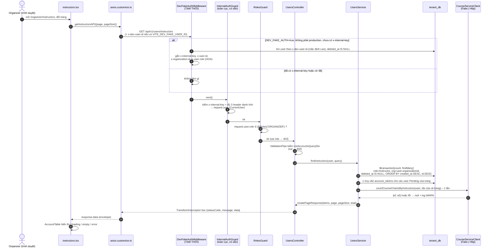

# UC12 – Xem danh sách Instructor: ghi chú thay đổi và luồng hoạt động

> Người làm: Trọng (thành viên D) · Nhánh: `feat/tenant/uc12-list-instructors` · Ngày: 01/10/2026
> Trạng thái: **đã chạy được end-to-end** (seed → API → màn hình), **chưa commit**.
> Link trong file này là đường dẫn tương đối tính từ `docs_temp/`. `#Lxx` = dòng xx (bấm được trong VS Code / GitHub; số dòng đúng tại thời điểm viết, sửa code sau này có thể lệch vài dòng).

---

## Mục lục

1. [Tóm tắt nhanh](#1-tóm-tắt-nhanh)
2. [Luồng hoạt động (workflow)](#2-luồng-hoạt-động-workflow)
3. [Backend – tenant-service](#3-backend--tenant-service)
4. [Seed dữ liệu](#4-seed-dữ-liệu)
5. [Frontend](#5-frontend)
6. [Biến môi trường](#6-biến-môi-trường)
7. [Cách chạy và kiểm tra](#7-cách-chạy-và-kiểm-tra)
8. [Phần đang FAKE và cách chuyển sang thật](#8-phần-đang-fake-và-cách-chuyển-sang-thật)
9. [Lưu ý quan trọng / bẫy dễ dính](#9-lưu-ý-quan-trọng--bẫy-dễ-dính)
10. [Việc cần chuyển cho người khác](#10-việc-cần-chuyển-cho-người-khác)
11. [Gắn các UC sau vào đâu](#11-gắn-các-uc-sau-vào-đâu)

---

## 1. Tóm tắt nhanh

- **Nghiệp vụ:** Organizer xem danh sách Instructor **trong chính Organization của mình**, kèm trạng thái tài khoản và số Course đang phụ trách.
- **Endpoint:** `GET /api/v1/users/instructors?page=1&pageSize=10` – chỉ role `ORGANIZER`.
- **Màn hình:** `/organizer/instructors` (route và mục sidebar đã có sẵn, không sửa).
- **Đang fake 2 thứ:** danh tính người gọi (vì gateway chưa dùng được) và số Course phụ trách (vì course-service chưa có endpoint).
- **Không migrate DB.** Không sửa `.env`. Không cài thư viện mới.

Quy tắc nghiệp vụ liên quan:

| BR | Nội dung | Áp dụng ở đâu |
|---|---|---|
| BR-37 | Xóa tài khoản = gán `deleted_at`, bản ghi giữ lại để lưu vết | Lọc `deleted_at IS NULL` trong truy vấn |
| BR-22 | Organizer phát lại lời mời cho tài khoản chưa kích hoạt hoặc lời mời đã hết hiệu lực | Cờ `invitationExpired` |
| BR-278 | Lời mời có hạn theo tham số nền tảng (mặc định 7 ngày); phát lại thì liên kết cũ mất hiệu lực | Cách tính `invitationExpired`, seed token |
| BR-287 | Quyền phụ trách gắn với cả chuỗi phiên bản, không gắn từng phiên bản | Đếm `course_chains`, không đếm `courses` |
| BR-1 | Số Course đếm theo chuỗi phiên bản | như trên |
| BR-30, BR-31 | Email là định danh duy nhất toàn nền tảng, chỉ xét tài khoản chưa xóa | Seed tự kiểm |
| BR-40 | Mỗi Organization chỉ một Organizer tại một thời điểm (tính cả người chờ nhận lời mời) | Seed tự kiểm |

---

## 2. Luồng hoạt động (workflow)

### 2.1 Tổng thể một request



### 2.2 Các điểm chặn và mã lỗi

| Bước | Điều kiện | Kết quả |
|---|---|---|
| Middleware fake | `x-dev-user-id` không phải UUID | 401 `[DEV_FAKE_AUTH] x-dev-user-id không hợp lệ.` |
| Middleware fake | user không tồn tại hoặc đã xóa | 401 `[DEV_FAKE_AUTH] Không tìm thấy tài khoản…` |
| InternalAuthGuard (có sẵn) | thiếu/sai `x-internal-key` | 401 `Invalid or missing internal service key.` |
| InternalAuthGuard (có sẵn) | thiếu `x-organization-id` (vd. Admin) | 401 `Missing authenticated user context.` |
| RolesGuard | role ≠ ORGANIZER | 403 `{code: 'FORBIDDEN', message}` |
| ValidationPipe | `page < 1`, `pageSize ∉ {10,20,50}`, tham số lạ (vd. `organizationId`) | 400 |
| course-service lỗi / timeout | — | **vẫn 200**, `managedCourseCount: null` |

Format lỗi do [`HttpExceptionFilter`](../services/tenant-service/src/common/filters/http-exception.filter.ts) (có sẵn): `{ statusCode, timestamp, path, error }`.

### 2.3 Cách tính 2 trường "tính lúc đọc"

**`invitationExpired`** – [`findExpiredInvitationUserIds`](../services/tenant-service/src/users/users.service.ts#L84)
- User không phải `Pending` → luôn `false`.
- User `Pending` → `true` nếu **không có** token thỏa: `purpose='Invitation'`, `consumed_at IS NULL`, `revoked_at IS NULL`, `expires_at > now()`.
  (Gồm cả trường hợp không có token nào, hoặc token còn "mở" nhưng đã quá hạn.)
- Một truy vấn `IN (...)` cho cả trang, không lưu DB.

**`managedCourseCount`** – [`countManagedCourses`](../services/tenant-service/src/users/users.service.ts#L106)
- Gọi `CourseServiceClient` **1 lần** với danh sách id của cả trang.
- Lỗi bất kỳ → trả `null` cho mọi dòng + log `WARN` "Không lấy được số Course phụ trách…". Không làm hỏng request.
- tenant **không** đọc `course_db`, **không** chép số này về (thiết kế tenant_db mục 4).

---

## 3. Backend – tenant-service

Thư mục gốc: [`services/tenant-service/`](../services/tenant-service/)

### 3.1 File TẠO MỚI

| File | Vai trò | Điểm cần xem |
|---|---|---|
| [`src/users/dto/list-accounts-query.dto.ts`](../services/tenant-service/src/users/dto/list-accounts-query.dto.ts) | Query `page` (≥1, mặc định 1), `pageSize` (∈ {10,20,50}, mặc định 10). Tên chung để UC13 dùng lại. **Chưa** có `keyword`, `status` (để UC12.4). | [`ListAccountsQueryDto`](../services/tenant-service/src/users/dto/list-accounts-query.dto.ts#L9) |
| [`src/users/interfaces/account-list-item.interface.ts`](../services/tenant-service/src/users/interfaces/account-list-item.interface.ts) | Kiểu dữ liệu một dòng | [`AccountListItem`](../services/tenant-service/src/users/interfaces/account-list-item.interface.ts#L2) (dùng chung), [`InstructorListItem`](../services/tenant-service/src/users/interfaces/account-list-item.interface.ts#L14) (+ `managedCourseCount`) |
| [`src/common/guards/roles.guard.ts`](../services/tenant-service/src/common/guards/roles.guard.ts) | Kiểm role theo `@Roles()`. So sánh dạng **HOA**. Chỉ gắn bằng `@UseGuards` ở controller, **không** toàn cục. | [`canActivate`](../services/tenant-service/src/common/guards/roles.guard.ts#L26) |
| [`src/common/middleware/dev-fake-auth.middleware.ts`](../services/tenant-service/src/common/middleware/dev-fake-auth.middleware.ts) | **TẠM THỜI** – fake danh tính. Comment đầu file ghi lý do và cách gỡ. | [`DEFAULT_DEV_USER_ID`](../services/tenant-service/src/common/middleware/dev-fake-auth.middleware.ts#L37) (= Lan), [`use()`](../services/tenant-service/src/common/middleware/dev-fake-auth.middleware.ts#L51) |
| [`src/integrations/course-service.client.ts`](../services/tenant-service/src/integrations/course-service.client.ts) | Abstract class = "interface" + token DI | [`countCourseChainsByInstructors`](../services/tenant-service/src/integrations/course-service.client.ts#L18) |
| [`src/integrations/http-course-service.client.ts`](../services/tenant-service/src/integrations/http-course-service.client.ts) | Gọi course-service thật bằng `fetch`, gửi `x-internal-key` + danh tính người gọi, timeout `AbortSignal.timeout` | [`countCourseChainsByInstructors`](../services/tenant-service/src/integrations/http-course-service.client.ts#L26) |
| [`src/integrations/fake-course-service.client.ts`](../services/tenant-service/src/integrations/fake-course-service.client.ts) | **DỮ LIỆU GIẢ**. Comment đầu file có đặc tả endpoint thật cần làm. | [`FAKE_COUNTS`](../services/tenant-service/src/integrations/fake-course-service.client.ts#L20) |
| [`prisma/seed-account-management.ts`](../services/tenant-service/prisma/seed-account-management.ts) | Seed tài khoản (xem [mục 4](#4-seed-dữ-liệu)) | — |

### 3.2 File ĐÃ SỬA (chỉ thêm, không đổi logic cũ)

| File | Trước | Sau |
|---|---|---|
| [`src/users/users.controller.ts`](../services/tenant-service/src/users/users.controller.ts) | Controller rỗng | Thêm [`@Get('instructors') findInstructors`](../services/tenant-service/src/users/users.controller.ts#L18), `@UseGuards(RolesGuard)`, `@Roles('ORGANIZER')` |
| [`src/users/users.service.ts`](../services/tenant-service/src/users/users.service.ts) | Service rỗng | [`findInstructors`](../services/tenant-service/src/users/users.service.ts#L26) + 3 hàm private: [`findExpiredInvitationUserIds`](../services/tenant-service/src/users/users.service.ts#L84), [`countManagedCourses`](../services/tenant-service/src/users/users.service.ts#L106), [`organizationIdOf`](../services/tenant-service/src/users/users.service.ts#L125) |
| [`src/app.module.ts`](../services/tenant-service/src/app.module.ts) | `UsersModule` **chưa được import** | Import [`UsersModule`](../services/tenant-service/src/app.module.ts#L25); `AppModule implements NestModule` với [`configure()`](../services/tenant-service/src/app.module.ts#L37) gắn `DevFakeAuthMiddleware` **chỉ cho `UsersController`** |
| [`src/common/decorator/customize.ts`](../services/tenant-service/src/common/decorator/customize.ts) | Có `Public`, `ResponseMessage`, `User` | Thêm [`ROLES_KEY`, `Roles()`](../services/tenant-service/src/common/decorator/customize.ts#L13) |
| [`src/integrations/integrations.module.ts`](../services/tenant-service/src/integrations/integrations.module.ts) | Chỉ có `IdentityClient` | Thêm [provider `CourseServiceClient`](../services/tenant-service/src/integrations/integrations.module.ts#L15): `COURSE_CLIENT_MODE=http` → Http, còn lại → Fake. Module `@Global` nên service nào cũng tiêm được |
| [`.env.example`](../services/tenant-service/.env.example) | 6 biến | Thêm `DEV_FAKE_AUTH`, `COURSE_CLIENT_MODE`, `COURSE_SERVICE_URL`, `COURSE_SERVICE_TIMEOUT_MS` |
| [`package.json`](../services/tenant-service/package.json) | — | Thêm script `"prisma:seed:accounts": "tsx prisma/seed-account-management.ts"` |

**Không đụng:** `InternalAuthGuard`, `HttpExceptionFilter`, `TransformInterceptor`, `main.ts`, `schema.prisma`, migration, `.env`.

### 3.3 Dùng lại cái có sẵn (không tự viết lại)

- `PageResponse` + `createPageResponse()` của [`@learnup/ts-common`](../libraries/ts-common/src/api/response.ts) → `data = { meta: { current, pageSize, pages, total }, items }`.
- `CurrentUser`, `HEADER_NAMES`, `parseUserRole`, `STANDARD_ERROR_CODES` cũng từ ts-common.
- Hằng số `UserRoleValue`, `UserStatus`, `TokenPurpose` ở [`tenant.constants.ts`](../services/tenant-service/src/common/constants/tenant.constants.ts).
- Không có lớp repository (project đang Controller → Service → Prisma), nên truy vấn nằm thẳng trong service.

### 3.4 Ví dụ response

```json
{
  "statusCode": 200,
  "message": "Lấy danh sách Instructor thành công",
  "data": {
    "meta": { "current": 1, "pageSize": 10, "pages": 3, "total": 23 },
    "items": [
      {
        "id": "01900000-0000-7000-8000-00000000a101",
        "fullName": "Trần Văn Minh",
        "email": "minh.tran@abc.vn",
        "department": "Phòng Kỹ thuật",
        "status": "Active",
        "activatedAt": "2026-09-02T02:00:00.000Z",
        "createdAt": "2026-09-01T02:00:00.000Z",
        "invitationExpired": false,
        "managedCourseCount": 2
      }
    ]
  }
}
```

---

## 4. Seed dữ liệu

File: [`prisma/seed-account-management.ts`](../services/tenant-service/prisma/seed-account-management.ts) (comment đầu file có đầy đủ mô tả + danh sách ID).

### 4.1 Nguyên tắc

- **Chạy sau** `npm run prisma:seed` (seed nền của bạn A: `platform_settings` + 3 gói). File của mình **không** tạo gói, **không** tạo `platform_settings`.
- Tìm gói `"Standard"`; không thấy → in `Chưa có gói Standard, hãy chạy npm run prisma:seed trước` và dừng.
- Upsert theo UUID cố định → chạy bao nhiêu lần cũng không trùng. **Không xóa/truncate** gì.
- DB chưa có CHECK, nên [`validateSeed`](../services/tenant-service/prisma/seed-account-management.ts#L329) tự kiểm mọi ràng buộc thiết kế trước khi ghi; sai một điều là dừng, không ghi gì.
- Token "còn hạn" tính `expires_at` theo **lúc chạy seed** (hạn lấy từ `platform_settings.invitation_link_ttl_days`) → luôn còn hạn sau mỗi lần chạy lại. Token "hết hạn" dùng ngày cố định trong tháng 9.

### 4.2 Các phần trong file

| Phần | Link |
|---|---|
| Danh sách tổ chức | [`organizations`](../services/tenant-service/prisma/seed-account-management.ts#L102) |
| 25 Instructor ABC (tên, email, đơn vị, loại) | [`abcInstructors`](../services/tenant-service/prisma/seed-account-management.ts#L174) |
| Sinh user từ "loại" (A/PV/PE/PN/DA/DN/X) | [`buildUser`](../services/tenant-service/prisma/seed-account-management.ts#L217) |
| Sinh lời mời | [`buildTokens`](../services/tenant-service/prisma/seed-account-management.ts#L298) |
| Tự kiểm ràng buộc | [`validateSeed`](../services/tenant-service/prisma/seed-account-management.ts#L329) |
| Ghi DB (1 transaction) | [`main`](../services/tenant-service/prisma/seed-account-management.ts#L466) |

### 4.3 Dữ liệu tạo ra và ID để test

ID dạng `01900000-0000-7000-8000-00000000XXXX` (UUID v7 hợp lệ, viết gọn bằng 4 ký tự cuối):

| Đối tượng | ID | Ghi chú |
|---|---|---|
| Admin | `…000000000001` | `organization_id = NULL` |
| Công ty ABC | `a001` | Active, subscription `a301` (gói Standard) |
| **Organizer Lan (ABC)** | **`a010`** | **mặc định của fake auth** |
| Instructor ABC | `a101` – `a125` | Minh = `a101` |
| Learner ABC | `a201` – `a204` | An, Bình, Cường (Active), Dũng (Pending) |
| Công ty TNHH XYZ | `b001` | Active, subscription `b301` |
| Organizer Hoa (XYZ) | `b010` | dùng để test không xem chéo |
| Instructor XYZ | `b101` – `b103` | |
| Token lời mời | `a404`, `a409` (hết hạn), `a423`, `a425`, `b403` (còn hạn) | token của user `x1NN` có id `x4NN` |

Phân bố 25 Instructor ABC:

| Loại | Số | ID | Hiện trong danh sách? |
|---|---|---|---|
| Active | 15 | còn lại | ✓ |
| Pending, lời mời còn hạn | 2 | `a123`, `a125` | ✓ `invitationExpired=false` |
| Pending, lời mời hết hạn | 2 | `a104`, `a109` | ✓ `invitationExpired=true` |
| Pending, không có token | 1 | `a117` | ✓ `invitationExpired=true` |
| Deactivated, từng kích hoạt | 2 | `a106`, `a119` | ✓ |
| Deactivated, chưa kích hoạt | 1 | `a113` | ✓ |
| Đã xóa (`deleted_at`) | 2 | `a111`, `a121` | ✗ |

→ Danh sách ABC = **23 dòng** = 3 trang với size 10 (10/10/3), 2 trang với size 20 (20/3).
`created_at` = 01/09/2026 + (n−1) ngày → `a125` mới nhất, đứng đầu.

Số Course giả ([`FAKE_COUNTS`](../services/tenant-service/src/integrations/fake-course-service.client.ts#L20)): Minh `a101`=2, Long `a114`=3, Hương `a102`=1, Nam `a103`=1, Hà `a105`=1, Khoa `b101`=1, còn lại 0.

> ⚠️ Nếu sửa ID trong seed thì phải sửa theo ở `FAKE_COUNTS` và `DEFAULT_DEV_USER_ID` (3 chỗ đang chép tay cùng ID).

---

## 5. Frontend

Thư mục gốc: [`frontend/src/`](../frontend/src/)

### 5.1 File TẠO MỚI

| File | Vai trò |
|---|---|
| [`components/organizer/account.table.tsx`](../frontend/src/components/organizer/account.table.tsx) | Bảng tài khoản **dùng chung** (UC12, sau này UC13). Nhận dữ liệu từ trang cha; tự lo cột chung, badge, ngày, phân trang 10/20/50, loading, empty, error + "Try again". |
| [`components/organizer/account.table.scss`](../frontend/src/components/organizer/account.table.scss) | Style nhỏ cho cụm badge và khung lỗi |

Các điểm trong `account.table.tsx`:
- [`statusLabel`](../frontend/src/components/organizer/account.table.tsx#L14): `Active` → "Active", `Pending` → "Pending activation", `Deactivated` → "Deactivated". Pending + `invitationExpired` → thêm nhãn phụ "Invitation expired".
- Màu badge dùng `StatusTag` có sẵn của [`organizer.ui.tsx`](../frontend/src/components/organizer/organizer.ui.tsx) (success / warning / neutral / error) – không tự đặt mã màu.
- [Trạng thái lỗi](../frontend/src/components/organizer/account.table.tsx#L57), [danh sách cột](../frontend/src/components/organizer/account.table.tsx#L70), [phân trang](../frontend/src/components/organizer/account.table.tsx#L119) (đổi pageSize thì [về trang 1](../frontend/src/components/organizer/account.table.tsx#L127)).
- Props mở rộng: `extraColumns` (cột riêng, vd. Courses) và `renderActions` (nút thao tác mỗi dòng).

### 5.2 File ĐÃ SỬA

| File | Thay đổi |
|---|---|
| [`pages/organizer/instructors.tsx`](../frontend/src/pages/organizer/instructors.tsx) | Bỏ dữ liệu giả cứng, gọi API thật trong [`useEffect`](../frontend/src/pages/organizer/instructors.tsx#L36). Giữ bố cục cũ. Thêm [cột Courses](../frontend/src/pages/organizer/instructors.tsx#L19) (null → "—"). Disable + tooltip "Coming soon": Import Excel, Add Instructor, ô tìm kiếm, select trạng thái, [View details](../frontend/src/pages/organizer/instructors.tsx#L115). Bỏ dòng "18 / 25 seats". Subtitle đổi thành "Manage instructor accounts in your organization." |
| [`pages/organizer/instructors.scss`](../frontend/src/pages/organizer/instructors.scss) | Thêm style cho link và **nút primary khi disabled** (chỉ trong trang này – xem [lưu ý 9](#9-lưu-ý-quan-trọng--bẫy-dễ-dính)) |
| [`services/organization.service.ts`](../frontend/src/services/organization.service.ts) | Thêm [`getInstructorsAPI`](../frontend/src/services/organization.service.ts#L13) |
| [`services/axios.customize.ts`](../frontend/src/services/axios.customize.ts) | **TẠM THỜI**: [gắn `x-dev-user-id`](../frontend/src/services/axios.customize.ts#L17) khi chạy dev **và** có `VITE_DEV_FAKE_USER_ID`. Đây là chỗ duy nhất gửi header dev. |
| [`types/organization.types.ts`](../frontend/src/types/organization.types.ts) | Thêm [`AccountStatus`](../frontend/src/types/organization.types.ts#L20), [`IAccountListQuery`](../frontend/src/types/organization.types.ts#L23), [`IAccountListItem`](../frontend/src/types/organization.types.ts#L29), [`IInstructorListItem`](../frontend/src/types/organization.types.ts#L41) |
| [`types/global.d.ts`](../frontend/src/types/global.d.ts) | Thêm [`IPageResponse<T>`](../frontend/src/types/global.d.ts#L21) khớp `PageResponse` của ts-common. **Không** dùng `IModelPaginate` (cái đó dùng `result`, không khớp backend). |
| [`utils/helper.ts`](../frontend/src/utils/helper.ts) | Thêm [`formatDateVN`](../frontend/src/utils/helper.ts#L45): ngày dd/MM/yyyy theo giờ `Asia/Ho_Chi_Minh` (dùng `Intl`, không thêm thư viện) |
| [`.env.example`](../frontend/.env.example) | Trước rỗng; thêm `VITE_BACKEND_URL`, `VITE_DEV_FAKE_USER_ID` kèm hướng dẫn |

**Không sửa:** `router.tsx`, `layout.organizer.tsx` (route + sidebar "Instructors" đã có), `learners.tsx`, `organizer.ui.*`, `.env.development`.

### 5.3 Lưu ý về axios của project

[`axios.customize.ts`](../frontend/src/services/axios.customize.ts) có sẵn 2 hành vi dễ nhầm:
- Thành công: trả về **envelope** `{statusCode, message, data}` (không phải `AxiosResponse`) → trong trang đọc `res.data.items`, `res.data.meta`.
- Lỗi HTTP: **không reject** mà trả `error.response.data` → trang phải kiểm `if (res.data)`; không có `data` thì coi là lỗi. Chỉ lỗi mạng mới rơi vào `catch`.

---

## 6. Biến môi trường

4 biến cũ của backend **giữ nguyên**: `PORT=8084`, `DATABASE_URL`, `INTERNAL_SERVICE_KEY`, `FRONTEND_URL`.

| Biến | Nơi đặt | Ý nghĩa | Mẫu | Bắt buộc |
|---|---|---|---|---|
| `DEV_FAKE_AUTH` | backend `.env` | Bật fake danh tính (bị bỏ qua nếu `NODE_ENV=production`) | `true` khi dev | Không (mặc định tắt) |
| `COURSE_CLIENT_MODE` | backend `.env` | `fake` hoặc `http` | `fake` | Không (mặc định fake) |
| `COURSE_SERVICE_URL` | backend `.env` | URL course-service | `http://localhost:8083` | Chỉ khi `http` |
| `COURSE_SERVICE_TIMEOUT_MS` | backend `.env` | Timeout gọi course | `3000` | Không |
| `VITE_BACKEND_URL` | frontend `.env.development.local` | Gọi thẳng tenant (bỏ qua gateway) | `http://localhost:8084` | Có, khi dev UC12 |
| `VITE_DEV_FAKE_USER_ID` | frontend `.env.development.local` | Đăng nhập giả bằng user khác; trống = Lan | `01900000-0000-7000-8000-00000000b010` | Không |

> Mẹo: biến môi trường của shell **ưu tiên hơn** file `.env` (cả Nest lẫn Vite), nên có thể chạy thử mà không sửa file:
> `DEV_FAKE_AUTH=true npm run start:dev` và `VITE_BACKEND_URL=http://localhost:8084 npm run dev`.

---

## 7. Cách chạy và kiểm tra

### 7.1 Chạy

```bash
# Backend – services/tenant-service
npm run prisma:seed             # 1 lần, seed nền
npm run prisma:seed:accounts    # seed tài khoản, chạy lại thoải mái
npm run start:dev               # cần DEV_FAKE_AUTH=true trong .env (hoặc shell)

# Frontend – frontend/
npm ci                          # cài theo package-lock, không đổi lock
npm run dev                     # http://localhost:3000/organizer/instructors
```

Swagger: `http://localhost:8084/docs` (tag "UC12 - Users").

### 7.2 Gọi thử bằng curl (khi `DEV_FAKE_AUTH=true`)

```bash
B=http://localhost:8084/api/v1/users/instructors
ID=01900000-0000-7000-8000-00000000

curl "$B?page=1&pageSize=10"                           # Lan (ABC): 10 dòng, total 23
curl "$B?page=3&pageSize=10"                           # 3 dòng
curl "$B?pageSize=20"                                  # 20 dòng, pages 2
curl -H "x-dev-user-id: ${ID}b010" "$B"                # Hoa (XYZ): chỉ 3 Instructor XYZ
curl -H "x-dev-user-id: ${ID}a101" "$B"                # Instructor Minh → 403
curl -H "x-dev-user-id: ${ID}a201" "$B"                # Learner An → 403
curl "$B?pageSize=15"                                  # 400

# Giống request đi qua gateway thật (không cần fake):
curl "$B" -H "x-internal-key: learnup-internal-secret" \
  -H "x-user-id: ${ID}a010" -H "x-organization-id: ${ID}a001" -H "x-user-role: ORGANIZER"
```

Thử course-service hỏng: chạy backend với `COURSE_CLIENT_MODE=http COURSE_SERVICE_URL=http://localhost:9` → vẫn 200, `managedCourseCount: null`, log có `WARN`.

### 7.3 Kết quả đã kiểm (01/10/2026)

| Mục | Kết quả |
|---|---|
| K1 – `prisma validate`, `prisma generate`, `tsc --noEmit`, `npm run build`, eslint (không `--fix`) + prettier trên file của mình | Qua. Còn 1 lỗi prettier **có sẵn** ở `customize.ts` dòng 2 (không phải dòng mình thêm) |
| K2 – seed nền + seed tài khoản 2 lần | Qua, không trùng: 2 tổ chức, 35 user, 5 token, 2 subscription, 1 platform_settings |
| K3 – endpoint | Qua tất cả trường hợp ở mục 7.2, cả timeout 500 ms và chế độ tắt fake |
| K4 – frontend build/lint, màn hình | Qua: hiện dữ liệu, đổi trang 3, đổi 20/page, lỗi + Try again. **Chưa kiểm** tooltip "Coming soon" bằng trình duyệt tự động – cần xem tay |

---

## 8. Phần đang FAKE và cách chuyển sang thật

### 8.1 Fake danh tính – `DevFakeAuthMiddleware`

**Vì sao phải fake:** request từ frontend chưa đi qua api-gateway vào tenant được:
1. Gateway không gắn `x-internal-key` → `InternalAuthGuard` trả 401.
2. Route gateway là `/api/users/**` (thiếu `v1`), tenant phục vụ `/api/v1/...`.
3. Gateway dùng `lb://TENANT-SERVICE` (Eureka) nhưng tenant chưa đăng ký Eureka.

**Hoạt động khi nào:** `DEV_FAKE_AUTH=true` **và** `NODE_ENV !== 'production'` **và** request chưa có `x-internal-key`. Organization và role luôn tra từ bảng `users`, không tin header.

**Gỡ bỏ khi gateway xong:**
1. Đặt `DEV_FAKE_AUTH=false` (hoặc xóa biến) → middleware không còn tác dụng ngay.
2. Xóa [`dev-fake-auth.middleware.ts`](../services/tenant-service/src/common/middleware/dev-fake-auth.middleware.ts) và [`configure()`](../services/tenant-service/src/app.module.ts#L37) trong `app.module.ts`.
3. Frontend: xóa [đoạn `x-dev-user-id`](../frontend/src/services/axios.customize.ts#L17), bỏ `VITE_DEV_FAKE_USER_ID`, trả `VITE_BACKEND_URL` về gateway (`http://localhost:8080`).
4. **Không phải sửa** controller, service, guard – chúng chỉ đọc `CurrentUser`.

### 8.2 Fake số Course – `FakeCourseServiceClient`

**Chuyển sang thật** khi course-service có endpoint `POST /api/v1/internal/course-chains/count-by-instructors`:
- Đặt `COURSE_CLIENT_MODE=http`, `COURSE_SERVICE_URL=http://localhost:8083`. Xong – không sửa code nghiệp vụ.
- Có thể xóa `fake-course-service.client.ts` và nhánh fake trong [`integrations.module.ts`](../services/tenant-service/src/integrations/integrations.module.ts#L15) khi không cần nữa.

---

## 9. Lưu ý quan trọng / bẫy dễ dính

1. **Role viết HOA vs PascalCase.** Header/JWT/`CurrentUser` dùng `ORGANIZER`; DB lưu `Organizer`. `@Roles()` phải truyền dạng HOA; truy vấn DB dùng `UserRoleValue.*` (PascalCase).
2. **`forbidNonWhitelisted` đang bật.** Query param chưa khai báo trong DTO → 400. Khi làm UC12.4 phải **thêm `keyword`, `status` vào `ListAccountsQueryDto`** trước, nếu không frontend gửi lên sẽ bị 400.
3. **`organizationId` không bao giờ lấy từ client.** Lấy từ `user.organizationId` trong service. Gửi `?organizationId=` sẽ bị 400.
4. **Admin gọi endpoint ra 401, không phải 403**, do `InternalAuthGuard` có sẵn bắt buộc `x-organization-id` mà Admin không có. Chưa sửa guard (ngoài phạm vi).
5. **Thứ tự chạy:** middleware → `InternalAuthGuard` (toàn cục) → `RolesGuard` (controller) → `ValidationPipe` → controller. Nên `request.user` luôn có khi `RolesGuard` chạy.
6. **Middleware chỉ gắn cho `UsersController`.** UC13 nằm cùng controller nên dùng được luôn. Endpoint ở controller khác muốn dùng fake thì phải thêm vào `forRoutes(...)`.
7. **`npm run lint` của tenant có `--fix`** → sẽ tự sửa cả file của người khác. Khi kiểm, chạy `npx eslint <file>` không `--fix`.
8. **Nút primary disabled bị chữ tối trên nền tối** do `organizer.ui.scss` dùng chung chưa có style disabled. Mới vá riêng trong `instructors.scss`; nên báo người phụ trách UI sửa ở file chung.
9. **SCSS của project thụt 4 dấu cách**, prettier mặc định 2 → giữ theo project. Frontend không có cấu hình prettier.
10. **UI tiếng Anh** theo skill frontend; message `@ResponseMessage` ở backend tiếng Việt theo các module tenant hiện có.
11. **ID seed được chép tay ở 3 nơi** (seed, `FAKE_COUNTS`, `DEFAULT_DEV_USER_ID`). Sửa một chỗ phải sửa đủ.
12. **Không cần migrate** cho UC12. Index `users(organization_id, role) WHERE deleted_at IS NULL` theo thiết kế đang thiếu – chỉ ảnh hưởng hiệu năng, chưa thêm.
13. File `infrastructure/postgres/init-databases.sh` và `services/tenant-service/package-lock.json` có thay đổi **không phải của UC12** – đừng commit nhầm.

---

## 10. Việc cần chuyển cho người khác

**(a) Đạt – api-gateway:** 3 lý do ở [mục 8.1](#81-fake-danh-tính--devfakeauthmiddleware). Cần: gắn `x-internal-key` khi forward, sửa route có `/v1` (hoặc rewrite path), cho tenant đăng ký Eureka (hoặc route URL tĩnh).

**(b) B – course-service, endpoint đếm Course:**
- `POST /api/v1/internal/course-chains/count-by-instructors`
- Header: `x-internal-key`, `x-user-id`, `x-organization-id`, `x-user-role`
- Body: `{ "instructorIds": string[] }`
- 200: `data = { "counts": { "<instructorId>": number } }` (bọc theo `TransformInterceptor` của course)
- Đếm dòng `course_chains` có `instructor_id` thuộc danh sách **và** `organization_id = x-organization-id` (BR-287, BR-1). Instructor không có chuỗi nào thì trả 0 hoặc bỏ qua (tenant tự coi thiếu = 0).

**(c) A – ràng buộc DB còn thiếu so với `TenantService_Database_Design.md`:**
- CHECK: email chữ thường; enum role/status/purpose/source; regex `tax_code`, `contact_phone`; Admin ⇔ `organization_id` NULL; `token_hash` 32 byte; `expires_at > created_at`; không đồng thời `consumed_at` và `revoked_at`; giá và giới hạn > 0; `starts_at < expires_at`; khoảng giá trị `platform_settings`.
- Unique/khóa: `users(id, organization_id)`; khóa ngoại kép `account_tokens(user_id, organization_id)`; `registrations.organization_id`, `organizer_user_id`; `subscriptions` WHERE `status='Scheduled'` (BR-281); `payments.subscription_id`; `organization_suspensions` WHERE `ended_at IS NULL`; `platform_settings ((true))`.
- Khác: default `status` (`organizations` = `PendingPayment`, `users` = `Pending`); `registrations.reopen_token_hash` đang nullable; thừa cột `subscriptions.certificate_reminder_sent_at`.

**(d) Cả nhóm – cần thống nhất:**
- Envelope thành công: `docs/api/conventions.md` (`{success, data}`) ≠ tenant (`{statusCode, message, data}`) ≠ gateway.
- Envelope lỗi: filter tenant `{statusCode, timestamp, path, error}` ≠ `ApiErrorResponse` của ts-common ≠ gateway.
- Phân trang: conventions (page từ 0, `size`, `totalElements`) ≠ ts-common (`meta` + `items`) ≠ frontend `IModelPaginate` (`result`).
- Role: HOA (header/JWT) vs PascalCase (DB).

---

## 11. Gắn các UC sau vào đâu

| UC | Gắn vào |
|---|---|
| UC12.1 Xem chi tiết | `renderActions` trong [`instructors.tsx`](../frontend/src/pages/organizer/instructors.tsx#L115) → bật lại "View details"; backend thêm `@Get('instructors/:id')` vào [`UsersController`](../services/tenant-service/src/users/users.controller.ts) |
| UC12.2 Thêm Instructor | Nút "Add Instructor" (bỏ `disabled`, link `/organizer/instructors/add` – route đã có) |
| UC12.3 / 12.5 / 12.6 / 12.7 | Thêm nút vào `renderActions` (có thể dùng Dropdown nếu nhiều thao tác) – không phải đổi bố cục bảng |
| UC12.4 Tìm kiếm | Thêm `keyword`, `status` vào [`ListAccountsQueryDto`](../services/tenant-service/src/users/dto/list-accounts-query.dto.ts#L9) và `where` trong [`findInstructors`](../services/tenant-service/src/users/users.service.ts#L26); frontend bỏ `disabled` ô tìm kiếm/select, thêm vào `IAccountListQuery` |
| UC12.8 Import Excel | Nút "Import Excel" (route `/organizer/instructors/import` đã có) |
| UC13 Danh sách Learner | Backend: thêm `@Get('learners')` dùng lại DTO + `AccountListItem` + `findExpiredInvitationUserIds`. Frontend: `learners.tsx` dùng lại [`AccountTable`](../frontend/src/components/organizer/account.table.tsx#L30) (không truyền `extraColumns` Courses) |
