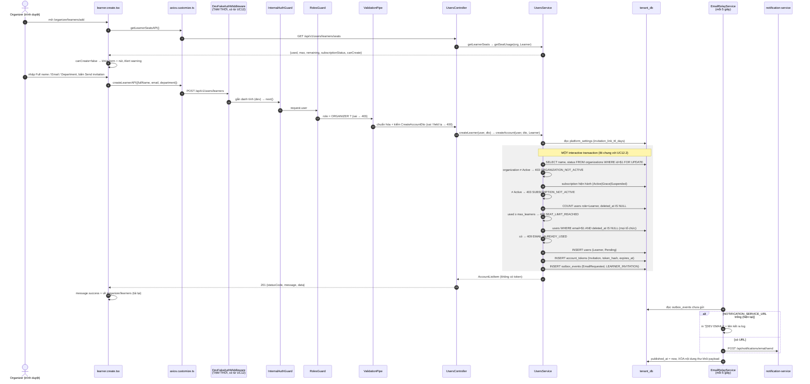

# UC13.2 – Thêm Learner: ghi chú thay đổi và luồng hoạt động

> Người làm: Trọng (thành viên D) · Nhánh: `feat/tenant/uc13.2-create-learner` · Ngày: 02/10/2026
> Trạng thái: **đã chạy được** (seed → API → build màn hình), **chưa commit**. Các ca lỗi và giao diện: Trọng tự test theo [mục 7.2](#72-gọi-thử-bằng-curl-khi-dev_fake_authtrue).
> Link trong file này là đường dẫn tương đối tính từ `docs_temp/`. `#Lxx` = dòng xx (đúng tại thời điểm viết, sửa code sau này có thể lệch vài dòng).
> Xây trên nền UC12.2 + UC13: xem [`UC12.2_ThemInstructor_GhiChu.md`](UC12.2_ThemInstructor_GhiChu.md) (lõi `createAccount`, `getSeatUsage`, `CreateAccountDto`, outbox, `seatBlockReason`) và [`UC13_XemDanhSachLearner_GhiChu.md`](UC13_XemDanhSachLearner_GhiChu.md) (danh sách Learner). UC13.2 **không viết lõi mới**: chỉ nối role `Learner` vào lõi đã có.

---

## Mục lục

1. [Tóm tắt nhanh](#1-tóm-tắt-nhanh)
2. [Luồng hoạt động (workflow)](#2-luồng-hoạt-động-workflow)
3. [Backend – tenant-service](#3-backend--tenant-service)
4. [Seed dữ liệu](#4-seed-dữ-liệu)
5. [Frontend](#5-frontend)
6. [Biến môi trường](#6-biến-môi-trường)
7. [Cách chạy và kiểm tra](#7-cách-chạy-và-kiểm-tra)
8. [Phần đang FAKE và cách chuyển sang thật](#8-phần-đang-fake-và-cách-chuyển-sang-thật)
9. [Lưu ý quan trọng / bẫy dễ dính](#9-lưu-ý-quan-trọng--bẫy-dễ-dính)
10. [Việc cần chuyển cho người khác](#10-việc-cần-chuyển-cho-người-khác)
11. [Gắn các UC sau vào đâu](#11-gắn-các-uc-sau-vào-đâu)

---

## 1. Tóm tắt nhanh

- **Nghiệp vụ:** Organizer tạo một tài khoản Learner mới (trạng thái `Pending`) trong chính Organization của mình; hệ thống gửi lời mời tới email đã khai. Người nhận tự đặt mật khẩu và kích hoạt ở UC04 (của A).
- **Endpoint:**
  - `POST /api/v1/users/learners` – tạo Learner, chỉ `ORGANIZER`. Body `CreateAccountDto` (dùng lại của UC12.2), trả `201` dạng `AccountListItem`.
  - `GET /api/v1/users/learners/seats` – số chỗ Learner, chỉ `ORGANIZER`.
- **Màn hình:** `/organizer/learners/add` (route có sẵn, trang mockup có sẵn → thay logic). Danh sách `/organizer/learners` bật nút "Add Learner" và hiện "x / y seats used".
- **Gửi email:** dùng lại `createAccount` → Transactional Outbox có sẵn, `templateCode = LEARNER_INVITATION` (đã khai trong `INVITATION_TEMPLATE` từ UC12.2). Nội dung thư **đã dựng theo role** từ UC12.2 (`tài khoản ${role}`), nên **không phải sửa** phần dựng thư → thư Instructor giữ nguyên từng ký tự.
- **Không migrate DB.** Không sửa `schema.prisma`, `.env`, `.env.example`. Không cài thư viện mới. **Không thêm biến môi trường.**
- **Seed:** Delta (gói Basic, `max_learners = 30`) có đủ 30 Learner (`d201` – `d230`) → hết chỗ Learner.

Quy tắc nghiệp vụ liên quan (nội dung trích từ `LearnUP_QuyTacNghiepVu`):

| BR | Nội dung | Áp dụng ở đâu |
|---|---|---|
| BR-21 | Tài khoản Instructor/Learner do Organizer tạo; người dùng nhận email mời, tự đặt mật khẩu và kích hoạt | tenant không nhận/không lưu mật khẩu; tạo `Pending` + token Invitation + thư mời |
| BR-23 | Tạo tài khoản Instructor hoặc Learner phải qua bước kiểm số chỗ còn lại theo giới hạn của Subscription | Bước 4 của `createAccount` (khóa dòng tổ chức + đếm), đọc `max_learners` |
| BR-36 | Vô hiệu hóa tài khoản không xóa dữ liệu và **không giải phóng chỗ** theo giới hạn gói | Đếm chỗ tính cả `Pending`, `Active`, `Deactivated` |
| BR-37 | Xóa tài khoản = gán `deleted_at`; xóa mới giải phóng chỗ | Đếm chỗ / kiểm email chỉ xét `deleted_at IS NULL` |
| BR-15 | Subscription hết hạn → ân hạn 7 ngày; trong thời gian này Organizer **không tạo tài khoản**, không tạo Course, không upload học liệu | Subscription `Grace` → 403 `SUBSCRIPTION_NOT_ACTIVE` |
| BR-17 | Subscription `Suspended` → Organizer chỉ còn quyền xem và kết xuất báo cáo (30 ngày) | Subscription `Suspended` → 403 `SUBSCRIPTION_NOT_ACTIVE` |
| BR-45 | Admin tạm khóa (Suspended) Organization khi tổ chức nhiều lần để report quá hạn hoặc vi phạm hệ thống | `organizations.status ≠ Active` → 403 `ORGANIZATION_NOT_ACTIVE` |
| BR-30 | Email là định danh đăng nhập duy nhất toàn nền tảng (chỉ xét tài khoản chưa xóa) | `findAccountByEmailAcrossOrganizations` – trùng với Instructor/Learner/Organizer ở **mọi** tổ chức đều chặn |
| BR-31 | Email của tài khoản đã xóa được cấp lại cho tài khoản mới | partial unique `WHERE deleted_at IS NULL` → email của Learner đã xóa (a211, a220) dùng lại được |
| BR-34 | Organizer nhập họ tên, email và đơn vị công tác khi tạo tài khoản Instructor/Learner | `CreateAccountDto` (fullName, email, department) |
| BR-279 | Đơn vị công tác là chữ nhập tự do, hệ thống chuẩn hóa khoảng trắng khi lưu (và gợi ý giá trị đã có – **chưa làm**) | `normalizeText`; rỗng → `null`. Gợi ý: xem [mục 10](#10-việc-cần-chuyển-cho-người-khác) |
| BR-278 | Lời mời có thời hạn theo tham số nền tảng (`invitation_link_ttl_days`, mặc định 7 ngày); phát lại thì liên kết cũ mất hiệu lực | `expires_at = created_at + ttl` |
| BR-269 | Thay đổi tham số nền tảng chỉ áp cho dữ liệu phát sinh sau | `expires_at` tính và chép **ngay lúc tạo token** |

---

## 2. Luồng hoạt động (workflow)

### 2.1 Tạo Learner – một request



### 2.2 Các điểm chặn và mã lỗi

Không đổi logic / thứ tự / mã lỗi so với UC12.2 (cùng hàm `createAccount`):

| Bước | Điều kiện | HTTP | `error.code` | Message (backend) |
|---|---|---|---|---|
| InternalAuthGuard (có sẵn) | thiếu / sai `x-internal-key` | 401 | — | `Invalid or missing internal service key.` |
| RolesGuard | role ≠ ORGANIZER | 403 | `FORBIDDEN` | Bạn không có quyền thực hiện thao tác này. |
| ValidationPipe | `fullName` rỗng / > 100, email sai / > 254, `department` > 100, ký tự điều khiển, `<` `>` ở fullName/department, field lạ | 400 | — | `message: string[]` (tiếng Việt) |
| 2 | `organizations.status ≠ Active` (BR-45: Admin tạm khóa tổ chức) | 403 | `ORGANIZATION_NOT_ACTIVE` | Tổ chức đang không hoạt động nên không tạo được tài khoản. |
| 3 | không có Subscription hiện hành, hoặc `Grace` (BR-15: ân hạn không tạo tài khoản) / `Suspended` (BR-17: chỉ xem + kết xuất báo cáo) | 403 | `SUBSCRIPTION_NOT_ACTIVE` | Subscription không ở trạng thái hoạt động nên không tạo được tài khoản. |
| 4 | Learner chưa xóa ≥ `max_learners` của subscription (BR-23: kiểm số chỗ theo Subscription; BR-36: vô hiệu hóa không giải phóng chỗ) | 409 | `SEAT_LIMIT_REACHED` | Đã dùng hết số chỗ theo giới hạn của Subscription. |
| 5 | email trùng tài khoản chưa xóa ở **bất kỳ** tổ chức nào, mọi role (BR-30: email duy nhất toàn nền tảng) | 409 | `EMAIL_ALREADY_USED` | Email đã được sử dụng cho một tài khoản khác. *(không lộ tổ chức)* |
| 6 | 2 request cùng email đồng thời → DB ném P2002 | 409 | `EMAIL_ALREADY_USED` | như trên |

### 2.3 Cách tính số chỗ Learner – [`getSeatUsage`](../services/tenant-service/src/users/users.service.ts#L211)

- `used` = [`countUsedSeats(client, organizationId, 'Learner')`](../services/tenant-service/src/users/users.service.ts#L241): Learner của tổ chức, `deleted_at IS NULL`, **mọi status** (BR-36: vô hiệu hóa không giải phóng chỗ; BR-37: chỉ xóa mới giải phóng).
- `max` = `max_learners` **trên subscription hiện hành** (bản chụp) – không đọc từ gói.
- `remaining = max(0, max − used)`; `canCreate = organization Active && subscription Active && remaining > 0`.
- Endpoint seats **không khóa**; lúc tạo thật mới khóa dòng tổ chức và đếm lại.

---

## 3. Backend – tenant-service

Thư mục gốc: [`services/tenant-service/`](../services/tenant-service/)

### 3.1 File TẠO MỚI

Không có. Dùng lại `CreateAccountDto`, `SeatUsage`, `AccountListItem` của UC12.2.

### 3.2 File ĐÃ SỬA

| File | Trước | Sau |
|---|---|---|
| [`src/users/users.controller.ts`](../services/tenant-service/src/users/users.controller.ts) | `GET learners` (UC13) + comment nhắc thêm seats | Thêm [`@Get('learners/seats')`](../services/tenant-service/src/users/users.controller.ts#L59) – `@Roles('ORGANIZER')`, `'Lấy số chỗ Learner thành công'`, comment nhắc giữ **trước** `learners/:id` (UC13.1); [`@Post('learners')`](../services/tenant-service/src/users/users.controller.ts#L67) – `@Roles('ORGANIZER')`, body `CreateAccountDto`, `'Tạo tài khoản Learner thành công'`, trả 201 (mặc định của `@Post`). `RolesGuard` vẫn chỉ gắn ở cấp class. Comment `@ApiTags` ghi thêm UC12.2, UC13.2. Endpoint cũ không đổi. |
| [`src/users/users.service.ts`](../services/tenant-service/src/users/users.service.ts) | `createInstructor`, `getInstructorSeats` + lõi chung | Thêm [`createLearner`](../services/tenant-service/src/users/users.service.ts#L196) → `createAccount(user, dto, UserRoleValue.Learner)`; [`getLearnerSeats`](../services/tenant-service/src/users/users.service.ts#L203) → `getSeatUsage(organizationIdOf(user), UserRoleValue.Learner)` (đúng mẫu `getInstructorSeats`). **Không sửa** [`createAccount`](../services/tenant-service/src/users/users.service.ts#L255): thư đã dùng `${role}` và [`INVITATION_TEMPLATE`](../services/tenant-service/src/users/users.service.ts#L47) đã có `Learner: 'LEARNER_INVITATION'`. |
| [`prisma/seed-account-management.ts`](../services/tenant-service/prisma/seed-account-management.ts) | Delta chỉ có 3 Instructor | Xem [mục 4](#4-seed-dữ-liệu) |

**Không đụng:** `users.module.ts`, DTO, interfaces, `InternalAuthGuard`, `RolesGuard`, `DevFakeAuthMiddleware`, `OutboxService`, `EmailRelayService`, `schema.prisma`, migration, `.env`, `.env.example`, `fake-learning-service.client.ts` (`FAKE_SUMMARIES`), `fake-course-service.client.ts` (`FAKE_COUNTS`).

### 3.3 Chi tiết transaction

Giống hệt UC12.2 mục 3.3 (cùng hàm). Khác duy nhất: `role = Learner` → đếm theo `max_learners`, `templateCode = 'LEARNER_INVITATION'`, thư ghi "tài khoản Learner".

### 3.4 Ví dụ (kết quả thật ngày 02/10/2026)

`POST /api/v1/users/learners` (Lan – ABC)

```json
{ "fullName": "Learner Test UC13.2", "email": "uc132.test@abc.vn", "department": "Phòng Kỹ thuật" }
```

→ `201`

```json
{
  "statusCode": 201,
  "message": "Tạo tài khoản Learner thành công",
  "data": {
    "id": "01a0fa19-580d-748a-a50a-830c92f5d01d",
    "fullName": "Learner Test UC13.2",
    "email": "uc132.test@abc.vn",
    "department": "Phòng Kỹ thuật",
    "status": "Pending",
    "activatedAt": null,
    "createdAt": "2026-10-02T00:52:40.077Z",
    "invitationExpired": false
  }
}
```

`GET /api/v1/users/learners/seats` (Lan, trước khi POST) → `200`

```json
{ "statusCode": 200, "message": "Lấy số chỗ Learner thành công",
  "data": { "used": 23, "max": 500, "remaining": 477, "subscriptionStatus": "Active", "canCreate": true } }
```

Thư trong log (`NOTIFICATION_SERVICE_URL` trống, token đã che):

```
[DEV EMAIL] To: uc132.test@abc.vn
Subject: LearnUP - Lời mời tham gia Công ty ABC
Xin chào Learner Test UC13.2,
Công ty ABC đã tạo cho bạn tài khoản Learner trên LearnUP.
Mở liên kết sau để đặt mật khẩu và kích hoạt tài khoản: http://localhost:3000/activate/<token 43 ký tự>
Liên kết có hiệu lực tới 2026-10-09T00:52:40.077Z.
```

---

## 4. Seed dữ liệu

File: [`prisma/seed-account-management.ts`](../services/tenant-service/prisma/seed-account-management.ts) (comment đầu file có thêm [phần "Bổ sung UC13.2"](../services/tenant-service/prisma/seed-account-management.ts#L75) + ID mới).

### 4.1 Thay đổi so với UC13

| Thay đổi | Chi tiết |
|---|---|
| [Vòng lặp Learner Delta](../services/tenant-service/prisma/seed-account-management.ts#L516) | `DELTA_LEARNER_COUNT = 30` (= `max_learners` gói Basic của seed nền). `n = 1..30` → ID `d2NN` (`01900000-0000-7000-8000-00000000d201` … `d230`, UUID hợp lệ như các ID khác), tên `Học viên Delta NN`, email `hocvien.NN@delta.vn` (chữ thường, không trùng), department xoay vòng 5 phòng, `kind = 'A'` (Active, `activated_at = created_at + 1 ngày`), `created_at = 2026-09-22T04:00Z + (n−1) giờ` (cố định, tăng dần). Không có token (đều Active). |
| [`validateSeed`](../services/tenant-service/prisma/seed-account-management.ts#L576) | Thêm [kiểm "Delta có đúng `max_learners` Learner chưa xóa"](../services/tenant-service/prisma/seed-account-management.ts#L668) (cùng kiểu kiểm `max_instructors`). Mọi kiểm cũ vẫn chạy và vẫn qua (gồm BR-23 Learner ≤ `max_learners` cho mọi tổ chức, email duy nhất, UUID…). |
| [Dòng in tổng kết](../services/tenant-service/prisma/seed-account-management.ts#L946) | Thêm `UC13.2: Công ty TNHH Delta 30/30 Learner (hết chỗ Learner)` |

Giữ nguyên: mọi ID/tên/email/trạng thái/token đã có; upsert theo UUID cố định, không xóa/truncate. **Không sửa `FAKE_SUMMARIES` / `FAKE_COUNTS`** – Learner Delta không có trong bảng fake → 0 khóa đang học / 0 quá hạn (đúng ý).

### 4.2 Dữ liệu mới và ID để test

| Đối tượng | ID | Ghi chú |
|---|---|---|
| Learner Delta | `d201` – `d230` | `Học viên Delta 01` … `30`, `hocvien.01@delta.vn` … `hocvien.30@delta.vn`, Active |
| Organizer Delta – Võ Minh Quân (có sẵn) | `d010` | dùng để test hết chỗ |

ID đầy đủ: `01900000-0000-7000-8000-00000000XXXX`.

### 4.3 Số chỗ Learner sau seed

| Tổ chức | Gói (bản chụp) | Learner chưa xóa | Còn lại | `canCreate` |
|---|---|---|---|---|
| ABC (Lan `a010`) | Premium (500) | 23 | 477 | true |
| XYZ (Hoa `b010`) | Standard (100) | 3 | 97 | true |
| Gamma (Thảo `c010`) | Standard (100), **Grace** | 0 | 100 | **false** |
| Delta (Quân `d010`) | Basic (30) | **30** | **0** | **false** |

Kết quả 2 lần chạy liền (02/10/2026): không lỗi, in giống hệt nhau. DB sau seed: 4 tổ chức, 4 subscription, `d301.max_learners = 30`, Delta 30 Learner chưa xóa. Tổng 96 user = 94 user seed + 2 user test Instructor có từ trước (`khang.do@abc.vn` của UC12.2, `test.hehe@gmail.com` – không rõ ai tạo); 12 token = 10 token seed + 2 của 2 user đó.

> ⚠️ **User test UC13.2 còn lại trong ABC:** lần POST thử ngày 02/10/2026 tạo `01a0fa19-580d-748a-a50a-830c92f5d01d` – `uc132.test@abc.vn` (Learner Test UC13.2, Phòng Kỹ thuật, Pending, có token + outbox đã relay). Seed **không** xóa user này (id ngẫu nhiên) → hiện ABC dùng **24/500 chỗ Learner (còn 476)** và danh sách UC13 của Lan là **24 dòng** (trước là 23). **Chưa xóa**, chờ Trọng quyết.

---

## 5. Frontend

Thư mục gốc: [`frontend/src/`](../frontend/src/)

### 5.1 File ĐÃ SỬA

| File | Thay đổi |
|---|---|
| [`pages/organizer/learner.create.tsx`](../frontend/src/pages/organizer/learner.create.tsx) | Mockup → **giữ bố cục/style** (vẫn `OrganizerPage className="organizer-instructor-create"` + import `instructor.create.scss` như mockup; không có scss riêng, không tạo mới), thay logic theo `instructor.create.tsx`: field `name`/`workUnit` (bắt buộc) → `fullName` (bắt buộc, ≤ 100), `email` (bắt buộc, ≤ 254), `department` "Department (optional)" (≤ 100); rule chặn `<` `>` / ký tự điều khiển ở Full name, Department; chuẩn hóa giống backend trước khi gửi. Bỏ "182 Learner seats available" ghi cứng → [ô Seat check](../frontend/src/pages/organizer/learner.create.tsx#L220) "x Learner seats remaining (used / max used)"; [gọi seats khi mở trang](../frontend/src/pages/organizer/learner.create.tsx#L60); `canCreate=false` → [khóa form + nút](../frontend/src/pages/organizer/learner.create.tsx#L162), Alert warning "You cannot add Learners right now." + [`seatBlockReason(seats, "Learner")`](../frontend/src/pages/organizer/learner.create.tsx#L79). [`submit`](../frontend/src/pages/organizer/learner.create.tsx#L82): `loading` + chống bấm 2 lần; [thành công](../frontend/src/pages/organizer/learner.create.tsx#L94) → `message.success("Learner account created. An invitation email will be sent to <email>.")` rồi về `/organizer/learners`. Cancel → `/organizer/learners` (trước là `navigate(-1)`). [`showCreateError`](../frontend/src/pages/organizer/learner.create.tsx#L109) map mã lỗi (mục 5.2). Kiểm `res.data` (axios trả envelope, không reject lỗi HTTP). |
| [`pages/organizer/learners.tsx`](../frontend/src/pages/organizer/learners.tsx) | [Gọi seats](../frontend/src/pages/organizer/learners.tsx#L89) (tải lại cùng "Try again" qua `reloadKey`); [nút Add Learner](../frontend/src/pages/organizer/learners.tsx#L121): `canCreate` → `Link` tới `/organizer/learners/add`, ngược lại disabled + tooltip lý do (`seatBlockReason`, đang tải: "Checking available seats…"); ["x / y seats used"](../frontend/src/pages/organizer/learners.tsx#L139) ở `extra` của `SectionCard` giống `instructors.tsx`. Import Excel, tìm kiếm, select trạng thái, View details vẫn disabled "Coming soon". |
| [`pages/organizer/learners.scss`](../frontend/src/pages/organizer/learners.scss) | **Bỏ** `.organizer-learners .organizer-note { font-size: 8px; }` → "seats used" hiển thị giống hệt trang Instructors (style chung `.organizer-note` trong `organizer.ui.scss`). Đã kiểm: trang learners không còn chỗ nào khác dùng `organizer-note` (AccountTable cũng không). Không thêm màu. |
| [`services/organization.service.ts`](../frontend/src/services/organization.service.ts) | Thêm [`getLearnerSeatsAPI`](../frontend/src/services/organization.service.ts#L72) (GET `/api/v1/users/learners/seats`), [`createLearnerAPI`](../frontend/src/services/organization.service.ts#L76) (POST `/api/v1/users/learners`), dùng lại `ICreateAccountReq`, `ISeatUsage`, `IAccountListItem` |

**Không sửa:** `types/organization.types.ts` (đủ kiểu), `instructor.create.*`, `instructors.tsx`, `router.tsx` (route `learners/add` đã trỏ `learner.create.tsx`), `organizer.ui.*`, `axios.customize.ts`, `account.table.tsx`, `helper.ts`, `.env*`.

### 5.2 Map mã lỗi → thông báo

| Mã | Hiển thị |
|---|---|
| `EMAIL_ALREADY_USED` | gắn vào ô Email: "This email is already used by another account." |
| `SEAT_LIMIT_REACHED` | Alert + tải lại seats: "All Learner seats are in use. Free a seat or upgrade your Subscription to add more Learners." |
| `SUBSCRIPTION_NOT_ACTIVE` | "Your Subscription is not active. New accounts cannot be created." + tải lại seats |
| `ORGANIZATION_NOT_ACTIVE` | "Your Organization is suspended. New accounts cannot be created." + tải lại seats |
| `FORBIDDEN` | "You do not have permission to add Learners." |
| 400 / khác | "Some details are invalid. Please review them and try again." |
| lỗi mạng (`catch`) | "Could not connect to the server. Please try again later." |

Lý do khóa nút / form (`seatBlockReason`, dùng chung UC12.2): Grace → "…grace period…"; Suspended → "…suspended…"; không có Subscription → "…no active Subscription."; hết chỗ → "All Learner seats are in use (used / max)."; còn lại → tổ chức bị khóa.

---

## 6. Biến môi trường

**Không thêm biến mới.** Các biến đang dùng (đều có sẵn):

| Biến | Nơi đặt | Ý nghĩa | Mẫu | Bắt buộc |
|---|---|---|---|---|
| `DEV_FAKE_AUTH` | backend (tenant) – `.env` hoặc biến shell lúc chạy | `true`: `DevFakeAuthMiddleware` tự gắn danh tính + `x-internal-key` cho request không qua gateway. Mặc định là Lan (`…a010`, Organizer ABC); đổi người bằng header `x-dev-user-id: <uuid user>` | `true` | Chỉ khi chạy dev không có gateway; middleware chỉ chạy khi `NODE_ENV !== 'production'`. **Không bật ở môi trường thật** |
| `FRONTEND_URL` | backend `.env` | Gốc của liên kết mời `…/activate/<token>` | `http://localhost:3000` | Không (mặc định `http://localhost:3000`) |
| `NOTIFICATION_SERVICE_URL` | backend `.env` (**đang trống**) | Trống: relay in thư ra log `[DEV EMAIL]`. Có giá trị: relay gọi notification-service | `http://localhost:8082` | Không (chỉ khi muốn gửi thật) |
| `VITE_BACKEND_URL` | frontend `.env.development` (có sẵn = `http://localhost:8080`, gateway) – ghi đè trong `.env.development.local` | `baseURL` của `axios.customize.ts` | `http://localhost:8084` (gọi thẳng tenant khi chưa qua gateway) | Có |
| `VITE_DEV_FAKE_USER_ID` | frontend `.env.development.local` | Chỉ khi chạy dev: axios gửi kèm header `x-dev-user-id` → đóng vai user khác khi backend bật `DEV_FAKE_AUTH` | `01900000-0000-7000-8000-00000000d010` (Quân – Delta) | Không (trống = Lan) |

Cách đặt để chạy dev (không cần sửa file `.env` nếu dùng biến shell):

```bash
# Backend – Git Bash
cd services/tenant-service
DEV_FAKE_AUTH=true npm run start:dev
# PowerShell:  $env:DEV_FAKE_AUTH='true'; npm run start:dev

# Frontend – đổi người đăng nhập giả: tạo/sửa frontend/.env.development.local (file local, không commit)
#   VITE_BACKEND_URL=http://localhost:8084
#   VITE_DEV_FAKE_USER_ID=01900000-0000-7000-8000-00000000d010   # Delta: nút Add Learner disabled
# Đổi biến VITE_* phải khởi động lại `npm run dev`.
```

Muốn gửi email thật: làm theo ghi chú UC12.2 mục 6 (đặt `NOTIFICATION_SERVICE_URL`, chạy notification-service). Không sửa code.

---

## 7. Cách chạy và kiểm tra

### 7.1 Chạy

```bash
# Backend – services/tenant-service
npm run prisma:seed             # 1 lần, seed nền (3 gói + platform_settings)
npm run prisma:seed:accounts    # seed tài khoản (chạy lại được)
DEV_FAKE_AUTH=true npm run start:dev

# Frontend – frontend/
npm ci                          # nếu node_modules thiếu package (lock không đổi)
npm run dev                     # http://localhost:3000/organizer/learners
```

Swagger: `http://localhost:8084/docs` (tag "Users").

### 7.2 Gọi thử bằng curl (khi `DEV_FAKE_AUTH=true`)

> Mỗi lần tạo thành công **chiếm vĩnh viễn 1 chỗ Learner** của tổ chức và thêm 1 dòng vào danh sách UC13 (seed không xóa). Hiện ABC đã có 1 user test (`uc132.test@abc.vn`) → 24/500.

```bash
B=http://localhost:8084/api/v1/users/learners
ID=01900000-0000-7000-8000-00000000
J='content-type: application/json'

# --- seats ---
curl "$B/seats"                                        # Lan (ABC): used 24 / max 500, canCreate true
curl -H "x-dev-user-id: ${ID}b010" "$B/seats"          # XYZ: used 3 / max 100, canCreate true
curl -H "x-dev-user-id: ${ID}c010" "$B/seats"          # Gamma: subscriptionStatus Grace, canCreate false
curl -H "x-dev-user-id: ${ID}d010" "$B/seats"          # Delta: used 30, max 30, remaining 0, canCreate false

# --- 1. hợp lệ (Lan) → 201, user Pending + token expires_at = created_at + 7 ngày, log [DEV EMAIL] "tài khoản Learner"
curl -X POST "$B" -H "$J" -d '{"fullName":"Nguyễn Văn Học","email":"hoc1@abc.vn","department":"Phòng Kỹ thuật"}'

# --- 2. email trùng Learner ABC (An a201) → 409 EMAIL_ALREADY_USED
curl -X POST "$B" -H "$J" -d '{"fullName":"Trùng Learner","email":"an.nguyen@abc.vn"}'

# --- 3. email trùng Instructor ABC (Minh a101) → 409 EMAIL_ALREADY_USED (khác role vẫn trùng, BR-30)
curl -X POST "$B" -H "$J" -d '{"fullName":"Trùng Instructor","email":"minh.tran@abc.vn"}'

# --- 4. email trùng tài khoản XYZ (Hậu b201) → 409, message chung (không lộ tổ chức)
curl -X POST "$B" -H "$J" -d '{"fullName":"Trùng XYZ","email":"hau.phung@xyz.vn"}'

# --- 5. email của Learner đã xóa (a211 hoai.doan@abc.vn / a220 son.luu@abc.vn) → 201 (BR-31)
curl -X POST "$B" -H "$J" -d '{"fullName":"Đoàn Thị Hoài","email":"hoai.doan@abc.vn"}'

# --- 6. chữ HOA + khoảng trắng → lưu "hoc6@abc.vn", tên gộp khoảng trắng; department "   " → null
curl -X POST "$B" -H "$J" -d '{"fullName":"  Trần   Văn  Sáu ","email":"  HOC6@ABC.VN ","department":"   "}'

# --- 7. Gamma (Grace) → 403 SUBSCRIPTION_NOT_ACTIVE
curl -X POST "$B" -H "$J" -H "x-dev-user-id: ${ID}c010" -d '{"fullName":"Gamma Test","email":"learner@gamma.vn"}'

# --- 8. Delta (hết chỗ Learner) → 409 SEAT_LIMIT_REACHED (kể cả email trùng, vì kiểm chỗ trước email)
curl -X POST "$B" -H "$J" -H "x-dev-user-id: ${ID}d010" -d '{"fullName":"Delta Test","email":"learner.test@delta.vn"}'

# --- 9. sai role / sai body
curl -X POST "$B" -H "$J" -H "x-dev-user-id: ${ID}a201" -d '{"fullName":"X","email":"x@abc.vn"}'          # Learner An → 403 FORBIDDEN
curl -X POST "$B" -H "$J" -d "{\"fullName\":\"X\",\"email\":\"x@abc.vn\",\"organizationId\":\"${ID}b001\"}"  # field lạ → 400
curl -X POST "$B" -H "$J" -d '{"fullName":"<b>An</b>","email":"x@abc.vn"}'                                # < > → 400
curl -X POST "$B" -H "$J" -d '{"fullName":"   ","email":"x@abc.vn"}'                                      # rỗng → 400
curl -X POST "$B" -H "$J" -d '{"fullName":"X","email":"not-an-email"}'                                    # 400

# --- 10. UC12 / UC13 không hỏng
curl "http://localhost:8084/api/v1/users/instructors?page=1&pageSize=10"
curl "http://localhost:8084/api/v1/users/learners?page=1&pageSize=10"
```

Thử tổ chức bị khóa (BR-45): chưa có seed – tạm đổi `organizations.status` sang `Suspended` bằng SQL rồi chạy lại seed để trả về `Active`.

Giao diện (tự kiểm): `VITE_DEV_FAKE_USER_ID` = `…a010` (Lan: nút Add Learner bật, "24 / 500 seats used"), `…c010` (Gamma: disabled, tooltip grace period), `…d010` (Delta: tooltip "All Learner seats are in use (30 / 30)."; mở thẳng `/organizer/learners/add` → form khóa + Alert warning).

### 7.3 Kết quả đã kiểm (02/10/2026) – mức tối thiểu

| Lệnh | Kết quả |
|---|---|
| `npx prisma validate` | Qua |
| `npx tsc --noEmit` (tenant) | Qua, 0 lỗi |
| `npm run build` (tenant) | Qua |
| `npx eslint` 3 file backend (không `--fix`) | Qua |
| `npx prettier --check` 3 file backend | Qua (đã `--write` riêng 3 file; chỉ `users.service.ts` đổi xuống dòng ở hàm mới thêm) |
| `npm run prisma:seed:accounts` × 2 | Qua cả 2 lần, in giống hệt nhau; DB: Delta 30 Learner, `d301.max_learners = 30` |
| `DEV_FAKE_AUTH=true npm run start:dev` | Khởi động không lỗi ("Found 0 errors", "Nest application successfully started") |
| `GET /learners/seats` (Lan) | `200 {used 23, max 500, remaining 477, Active, canCreate true}` |
| `GET /learners/seats` (`x-dev-user-id …d010`) | `200 {used 30, max 30, remaining 0, Active, canCreate false}` |
| `POST /learners` (Lan, 1 lần) | `201`, dữ liệu như mục 3.4; log `[DEV EMAIL]` có `/activate/<token>`, thư ghi "tài khoản Learner" |
| `GET /instructors?page=1&pageSize=10` | `200` |
| (thêm) `GET /learners/seats` (Lan, sau POST) | `200 {used 24, max 500, remaining 476}` – 1 lệnh GET chỉ đọc, ngoài 3 lệnh đã định |
| Tắt server | Đã tắt (kể cả tiến trình node con giữ cổng 8084) |
| Frontend `npx eslint` 3 file `.ts/.tsx` | Qua (frontend không cấu hình prettier → không chạy) |
| Frontend `npm run build` | Qua (`tsc -b` + `vite build`; chỉ cảnh báo chunk > 500 kB có sẵn). Không cần `npm ci` |
| Frontend `npm run dev` | Khởi động được; `/organizer/learners` → 200, `/organizer/learners/add` → 200 (module `learner.create.tsx` → 200); đã tắt |
| Các ca lỗi, giao diện | **Chưa kiểm** – Trọng tự test theo mục 7.2 |

---

## 8. Phần đang FAKE và cách chuyển sang thật

### 8.1 Gửi email – chế độ log của `EmailRelayService`

Như UC12.2 mục 8.1: `NOTIFICATION_SERVICE_URL` trống → thư in ra log `[DEV EMAIL]`. Chuyển sang thật: đặt biến, không sửa code. `LEARNER_INVITATION` chưa có template ở notification-service (gửi kèm subject/body nên vẫn gửi được).

### 8.2 Danh tính – `DevFakeAuthMiddleware` (từ UC12)

Không đổi. `UsersController` đã nằm trong `forRoutes(UsersController)` nên 2 endpoint mới dùng được fake ngay.

### 8.3 Tình trạng đào tạo – `FakeLearningServiceClient` (từ UC13)

Không đổi. Learner mới tạo / Learner Delta không có trong `FAKE_SUMMARIES` → Courses 0, Overdue 0.

### 8.4 Trang kích hoạt (`activate/:token`) – của A, **đang là mock**

`pages/guest/activate.tsx` chưa gọi API, ghi cứng nội dung. Liên kết mời Learner mở được trang này nhưng **chưa kích hoạt thật**.

---

## 9. Lưu ý quan trọng / bẫy dễ dính

1. **Lõi dùng chung với UC12.2.** `createAccount` / `getSeatUsage` / `countUsedSeats` phục vụ cả Instructor và Learner. Sửa lõi là ảnh hưởng **cả hai** UC.
2. **Thứ tự kiểm cố định:** tổ chức → Subscription → số chỗ → email. Ở Delta (hết chỗ Learner) gửi email trùng vẫn ra `SEAT_LIMIT_REACHED`.
3. **Delta hết chỗ Learner nhưng Instructor cũng hết chỗ** (3/3) → không dùng Delta để test tạo Instructor/Learner thành công. Muốn tổ chức còn chỗ Learner nhưng hết chỗ Instructor thì chưa có seed.
4. **Đếm chỗ tính cả `Pending`, `Deactivated`** (BR-36: vô hiệu hóa không giải phóng chỗ). Chỉ xóa (BR-37) mới giải phóng.
5. **`validateSeed` gắn Delta với gói Basic:** nếu seed nền đổi `max_learners` của Basic (hiện 30), seed tài khoản dừng với "Delta phải có đúng N Learner chưa xóa…" → sửa `DELTA_LEARNER_COUNT`. Nếu vượt 99 thì ID `d2NN` không đủ chỗ (phải đổi dạng ID).
6. **Email trùng khác role vẫn bị chặn** (BR-30: email duy nhất toàn nền tảng): tạo Learner bằng email của một Instructor/Organizer → 409.
7. **`learner.create.tsx` dùng chung `instructor.create.scss` và class `organizer-instructor-create`** (như mockup cũ). Sửa scss của trang Instructor sẽ đổi luôn trang Learner.
8. **Route `learners/seats` phải đứng TRƯỚC `learners/:id`** khi làm UC13.1.
9. **Token gốc nằm trong log `[DEV EMAIL]` ở chế độ dev** → đừng dán log ra ngoài.
10. **User do curl/màn hình tạo không bị seed xóa.** Hiện ABC có thêm `uc132.test@abc.vn` (Learner) và 2 Instructor test cũ (`khang.do@abc.vn`, `test.hehe@gmail.com`) → danh sách UC12/UC13 của Lan lệch so với số seed (Learner 24 dòng thay vì 23).
11. Gỡ bỏ override `font-size: 8px` trong `learners.scss`: chữ "seats used" giờ theo `.organizer-note` chung (giống Instructors).

---

## 10. Việc cần chuyển cho người khác

**(a) A – UC04 kích hoạt tài khoản:**
- Trang `/activate/:token` (`pages/guest/activate.tsx`) **còn mock** (ghi cứng nội dung) → liên kết mời Learner **chưa kích hoạt thật**. Cần API trả tên tổ chức, email, role theo token; kích hoạt = lưu mật khẩu qua identity-service + `status = Active`, `activated_at = now`, `consumed_at = now` trong một transaction (chi tiết: UC12.2 mục 10(a)). Token Learner và Instructor cùng dạng, cùng bảng `account_tokens`.

**(b) BR-279 – gợi ý đơn vị công tác (chưa làm):** "Đơn vị công tác là chữ nhập tự do, hệ thống chuẩn hóa khoảng trắng khi lưu và gợi ý giá trị đã có". Phần chuẩn hóa đã có; phần **gợi ý** chưa làm cho cả Instructor lẫn Learner. Đề xuất làm **chung** một lần sau: `GET /api/v1/users/departments?keyword=` trả `DISTINCT department` (chưa xóa) trong tổ chức, frontend đổi `Input` Department ở cả `instructor.create.tsx` và `learner.create.tsx` sang `AutoComplete` của antd.

**(c) Đạt – notification-service:** `templateCode` `LEARNER_INVITATION` (cùng `INSTRUCTOR_INVITATION`) chưa có template; các điểm khác như UC12.2 mục 10(b).

---

## 11. Gắn các UC sau vào đâu

| UC | Gắn vào |
|---|---|
| UC13.1 – Xem chi tiết Learner | `@Get('learners/:id')` đặt **sau** `learners/seats` trong `users.controller.ts` |
| UC13.6 – Xóa Learner | Gán `deleted_at` → `countUsedSeats` tự giải phóng chỗ; sau khi xóa `setReloadKey` ở `learners.tsx` sẽ tải lại cả danh sách lẫn seats (nút Add Learner tự bật lại) |
| UC13.7 – Mời lại Learner (A, BR-22, BR-278) | Giống UC12.7: thu hồi token mở → token mới → outbox. Nên tách phần dựng subject/body + `activationLink` trong `createAccount` thành hàm dùng chung. Không kiểm số chỗ |
| UC13.8 – Import Excel | Mỗi dòng gọi lại lõi `createAccount(…, Learner)` hoặc làm bản theo lô có khóa tổ chức 1 lần + đếm chỗ 1 lần (BR-23) |
| BR-279 gợi ý đơn vị công tác | Xem [mục 10(b)](#10-việc-cần-chuyển-cho-người-khác) – làm chung Instructor + Learner |
