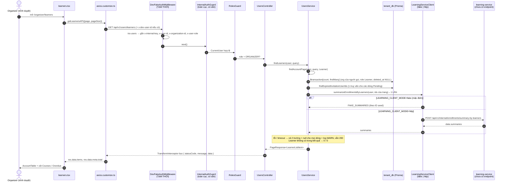

# UC13 – Xem danh sách Learner: ghi chú thay đổi và luồng hoạt động

> Người làm: Trọng (thành viên D) · Nhánh: `feat/tenant/uc13-list-learners` · Ngày: 02/10/2026
> Trạng thái: **đã chạy được** (seed → API → build + dev màn hình), **chưa commit**. Các ca lỗi và giao diện: Trọng tự test theo [mục 7.2](#72-gọi-thử-bằng-curl-khi-dev_fake_authtrue).
> Link trong file này là đường dẫn tương đối tính từ `docs_temp/`. `#Lxx` = dòng xx (đúng tại thời điểm viết, sửa code sau này có thể lệch vài dòng).
> Xây trên nền UC12 / UC12.2: xem [`UC12_XemDanhSachInstructor_GhiChu.md`](UC12_XemDanhSachInstructor_GhiChu.md) (DevFakeAuthMiddleware, RolesGuard, quy ước role HOA / PascalCase, axios trả envelope…) và [`UC12.2_ThemInstructor_GhiChu.md`](UC12.2_ThemInstructor_GhiChu.md).

---

## Mục lục

1. [Tóm tắt nhanh](#1-tóm-tắt-nhanh)
2. [Luồng hoạt động (workflow)](#2-luồng-hoạt-động-workflow)
3. [Backend – tenant-service](#3-backend--tenant-service)
4. [Seed dữ liệu](#4-seed-dữ-liệu)
5. [Frontend](#5-frontend)
6. [Biến môi trường](#6-biến-môi-trường)
7. [Cách chạy và kiểm tra](#7-cách-chạy-và-kiểm-tra)
8. [Phần đang FAKE và cách chuyển sang thật](#8-phần-đang-fake-và-cách-chuyển-sang-thật)
9. [Lưu ý quan trọng / bẫy dễ dính](#9-lưu-ý-quan-trọng--bẫy-dễ-dính)
10. [Việc cần chuyển cho người khác](#10-việc-cần-chuyển-cho-người-khác)
11. [Gắn các UC sau vào đâu](#11-gắn-các-uc-sau-vào-đâu)

---

## 1. Tóm tắt nhanh

- **Nghiệp vụ:** Organizer xem danh sách tài khoản Learner **trong chính Organization của mình**, kèm trạng thái tài khoản và tình trạng tham gia đào tạo (số khóa đang học, số khóa quá hạn).
- **Endpoint:** `GET /api/v1/users/learners?page=1&pageSize=10` – chỉ role `ORGANIZER`.
- **Màn hình:** `/organizer/learners` (route và mục sidebar đã có sẵn, không sửa).
- **Đang fake 2 thứ:** danh tính người gọi (giống UC12, `DEV_FAKE_AUTH`) và tình trạng đào tạo (learning-service chưa có endpoint → `LEARNING_CLIENT_MODE=fake`).
- **Không migrate DB.** Không sửa `.env`. Không cài thư viện mới.
- **Đã tách phần chung** của `findInstructors` thành hàm private `findAccountPage`, UC12 và UC13 dùng chung. Response UC12 đã so **từng byte** trước/sau: giống hệt (mục 7.3).

Quy tắc nghiệp vụ liên quan:

| BR | Nội dung | Áp dụng ở đâu |
|---|---|---|
| BR-37 | Xóa tài khoản = gán `deleted_at`, bản ghi giữ lại để lưu vết | Lọc `deleted_at IS NULL` trong truy vấn |
| BR-22 | Organizer phát lại lời mời cho tài khoản chưa kích hoạt hoặc lời mời đã hết hiệu lực | Cờ `invitationExpired` (dùng lại logic UC12) |
| BR-278 | Lời mời có hạn theo tham số nền tảng (`invitation_link_ttl_days`, mặc định 7 ngày) | Cách tính `invitationExpired`, seed token |
| BR-36 | Vô hiệu hóa không xóa dữ liệu, không giải phóng chỗ | Learner `Deactivated` vẫn hiện trong danh sách |
| BR-38 | Enrollment của tài khoản đang bị vô hiệu hóa không tính vào thống kê quá hạn | `overdueCourseCount = 0` với Learner Deactivated (learning-service tính) |
| BR-144 | Không tính quá hạn với Enrollment Exempted, Halted, của tài khoản bị vô hiệu hóa, dạng Optional, và khoảng tổ chức bị tạm khóa | Cách đếm `overdueCourseCount` (learning-service) |
| BR-129 | Enrollment Optional không có hạn nên không bao giờ quá hạn | như trên |
| BR-300 | Quá hạn khi `due_at <= now()` (tính lúc đọc, không lưu) | như trên – khớp `enrollmentDisplayStatusSql()` của learning-service |
| BR-30, BR-31 | Email là định danh duy nhất toàn nền tảng, chỉ xét tài khoản chưa xóa | Seed tự kiểm |
| BR-23 | Tạo tài khoản phải qua kiểm số chỗ theo Subscription | Seed tự kiểm: số Learner chưa xóa ≤ `max_learners` |

"Tình trạng tham gia đào tạo" = 2 số do **learning-service sở hữu** (tenant KHÔNG đọc `learning_db`, KHÔNG chép về):

| Trường | Ý nghĩa |
|---|---|
| `activeCourseCount` | Số Enrollment đang dở: NotStarted + InProgress (kể cả đang quá hạn), cả Required lẫn Optional |
| `overdueCourseCount` | Số Enrollment **Required** đang quá hạn, tính lúc đọc theo BR-144 / BR-300; tài khoản Deactivated = 0 (BR-38) |

Không tách Required/Optional ở danh sách.

---

## 2. Luồng hoạt động (workflow)

### 2.1 Tổng thể một request



### 2.2 Các điểm chặn và mã lỗi

| Điểm chặn | Khi nào | HTTP | Body (rút gọn) |
|---|---|---|---|
| DevFakeAuthMiddleware | `x-dev-user-id` sai định dạng / không tồn tại / đã xóa | 401 | `[DEV_FAKE_AUTH] …` |
| InternalAuthGuard | thiếu / sai `x-internal-key` (khi tắt fake) | 401 | – |
| RolesGuard | role không phải `ORGANIZER` (Instructor, Learner, Admin) | 403 | `{ code: "FORBIDDEN", message: "Bạn không có quyền thực hiện thao tác này." }` |
| `organizationIdOf` | người gọi không thuộc Organization nào | 403 | `Tài khoản không thuộc Organization nào.` |
| ValidationPipe (`ListAccountsQueryDto`) | `page < 1`, `pageSize ∉ {10, 20, 50}` | 400 | `["pageSize phải là 10, 20 hoặc 50"]` |
| learning-service lỗi / timeout | mạng, HTTP ≠ 2xx, sai hợp đồng, quá `LEARNING_SERVICE_TIMEOUT_MS` | **200** | `activeCourseCount: null, overdueCourseCount: null` mọi dòng + log WARN |

### 2.3 Cách tính 3 trường "tính lúc đọc"

| Trường | Ở đâu tính | Cách tính |
|---|---|---|
| `invitationExpired` | tenant (dùng lại UC12) | Pending và không còn token Invitation chưa dùng, chưa thu hồi, `expires_at > now` |
| `activeCourseCount` | learning-service | xem mục 1 |
| `overdueCourseCount` | learning-service | xem mục 1 |

---

## 3. Backend – tenant-service

Đường dẫn gốc: `services/tenant-service/`.

### 3.1 File TẠO MỚI

| File | Nội dung |
|---|---|
| [`src/integrations/learning-service.client.ts`](../services/tenant-service/src/integrations/learning-service.client.ts#L21) | Abstract class `LearningServiceClient` (interface + token DI) và kiểu `LearnerEnrollmentSummary`. Method [`summarizeEnrollmentsByLearners`](../services/tenant-service/src/integrations/learning-service.client.ts#L26) |
| [`src/integrations/http-learning-service.client.ts`](../services/tenant-service/src/integrations/http-learning-service.client.ts#L29) | Bản thật: `fetch` + `x-internal-key` + 3 header danh tính người gọi, timeout `AbortSignal.timeout`, đọc `body.data.summaries` ([`#L46`](../services/tenant-service/src/integrations/http-learning-service.client.ts#L46)) |
| [`src/integrations/fake-learning-service.client.ts`](../services/tenant-service/src/integrations/fake-learning-service.client.ts#L39) | **DỮ LIỆU GIẢ** `FAKE_SUMMARIES` theo ID seed; comment đầu file có đặc tả endpoint thật cho Hào |

### 3.2 File ĐÃ SỬA

| File | Trước | Sau |
|---|---|---|
| [`src/users/users.controller.ts`](../services/tenant-service/src/users/users.controller.ts#L10) | `@ApiTags('UC12 - Users')` | `@ApiTags('Users') // UC12, UC13` (đã chốt: đổi tag class, không thêm tag ở method) |
| [`src/users/users.controller.ts`](../services/tenant-service/src/users/users.controller.ts#L45) | – | `@Roles('ORGANIZER') @Get('learners') @ResponseMessage('Lấy danh sách Learner thành công')`. **Không** gắn lại `RolesGuard` (đã có ở cấp class). Comment nhắc `learners/seats` phải đứng trước `learners/:id` |
| [`src/users/users.service.ts` – `findInstructors`](../services/tenant-service/src/users/users.service.ts#L68) | Tự làm toàn bộ: lọc, đếm, phân trang, `invitationExpired`, `managedCourseCount` | Gọi `findAccountPage(…, Instructor)` rồi gắn `managedCourseCount` như cũ. Cùng select, cùng thứ tự trường, cùng log WARN |
| [`src/users/users.service.ts` – `findLearners`](../services/tenant-service/src/users/users.service.ts#L93) | – | Gọi `findAccountPage(…, Learner)` + `summarizeLearnerEnrollments` **1 lần** cho cả trang |
| [`src/users/users.service.ts` – `findAccountPage`](../services/tenant-service/src/users/users.service.ts#L125) | – | **Hàm private chung** (tách từ `findInstructors`): `organizationId` lấy từ `user`, `role`, `deleted_at IS NULL`, `created_at DESC, id DESC`, `$transaction[count, findMany]`, `findExpiredInvitationUserIds` |
| [`src/users/users.service.ts` – `summarizeLearnerEnrollments`](../services/tenant-service/src/users/users.service.ts#L456) | – | Bọc client: lỗi → `null` + log WARN `Không lấy được tình trạng đào tạo của Learner từ learning-service: …` |
| [`src/users/users.service.ts` – constructor](../services/tenant-service/src/users/users.service.ts#L62) | – | Tiêm thêm `LearningServiceClient` |
| [`src/users/interfaces/account-list-item.interface.ts`](../services/tenant-service/src/users/interfaces/account-list-item.interface.ts#L20) | – | `LearnerListItem extends AccountListItem { activeCourseCount; overdueCourseCount }` (`number \| null`) |
| [`src/integrations/integrations.module.ts`](../services/tenant-service/src/integrations/integrations.module.ts#L27) | – | Provider `LearningServiceClient`: `LEARNING_CLIENT_MODE=http` → Http, còn lại → Fake. Provider cũ không đổi |
| [`.env.example`](../services/tenant-service/.env.example#L15) | – | `LEARNING_CLIENT_MODE=fake`, `LEARNING_SERVICE_URL=http://localhost:8085`, `LEARNING_SERVICE_TIMEOUT_MS=3000` |
| [`prisma/seed-account-management.ts`](../services/tenant-service/prisma/seed-account-management.ts#L56) | 4 Learner ABC | xem mục 4 |

### 3.3 Dùng lại cái có sẵn (không tự viết lại)

- `ListAccountsQueryDto` (không thêm field), `createPageResponse` / `PageResponse` của `@learnup/ts-common`.
- `findExpiredInvitationUserIds`, `organizationIdOf` của UC12.
- `RolesGuard`, `InternalAuthGuard`, `TransformInterceptor`, `HttpExceptionFilter`, `DevFakeAuthMiddleware` – không sửa.
- Frontend: `AccountTable`, `StatusTag`, `OrganizerButton`… – không sửa.

### 3.4 Ví dụ response

```json
{
  "statusCode": 200,
  "message": "Lấy danh sách Learner thành công",
  "data": {
    "meta": { "current": 3, "pageSize": 10, "pages": 3, "total": 23 },
    "items": [
      {
        "id": "01900000-0000-7000-8000-00000000a203",
        "fullName": "Lê Văn Cường",
        "email": "cuong.le@abc.vn",
        "department": "Phòng Kỹ thuật",
        "status": "Active",
        "activatedAt": "2026-09-06T04:00:00.000Z",
        "createdAt": "2026-09-05T04:00:00.000Z",
        "invitationExpired": false,
        "activeCourseCount": 1,
        "overdueCourseCount": 0
      }
    ]
  }
}
```

Khi learning-service lỗi: `"activeCourseCount": null, "overdueCourseCount": null` ở **mọi** dòng, `statusCode` vẫn 200.

---

## 4. Seed dữ liệu

File: [`services/tenant-service/prisma/seed-account-management.ts`](../services/tenant-service/prisma/seed-account-management.ts#L56).

### 4.1 Thay đổi

- Giữ nguyên mọi ID, tên, email, trạng thái, token đã có (kể cả `a201`–`a204`). Vẫn upsert theo UUID cố định, KHÔNG xóa / truncate.
- [`abcLearners`](../services/tenant-service/prisma/seed-account-management.ts#L353) thêm cột `department` (trước gán cứng "Phòng Kỹ thuật"; `a201`–`a204` vẫn là "Phòng Kỹ thuật"), mở rộng lên 25 Learner.
- Thêm [`xyzLearners`](../services/tenant-service/prisma/seed-account-management.ts#L382) (3 Learner).
- [`buildTokens`](../services/tenant-service/prisma/seed-account-management.ts#L517): Learner `x2NN` → token `x5NN`; Instructor `x1NN` vẫn `x4NN` (xem bẫy 9.2).
- `validateSeed`:
  - [BR-23 cho Learner](../services/tenant-service/prisma/seed-account-management.ts#L648): số Learner chưa xóa ≤ `max_learners` của bản chụp gói, với **mọi** tổ chức.
  - [ID token không trùng](../services/tenant-service/prisma/seed-account-management.ts#L718) (chặn đúng lỗi ở 9.2).
  - Các kiểm có sẵn (UUID, email chuẩn hóa + duy nhất BR-30/31, Pending ⇔ `activated_at` NULL, BR-40, 1 token mở/user…) tự áp cho dữ liệu mới.
- In thêm số Learner chưa xóa / số chỗ ([`#L884`](../services/tenant-service/prisma/seed-account-management.ts#L884)).
- Comment đầu file: thêm phần "Bổ sung UC13" + bảng ID.

### 4.2 Phân bố Learner ABC (`created_at` = 03/09/2026 + (n−1) ngày, a225 mới nhất)

| Loại | Số | ID |
|---|---|---|
| Active | 15 | a201–a203, a206, a208, a210, a212, a214–a216, a218, a219, a221, a222, a224 |
| Pending – lời mời còn hạn (phát lúc chạy seed − 1 ngày, hạn + `invitation_link_ttl_days`) | 2 | a223, a225 |
| Pending – lời mời hết hạn (ngày **cố định**: `created_at` + 1 giờ, hạn 7 ngày → hết 14/09, 16/09) | 2 | a205, a207 |
| Pending – không có token | 1 | a204 (Dũng, như cũ) |
| Deactivated – từng kích hoạt | 2 | a209, a217 |
| Deactivated – chưa kích hoạt | 1 | a213 |
| Đã xóa (`deleted_at` = 28/09/2026) – **không hiện** | 2 | a211, a220 |
| **Hiển thị** | **23** | 3 trang với pageSize 10 (10 / 10 / 3) |

### 4.3 ID mới

| Đối tượng | ID (dạng `01900000-0000-7000-8000-00000000XXXX`) |
|---|---|
| Learner ABC mới | a205 – a225 |
| Learner XYZ | b201 (Hậu, Active), b202 (Thu, Active), b203 (Tài, Pending còn hạn) |
| Token Learner | a505, a507 (hết hạn), a523, a525, b503 (còn hạn) |

### 4.4 Tình trạng đào tạo giả (`FAKE_SUMMARIES`)

| Learner | active / overdue | Ghi chú |
|---|---|---|
| a201 An | 3 / 1 | có quá hạn |
| a202 Bình | 2 / 0 | |
| a203 Cường | 1 / 0 | |
| a206 Bảo | 4 / 2 | |
| a208 Định | 2 / 0 | |
| a209 Giang | 2 / 0 | **Deactivated → overdue 0 (BR-38)** |
| a210 Hiếu | 1 / 1 | |
| a214 Lộc | 5 / 1 | |
| a215 Mỹ | 1 / 0 | |
| a216 Nghĩa | 3 / 0 | |
| a217 Oanh | 1 / 0 | **Deactivated → overdue 0** |
| a218 Phúc | 2 / 1 | |
| a219 Quyên | 1 / 0 | |
| a221 Tâm | 6 / 3 | nhiều quá hạn nhất |
| a222 Thịnh | 2 / 0 | |
| a224 Vương | 1 / 0 | |
| b201 Hậu (XYZ) | 2 / 1 | |
| b202 Thu (XYZ) | 1 / 0 | |
| còn lại (Pending, a212 Khải, a213 Kiều, b203) | 0 / 0 | không có trong bảng → tenant coi là 0 |

### 4.5 Số đếm sau seed (chạy 2 lần liền, cùng kết quả)

```
Đã seed dữ liệu quản lý tài khoản:
  - Công ty ABC: 1 Organizer, 25 Instructor (2 đã xóa), 25 Learner (23 chưa xóa / 500 chỗ)
  - Công ty TNHH XYZ: 1 Organizer, 3 Instructor, 3 Learner
  - 1 Admin, 2 subscription Active (ABC gói Premium, XYZ gói Standard), 10 lời mời
  - UC12.2: Công ty CP Gamma (subscription Grace), Công ty TNHH Delta (gói Basic, 3/3 Instructor)
```

10 lời mời = 5 Instructor cũ (a404, a409, a423, a425, b403 – không đổi) + 5 Learner mới.

---

## 5. Frontend

Đường dẫn gốc: `frontend/src/`. Không sửa `router.tsx`, layout, `organizer.ui.*`, `axios.customize.ts`, `account.table.tsx`.

| File | Thay đổi |
|---|---|
| [`pages/organizer/learners.tsx`](../frontend/src/pages/organizer/learners.tsx#L40) | Bỏ dữ liệu cứng; gọi `getLearnersAPI` trong `useEffect` ([`#L55`](../frontend/src/pages/organizer/learners.tsx#L55)) y như `instructors.tsx`; dùng `AccountTable` với [`trainingColumns`](../frontend/src/pages/organizer/learners.tsx#L20): **Courses** = `activeCourseCount` (null → "—"), **Overdue** = `overdueCourseCount` (null → "—", > 0 → `StatusTag` warning, 0 → "0"). Import Excel, Add Learner, ô tìm kiếm, select trạng thái, View details: disabled + tooltip "Coming soon". KHÔNG hiện "x / y seats used" (UC13.2). Loading / empty / error + "Try again" do `AccountTable` lo |
| [`pages/organizer/learners.scss`](../frontend/src/pages/organizer/learners.scss) | Giữ class cũ; thêm style link disabled + nút primary disabled (chép từ `instructors.scss`, không màu mới) |
| [`services/organization.service.ts`](../frontend/src/services/organization.service.ts#L57) | `getLearnersAPI(query: IAccountListQuery)` |
| [`types/organization.types.ts`](../frontend/src/types/organization.types.ts#L103) | `ILearnerListItem extends IAccountListItem` |

Ô lọc dùng lại class `organizer-instructors-filters` như mockup cũ (định nghĩa trong `instructors.scss`, router import tĩnh nên CSS luôn được nạp).

---

## 6. Biến môi trường

| Biến | Nơi đặt | Ý nghĩa | Mẫu | Bắt buộc |
|---|---|---|---|---|
| `DEV_FAKE_AUTH` | `services/tenant-service/.env` | Fake danh tính khi chưa qua gateway (UC12) | `true` | Chỉ dev |
| `LEARNING_CLIENT_MODE` | `services/tenant-service/.env` | `fake` (mặc định) / `http` | `fake` | Không (thiếu = fake) |
| `LEARNING_SERVICE_URL` | `services/tenant-service/.env` | Gốc URL learning-service | `http://localhost:8085` | Khi `http` |
| `LEARNING_SERVICE_TIMEOUT_MS` | `services/tenant-service/.env` | Timeout gọi learning-service | `3000` | Không (mặc định 3000) |
| `INTERNAL_SERVICE_KEY` | tenant **và** learning `.env` | Khóa nội bộ, phải **trùng** nhau khi `http` | `learnup-internal-secret` | Có |

`.env` hiện tại của anh (4 dòng) → **thêm** để chạy dev:

```
DEV_FAKE_AUTH=true
LEARNING_CLIENT_MODE=fake
```

(Không thêm `LEARNING_CLIENT_MODE` cũng chạy fake, nhưng ghi rõ cho dễ đổi.)

### Chuyển `LEARNING_CLIENT_MODE` sang `http` từng bước

1. Chờ Hào xác nhận learning-service đã có `POST /api/v1/internal/enrollments/summary-by-learners` đúng đặc tả mục 10.
2. Chạy learning-service: `cd services/learning-service && npm run start:dev` (cổng 8085, theo `.env` của learning).
3. Kiểm `INTERNAL_SERVICE_KEY` trong `.env` của learning-service **trùng** với tenant (`learnup-internal-secret`).
4. Trong `services/tenant-service/.env` đổi/thêm:
   ```
   LEARNING_CLIENT_MODE=http
   LEARNING_SERVICE_URL=http://localhost:8085
   LEARNING_SERVICE_TIMEOUT_MS=3000
   ```
5. Khởi động lại tenant-service (provider chọn lúc khởi động, `--watch` không đọc lại `.env`).
6. Đảm bảo learning_db có Enrollment với `learner_id` = ID seed tenant (`…a201`…), nếu không danh sách sẽ ra 0 / 0 hết (xem 10).
7. Gọi `curl http://localhost:8084/api/v1/users/learners` → số khác 0; xem log tenant không có WARN "Không lấy được tình trạng đào tạo…".
8. Không phải sửa code nghiệp vụ. Muốn quay lại fake: đặt lại `fake`, khởi động lại.

---

## 7. Cách chạy và kiểm tra

### 7.1 Chạy

```bash
# Backend – services/tenant-service
npm run prisma:seed            # seed nền (nếu DB mới)
npm run prisma:seed:accounts   # chạy lại nhiều lần được
npm run start:dev              # cổng 8084, cần DEV_FAKE_AUTH=true

# Frontend – frontend/
npm run dev                    # http://localhost:3000/organizer/learners
```

### 7.2 Gọi thử bằng curl (khi `DEV_FAKE_AUTH=true`)

```bash
P=01900000-0000-7000-8000-00000000
U=http://localhost:8084/api/v1/users/learners

curl "$U?page=1&pageSize=10"                          # Lan a010 (mặc định) → 200, total 23
curl -H "x-dev-user-id: ${P}a010" "$U?page=3"          # trang 3: Cường, Bình, An
curl -H "x-dev-user-id: ${P}b010" "$U"                 # Hoa (XYZ) → 200, total 3 (không thấy Learner ABC)
curl -H "x-dev-user-id: ${P}a101" "$U"                 # Instructor Minh → 403 FORBIDDEN
curl -H "x-dev-user-id: ${P}a201" "$U"                 # Learner An → 403 FORBIDDEN
curl "$U?pageSize=15"                                  # → 400 "pageSize phải là 10, 20 hoặc 50"
```

Learning client hỏng → 200 với null: khởi động tenant với `LEARNING_CLIENT_MODE=http` và `LEARNING_SERVICE_URL` trỏ cổng không có service (vd. `http://localhost:8999`), ví dụ trong Git Bash:

```bash
DEV_FAKE_AUTH=true LEARNING_CLIENT_MODE=http LEARNING_SERVICE_URL=http://localhost:8999 npm run start:dev
curl "$U"   # → 200, activeCourseCount/overdueCourseCount = null mọi dòng; log WARN
```

(Không phải sửa `.env`: biến shell được `ConfigModule` đọc, ưu tiên hơn `.env`.)

### 7.3 Kết quả kiểm tra lúc làm

| Lệnh | Kết quả |
|---|---|
| `npx prisma validate` | valid |
| `npx prisma generate` | OK |
| `npx tsc --noEmit` | 0 lỗi |
| `npm run build` | OK |
| `npx eslint <8 file backend>` (không `--fix`) | 0 lỗi |
| `npx prettier --check <8 file backend>` | OK (đã `--write` đúng 2 file của mình: `users.controller.ts`, `fake-learning-service.client.ts`) |
| `npm run prisma:seed:accounts` × 2 | OK, cùng số đếm |
| `GET /users/learners` (Lan) | 200, total 23, 3 trang 10/10/3, đúng cờ hết hạn (a205, a207, a204), Deactivated hiện, đã xóa không hiện |
| `GET /users/learners` (Hoa) | 200, total 3 |
| a101 / a201 | 403 |
| `pageSize=15` | 400 |
| `GET /users/instructors` trang 1, 2, 3 (size 10) và size 50 | **giống hệt từng byte** so với trước khi tách hàm (total 25 = 23 seed + 2 user test tạo bằng UC12.2) |
| Frontend `npx eslint` 3 file | 0 lỗi |
| Frontend `npm run build` | OK (sau `npm ci`, xem 9.6) |
| Frontend `npm run dev` | `/organizer/learners` trả 200, module `learners.tsx` biên dịch được |

---

## 8. Phần đang FAKE và cách chuyển sang thật

| Fake | File | Vì sao | Cách bỏ |
|---|---|---|---|
| Danh tính người gọi | `src/common/middleware/dev-fake-auth.middleware.ts` (UC12, không sửa) | gateway chưa dùng được | xem ghi chú UC12 |
| Tình trạng đào tạo | [`fake-learning-service.client.ts`](../services/tenant-service/src/integrations/fake-learning-service.client.ts#L39) | learning-service chưa có endpoint; seed learning dùng ID khác | mục 6 "Chuyển sang http" |

---

## 9. Lưu ý quan trọng / bẫy dễ dính

1. **Đã tách hàm chung từ `findInstructors`.** `findAccountPage` giờ dùng cho cả UC12 và UC13. Sửa nó (vd. UC12.4/UC13.4 thêm `keyword`, `status`) là ảnh hưởng **cả hai** danh sách. Response UC12 đã so byte-to-byte trước/sau: không đổi.
2. **ID token Learner là `x5NN`, không phải `x4NN`.** `buildTokens` trước đây thay chữ số thứ 2 bằng `4` cho cả `x1NN` và `x2NN` → `a201` và `a101` cùng ra `a401` (chưa lộ vì `a201`–`a204` chưa có token). Đã sửa: Learner → `5`, Instructor giữ `4`; token Instructor cũ (a404, a409, a423, a425, b403) giữ nguyên ID và nội dung. `validateSeed` thêm kiểm "ID token trùng".
3. **ID seed chép tay ở 2 nơi:** `prisma/seed-account-management.ts` và `FAKE_SUMMARIES` (cũng như `FAKE_COUNTS` của UC12). Đổi ID / thêm Learner ở seed thì sửa cả fake.
4. **Swagger tag đổi** từ `'UC12 - Users'` sang `'Users'` ở cấp class (UC12 và UC13 cùng một nhóm). Ai đang tìm theo tag cũ trên `/docs` sẽ thấy tên mới.
5. **Lời mời hết hạn dùng ngày cố định** (`created_at` + 1 giờ, hạn 7 ngày). Nếu sau này dời Learner hết hạn xuống cuối danh sách (ngày tạo gần hiện tại) thì token có thể **còn hạn** → cờ sai. Lời mời còn hạn thì tính theo lúc chạy seed nên luôn còn hạn.
6. **Frontend `node_modules` cũ:** `npm run build` báo lỗi ở `components/learner/lesson.markdown.tsx` (không phải UC13) vì thiếu `react-markdown`, `rehype-sanitize`, `remark-gfm` dù đã có trong `package.json`. Đã chạy `npm ci` (lock file không đổi) → build OK. Máy khác pull về cũng cần `npm ci`.
7. **Ranh giới quá hạn là `due_at <= now()`** (BR-300, khớp `enrollmentDisplayStatusSql()`), không phải `<`.
8. Provider fake/http chọn **lúc khởi động**, đổi `LEARNING_CLIENT_MODE` phải khởi động lại tenant.
9. `learners.scss` còn class cũ `.organizer-learners .organizer-note { font-size: 8px; }` – giữ nguyên theo yêu cầu; UC13.2 hiện "x / y seats used" bằng `organizer-note` sẽ bị chữ 8px, cần xem lại lúc đó.

---

## 10. Việc cần chuyển cho người khác

**Hào (learning-service):**

- Làm endpoint:
  - `POST /api/v1/internal/enrollments/summary-by-learners`
  - Header: `x-internal-key`, `x-user-id`, `x-organization-id`, `x-user-role` (InternalAuthGuard của learning đã đòi đủ 4 cái)
  - Body: `{ "learnerIds": string[] }`
  - 200: `data = { "summaries": { "<learnerId>": { "activeCourseCount": number, "overdueCourseCount": number } } }` (bọc `{ statusCode, message, data }` bởi TransformInterceptor có sẵn)
  - Chỉ đếm Enrollment có `organization_id = x-organization-id`.
  - `activeCourseCount` = NotStarted + InProgress (kể cả đang quá hạn), Required lẫn Optional.
  - `overdueCourseCount` = Required, NotStarted/InProgress, `due_at <= now()`, tổ chức không có lần tạm khóa đang mở bắt đầu trước `due_at`, tài khoản không bị vô hiệu hóa (BR-38, BR-144, BR-300). Exempted, Halted, Optional không bao giờ quá hạn (BR-129).
  - Learner không có Enrollment → bỏ qua (tenant coi là 0).
- Gợi ý dùng lại: `enrollmentDisplayStatusSql()` (`src/enrollments/enrollment-display-status.sql.ts`, đã xử lý BR-144) và `learner_accounts.deactivated_at` (BR-38).
- **Seed learning dùng ID khác tenant** (`0199a000-…-0b0000000001`). Cần đồng bộ `learner_id` (và `organization_id`) với ID seed tenant (`01900000-0000-7000-8000-00000000a201`…, org `…a001`) để luồng thật có dữ liệu. Có thể lấy bảng ở mục 4.4 làm số mong đợi.

---

## 11. Gắn các UC sau vào đâu

| UC | Gắn vào |
|---|---|
| UC13.1 – Xem chi tiết Learner | Route `@Get('learners/:id')` đặt **sau** `learners/seats`; frontend: `renderActions` trong `learners.tsx` (bỏ disabled "View details →", điều hướng `/organizer/learners/:learnerId`) |
| UC13.2 – Thêm Learner | `@Get('learners/seats')` (trước `:id`) dùng `getSeatUsage(org, Learner)` có sẵn; `@Post('learners')` gọi `createAccount(user, dto, Learner)` có sẵn (template `LEARNER_INVITATION` đã khai); frontend: nút Add Learner + `extra` của `SectionCard` hiện "x / y seats used" (theo `instructors.tsx` + `seatBlockReason(seats, "Learner")`) |
| UC13.3 – Cập nhật thông tin Learner | Thao tác trong `renderActions` / trang chi tiết; backend `PATCH learners/:id` |
| UC13.4 – Tìm kiếm Learner | Thêm `keyword`, `status` (tùy chọn) vào `ListAccountsQueryDto` và `where` trong `findAccountPage` → áp cho cả UC12.4; frontend bỏ disabled ô tìm kiếm / select |
| UC13.5 – Đổi trạng thái | `renderActions`; nhớ BR-38: learning-service phải biết `deactivated_at` (đồng bộ `learner_accounts`) để overdue = 0 |
| UC13.6 – Xóa Learner | `renderActions`; gán `deleted_at` → tự biến khỏi danh sách và giải phóng chỗ (BR-37) |
| UC13.7 – Mời lại Learner | Hiện nút khi `status = Pending` (đặc biệt `invitationExpired = true`) trong `renderActions` |
